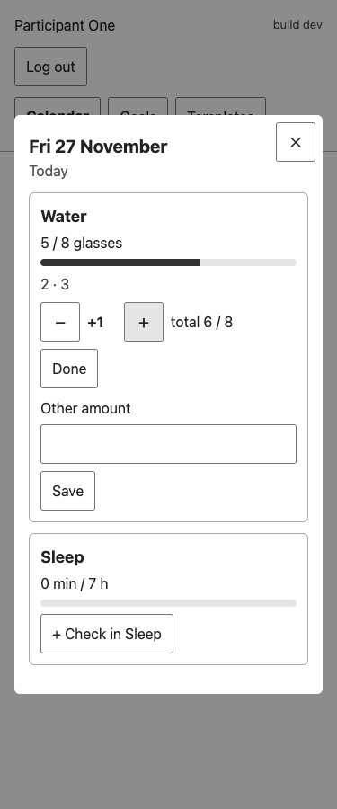
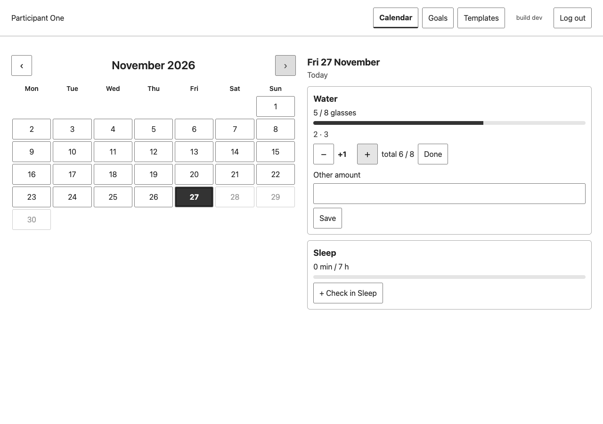

# Month calendar implementation evidence (Issue #155)

Contract: [F-11](sprints/sprint-2/F-11-month-calendar.md), with ADR 0063 to ADR 0074 and ADR 0097. Run on macOS 27.2, Node.js 26.8, local PostgreSQL with a test database used only by this worktree (ADR 0094 rule 5), and Google Chrome (`PLAYWRIGHT_CHANNEL=chrome`). The browser tests ran on port 33155 through a local config that is not committed, because `client/playwright.config.js` hard-codes 33132 and the #158 worktree uses it. TC-73 has 33132 hard-coded in its own request context, so it was run separately on 33132 when nothing else was listening there. Run by Claude Code; not yet run in CI.

## Before the change (tests committed in 91a930e, before any code)

- Server suite on `staging` (650cde2): 113 tests, 113 pass.
- New and changed server tests (`server/test/calendar.test.js`: TC-120, TC-121; `server/test/client.test.js` with `/calendar`) against the unchanged code: 6 tests, 0 pass, 6 fail.
- Browser suite with the new `client/test/calendar.spec.js` and the changed Sprint 1 login steps, against the unchanged code: 70 failed, 12 passed, 4 skipped.

## After the change

Commit and results are in the table below (filled from the final run).

| Command | Result |
|---|---|
| `npm test` in `server/` | RESULT_SERVER |
| `npx playwright test` in `client/` (Chrome, port 33155) | RESULT_BROWSER |
| `npx playwright test test/templates.spec.js -g TC-73` (port 33132) | 2 passed |

The 4 skipped cases are width-specific: TC-36 and the desktop TC-116 case run at 1280 px only; TC-111 and the phone TC-116 case at 375 px only.

## AC results

| AC | Test (file) | Result |
|---|---|---|
| AC-11.1 | TC-36 (`calendar.spec.js`) | pass at 1280 px |
| AC-11.2 | TC-110 | pass; the List step waits for #156 (ADR 0097) |
| AC-11.3 | TC-111 | pass at 375 px; the future-day step runs only when tomorrow is in this month |
| AC-11.4 | TC-36, TC-112, TC-120 | pass |
| AC-11.5 | TC-36 (desktop), TC-111, TC-116 | pass |
| AC-11.6 | TC-113, TC-47/TC-48 | pass |
| AC-11.7 | TC-114 (keys and pointer) | pass |
| AC-11.8 | TC-115 | pass |
| AC-11.9 | TC-116 (phone and desktop) | pass |
| AC-11.10 | TC-113, TC-115 (card total and entries) | pass; sign and colour are TC-117, which runs in #156 (ADR 0097) |
| AC-11.11 | TC-120, TC-121 (`calendar.test.js`) | pass; `state` is `null` on every day until #156 |
| AC-11.12 | TC-47/TC-48 (`calendar.spec.js`) | pass at 375 and 1280 px |
| AC-11.13 | TC-130, and the Sprint 1 tests with only the ADR 0073 point 4 steps changed | pass |

## Sprint 1 tests that changed (ADR 0073 point 4)

- After a Participant logs in, the address is `/calendar`. The login helpers in the goals, progress, template-kind, entries and goal-change specs then open "Goals" from the menu; the auth and templates helpers expect `/calendar`.
- TC-07: the Participant's menu is "Calendar", "Goals", "Templates". The auth and templates TC-47/TC-48: Tab reaches "Calendar" before "Goals". The goals TC-47/TC-48: one more Tab to reach "+ New goal".
- `server/test/client.test.js`: the built client also serves `/calendar`.

The checks on the goals page itself did not change.

## Choices the contract does not spell out (drafted by Claude Code, accepted by phittayanan on 2026-11-27)

1. The − / + buttons are named "One less" and "One more".
2. The counter shows "+2" and "total 12 / 8"; the time bar shows "+45 min" and "total 7 h 25 min", with a mark at the target.
3. A card lists its entries on one line, newest first: "2 · 3".
4. Cards are in the order the goals were created, oldest first.
5. On the current month › is disabled, not hidden.
6. Cancel on the time bar drops the amount without the ADR 0067 question (the question is for closing the box or choosing another day).
7. A full past day says "2026-11-26 is full (12 glasses)." with the F-08 wording.
8. On desktop the panel keeps its chosen day while other months are shown.

Also drafted by Claude Code and not yet accepted: `GET /api/calendar` answers `400 VALIDATION_ERROR` with the message "Month must be YYYY-MM.", also for an empty or repeated `month` (the contract names the code, not the message).

## Screenshots (for the D2 PDF)

| Phone: calendar | Phone: count input | Phone: time bar | Desktop: count input | Desktop: time bar |
|---|---|---|---|---|
|  |  |  |  |  |

Not done: no day colour, sign or chip (Issue #156); no deploy; not run on Windows or in CI; the screens were not checked by a person with a screen reader.
