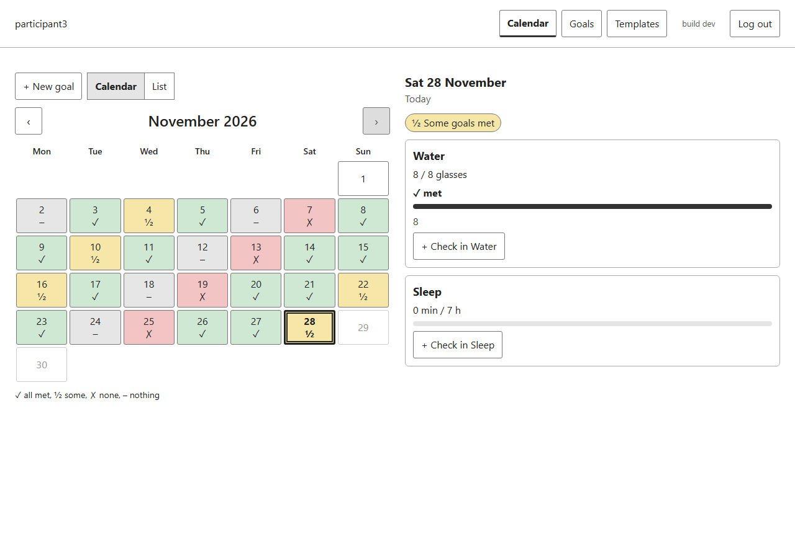
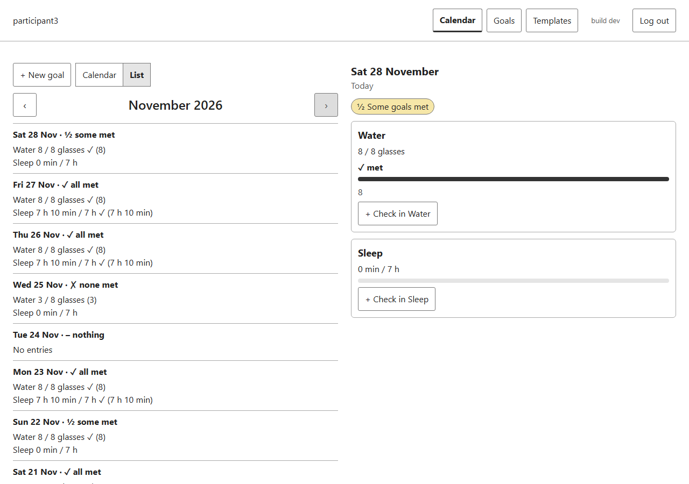
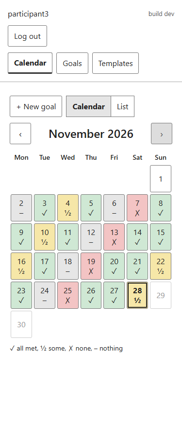
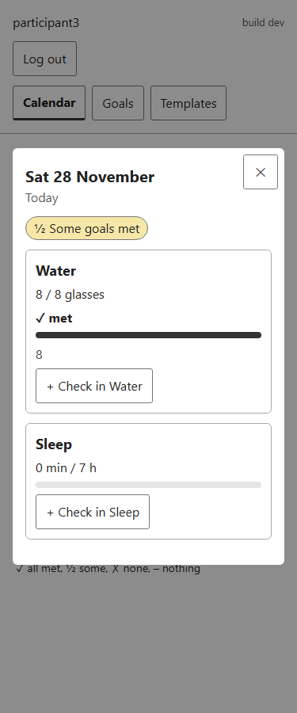
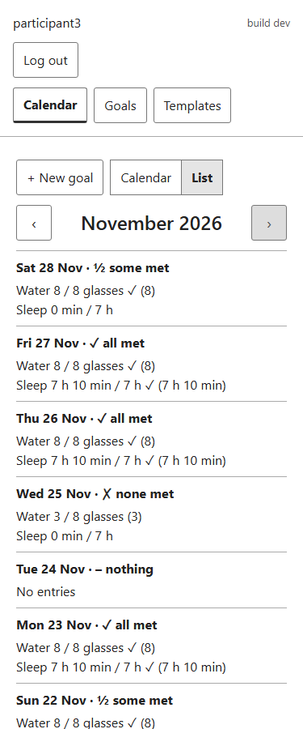

# Day colours and Calendar / List implementation evidence (Issue #156)

Contracts: [F-12](sprints/sprint-2/F-12-day-colours.md) and [F-15](sprints/sprint-2/F-15-calendar-list.md), with ADR 0069 to ADR 0072 and ADR 0102 to ADR 0105. Run on Windows 11, Node.js 24.14.0, PostgreSQL 16.14 in a Docker container and a test database used only by this worktree, Playwright's Chromium, `TEST_SERVER_PORT=33170` and its own `PLAYWRIGHT_OUTPUT_DIR` (ADR 0098). Run by Claude Code; not run in CI at the time of writing.

## Before the change

- On `staging` (0137749): server suite 128 tests, 128 pass; browser suite 95 passed, 5 skipped.
- Server tests committed in c9f4a68, before any code: 132 tests, 128 pass, 4 fail (TC-120, TC-123 API, TC-124, and `day-state-rules.test.js` as one failure because its module did not exist, so its TC-37 and TC-123 unit cases did not run one by one). TC-126 passed already: the time format helper was built in #168.
- Browser tests committed in 3fb2076, before any code: `day-colours.spec.js` and `calendar.spec.js` gave 19 failed, 23 passed, 6 skipped. The new case "a day with no counted goal shows no sign chip" passed already, because there was no chip at all.
- ef022dc changes one new test after the first run against the new code: the failed month read was mocked as 500, for which `client/src/api.js` shows its general message, so it is now a 400 with an API message. The app code did not change for this.

## Update from `staging` after #154 merged

#184 (entry edit and delete) merged into `staging` first. The branch merged `staging` (conflicts in `client/src/calendar.jsx` and this Issue's traceability rows, both sides kept). #184 had used ADR 0101, so this Issue's ADRs became 0102 to 0105, and the decision to open this PR before #154 was removed as no longer true (projectnewy). The ADR numbers in the commit messages made before the renumbering are the old ones.

Then TC-122 was added to `calendar.test.js`, and the calendar colour step of F-13 AC-13.9 to TC-150 in `entry-edit.spec.js`, whose day locators now accept the state words. TC-122 and the colour step passed with no new app code, because the state is computed on every read; they have no red run of their own. In the first run the new colour lines had been put in TC-149 by mistake, and TC-149 failed at both widths (118 passed, 2 failed, 6 skipped); they were moved to TC-150.

## After the change

Tested commit: 51d4ca7 (later commits change documents only).

| Command | Result |
|---|---|
| `npm test` in `server/` | 151 tests, 151 pass, 0 fail, 0 skipped |
| `npx playwright test` in `client/` | 120 passed, 6 skipped, 0 failed |

The 6 skipped cases are width-specific: the 5 of #155, and the ADR 0103 case, which runs at 1280 px only. Before the update, on 4395185: server 143 of 143; browser 114 passed, 6 skipped.

## AC results

| AC | Test (file) | Result |
|---|---|---|
| AC-12.1 | TC-37 (`day-state-rules.test.js`: the 8 cases of F-12 section 4, and 3 more) | pass |
| AC-12.2 | TC-49 (three cases in `day-colours.spec.js`) | the automated part passes at 375 and 1280 px; phittayanan recorded the markup review in the [review of 8cf2ee2](https://github.com/phittayanan/habit-tracker/pull/185#pullrequestreview-6091551110) of PR #185 |
| AC-12.3, AC-12.6 | TC-117 (`day-colours.spec.js`), TC-124 (`calendar.test.js`) | pass |
| AC-12.4, and F-13 AC-13.9 (calendar colour) | TC-122 (`calendar.test.js`), TC-150 colour step (`entry-edit.spec.js`) | pass |
| AC-12.5 | TC-123 unit (`day-state-rules.test.js`) and API (`calendar.test.js`) | pass |
| AC-15.1, AC-15.4 | TC-40 (`day-colours.spec.js`), TC-110 List step (`calendar.spec.js`) | pass |
| AC-15.2, AC-15.3 | TC-125 (two cases) | pass |
| AC-15.5 | TC-126 (`time-format.test.js`), TC-125 | pass |
| AC-15.6 | TC-121 (`calendar.test.js`); TC-125 also gives another Participant an entry that must not show | pass |
| AC-15.1 to AC-15.4, keyboard and width | TC-47/TC-48 on the List (`day-colours.spec.js`): the switch with Enter and Space, both month arrows, no horizontal scroll | pass at 375 and 1280 px |
| F-15 section 4 | Failed month read: the API message shows and the switch still works | pass |
| ADR 0103, ADR 0105 | Panel stays with the List and a save updates it (1280 px); the chosen day keeps its colour with a 3 px border | pass |

## Changes to earlier tests

- `client/test/calendar.spec.js`: a day button's name now includes the F-12 words, so its day locator accepts them; TC-110 gains its List step (ADR 0097).
- `server/test/calendar.test.js`: TC-120 expects the day states in place of `state: null`.

## Choices the contracts do not spell out (drafted by Claude Code, accepted by phittayanan in the [review of 8cf2ee2](https://github.com/phittayanan/habit-tracker/pull/185#pullrequestreview-6091551110) of PR #185)

1. A List heading uses the short words of F-15 ("all met", "some met", "none met", "nothing"); the chip and the day button names use the long words of F-12 section 6, which says "the same words" appear on both. The F-15 text and TC-125 give the short ones for headings.
2. The chip reads "✓ All goals met", "½ Some goals met", "✗ No goal met" or "– Nothing recorded", and sits under the date and "Today".
3. A day cell shows the number above the sign, centred, and is at least 56 px high.
4. The legend is under the calendar only; the List has the words in each heading.
5. A List date uses English three-letter weekday and month names ("Thu 27 Nov").
6. The colour values were read from the F-11 prototype screenshot: green `#cfe8d4`, yellow `#f6e7a8`, red `#f3c4c4`, grey `#e6e6e6`.

Also changed, with no test of its own: today's day button now shows the usual focus outline when it has keyboard focus. In the #155 stylesheet, today's inner outline took the place of the focus outline.

## Screenshots (synthetic data)

| Desktop: calendar | Desktop: List | Phone: calendar | Phone: day box | Phone: List |
|---|---|---|---|---|
|  |  |  |  |  |

The screenshots were taken before the update from `staging`, so the day box in them has no F-13 Edit and Delete buttons.

Not done: no deploy; no run in CI; not checked by a person with a screen reader. No separate AI review of the branch was run before this file was written.
