<!-- Deliverable 1 source (Issue #11). Build the PDF from this folder: npm ci, npx playwright install chromium, npm run build. Output: dist/deliverable-1.pdf (not committed). build.mjs fills the page numbers. Parts A to E are copied from the documents at tag v1.0. -->

<h1 style="font-size:22pt;margin-bottom:4pt">CPE 334 Project Deliverable 1</h1>

<p style="font-size:13pt;margin-top:0">Engineering baseline and working Sprint 1</p>

| | |
|---|---|
| Team (LEB2 group) | Nine's AI |
| Theme and context | Theme 8, Habit and Activity Tracking System (GWS §6.8). Context: a general habit programme with no named organisation (ADR 0003). |
| Repository | https://github.com/phittayanan/habit-tracker |
| Submitted release | Tag `v1.0` (annotated, 2026-11-10 13:35 +07) on commit `64831f7`, the merge of the release PR #61 from `staging` into `main` |

| Student | Student ID | GitHub |
|---|---|---|
| Phittayanan Tiencharoen | [student ID — fill privately] | phittayanan |
| Phuttipong Phankitnirundorn | [student ID — fill privately] | projectnewy |

## Navigation {#navigation}

One row per part. Page numbers refer to this PDF.

| Part | Pages | IDs covered | Execution evidence |
|---|---|---|---|
| A. SRS and product scope | {{pages:part-a}} | BR-01 to BR-15, FR-01 to FR-23, NFR-01 to NFR-09; assumptions A-1 to A-11; TA questions T-1 to T-10; ADR 0001 to ADR 0051 | NFR-01 to NFR-09 results: Part F, page {{page:f-3}} |
| B. Feature inventory and traceability | {{pages:part-b}} | F-01 to F-17; BR → FR → feature → AC → test; planned tests TC-01 to TC-74; coverage gaps; approved changes | AC → test results: Part F, page {{page:f-3}} |
| C. System-Level SDS | {{pages:part-c}} | Architecture, data model (User, Session, Template, Goal, Entry), UI and API conventions, role matrix, authentication, configuration, GCP plan; open points S-1 to S-17 | Access restrictions: Part F, pages {{page:f-2}} and {{page:f-4}} |
| D. Three-sprint plan | {{pages:part-d}} | Sprints 1 to 3, feature IDs per sprint, dependencies, cut line, risks | Sprint 1 release and board: Part F, page {{page:f-5}} |
| E. Sprint 1 engineering contracts | {{pages:part-e}} | F-01, F-02, F-03, F-04, F-06, F-07, F-08, F-09, F-10; AC-01.1 to AC-10.7; AC-SYS.1 to AC-SYS.5; STS; Product Definition of Done | Part F, pages {{page:f-2}} to {{page:f-5}} |
| F. Working Sprint 1 and verification | {{pages:part-f}} | Demonstrations (Figures 1 to 9), build and test results, AC → test table, two test excerpts with red and green runs, Issue/PR chains #42 → #43 and #53 → #54, release PR #61, history, contributions, AI use, limitations | This part |

## Contents {#contents}

<!-- toc -->

# Part A. SRS and product scope {#part-a}

<!-- source: docs/srs.md at v1.0 (64831f7) -->

## Software Requirements Specification

Part A of Deliverable 1 (Issue #4). Every requirement cites the ADR it comes from. Where no ADR settles a point, it is listed in section 6.3 as an open point for the students. Nothing here is decided beyond the ADRs.

### 1. Introduction

#### 1.1 Purpose
This document states what the Habit Tracker must do: the problem, the actors, the scope, and numbered business (BR), functional (FR) and non-functional (NFR) requirements. It is the baseline for the feature inventory (`docs/features.md`), the SDS (`docs/system-sds.md`) and the sprint plan.

Problem and context (ADR 0003: a general programme, no named organisation, no real-world setting): a programme runs recurring activities. Its Program Managers need one place to define what those activities are (a name, a unit and a valid range). Its Participants need to set a daily goal on an activity, record what they did each day, and see whether they met the goal and how long they have kept it up. Today there is no shared definition of an activity and no private record per Participant. The product holds no routine-specific rules (ADR 0002): a Manager defines any routine as a template.

#### 1.2 Scope
In scope for the product (all three sprints):
- Real login, logout and current-user identity, with two roles (Participant, Program Manager), one role per account. Seeded accounts (ADR 0004, ADR 0027).
- Activity templates kept by Program Managers (ADR 0007, ADR 0017, ADR 0018).
- Daily-target goals set by Participants on a template (ADR 0010, ADR 0011, ADR 0012).
- Daily entries with date and value rules (ADR 0005, ADR 0006, ADR 0008, ADR 0009).
- Progress as days met, history, streaks, and a stored reminder (ADR 0013 to ADR 0016).
- A browser UI built around one month calendar (ADR 0037 to ADR 0049).
- Private participant data (ADR 0019).

Sprint allocation (ADR 0020, ADR 0021): Sprint 1 (due 8 Nov 2026) is the handout's example only: a Manager defines a template; a Participant selects it, sets a goal, records daily activity and sees computed progress, with the entry rules and access restrictions enforced. Sprint 2 (due 29 Nov): goal changes and history. Sprint 3 (due 13 Dec): streaks, reminders, summaries and hardening.

#### 1.3 Scope Exclusions
- Medical diagnosis and treatment advice (course brief, GWS §6.8).
- Self-registration and password recovery, for the whole project (ADR 0004). Email verification is also not required in Sprint 1 (D1 §2); whether it is ever built is open (6.3, A-7).
- Any sharing of history. A Manager sees templates only, nothing about Participants' goals or entries (ADR 0019).
- Sending real reminders. The product stores and shows a reminder and sends nothing (ADR 0016).
- Several roles per account (course brief, GWS §5.2).
- Free-text unit spelling checks (ADR 0007).
- Participant-owned or copied templates (ADR 0018).
- Per-user time-zone settings (ADR 0006).

### 2. Stakeholders and Users

| Stakeholder | Interest |
|---|---|
| Program Manager | Keeps a shared, consistent set of activity definitions for the programme. |
| Participant | Tracks their own daily progress toward a goal, privately. |
| Course team (two students) and TA / instructor | Build and assess the product against the course brief. They do not use it. |

#### 2.1 Actors and Responsibilities

| Actor | Responsibilities | Must not |
|---|---|---|
| Program Manager | Log in and out. Create templates. Edit a template while no goal uses it. Retire a template (ADR 0017). | See any Participant's goals or entries (ADR 0019). |
| Participant | Log in and out. View active templates read-only. Create a goal. Record, edit and delete own entries. View own progress, history, streak and reminder (ADR 0018, ADR 0009). | Edit or create templates. See another Participant's data. |
| System | Hash passwords, keep sessions in the database, derive goal state and progress from dates and entries, enforce every rule on the backend. | Rely on a hidden control, a client-chosen user ID or a role selector. |

### 3. Business Requirements (BR)

| ID | Business rule | Source | Sprint | Tested by |
|---|---|---|---|---|
| BR-01 | An entry's date must be today or earlier, and inside its goal's start and end dates. Anything else is rejected. | ADR 0005 | 1 | Unit and API: future date, before start, after end, today, boundary days |
| BR-02 | A day is a date in Asia/Bangkok, for every user. | ADR 0006 | 1 | Unit: entries either side of midnight Bangkok |
| BR-03 | An entry's value must lie within its template's minimum and maximum (inclusive). A template's minimum must be below its maximum. | ADR 0007 | 1 | Unit and API: below, at, above each limit; min not below max |
| BR-04 | A Participant has at most one entry per goal per day. A second entry for the same day is rejected; the Participant edits the existing one instead. Known Sprint 1 limit: editing is FR-17 (Sprint 2), so in Sprint 1 a wrong same-day entry cannot be fixed. | ADR 0008 | 1 | API: second entry returns 409 |
| BR-05 | A Participant has at most one active goal per template. | ADR 0010 | 1 | API: second active goal rejected |
| BR-06 | A goal is Active until its end date passes, then Ended. The state is computed from dates. An entry to an ended goal is rejected by BR-01. | ADR 0012 | 1 | Unit: state on start, end, day after end |
| BR-07 | Progress is days met: the count of days whose value reached the daily target, out of the days so far. | ADR 0013 | 1 | Unit: counts for met, missed and empty days |
| BR-08 | A Manager may edit a template only while no goal uses it. A used template can only be retired. A retired template cannot start new goals; existing goals continue. | ADR 0017 | 1 for edit; 2 for retire (see A-2) | API: edit used template refused; new goal on retired template refused; existing goal still takes entries |
| BR-09 | A Participant cannot create, edit or retire a template. | ADR 0018; GWS §6.8 | 1 | API: Participant request returns 403 |
| BR-10 | A Participant's goals and entries are private. A Manager and any other Participant are refused access (no sharing). | ADR 0019; GWS §6.8 | 1 | API: cross-Participant and Manager reads and writes return 403 or 404 |
| BR-11 | An entry may be edited or deleted on any day inside its goal's period. Progress and streaks are recomputed from entries. | ADR 0009 | 2 | API and unit: edit and delete, then recompute |
| BR-12 | A goal change applies from today on. Earlier days keep the old target, so each goal version is stored. | ADR 0011 | 2 | Unit: past days judged against the old target |
| BR-13 | A streak is consecutive days met. One missed day resets it to zero. Today does not break the streak until the day is over. | ADR 0015 | 3 | Unit: runs, a miss, today without an entry |
| BR-14 | A reminder (time and weekdays, per goal) is stored and shown. Nothing is sent. | ADR 0016 | 3 | API: store and read; no outbound call |
| BR-15 | A day on the calendar is green when every goal was met, yellow when some were met, red when none were met, grey when nothing was recorded. | ADR 0045, ADR 0046, ADR 0040 | 2 (see A-3) | Unit: colour per combination |

### 4. Functional Requirements (FR)

Observable behaviour. "Sprint 1" items are the handout's example.

| ID | Requirement | Source | Sprint |
|---|---|---|---|
| FR-01 | A user logs in with a seeded account's credentials. A valid login creates a database session and sets an HTTP-only cookie holding the session ID. An invalid login is refused with no session. | ADR 0027, ADR 0004 | 1 |
| FR-02 | A logged-in user logs out. The session row is deleted and the cookie no longer gives access. | ADR 0027 | 1 |
| FR-03 | A logged-in user can retrieve who they are (name and role). A request with no valid session to a protected path is refused with 401. | ADR 0027; GWS §5.2 | 1 |
| FR-04 | A session ends 8 hours after login. After that, protected requests are refused with 401. | ADR 0028 | 1 |
| FR-05 | A Manager creates a template with a name, a free-text unit, and a minimum and maximum per entry. A minimum not below the maximum is rejected. | ADR 0007, ADR 0043 | 1 |
| FR-06 | A Manager sees a table of templates (name, unit, min-max, active or retired) with New and Edit actions. The Retire action appears with FR-08 in Sprint 2 and is hidden in Sprint 1. | ADR 0043 | 1 (see A-2) |
| FR-07 | A Manager edits a template's name, unit or range while no goal uses it, and is refused once a goal uses it. | ADR 0017 | 1 (see A-2) |
| FR-08 | A Manager retires a template. It no longer appears for new goals; goals already using it keep working. | ADR 0017 | 2 (see A-2) |
| FR-09 | A Participant sees all active templates, read-only. | ADR 0018 | 1 |
| FR-10 | A Participant creates a goal from a "+ New goal" form: template dropdown, daily target, start and end dates. A second active goal on the same template is rejected. | ADR 0049, ADR 0010 | 1 |
| FR-11 | A Participant records a day's value by typing a number. The unit is shown and the template's range is checked. Rejections follow BR-01, BR-03 and BR-04, each with a clear message. | ADR 0039, ADR 0008 | 1 |
| FR-12 | A Participant sees computed progress for a goal: days met out of days so far. | ADR 0013 | 1 |
| FR-13 | A Participant sees only their own goals, entries and progress. Requests for another Participant's data are refused. | ADR 0019 | 1 |
| FR-14 | A Manager's request for any Participant's goals or entries is refused. | ADR 0019 | 1 |
| FR-15 | After login a Participant sees this month's calendar first. On desktop the calendar is on the left and a side panel on the right shows the chosen day (today at start): every goal with a number box. The streak is not shown here; it comes in Sprint 3 with FR-20 (decided on PR #23). | ADR 0037, ADR 0047, ADR 0045 | 2 (see A-3) |
| FR-16 | The calendar colours each day green, yellow, red or grey per BR-15. | ADR 0040, ADR 0045, ADR 0046 | 2 (see A-3) |
| FR-17 | A Participant edits or deletes an entry on any day inside the goal period. | ADR 0009 | 2 |
| FR-18 | A Participant changes a goal's target from today on. Earlier days keep the old target. | ADR 0011 | 2 |
| FR-19 | A Participant switches between Calendar and List above the calendar. The list shows records by date, newest first, for the same month. | ADR 0014, ADR 0041, ADR 0048 | 2 |
| FR-20 | A Participant sees the current streak next to each goal and the best streak on the goal's detail page. | ADR 0015, ADR 0042 | 3 |
| FR-21 | A Participant stores a reminder time and weekdays per goal. The app shows them and sends nothing. | ADR 0016 | 3 |
| FR-22 | The layout is the same for everyone. Menu items change with the role; the backend still checks every request. | ADR 0026 | 1 |
| FR-23 | A request from a Participant to create, edit or retire a template is refused with 403 and changes nothing. | ADR 0018; GWS §5.2 | 1 |

### 5. Non-Functional Requirements (NFR)

Areas are security and privacy, usability and accessibility, and maintainability (ADR 0022). Performance is deliberately not an NFR area (ADR 0022). ADR 0022 leaves the targets to this SRS; the numbers below are proposed from the course limits and are for the students to confirm (A-8).

| ID | Area | Requirement (measurable target) | Source | Verification |
|---|---|---|---|---|
| NFR-01 | Security | Stored passwords are bcrypt hashes. Zero plaintext passwords in code, Git, logs or screens. | ADR 0029; GWS §5.2 | Test reads the user table; repository search for seed passwords finds none |
| NFR-02 | Security | Every protected endpoint returns 401 without a session. Every role-restricted endpoint returns 403 for the wrong role. 100% of protected endpoints are covered by an automated test. | ADR 0027, ADR 0026; GWS §5.2 | API test per endpoint, listed in the role matrix |
| NFR-03 | Privacy | Across two Participant accounts and one Manager account, 0 reads or writes of another account's goals or entries succeed. | ADR 0019 | API tests on every goal and entry endpoint |
| NFR-04 | Security | Session cookie is HTTP-only. A session older than 8 hours is refused. Logout invalidates the session at once. | ADR 0027, ADR 0028 | API tests with an aged and a logged-out session |
| NFR-05 | Usability | The Participant's calendar screen has no horizontal scroll and all controls work at 375 px width and at 1280 px width (desktop designed first). | ADR 0038 | Playwright run at both widths |
| NFR-06 | Accessibility | Every Participant and Manager action reachable by keyboard alone. Calendar colours are never the only signal for a day's state. | ADR 0022, ADR 0040 | Playwright keyboard run; review of the calendar markup |
| NFR-07 | Maintainability | From a clean clone, the documented commands build, migrate, seed and start the app in 15 minutes or less. | ADR 0022 | Clean-clone run, timed, in Lab 5 |
| NFR-08 | Maintainability | Business-rule code (BR-01 to BR-07) has one unit test per rule and at least 80% line coverage of the rule code. | ADR 0022, ADR 0035 | Coverage report from CI |
| NFR-09 | Maintainability | Tests run in CI on every PR, against a real test database, at unit, API and browser level. | ADR 0035, ADR 0033 | CI run on a PR |

#### 5.1 NFR Verification by Sprint

| NFR ID | Requirement | Verified in Sprint |
|---|---|---|
| NFR-01 | Password hashing | 1 |
| NFR-02 | 401 and 403 coverage | 1 (rechecked on each later endpoint) |
| NFR-03 | Cross-account privacy | 1 (rechecked in 2 and 3 as endpoints are added) |
| NFR-04 | Session cookie and expiry | 1 |
| NFR-05 | Phone and desktop width | 1 for Sprint 1 screens; 2 and 3 for later screens |
| NFR-06 | Keyboard and non-colour signal | 1 for Sprint 1 screens; 2 and 3 for later screens |
| NFR-07 | Clean-clone setup | 1 (documented setup); timed run in Lab 5 |
| NFR-08 | Rule unit tests and coverage | 1; hardening in 3 |
| NFR-09 | Tests in CI | 1 locally; in CI from Lab 5 |

### 6. Constraints and Assumptions

#### 6.1 Constraints (fixed by the course or the repo)
- Theme 8, Habit and Activity Tracking, is the working assumption (GWS §6.8).
- Real UI, API, then persistent database. Data survives restart and redeploy (GWS §5.1).
- Business rules are enforced on the backend. The frontend may repeat them (GWS §5.2).
- Stack: Node.js, Express, React with Vite, Prisma, PostgreSQL; one container; REST over JSON (ADR 0023 to ADR 0025). Detail belongs in the SDS.
- One `staging` branch for all sprints (ADR 0001).

#### 6.2 Decisions recorded
All design decisions are in `docs/adr/` (ADR 0002 to 0049), agreed by both students. The requirements above cite them by number.

#### 6.3 Assumptions and open points for the students
No ADR settles these. Each is left open and needs a decision before the requirement is final.

| ID | Open point | Affects |
|---|---|---|
| A-1 | "Days so far" for progress: assumed to run from the goal's start date to today, or to the end date if the goal has ended. Confirm. | BR-07, FR-12 |
| A-2 | Which sprint builds template edit and retire. The handout's Sprint 1 example only requires defining a template. Template edit (FR-07) stays in Sprint 1 because the handout's "Participant cannot edit a template" test needs it. Retire (FR-08, and the retire part of BR-08) moves to Sprint 2, as the partner's review listed. | BR-08, FR-06 to FR-08 |
| A-3 | Which sprint builds the coloured calendar and the side panel. ADR 0037 puts the calendar first for the Participant, but no ADR says which of ADR 0040 to 0049 land in Sprint 1. Sprint 1 is the handout's slice, so Sprint 1 has only a plain page for goals and progress (FR-10 to FR-12). The month calendar and side panel (FR-15) and the colours (FR-16, BR-15) move to Sprint 2, as the partner's review listed. | BR-15, FR-15, FR-16 |
| A-4 | Decided on PR #23: a goal's daily target is greater than 0 and not above the template's maximum (`max_value`), so every target can be met. | FR-10 |
| A-5 | Whether Participants can see template names after retirement on their existing goals, and what the Manager's table shows for them. | FR-08, FR-09 |
| A-6 | Whether native or mobile apps are out of scope. ADR 0038 says the design covers phone and desktop screens, which this SRS reads as a browser app only. | 1.3 |
| A-7 | Whether email verification is excluded for the whole project. Only self-registration and password recovery are (ADR 0004). | 1.3 |
| A-8 | NFR numbers: the width and keyboard targets are proposed here, not agreed. | NFR-05, NFR-06 |
| A-9 | Seeded account names and the way their passwords are shared privately (not in the repository). | FR-01 |
| A-10 | What a goal's detail page shows besides the best streak (ADR 0042 names the page, not its content). | FR-20 |
| A-11 | Sprint 1 limit: a wrong same-day entry cannot be fixed until editing (FR-17) arrives in Sprint 2. Chosen over adding an edit to Sprint 1; the students may revisit. | BR-04, FR-11, FR-17 |

#### 6.4 Questions for the TA (open)
The team cannot settle these. They are open points in the handouts (`docs/design-questions.md`, "Ask the TA"). Record each reply here or in an ADR.

| ID | Question for the TA | Status |
|---|---|---|
| T-1 | One `staging` branch for all sprints, or one per sprint? ADR 0001 proposes one. | Open |
| T-2 | How long may the final demo video be: 4 minutes (FD Part E) or 10 minutes (FD §2, GWS §9)? | Open |
| T-3 | Is the final video worth 8 points with a separate one-page release summary (GWS §9) or 10 points with no summary (FD)? | Open |
| T-4 | What must the final video and the final PDF contain where GWS §9 and FD disagree? | Open |
| T-5 | Must the merge gate cover PRs into `staging`, or only `main`? Does the ruleset include the default branch, which is `staging` here? How many approvals are required? | Open |
| T-6 | Lab 5 sits in the 3 and 5 Nov workshop but needs an accepted Sprint 1 release due 8 Nov. What is the real order? | Open |
| T-7 | Is there a Lab 6 and Lab 7 handout? When? | Open |
| T-8 | How do we ask for agreement on an alternative Sprint 1 slice or a brief ambiguity, and how long does a reply take? | Open |
| T-9 | May student IDs be left out of the PDF and given only on LEB2, given the repository is public? | Open |
| T-10 | Which GCP access method applies: the instructor's announced method or a personal Gmail Free Trial? | Open |

## Design decisions by topic {#design-decisions}

Each line is one decision record: number, the question, then the answer chosen. The full records are in the repository's `docs/adr/` folder.

### Scope and product

- 0002 Theme and routine - No single routine: Managers define any routine as a template, so the product holds no routine-specific rules.
- 0003 Stakeholder and problem - A general programme with no named organisation; the SRS describes the roles only.
- 0004 Out of scope - Exclude self-registration and password recovery for the whole project, not only Sprint 1.
- 0020 Sprint 1 slice - The handout's example only, with the rules chosen above.
- 0021 Sprint 2 and Sprint 3 split - Sprint 2: goal changes and history. Sprint 3: streaks, reminders, summaries and hardening.
- 0022 Non-functional requirements - Security and privacy; usability and accessibility; maintainability.

### Entry rules

- 0005 Valid entry dates - Past or today, but only inside the goal's start and end dates; entries outside the goal period are rejected.
- 0006 What a day is - One fixed time zone for everyone (Asia/Bangkok), so every user has the same date.
- 0007 Units and valid ranges - The Manager types a free-text unit and a minimum and maximum per entry.
- 0008 Second entry on the same day - One entry per day; a second entry is rejected, and the Participant edits the existing one.
- 0009 Editing and deleting entries - Edit or delete on any day inside the goal period; progress and streaks are recomputed after each change.

### Goals, progress and templates

- 0010 What a goal is - A daily target for one template, with a start date and an end date.
- 0011 Changing a goal - A change applies from today on; earlier days keep the old target, so each goal version is stored.
- 0012 Goal states and transitions - Active, then Ended when the end date passes; the system sets the state from the dates.
- 0013 How progress is computed - Days met: the days whose value reached the daily target, out of the days so far.
- 0014 What history shows - A list of entries by date for one goal, newest first.
- 0015 What a streak means - Consecutive days where the daily target was met; one missed day resets it to zero.
- 0016 Reminder or schedule placeholder - A Participant stores a reminder time and weekdays per goal; the app shows them and sends nothing.
- 0017 Template changes and retirement - A Manager can edit a template only while no goal uses it, and can retire a template; a retired template starts no new goals, and existing goals continue.
- 0018 Template visibility - Participants see all active templates, read-only, and cannot copy or create their own.
- 0019 Sharing and what a Manager sees - No sharing; a Manager sees only templates, nothing about Participants' goals or entries.

### Screens

- 0026 Navigation - One layout for everyone; the menu items change with the role.
- 0037 What a Participant sees first after login - This month's calendar; tap a day to log.
- 0038 Which screen the design starts from - Both phone and desktop, desktop first.
- 0039 How a Participant records a day - Type a number; the app shows the unit and checks the minimum and maximum.
- 0040 How progress is shown on a goal - Calendar colours: green day = target met, red = missed.
- 0041 How a Participant sees past days - Both: the calendar for the pattern, a list for exact amounts.
- 0042 Where the streak is shown - Both: current streak next to the goal, best streak on the detail page.
- 0043 What the Program Manager sees first - A template list (name, unit, min-max, active or retired) with New, Edit and Retire buttons.
- 0044 Overall feel of the app - Minimal; the calendar is the only strong colour.
- 0045 One calendar or one per goal - All goals together on one calendar; a day is green only if every goal was met.
- 0046 Colour of a day where only some goals were met - Yellow: green = all met, yellow = some met, red = none met, grey = nothing recorded.
- 0047 Where the numbers are typed on a computer screen - A side panel beside the calendar shows the chosen day with every goal's number box and current streak.
- 0048 Where the history list is - A Calendar / List switch above the calendar; the list shows records by date, newest first, for the same month.
- 0049 How a Participant starts a new goal - A "+ New goal" button opens a form: template, daily target, start and end dates, Save.
- 0050 Auth layout - Package A: a centered login form at most 352px wide without a card, and a shared wrapping top bar.

### Technology, security and deployment

- 0023 Stack - The kit's stack as it is: Node.js, Express, React with Vite, Prisma, PostgreSQL.
- 0024 Shape of the application - One container: the API serves the built frontend.
- 0025 API conventions - REST over JSON: resource paths, standard HTTP status codes, and a JSON error body with a code and message.
- 0027 Session design - A server-side session row in the database and an HTTP-only cookie with the session ID; logout deletes the row.
- 0028 Session length - 8 hours from login.
- 0029 Password hashing method - bcrypt.
- 0051 Unknown-user login - Compare the password against a precomputed cost-10 bcrypt hash, return the same `401 INVALID_CREDENTIALS` and create no session.
- 0030 GCP components - The reference stack, with the kit defaults.
- 0031 Who owns the GCP project - phittayanan creates and owns the project and adds projectnewy as Editor.
- 0032 Manual approval before deploy - No approval step; a merge into `main` deploys through the pipeline.
- 0033 Shape of the CI check - One job `test-and-docker`, as in the kit, as the single required check.
- 0035 Test levels and tools - The stack's usual test runner for unit and API tests against a real test database, and Playwright for browser journeys.

### Team process

- 0001 Branches - One `staging` branch for all sprints; each sprint ends with a release PR from `staging` into `main` and a tag.
- 0034 Student IDs in the PDF - IDs are typed into the final PDF by hand after export.
- 0036 Recording each student's part - Each Issue has one assignee and the other student reviews its PR; the assignee alternates between areas.

# Part B. Feature inventory and traceability {#part-b}

<!-- source: docs/features.md at v1.0 (64831f7) -->

## Features

Part B of Deliverable 1 (Issue #5). Each feature groups SRS requirements (`docs/srs.md`); its sprint comes from the SRS. Nothing here adds a requirement or moves scope. Requirement-to-test mapping is in `docs/traceability.md`. Where the SRS and ADRs do not settle a point, it is listed under "Open points" for the students.

### Feature List

| ID | Feature | Description | Requirements | Depends on | Sprint |
|---|---|---|---|---|---|
| F-01 | Login, logout and session | A seeded user logs in and out. The session is a database row with an HTTP-only cookie, ends after 8 hours, and the user can retrieve who they are. | FR-01, FR-02, FR-03, FR-04, NFR-01, NFR-04 | none | 1 |
| F-02 | Role layout and endpoint protection | One layout for everyone; menu items follow the role. Every protected endpoint is checked on the backend: 401 without a session, 403 for the wrong role. | FR-22, NFR-02 | F-01 | 1 |
| F-03 | Template creation and Manager list | A Manager creates a template (name, unit, minimum, maximum) and sees the template table with New and Edit actions (no Retire control in Sprint 1). | FR-05, FR-06, BR-03 (minimum below maximum) | F-01, F-02 | 1 |
| F-04 | Template edit | A Manager edits a template only while no goal uses it. | FR-07, BR-08 (edit part) | F-03, F-07 | 1 |
| F-05 | Template retire | A Manager retires a template; the Retire control appears in the table with this feature. It leaves the new-goal list; existing goals continue. | FR-08, BR-08 (retire part) | F-03, F-07 | 2 |
| F-06 | Participant template view and write refusal | A Participant sees active templates read-only. A Participant's create, edit or retire request is refused with 403. | FR-09, FR-23, BR-09 | F-01, F-02, F-03 | 1 |
| F-07 | Goal creation | A Participant creates a goal on a template with a daily target and start and end dates. One active goal per template; the state (Active or Ended) is derived from dates. | FR-10, BR-05, BR-06 | F-03, F-06 | 1 |
| F-08 | Daily entry recording | A Participant records a day's value. Date, value-range and one-entry-per-day rules are enforced on the backend with clear messages. | FR-11, BR-01, BR-02, BR-03, BR-04, BR-06 | F-07 | 1 |
| F-09 | Progress (days met) | A Participant sees days met out of days so far for a goal. | FR-12, BR-07 | F-08 | 1 |
| F-10 | Participant data privacy | A Participant sees only their own goals, entries and progress. Another Participant and any Manager are refused. | FR-13, FR-14, BR-10, NFR-03 | F-01, F-07, F-08 | 1 |
| F-11 | Month calendar and side panel | After login a Participant sees this month's calendar, and a side panel for the chosen day with each goal's number box (no streak until Sprint 3, F-16; decided on PR #23). | FR-15 | F-08, F-09 | 2 |
| F-12 | Calendar day colours | Each calendar day is green, yellow, red or grey. | FR-16, BR-15 | F-11 | 2 |
| F-13 | Entry edit and delete | A Participant edits or deletes an entry on any day inside the goal period; progress is recomputed. | FR-17, BR-11 | F-08, F-09 | 2 |
| F-14 | Goal change | A Participant changes a goal's target from today on; earlier days keep the old target. | FR-18, BR-12 | F-07, F-09 | 2 |
| F-15 | Calendar and List history | A Participant switches between Calendar and List; the list shows the month's records newest first. | FR-19 | F-11 | 2 |
| F-16 | Streaks | The current streak shows next to each goal; the best streak shows on the goal's detail page. | FR-20, BR-13 | F-08, F-13 | 3 |
| F-17 | Stored reminder | A Participant stores a reminder time and weekdays per goal. The app shows them and sends nothing. | FR-21, BR-14 | F-07 | 3 |

Every FR-01 to FR-23 appears in exactly one feature. Every BR-01 to BR-15 appears in at least one; BR-03, BR-06 and BR-08 are shared by the rows shown.

### Cross-cutting requirements

These NFRs apply to many features or to the system as a whole. Each links to the features it constrains or to a named system responsibility, with the sprint that sets it up and the sprint that verifies it.

| NFR | Linked to | Set up in | Verified in |
|---|---|---|---|
| NFR-01 Password hashing | F-01 | 1 | 1 |
| NFR-02 401 and 403 coverage | F-02 (all features with endpoints) | 1 | 1; rechecked on each later endpoint |
| NFR-03 Cross-account privacy | F-10 (all goal and entry endpoints) | 1 | 1; rechecked in 2 and 3 |
| NFR-04 Session cookie and expiry | F-01 | 1 | 1 |
| NFR-05 Phone and desktop width | Sprint 1 screens of F-03, F-04, F-06, F-07, F-08, F-09; later screens of F-11 to F-17 | 1 | 1 for Sprint 1 screens; 2 and 3 for later screens |
| NFR-06 Keyboard and non-colour signal | Same screens as NFR-05; calendar markup of F-12 | 1 | 1 for Sprint 1 screens; 2 and 3 for later screens |
| NFR-07 Clean-clone setup | System responsibility: setup commands and documentation | 1 | 1 (documented); timed run in Lab 5 |
| NFR-08 Rule unit tests and coverage | F-07, F-08, F-09 (rule code for BR-01 to BR-07) | 1 | 1; hardening in 3 |
| NFR-09 Tests in CI | System responsibility: CI | 1 (local) | CI from Lab 5 |

### Acceptance Criteria

Acceptance criteria (AC) are not written here. Part B asks for no AC on later-sprint features, and the Sprint 1 AC belong to each feature's contract (Part E, with stable AC IDs and planned test IDs). Until those contracts exist, the AC column in `docs/traceability.md` points to Part E.


The students' open points O-1 to O-8 are in `docs/features.md` in the repository; the answered ones are under Approved Changes in the traceability below.

## Traceability

### BR -> FR

| BR | FR |
|---|---|
| BR-01 | FR-11 |
| BR-02 | FR-11 |
| BR-03 | FR-05, FR-11 |
| BR-04 | FR-11 |
| BR-05 | FR-10 |
| BR-06 | FR-10, FR-11 |
| BR-07 | FR-12 |
| BR-08 | FR-06, FR-07, FR-08 |
| BR-09 | FR-09, FR-23 |
| BR-10 | FR-13, FR-14 |
| BR-11 | FR-17 |
| BR-12 | FR-18 |
| BR-13 | FR-20 |
| BR-14 | FR-21 |
| BR-15 | FR-16 |

### FR -> Feature -> Acceptance Criteria -> Test

Auth implementation review: [https://github.com/phittayanan/habit-tracker/pull/34](https://github.com/phittayanan/habit-tracker/pull/34), for Issue #32 and parent #9.

Test IDs (`TC-nn`) map to the list below. Auth tests exist under `server/test/` and `client/test/` for implementation Issue #32. Template create and view tests exist in the same folders for implementation Issue #36. Goal tests are implemented for Issue #40, Entry tests for Issue #42, Progress and privacy tests for Issue #44, and template edit tests for Issue #53; broader privacy tests remain planned. See [Auth implementation evidence](https://github.com/phittayanan/habit-tracker/blob/64831f7/docs/auth-implementation-evidence.md) and [Template implementation evidence](https://github.com/phittayanan/habit-tracker/blob/64831f7/docs/template-implementation-evidence.md), [Goal](https://github.com/phittayanan/habit-tracker/blob/64831f7/docs/goal-implementation-evidence.md) and [Entry](https://github.com/phittayanan/habit-tracker/blob/64831f7/docs/entry-implementation-evidence.md) and [Progress and privacy](https://github.com/phittayanan/habit-tracker/blob/64831f7/docs/progress-privacy-implementation-evidence.md) and [Template edit](https://github.com/phittayanan/habit-tracker/blob/64831f7/docs/template-edit-implementation-evidence.md) for red/green commands, tested commits, AC results and limits. Auth API/unit checks pass 22/22 and Playwright checks pass 12/12 at 375px and 1280px on `31746a3` in the current review round; teammate re-review remains pending after changes requested. Template server checks pass 31/31 and Playwright checks pass 20/20 at 375px and 1280px on `5435e89`. Initial-build counts remain in the evidence history. AC are set in each Sprint 1 feature contract (Part E); later-sprint rows need none now. Issue #9 is the Sprint 1 parent build Issue. The AC for F-07 to F-10 are written in `docs/sprints/sprint-1/` (contract Issue #28), and the AC for F-01 to F-04 and F-06 in the same folder (contract Issue #30). TC-53 to TC-61 were added by the first four contracts, and TC-62 to TC-73 by the other five.

| BR | FR | Feature | AC | Test ID | Sprint | Issue / PR |
|---|---|---|---|---|---|---|
| none | FR-01 | F-01 | AC-01.1 to AC-01.3, AC-01.9, AC-01.10 | TC-01, TC-02, TC-46, TC-62, TC-64, TC-65 | 1 | #30, #32, #9, [implementation](https://github.com/phittayanan/habit-tracker/pull/34) |
| none | FR-02 | F-01 | AC-01.4 | TC-03 | 1 | #30, #32, #9, [implementation](https://github.com/phittayanan/habit-tracker/pull/34) |
| none | FR-03 | F-01 | AC-01.5, AC-01.6 | TC-04, TC-05 | 1 | #30, #32, #9, [implementation](https://github.com/phittayanan/habit-tracker/pull/34) |
| none | FR-04 | F-01 | AC-01.7 | TC-06, TC-63 | 1 | #30, #32, #9, [implementation](https://github.com/phittayanan/habit-tracker/pull/34) |
| BR-03 | FR-05 | F-03 | AC-03.1 to AC-03.5, AC-03.7 | TC-09, TC-10, TC-68, TC-69, TC-70 | 1 | #30, #36, #9, [implementation](https://github.com/phittayanan/habit-tracker/pull/37) |
| BR-08 | FR-06 | F-03 | AC-03.6 | TC-11 | 1 | #30, #36, #9, [implementation](https://github.com/phittayanan/habit-tracker/pull/37) |
| BR-08 | FR-07 | F-04 | AC-04.1 to AC-04.6 | TC-12, TC-13, TC-71, TC-72, TC-73 | 1 | #30, #53, #9, [implementation](https://github.com/phittayanan/habit-tracker/pull/54) |
| BR-08 | FR-08 | F-05 | later | TC-14, TC-15 | 2 | none yet |
| BR-09 | FR-09 | F-06 | AC-06.1, AC-06.2 | TC-16 | 1 | #30, #36, #9, [implementation](https://github.com/phittayanan/habit-tracker/pull/37) |
| BR-05, BR-06 | FR-10 | F-07 | AC-07.1 to AC-07.10 | TC-20, TC-21, TC-22, TC-53, TC-54, TC-55, TC-60, TC-74 | 1 | #28, #38, #40, #9, [implementation](https://github.com/phittayanan/habit-tracker/pull/41) |
| BR-01, BR-02, BR-03, BR-04, BR-06 | FR-11 | F-08 | AC-08.1 to AC-08.12 | TC-23 to TC-30, TC-56, TC-58, TC-61 | 1 | #28, #38, #42, #9 |
| BR-07 | FR-12 | F-09 | AC-09.1 to AC-09.8 | TC-31, TC-32, TC-59 | 1 | #28, #44, #9, [implementation](https://github.com/phittayanan/habit-tracker/pull/51) |
| BR-10 | FR-13 | F-10 | AC-10.1, AC-10.2, AC-10.4 to AC-10.7 | TC-33, TC-34, TC-35, TC-57 | 1 | #28, #44, #9, [implementation](https://github.com/phittayanan/habit-tracker/pull/51) |
| BR-10 | FR-14 | F-10 | AC-10.3 | TC-34 | 1 | #28, #44, #9, [implementation](https://github.com/phittayanan/habit-tracker/pull/51) |
| none | FR-15 | F-11 | later | TC-36 | 2 | none yet |
| BR-15 | FR-16 | F-12 | later | TC-37 | 2 | none yet |
| BR-11 | FR-17 | F-13 | later | TC-38 | 2 | none yet |
| BR-12 | FR-18 | F-14 | later | TC-39 | 2 | none yet |
| none | FR-19 | F-15 | later | TC-40 | 2 | none yet |
| BR-13 | FR-20 | F-16 | later | TC-41, TC-42 | 3 | none yet |
| BR-14 | FR-21 | F-17 | later | TC-43 | 3 | none yet |
| none | FR-22 | F-02 | AC-02.1 to AC-02.5 | TC-07, TC-08, TC-66, TC-67 | 1 | #30, #32, #9, [implementation](https://github.com/phittayanan/habit-tracker/pull/34) |
| BR-09 | FR-23 | F-06, F-04 | AC-06.3, AC-04.7 | TC-17, TC-18 (create, edit); TC-19 (retire, Sprint 2) | 1 | #30, #36, #53, #9, [implementation](https://github.com/phittayanan/habit-tracker/pull/37) |

Goal implementation evidence: [Issue #40](https://github.com/phittayanan/habit-tracker/blob/64831f7/docs/goal-implementation-evidence.md). AC-07.1/2 → TC-20; AC-07.3 → TC-21; AC-07.4 → TC-55; AC-07.5 → TC-22; AC-07.6/8 → TC-53; AC-07.7 → TC-54; AC-07.9 → TC-60; AC-07.10 → TC-74. `server/test/goal.test.js` covers the API/database cases; `server/test/goal-rules.test.js` adds rule units; `client/test/goals.spec.js` covers TC-60 and Goal TC-47/48 at both widths. TC-08's independent discovery now includes both `/api/goals` methods and their implicit HEAD protection. Goal rule coverage is local evidence for NFR-08; this is not a claim of CI coverage or completion of the later BR-01 to BR-07 rules.

### NFR -> Feature -> Verification -> Test

| NFR | Feature or responsibility | Verification | Test ID | Verified in Sprint |
|---|---|---|---|---|
| NFR-01 | F-01 | User table read; repository search (AC-01.8) | TC-44, TC-45 | 1 |
| NFR-02 | F-02 | API test per endpoint (role matrix, AC-02.2, AC-02.3) | TC-08, TC-66, TC-34 (goal and entry endpoints, AC-10.4) | 1 (rechecked later) |
| NFR-03 | F-10 | API tests, two Participants and one Manager | TC-33, TC-34, TC-57 | 1 (rechecked in 2 and 3) |
| NFR-04 | F-01 | API and unit tests: cookie flag, aged session, logged-out session (AC-01.1, AC-01.4, AC-01.7) | TC-06, TC-46, TC-03, TC-63 | 1 |
| NFR-05 | Sprint 1 screens of F-01 (login), F-03, F-04, F-06 to F-09; later screens | Playwright at 375 px and 1280 px (AC-SYS.1) | TC-47 | 1; 2 and 3 for later screens |
| NFR-06 | Same screens, including F-01 (login); F-12 markup | Playwright keyboard run (AC-SYS.2); markup review | TC-48, TC-49 | 1; 2 and 3 for later screens |
| NFR-07 | System: setup commands and docs | Timed clean-clone run (AC-SYS.3) | TC-50 | 1 documented; timed in Lab 5 |
| NFR-08 | F-07, F-08, F-09 (rule code) | Coverage report (AC-SYS.4) | TC-51 | 1; 3 |
| NFR-09 | System: CI | CI run on a PR (AC-SYS.5; run locally in Sprint 1) | TC-52 | 1 locally; CI from Lab 5 |

### Coverage Gaps

- Every BR-01 to BR-15, FR-01 to FR-23 and NFR-01 to NFR-09 maps to a feature (or a named system responsibility for NFR-07 and NFR-09) and to at least one planned test. No requirement is uncovered.
- AC exist for every Sprint 1 feature: F-07 to F-10 (Issue #28) and F-01 to F-04, F-06 (draft contracts, Issue #30). The five system checks for NFR-05 to NFR-09 (TC-47, TC-48, TC-50, TC-51, TC-52) have AC-SYS.1 to AC-SYS.5 in `docs/sprints/sprint-1/README.md` (Issue #8). Sprint 2 and 3 rows have none by design.
- Auth API/unit/browser checks have passed for Issue #32, including TC-47/48 on the login and shared role layout. Template create and view checks have passed for Issue #36 on `5435e89`, including TC-47/48 on the template list and new form at 375px and 1280px. F-04 tests (TC-12, TC-13 with the edit-versus-goal race, TC-18, TC-71, TC-72, TC-73, and TC-47/48 on the edit form) pass locally for Issue #53 on `3d1ccbb`, and TC-08 now audits `PATCH /api/templates/:id`; teammate review is pending. The Sprint 2 retire refusal (TC-19) remains planned. TC-08 independently discovers implemented API routes from the Express router tree, including mounted routers and methods; only exact login/health/ready methods are public. Issue #36 adds `GET /api/templates` and `POST /api/templates` to that coverage. Missing coverage registration and missing protection are regression-tested; each later feature must extend the protected coverage entries. Implementation re-review and merge remain pending.
- FR-23 retire refusal (TC-19) cannot run until FR-08 exists in Sprint 2.
- The calendar rows (FR-15, FR-16, FR-19) and NFR-06's non-colour check (TC-49) have only a Sprint 2 test name.
- Open points that change a row if answered differently: SRS A-1 (FR-12), A-2 (FR-06 to FR-08), A-3 (FR-15, FR-16), A-11 (FR-11); and O-1 to O-8 in `docs/features.md`.

### Approved Changes

| Date | Change | Affected IDs | Approved by |
|---|---|---|---|
| 2026-11-07 | No new Sprint 3 summary feature. Progress (F-09) and the calendar colours (F-12) cover the "summaries" named in ADR 0021 and SRS 1.2. Sprint plan open point O-1 | F-09, F-12, FR-12, FR-16 | phittayanan and projectnewy (PR #26 review) |
| 2026-11-07 | FR-08 (Retire template, with the retire part of BR-08) moves from Sprint 1 to Sprint 2; Retire is hidden in Sprint 1. Sprint 1 is the handout slice | FR-08, FR-06, BR-08 | phittayanan and projectnewy (PR #21 review, PR #22 open point O-4) |
| 2026-11-07 | FR-15 (calendar and side panel) and FR-16 with BR-15 move from Sprint 1 to Sprint 2 | FR-15, FR-16, BR-15 | phittayanan and projectnewy (PR #21 review) |
| 2026-11-07 | FR-23 added: a Participant's request to create, edit or retire a template is refused with 403 and changes nothing | FR-23, BR-09 | phittayanan and projectnewy (PR #21 review) |
| 2026-11-07 | No streak in the Sprint 2 side panel (number box only); the streak comes in Sprint 3 (FR-20, ADR 0021). A-4 decided: a goal's daily target is above 0 and not above the template's maximum | FR-15, F-11, FR-20, F-16, A-4 | phittayanan and projectnewy (PR #23 review, PR #25) |

# Part C. System-Level SDS {#part-c}

<!-- source: docs/system-sds.md at v1.0 (64831f7) -->

## System Design Specification

Part C of Deliverable 1 (Issue #6). The design is built from the ADRs (`docs/adr/`) and the requirements in `docs/srs.md`. Each section cites its source. Where no ADR or SRS line settles a point, the design gives a **proposal** and lists it in section 8.2. On PR #23 phittayanan answered the open points S-1 to S-14; those answers are recorded in 8.2 as decided, and S-15 to S-17 are new and still open. Nothing here changes a requirement or an ADR. Per-feature detail (exact request and response shapes, acceptance criteria) belongs to the Sprint 1 contracts (Part E).

### 1. Overview

#### 1.1 What this document covers
How the Habit Tracker is built: the stack and components, the data model, the screens and API conventions, who may do what, how login and sessions work, and how the app is configured and later deployed. It covers the whole product. Sprint 1 (the handout's slice) is marked where the design differs by sprint. Sprint 2 and Sprint 3 screens, endpoints and permissions are outlined here; their exact paths and shapes are set in those sprints' contracts.

#### 1.2 Design at a glance
| Topic | Decision | Source |
|---|---|---|
| Stack | Node.js, Express, React with Vite, Prisma, PostgreSQL | ADR 0023 |
| Shape | One container: the API serves the built frontend. A modular monolith | ADR 0024 |
| API | REST over JSON, standard status codes, JSON error body with a code and message | ADR 0025 |
| Layout | One layout for everyone; menu items follow the role | ADR 0026 |
| Sessions | A session row in the database; an HTTP-only cookie holds the session ID; logout deletes the row | ADR 0027 |
| Session length | 8 hours from login | ADR 0028 |
| Passwords | bcrypt (the `bcryptjs` package) | ADR 0029 |
| Day | A calendar date in Asia/Bangkok for every user | ADR 0006 |
| Goal state | Derived from dates, never stored | ADR 0012 |
| Hosting | GCP reference stack with the kit defaults | ADR 0030 |
| Tests | Unit and API tests against a real test database; Playwright for browser journeys | ADR 0035 |

**Why this stack:** ADR 0023 chose the Lab 5 kit's stack as it is, because the kit's Dockerfile, CI and deploy scripts then work with no changes, which is the least risk (the handout asks us to explain the stack, D1 §3.3).

#### 1.3 Constraints from the course
Real UI, API, then persistent database; data survives a restart and a redeploy (GWS §5.1). Roles are enforced on the backend, never by a hidden control or a client-chosen user ID (GWS §5.2). Docker, CI and GCP come in Lab 5, so Sprint 1 is designed for them but does not need them. No real secret in Git, the image, logs or the PDF (L5 §4.3).

### 2. Architecture

#### 2.1 Components
| Component | Responsibility | Talks to |
|---|---|---|
| Browser app (React, built with Vite) | Screens, form validation for fast feedback, calling the API. Holds no business rule that the server does not also enforce | API over HTTPS, same origin |
| API (Express, Node.js) | Authentication, authorization, every business rule (BR-01 to BR-15), request validation, serving the built frontend files | Database through Prisma |
| Database (PostgreSQL) | Durable storage, constraints (unique, foreign key, check), migrations | API only |
| Test database | A separate PostgreSQL database for the tests. ADR 0035 says only "a real test database"; that the suite resets and seeds it before each run is a proposal (S-15) | API tests |

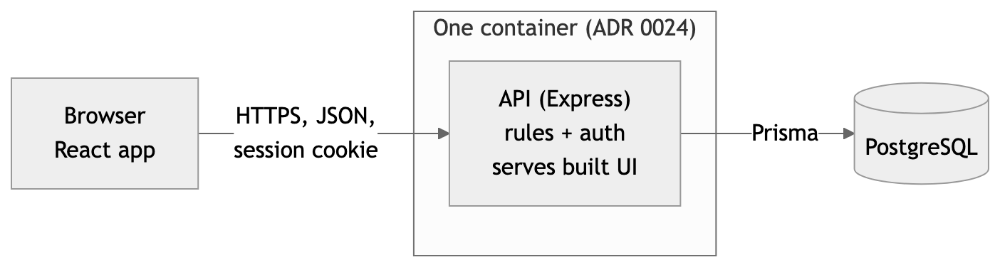

#### 2.2 Where business rules are enforced
The API enforces every rule. The frontend may repeat a rule to show a message sooner, but a request that breaks a rule is refused by the API whatever the frontend does (GWS §5.2; SRS 6.1). Inside the API a request passes through these steps:

1. Session check: read the cookie, load the session row, refuse with 401 if it is missing or expired.
2. Role check: refuse with 403 if the role may not use the route.
3. Ownership check: for goal and entry routes, the record's participant must be the session user.
4. Validation: shape and types of the input.
5. Rule check: date, range, uniqueness and state rules (section 3.4).
6. Write through Prisma, with database constraints as the last guard.

The user ID for any action comes from the session, never from the request body or the URL.

#### 2.3 Time and dates
"Today" is computed on the server as a calendar date in Asia/Bangkok (BR-02, ADR 0006). Dates are stored as plain `DATE` values with no time part, so there is no time-zone field and no per-user setting.

#### 2.4 Code layout (S-1, decided)
The Lab 5 kit expects a `client/` folder and a `server/` folder, each with `package.json`, `npm ci`, `npm test` and `npm run build`; Prisma migrations and a seed script (`npm run prisma:seed`) in `server/`; and a server that starts with `node dist/index.js` and reads `PORT` (KIT README). The design follows that layout. Inside `server/src/`: routes (HTTP only), services (rules), and a thin data layer (Prisma).

### 3. Data Design

#### 3.1 Entities
Sprint 1 entities are User, Session, Template, Goal and Entry. Later sprints add to them (3.5). The key type and decimal precision are decided (S-2); the relationships and constraints come from the SRS and ADRs.

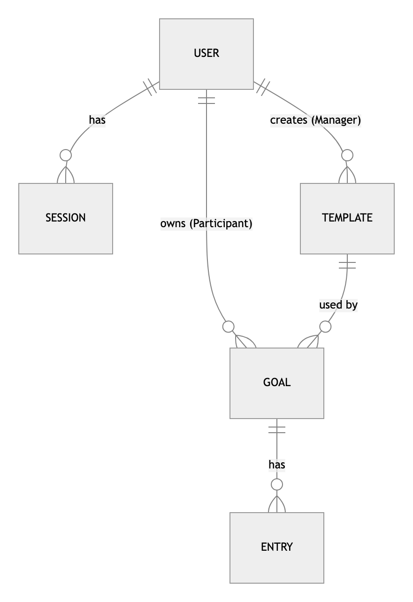

#### 3.2 Fields and constraints
**User** (seeded; no self-registration, ADR 0004)
| Field | Type | Constraint | Note |
|---|---|---|---|
| id | integer | primary key | Integer IDs (S-2, decided) |
| username | text | unique, not null | Login name; seeded account names are open (SRS A-9) |
| display_name | text | not null | Shown by "who am I" (FR-03) |
| role | `PARTICIPANT` or `MANAGER` | not null | One role per account (GWS §5.2) |
| password_hash | text | not null | bcrypt hash only (NFR-01) |
| created_at | timestamp | not null | |

**Session** (ADR 0027, ADR 0028)
| Field | Type | Constraint | Note |
|---|---|---|---|
| id | random text, at least 128 bits | primary key | The value in the cookie. Not guessable |
| user_id | reference to User | not null, on delete cascade | |
| created_at | timestamp | not null | |
| expires_at | timestamp | not null | `created_at` plus 8 hours; not extended by activity. ADR 0028 says "8 hours from login"; the 30-minute inactivity option (a sliding expiry) was not chosen |

**Template** (ADR 0007, ADR 0017)
| Field | Type | Constraint | Note |
|---|---|---|---|
| id | integer | primary key | |
| name | text | not null, unique | A duplicate name is refused with 409 (S-4, decided) |
| unit | text | not null | Free text; spelling is not checked (ADR 0007) |
| min_value | decimal | not null | Per entry |
| max_value | decimal | not null, `min_value < max_value` | Database check (BR-03) |
| state | `ACTIVE` or `RETIRED` | not null, default `ACTIVE` | Retire is built in Sprint 2 (FR-08); the column exists from the start |
| created_by | reference to User | not null | The Manager who created it |
| created_at | timestamp | not null | |

**Goal** (ADR 0010, ADR 0012)
| Field | Type | Constraint | Note |
|---|---|---|---|
| id | integer | primary key | |
| participant_id | reference to User | not null | Ownership link. Set from the session, never from the request |
| template_id | reference to Template | not null | |
| daily_target | decimal | not null, greater than 0 and not above the template's `max_value` | Decided on PR #23 (answer to SRS A-4), so every target can be met. The "not above `max_value`" check is a service rule because it compares two tables. The SRS closes A-4 in a separate change |
| start_date | date | not null | |
| end_date | date | not null, `end_date >= start_date` | Database check |
| created_at | timestamp | not null | |

The goal's state (Active or Ended) is not a column. It is computed from the dates (ADR 0012, BR-06).

**Entry** (ADR 0005, ADR 0008)
| Field | Type | Constraint | Note |
|---|---|---|---|
| id | integer | primary key | |
| goal_id | reference to Goal | not null, on delete restrict | Ownership follows the goal's participant |
| entry_date | date | not null | |
| value | decimal | not null | Range checked against the template (BR-03) |
| created_at | timestamp | not null | |
| | | **unique (goal_id, entry_date)** | One entry per goal per day (BR-04). The database enforces it even under two requests at once |

Decimal columns (`min_value`, `max_value`, `daily_target`, `value`) use a fixed precision; the scale is set in the contracts (S-2, decided).

#### 3.3 Ownership links
- A Goal belongs to one Participant (`participant_id`). An Entry belongs to that Participant through its Goal. This is what makes "a Participant sees only their own data" (BR-10) a single check.
- A Template belongs to no Participant. Any Manager may see, edit or retire any template, including one another Manager made (S-5, decided). `created_by` records who made it but gives no extra right.
- A Manager has no link to a Participant's Goal or Entry, so there is nothing for a Manager to be granted (ADR 0019, no sharing).

#### 3.4 Where each rule lives
| Rule | Enforced by | Test (traceability) |
|---|---|---|
| BR-01 entry date today or earlier, inside the goal period | Service (needs the goal and "today") | TC-24 to TC-26 |
| BR-02 day is an Asia/Bangkok date | Service computes "today" | TC-27 |
| BR-03 value inside the template range; min below max | Service for the entry range; database check for min below max | TC-10, TC-28 |
| BR-04 one entry per goal per day | Database unique constraint, mapped to a 409 | TC-29 |
| BR-05 one active goal per template per Participant | Service, inside a transaction (S-6, decided) | TC-21 |
| BR-06 goal state from dates | Computed; no stored state | TC-22, TC-30 |
| BR-07 progress is days met | Computed from entries | TC-31 |
| BR-08 edit a template only while no goal uses it | Service (checks for goals on the template) | TC-12, TC-13 |
| BR-09, BR-10 role and ownership | Role and ownership checks (2.2) | TC-17, TC-18, TC-33 to TC-35 |
| BR-11 edit or delete an entry inside the goal period (Sprint 2) | Service; progress and streaks are recomputed from entries | TC-38 |
| BR-12 goal change applies from today on (Sprint 2) | Service writes a new goal version; each day is judged against the version in force | TC-39 |
| BR-13 streak (Sprint 3) | Computed from entries and goal versions | TC-41, TC-42 |
| BR-14 reminder stored and shown, nothing sent (Sprint 3) | Service stores it; no outbound call | TC-43 |
| BR-15 calendar day colour (Sprint 2) | Computed from the day's entries | TC-37 |

#### 3.5 Planned additions (later sprints)
| Sprint | Addition | Source |
|---|---|---|
| 2 | Goal versions: each change of the daily target is a new row with an effective-from date, so earlier days keep the old target. The Sprint 1 `daily_target` column then moves to the version rows | ADR 0011, BR-12 |
| 2 | Entry edit and delete | Rule: ADR 0009, BR-11. Sprint: SRS FR-17 (ADR 0009 gives no sprint) |
| 2 | Template retire (the `state` column is already there) | Rule: ADR 0017. Sprint: SRS FR-08 and features O-4 |
| 3 | Reminder time and weekdays per goal (stored, nothing is sent) | Rule: ADR 0016, BR-14. Sprint: ADR 0021 |
| 3 | Streaks: computed from entries and goal versions, never stored | Rule: ADR 0015. Sprint: ADR 0021 |

Progress and streaks are computed from entries each time, so an edit needs no extra update step (ADR 0009). Calendar colours are computed the same way (BR-15).

#### 3.6 Database setup, migrations and seed data
- **Setup:** PostgreSQL 16 (the kit's version). The connection comes only from `DATABASE_URL` (section 7).
- **Migrations:** Prisma migrations, applied with `prisma migrate deploy`. They are additive only (add tables or columns), so an older image still works after a rollback (SG Ep. 0.4). Each migration is committed with the feature that needs it.
- **Seed:** a script that is safe to run twice (the kit's `npm run prisma:seed`). It creates synthetic data only: one Manager, at least two Participants (the cross-account tests need two), and a few templates. Seeded passwords are read from environment variables, never written in code or the repository (SG Ep. 2.2). Account names are open (SRS A-9).
- **Tests:** ADR 0035 says the tests run against a real test database. That the suite uses its own database and resets and seeds it before each run is a proposal (S-15).

### 4. Interface Design

#### 4.1 Screens and navigation
One layout for everyone: a top bar with the user's name, the role's menu items and a Log out control (ADR 0026, FR-22). The menu only hides what a role cannot use; the API still checks every request.

| Screen | Role | Sprint | Source |
|---|---|---|---|
| Login | everyone | 1 | FR-01 |
| Template list: a table (name, unit, min-max, active or retired) with New and Edit. Retire appears in Sprint 2 | Manager | 1 | FR-06, ADR 0043 |
| Template form (create and edit) | Manager | 1 | FR-05, FR-07 |
| Templates: active templates, read-only | Participant | 1 | FR-09, ADR 0018 |
| Goals page: the Participant's goals with computed progress. A plain page in Sprint 1 | Participant | 1 | FR-10, FR-12; SRS A-3 |
| New goal form: template dropdown, daily target, start and end dates | Participant | 1 | FR-10, ADR 0049 |
| Record a day: a number box with the unit shown, per goal | Participant | 1 | FR-11, ADR 0039 |
| Month calendar with a side panel for the chosen day (today at start): every goal with a number box. The streak is not shown in Sprint 2; it comes in Sprint 3 with FR-20 (decided on PR #23). SRS FR-15 and features F-11 still list the streak and get a one-line fix in a separate PR | Participant | 2 | FR-15, ADR 0037, ADR 0047, ADR 0021 |
| Calendar colours: green all met, yellow some met, red none met, grey nothing recorded | Participant | 2 | FR-16, ADR 0040, ADR 0045, ADR 0046 |
| Calendar and List switch (list is newest first, for the same month) | Participant | 2 | FR-19, ADR 0041, ADR 0048 |
| Goal detail page with the best streak | Participant | 3 | FR-20, ADR 0042 |
| Reminder settings on a goal | Participant | 3 | FR-21 |

Sprint 1 does not build the calendar; the calendar becomes the Participant's first screen in Sprint 2 (SRS A-3). The look is plain, with colour only on the calendar (ADR 0044). Desktop is designed first, and the screens also work at 375 px wide (ADR 0038, NFR-05).

#### 4.2 Shared UI behaviour
| State | Behaviour |
|---|---|
| Validation | A rule message is shown next to the field or the form. The text comes from the API error's `message`. The frontend may check the same rule first |
| Loading | While a request runs, the control that sent it is disabled and a loading indicator is shown. Nothing is shown as saved until the API answers |
| Empty | Each list has a plain sentence when it has no rows (for example "No templates yet"), and the New button stays visible for the role that can create |
| Error | A failed request shows one clear message and keeps the user's input. A 401 returns the user to the login screen. A 5xx shows a generic message with no technical detail |
| Keyboard and colour | Every action works with the keyboard alone, and a colour is never the only signal of a state (NFR-06) |

Exact wording of the messages is set in each feature contract.

#### 4.3 API conventions (ADR 0025)
- REST over JSON. Paths start with `/api`. Resource names are plural nouns.
- **Status codes:** 200 and 201 for success; 204 for success with no body; **400** when the request itself is invalid, including a date or value that breaks BR-01 or BR-03 (proposal, S-16); 401 for no valid session; 403 for a valid session whose role may not do this; **404** when the record does not exist, and for another Participant's goal or entry, so its existence is not revealed (S-7, decided); **409** when the request conflicts with data already stored: a second entry on the same day (BR-04), a second active goal on a template (BR-05), an edit of a template that a goal uses (BR-08) or a duplicate template name (S-4); 500 for a server fault. A Manager's request for a Participant's data still gets 403, for the wrong role.
- **Error body:** `{ "error": { "code": "ENTRY_ALREADY_EXISTS", "message": "..." } }`. `code` is a stable name tests can check; `message` is plain language for the user.
- **Validation:** every request body, parameter and query is validated on the server before any rule runs. The validation library is zod (S-8, decided). Unknown fields are never stored; whether the schema ignores or refuses them is set in the first contract.
- **Safe errors:** responses never carry a stack trace, SQL, file path, secret or another user's data. The full detail goes to the server log only. Login failures give the same message for an unknown user and a wrong password.
- **Dates and numbers:** dates are `YYYY-MM-DD` strings (Asia/Bangkok dates); values are numbers.

#### 4.4 Endpoints (baseline, S-9)
Accepted as a baseline on PR #23. Exact paths and shapes are set in the feature contracts; rows for Sprint 2 and 3 are outlines. Roles are in section 5.

| Method and path | Purpose | Sprint | FR |
|---|---|---|---|
| `GET /api/health` | Process is up | 1 | kit smoke test |
| `GET /api/ready` | 200 when the database answers, 503 when it does not | 1 | kit smoke test |
| `POST /api/auth/login` | Log in, set the session cookie | 1 | FR-01 |
| `POST /api/auth/logout` | Delete the session row, clear the cookie | 1 | FR-02 |
| `GET /api/auth/me` | Name and role of the session user | 1 | FR-03 |
| `GET /api/templates` | Participant: active templates. Manager: all | 1 | FR-06, FR-09 |
| `POST /api/templates` | Create a template | 1 | FR-05 |
| `PATCH /api/templates/:id` | Edit a template that no goal uses | 1 | FR-07 |
| `POST /api/templates/:id/retire` | Retire a template | 2 | FR-08 |
| `GET /api/goals` | The caller's own goals, each with progress | 1 | FR-10, FR-12 |
| `POST /api/goals` | Create a goal for the caller | 1 | FR-10 |
| `POST /api/goals/:id/entries` | Record a value for a day | 1 | FR-11 |
| `GET /api/goals/:id/entries` | List the entries of the caller's goal | 1 | FR-12, FR-13 |
| `PATCH` and `DELETE /api/goals/:id/entries/:entryId` | Edit or delete an entry | 2 | FR-17 |
| `PATCH /api/goals/:id` | Change the daily target from today on | 2 | FR-18 |
| `GET /api/calendar?month=YYYY-MM` | The caller's day colours for a month, over all goals | 2 | FR-15, FR-16 |
| `GET /api/entries?month=YYYY-MM` | The caller's entries for a month, newest first (the List view) | 2 | FR-19 |
| `GET /api/goals/:id` | One goal with its current and best streak (detail page) | 3 | FR-20 |
| `PUT /api/goals/:id/reminder` | Store a reminder time and weekdays on a goal | 3 | FR-21 |

### 5. Roles and Permissions

Two roles, one per account: Participant and Manager (GWS §5.2, GWS §6.8). A request with no valid session is "anonymous". The permissions below are enforced by the API (section 2.2); a hidden control is not authorization.

#### 5.1 Role / Permission Matrix
| Operation | Anonymous | Participant | Manager | Records it may touch |
|---|---|---|---|---|
| Log in | allowed | allowed | allowed | own account |
| Log out, who am I | 401 | allowed | allowed | own session |
| View templates | 401 | active only, read-only | all | all templates |
| Create a template | 401 | 403 | allowed | |
| Edit a template | 401 | 403 | allowed while no goal uses it | any template |
| Retire a template (Sprint 2) | 401 | 403 | allowed | any template |
| Create a goal | 401 | allowed | 403 | for self only |
| View goals and progress | 401 | own goals only | 403 | only records with `participant_id` equal to the session user |
| Record an entry | 401 | on own goal only | 403 | only goals owned by the session user |
| View entries | 401 | own only | 403 | only entries of own goals |
| Edit or delete an entry (Sprint 2) | 401 | own only | 403 | only entries of own goals |
| Change a goal's daily target (Sprint 2) | 401 | own goals only | 403 | only goals owned by the session user |
| View the month calendar and the entry list (Sprint 2) | 401 | own data only | 403 | only the session user's entries |
| Store or change a reminder (Sprint 3) | 401 | own goals only | 403 | only goals owned by the session user |
| View a goal's detail and streak (Sprint 3) | 401 | own goals only | 403 | only goals owned by the session user |

Rules behind the matrix:
- **Ownership:** a Participant's goals and entries are private (BR-10, ADR 0019). A request for another Participant's goal or entry gets 404, so its existence is not revealed (S-7, decided). A Manager's request for them gets 403, for the wrong role. A Manager sees templates only.
- **No client-chosen identity:** the acting user is always the session user. A request field such as `participant_id` is ignored or refused (GWS §5.2).
- **Test cover:** NFR-02 asks that every protected endpoint has a test for 401 and for the wrong role (TC-08); NFR-03 asks for cross-account tests with two Participants and a Manager (TC-33, TC-34).

### 6. Authentication and Session Lifecycle

#### 6.1 Credentials
Accounts are seeded; there is no self-registration or password recovery (ADR 0004). Passwords are stored only as bcrypt hashes (ADR 0029, NFR-01). Seed passwords come from environment variables and are never in code, Git, logs or screens.

#### 6.2 Login
1. The browser sends `POST /api/auth/login` with the username and password.
2. The API looks up the user and compares the password with the bcrypt hash. An unknown user and a wrong password give the same 401 and the same message, and create no session (FR-01).
3. On success the API creates a Session row with a random ID and `expires_at` = now plus 8 hours (ADR 0028), and sets a cookie holding that ID.

#### 6.3 Session cookie
HTTP-only, so page scripts cannot read it (ADR 0027, NFR-04). Also: `Secure` in production and `SameSite=Lax` (S-10, decided), path `/`, and no `Max-Age` beyond the 8 hours. The cookie holds only the random session ID, never user data.

#### 6.4 Every protected request
The API reads the cookie, loads the Session row, and refuses with 401 if the row is missing or `expires_at` has passed. The 8 hours run from login and are not extended by activity (ADR 0028: "8 hours from login"; the 30-minute inactivity option was not chosen). Expired rows are removed when the API finds them (S-11, decided); there is no scheduled clean-up.

#### 6.5 Current user
`GET /api/auth/me` returns the name and role of the session user, or 401 (FR-03).

#### 6.6 Logout
`POST /api/auth/logout` deletes the Session row and clears the cookie. The old cookie value no longer gives access, even if it is replayed (FR-02, NFR-04, TC-03).

#### 6.7 Why a database session
A redeploy or a new container does not log users out, and logout really ends the session (ADR 0027, SG Ep. 2.2). No session data lives in server memory.

#### 6.8 Cross-site requests (S-12)
A cookie session needs protection against cross-site requests. Decided on PR #23 (S-12): `SameSite=Lax`, JSON-only bodies, and a refusal of state-changing requests whose `Origin` is not the app's own origin. The exact check is written in the F-01 contract.

### 7. Configuration and Deployment Plan

#### 7.1 Environment variables (baseline, S-13 decided)
Every setting comes from the environment. `.env` is never committed; `.env.example` holds placeholders only (L5 R-02, R-12). Names follow the kit; the table is the design baseline and is finalised in `docs/labs/lab-05/deployment.md` (to be written in Lab 5).

| Variable | Purpose | Secret | Local source | GCP source |
|---|---|---|---|---|
| `DATABASE_URL` | PostgreSQL connection string | yes | `server/.env` | Secret Manager |
| `PORT` | Port the server listens on (3000) | no | `server/.env` | Cloud Run sets it |
| `NODE_ENV` | `development`, `test` or `production` | no | npm scripts | Cloud Run setting |
| `SEED_MANAGER_PASSWORD` | Password for the seeded Manager | yes | `server/.env` | Secret Manager |
| `SEED_PARTICIPANT_PASSWORD` | Password for the seeded Participants | yes | `server/.env` | Secret Manager |
| `SEED_DEMO_DATA` | Whether the seed also loads demo templates | no | `server/.env` | Cloud Run setting |
| `VITE_API_URL` | API base URL for the dev frontend only | no | `client/.env` | not used (same origin) |

The container listens on `PORT` at `0.0.0.0`, keeps no data on its own disk and reads every setting from the environment (SG Ep. 3.3).

#### 7.2 Secret handling
- No secret in Git, the image, logs, screenshots or the PDF. `.gitignore` already covers `.env`, `*.pem`, `*.key` and `service-account*.json`.
- Runtime secrets live in GCP Secret Manager. Pipeline settings live in GitHub environment variables and secrets. GitHub signs in to GCP with Workload Identity Federation, not a key file (SG Ep. 0.4).
- Seeded passwords are shared with testers privately, not in the repository (D1 §4.4).
- If a secret is ever pushed: change it at once, redeploy and tell a TA (L5 §4.3).

#### 7.3 Database configuration
Local: a PostgreSQL 16 instance reached through `DATABASE_URL`, started with the kit's Docker Compose file (S-14, decided). GCP: Cloud SQL for PostgreSQL 16 (KIT `deploy.sh`) on the `db-f1-micro` tier (ADR 0030), reached by Cloud Run through the connection name (KIT). The kit creates a 10 GB SSD. Turning storage auto-increase off is recommended, not required (L5 §5).

#### 7.4 Planned GCP deployment (Lab 5; ADR 0030 to ADR 0033, kit defaults)
Each row says where it comes from. ADRs 0030 to 0033 set the reference stack with the kit defaults, the Cloud Run and Cloud SQL sizes, no approval step and the CI job name; the other facts come from the kit (KIT) and the GCP guide (SG).

| Part | Plan | Source |
|---|---|---|
| Image | One Docker image: the API plus the built frontend. Port 3000 and a non-root user come from the kit's Dockerfile | ADR 0024; KIT `Dockerfile` |
| Registry | Artifact Registry. The image tag is the full commit SHA, and the service is deployed by image digest | KIT; SG Ep. 0.4 |
| Run | Cloud Run: minimum 0, maximum 3 instances. Region `asia-southeast1` and public access for the demo | ADR 0030; KIT `deploy.sh` |
| Database | Cloud SQL for PostgreSQL 16, smallest tier `db-f1-micro`. Data lives here, so it survives a restart and a redeploy | ADR 0030; KIT; L5 R-04 |
| Migrations | A separate job runs `prisma migrate deploy` before the service is updated; migrations are additive only | KIT; SG Ep. 0.4 |
| Secrets | Secret Manager for `DATABASE_URL` and the seed passwords; GitHub signs in with Workload Identity Federation, not a key file | KIT; SG Ep. 0.4 |
| CI | GitHub Actions, one job `test-and-docker`, the single required check. The kit runs it on PRs into `main` and SG Ep. 4.2 adds `staging`. Which branches the required check gates is open (T-5) | ADR 0033; KIT `ci-docker.yml`; SG Ep. 4.2 |
| Release | Only `main` deploys. The reviewed release PR is the gate; there is no extra approval step. A smoke test runs after each deploy (read-only, no admin account) | ADR 0032; KIT; SG Ep. 7 |
| Rollback | Redeploy an earlier image SHA; the database is not rolled back | KIT; SG Ep. 8 |
| Ownership | phittayanan creates and owns the GCP project and adds projectnewy as Editor. ADR 0031 says to use the other way round (projectnewy owns it) if phittayanan's Gmail has already used the Free Trial. Which GCP access method applies is open (T-10) | ADR 0031; L5 §4.4 |

The kit's names (`toktickit`, `toktickit-migrate`, `toktickit-pg`, `toktickit-runner`, `toktickit-deployer`) are replaced everywhere by this project's names in Lab 5. The kit's smoke test calls `/api/categories`, which this app does not have. What it checks instead is open (S-17).

Sprint 1 itself needs only the local setup: install, migrate, seed, run and test, documented in the README. Docker and GCP are due in Lab 5.

### 8. Key Design Decisions

#### 8.1 Decisions this design rests on
| Decision | ADR |
|---|---|
| Kit stack, one container, REST over JSON | 0023, 0024, 0025 |
| One layout; roles checked on the backend | 0026; GWS §5.2 |
| Database sessions, 8 hours, bcrypt | 0027, 0028, 0029 |
| Fixed Asia/Bangkok day | 0006 |
| Free-text unit with a per-entry range | 0007 |
| One entry per goal per day | 0008 |
| Daily-target goal with start and end dates; one active goal per template | 0010 |
| Goal state from dates, not stored | 0012 |
| Progress as days met | 0013 |
| Template edit only while unused; retire | 0017 |
| No sharing; a Manager sees templates only | 0019 |
| Sprint 1 is the handout slice; later split | 0020, 0021 |
| GCP reference stack; no approval step; one CI job | 0030, 0032, 0033 |
| Tests at three levels against a real database | 0035 |

#### 8.2 Open points and answers
On PR #23 phittayanan answered S-1 to S-14. The answers are recorded here as decided; any of them can still be changed in a contract. S-15 to S-17 are new and open.

| ID | Point | Status and answer | Affects |
|---|---|---|---|
| S-1 | Folder layout | Decided: the kit's layout (`client/`, `server/`) | 2.4 |
| S-2 | Key type, names and decimal precision | Decided: integer IDs; decimals with a fixed precision (the scale is set in the contracts). Field and table names stay as in 3.2 | 3.2 |
| S-3 | Goal delete | Decided: no goal delete. The SRS has none, and goals end only by date (ADR 0012) | 3.2 |
| S-4 | Unique template name | Decided: unique, and a duplicate returns 409 | 3.2, 4.3 |
| S-5 | Manager rights on templates | Decided: any Manager may edit or retire any template, including one another Manager made | 3.3, section 5 |
| S-6 | BR-05 under two requests at once | Decided: a check inside a transaction in the service | 3.4 |
| S-7 | Another Participant's record | Decided: 404, so its existence is not revealed. A Manager's request still gets 403 | 4.3, section 5 |
| S-8 | Validation library | Decided: zod | 4.3 |
| S-9 | Endpoint names and paths | Accepted as a baseline; exact paths are set in the contracts | 4.4 |
| S-10 | Cookie flags | Decided: `Secure` in production, `SameSite=Lax` | 6.3 |
| S-11 | Expired sessions | Decided: removed when found; no scheduled clean-up | 6.4 |
| S-12 | Cross-site requests | Decided: an Origin check on state-changing requests, with `SameSite=Lax` and JSON-only bodies | 6.8 |
| S-13 | Environment variables | Decided: the table in 7.1 is the baseline | 7.1 |
| S-14 | Local PostgreSQL | Decided: the kit's Docker Compose file | 7.3 |
| S-15 | Does the test suite use its own database and reset and seed it before each run | Open (proposal): yes. ADR 0035 says only "a real test database" | 2.1, 3.6 |
| S-16 | Codes for rule rejections | Open (proposal): 400 for BR-01 and BR-03 (the request's date or value is invalid); 409 for BR-04, BR-05 and BR-08 (it conflicts with stored data) | 4.3 |
| S-17 | What the post-deploy smoke test checks for this app | Open (proposal): `/api/health`, `/api/ready`, `/`, and an optional login as a seeded Participant. Seeded account names are SRS A-9 | 7.4 |

Also decided on PR #23 (not S-numbered):
- **SRS A-4:** a goal's `daily_target` is above 0 and not above the template's maximum, so every target can be met (3.2).
- **Streak in the Sprint 2 side panel:** none. The streak comes in Sprint 3 with FR-20, BR-13 and ADR 0021 (4.1).

The SRS and `docs/features.md` need a one-line change for each of these two; both are made in separate PRs. The other SRS open points (A-1 to A-11) and the TA questions (T-1 to T-10) still apply to the parts of this design they affect: A-1 to the progress calculation, A-9 to the seed, T-5 and T-10 to 7.4.

# Part D. Three-sprint plan {#part-d}

<!-- source: docs/sprints/plan.md at v1.0 (64831f7) -->

## Sprint Plan

Part D of Deliverable 1 (Issue #7). The plan splits the product baseline across the three course sprints. It is built from merged documents only: the sprint column of `docs/features.md`, the FR sprints and A-3 in `docs/srs.md`, the planned tests in `docs/traceability.md`, `docs/system-sds.md` and the ADRs. It adds no feature, requirement or scope. The handout asks for each sprint's goal, feature IDs, dependencies and completion outcome, covering the whole baseline between them (`docs/assignment.md` 4.3, Part D), and for the scope of Sprint 1 (rubric, 4.1). Who does which Issue is not set here (ADR 0036 gives each Issue one assignee). Points the documents do not settle are in "Open points"; the answers from review round 1 are in "Decisions from review round 1".

### Goals

| Sprint | Goal | Source |
|---|---|---|
| 1 | The handout's example only: a Manager defines a template; a Participant selects it, sets a goal, records daily activity and sees computed progress, with the entry rules and access restrictions enforced. Login, logout, two roles and backend permissions come with it. | ADR 0020; SRS 1.2 |
| 2 | Goal changes and history: template retire, the month calendar with its side panel and colours, entry edit and delete, goal change, and the Calendar and List switch. | ADR 0021; SRS A-3 |
| 3 | Streaks and the stored reminder. Hardening, regression tests and defect fixes round it off. | ADR 0021; GWS §7 (`docs/assignment.md` 3.4) |

### Sprint Schedule

| Sprint | Due | What the handout says is due | Source |
|---|---|---|---|
| 1 | 8 Nov 2026 | A small working increment on `main`: authentication, permissions and persistence, with a normal workflow, a business-rule rejection and access restrictions, all with tests. It runs locally from documented setup. | `docs/assignment.md` 3.4, 4.2 |
| 2 | 29 Nov 2026 | An integrated, tested increment of the major remaining workflows. Sprint 3 contracts, working progress and a remaining-work list are also due this day. | `docs/assignment.md` 3.4, 5.2 |
| 3 | 13 Dec 2026 | Remaining features, integration, failure handling, usability, authorization, regression tests and defect fixes. Released. | `docs/assignment.md` 3.4 |

The team keeps one `staging` for all sprints and asks the TA to confirm (SRS T-1; PR #26 review, O-5).

### Scope per Sprint

Feature IDs and FR/BR/NFR links come from `docs/features.md`. Test IDs (`TC-nn`) come from `docs/traceability.md`; they are provisional names and no test is written or run yet.

#### Sprint 1 (due 8 Nov 2026)

**Goal.** See Goals above.

| Feature | Requirements | Depends on |
|---|---|---|
| F-01 Login, logout and session | FR-01 to FR-04, NFR-01, NFR-04 | none |
| F-02 Role layout and endpoint protection | FR-22, NFR-02 | F-01 |
| F-03 Template creation and Manager list | FR-05, FR-06, BR-03 | F-01, F-02 |
| F-06 Participant template view and write refusal | FR-09, FR-23, BR-09 | F-01, F-02, F-03 |
| F-07 Goal creation | FR-10, BR-05, BR-06 | F-03, F-06 |
| F-04 Template edit | FR-07, BR-08 (edit part) | F-03, F-07 |
| F-08 Daily entry recording | FR-11, BR-01 to BR-04, BR-06 | F-07 |
| F-09 Progress (days met) | FR-12, BR-07 | F-08 |
| F-10 Participant data privacy | FR-13, FR-14, BR-10, NFR-03 | F-01, F-07, F-08 |

The rows run in build order, taken from the Depends-on column. F-04 follows F-07 because refusing an edit once a goal uses the template needs a goal to exist (features O-6).

**Sprint 1 scope.**
- In: the nine features above, plus NFR-05 to NFR-09 as they apply to the Sprint 1 screens and the local setup (features, cross-cutting table). Sprint 1 has a plain goals page and no calendar (SRS A-3, SDS 4.1).
- Out of Sprint 1: the Retire control and FR-08 (features O-4, decided by the owner on 2026-11-07), entry edit and delete (FR-17), so a wrong same-day entry cannot be fixed yet (SRS A-11), Docker, CI and GCP (Lab 5, not D1; `docs/assignment.md` 4.2).
- Out of the project: the exclusions in SRS 1.3 and ADR 0004.

**Tests planned.** TC-01 to TC-13, TC-16 to TC-18, TC-20 to TC-35, TC-44 to TC-48, TC-50 to TC-52, TC-53 to TC-61, TC-62 to TC-73 and TC-74 (NFR-07 documented, NFR-09 run locally; TC-53 to TC-61 were added by the F-07 to F-10 contracts, Issue #28, TC-62 to TC-73 by the F-01 to F-04 and F-06 contracts, Issue #30, and TC-74 by the F-07 revision, Issue #38). TC-08 grows with each implemented protected endpoint; TC-18 belongs to F-04 after F-07, rather than F-06, so the build order has no edit/goal dependency cycle. The negative and boundary cases include TC-02, TC-05, TC-06, TC-10, TC-13, TC-17, TC-18, TC-21, TC-24 to TC-30, TC-33 and TC-34. AC are written in each feature's contract (Part E, `docs/sprints/sprint-1/`), and the AC column of the traceability matrix lists them.

**Completion outcome.** The increment the handout requires is on `main` with documented local setup (`docs/assignment.md` 4.2):
- a full journey through the UI, the API and the database: a Manager creates a template, a Participant sets a goal, records an entry and reads the saved progress;
- login, logout and current-user identity for the two roles;
- a business-rule rejection (for example a future-dated entry or a second entry for a day) and a forbidden operation (a Participant creating a template, or one Participant reading another's goals), both refused by the backend;
- automated tests for the rules, persistence and access restrictions, with the results linked to the released commit;
- Issues, branches, teammate-reviewed PRs and a reviewed release PR from `staging` into `main`, tagged `v1.0`.

**Feasibility.** Nine features in under two days is tight, so the Sprint 1 build is grouped into five Issues, in the build order above (PR #26 review):

| Issue | Features |
|---|---|
| Auth | F-01, F-02 |
| Template | F-03, F-04, F-06 |
| Goal | F-07 |
| Entry | F-08 |
| Progress and privacy | F-09, F-10 |

*Cut line.* If the team is behind on Saturday evening, cut in this order: F-04 first, then F-09 shown as a plain number. Always keep login, the two roles, the tested rule and a finished journey. Any cut is recorded in "Approved Changes" in `docs/traceability.md`.

#### Sprint 2 (due 29 Nov 2026)

**Goal.** See Goals above.

| Feature | Requirements | Depends on |
|---|---|---|
| F-05 Template retire | FR-08, BR-08 (retire part) | F-03, F-07 |
| F-11 Month calendar and side panel | FR-15 | F-08, F-09 |
| F-12 Calendar day colours | FR-16, BR-15 | F-11 |
| F-13 Entry edit and delete | FR-17, BR-11 | F-08, F-09 |
| F-14 Goal change | FR-18, BR-12 | F-07, F-09 |
| F-15 Calendar and List history | FR-19 | F-11 |

All dependencies are Sprint 1 features or earlier Sprint 2 features, so Sprint 2 can start once Sprint 1 is released. F-12 and F-15 follow F-11. The side panel shows no streak until Sprint 3 (F-16; decided on PR #23).

**Data change.** Goal versions: each change of the daily target becomes a new row with an effective-from date, and the Sprint 1 `daily_target` column moves to the version rows (SDS 3.5, ADR 0011).

**Tests planned.** TC-14, TC-15, TC-19 (F-05), TC-36 (F-11), TC-37 (F-12), TC-38 (F-13), TC-39 (F-14), TC-40 (F-15), TC-49 (non-colour signal on the calendar). NFR-05 and NFR-06 are checked on the new screens, and NFR-02 and NFR-03 are rechecked on each new endpoint (SRS 5.1). Feature contracts with AC and test IDs are written before each feature is built (`docs/assignment.md` 3.5).

**Completion outcome.** All six Sprint 2 features are implemented, reviewed, integrated and verified against their contracts, with Sprint 1 behavior, login, backend permissions and record ownership still working (`docs/assignment.md` 5.2). The Participant's first screen is the month calendar. The Sprint 2 release is on `main`. By the same date the Sprint 3 contracts, working progress on at least one Sprint 3 workflow or rule, and a remaining-work list are due (`docs/assignment.md` 5.2).

#### Sprint 3 (due 13 Dec 2026)

**Goal.** See Goals above.

| Feature | Requirements | Depends on |
|---|---|---|
| F-16 Streaks | FR-20, BR-13 | F-08, F-13 |
| F-17 Stored reminder | FR-21, BR-14 | F-07 |

F-16 needs F-13 (Sprint 2) because a streak is computed from entries after any edit or delete. F-17 depends only on F-07 and could start earlier. ADR 0021 names it as the small item done before 29 Nov.

**Also in Sprint 3.** NFR-08 hardening (SRS 5.1), the NFR rechecks in SRS 5.1, and the handout's remaining Sprint 3 work: integration, failure handling, usability, authorization, regression tests and defect fixes (`docs/assignment.md` 3.4). None of these has a feature ID; they stay a note, with a tracking Issue in Sprint 3 (O-2 below).

**Tests planned.** TC-41, TC-42 (F-16), TC-43 (F-17).

**Completion outcome.** Both features are implemented and verified against their contracts, all baseline features of the three sprints are complete, and the final release is on `main` (`docs/assignment.md` 3.4, 6.2).

#### Coverage check

| Sprint | Features | FR covered |
|---|---|---|
| 1 | F-01, F-02, F-03, F-04, F-06, F-07, F-08, F-09, F-10 | FR-01 to FR-07, FR-09 to FR-14, FR-22, FR-23 |
| 2 | F-05, F-11, F-12, F-13, F-14, F-15 | FR-08, FR-15 to FR-19 |
| 3 | F-16, F-17 | FR-20, FR-21 |

That is 17 features and FR-01 to FR-23, each in one sprint, matching the sprint column of `docs/features.md`. FR-23 is a Sprint 1 requirement, but its retire refusal (TC-19) can only run in Sprint 2 (features O-5).

# Part E. Sprint 1 engineering contracts {#part-e}

<!-- source: docs/sprints/sprint-1/README.md at v1.0 (64831f7) -->

## Sprint 1

Part E of Deliverable 1 (Issue #8): the Sprint 1 engineering contracts and how they fit together. The contracts are the nine files `F-01-login.md` to `F-10-privacy.md` in this folder (there is no F-05 in Sprint 1: Retire is Sprint 2). Each was written and reviewed before its feature was built, and later changes stay visible in its revision history (handout D1 §3.5, GWS §8.2).

This overview adds no feature, requirement or rule. It indexes the contracts, collects their tests into one specification, records the Product Definition of Done and states what is still open. It is built only from the merged `docs/srs.md`, `docs/features.md`, `docs/traceability.md`, `docs/system-sds.md`, `docs/sprints/plan.md`, the ADRs and the nine contracts. Facts that were generated from the contract files (sections "Contracts", "Software Test Specification" and "Contract Revision History") were produced by a script that reads those files, so they match them as of the date below.

State of this overview: 2026-11-08.

### Goal

The handout's example only: a Manager defines a template; a Participant selects it, sets a goal, records daily activity and sees computed progress, with the entry rules and access restrictions enforced. Login, logout, two roles and backend permissions come with it (ADR 0020; SRS 1.2; `docs/sprints/plan.md`).

### Scope

- **In:** the nine features F-01, F-02, F-03, F-04, F-06, F-07, F-08, F-09 and F-10, and NFR-05 to NFR-09 as they apply to the Sprint 1 screens and the local setup (the system checks below). Sprint 1 has a plain goals page and no calendar (SRS A-3, SDS 4.1).
- **Out of Sprint 1:** the Retire control and FR-08 (features O-4), entry edit and delete (FR-17), so a wrong same-day entry cannot be fixed yet (SRS A-11); Docker, CI and GCP (Lab 5, not Deliverable 1; `docs/assignment.md` 4.2).
- **Out of the project:** the exclusions in SRS 1.3 and ADR 0004.
- **Cut line** (plan.md, "Feasibility"): if the team is behind, cut F-04 first, then show F-09 as a plain number. Login, the two roles, the tested rules and a finished journey are always kept. A cut is recorded in "Approved Changes" in `docs/traceability.md`.

### Software Test Specification

Each contract's section 10 is its test specification: test ID, linked AC, level, precondition or input, action and expected result. The system checks below apply to the whole Sprint 1 build.

#### System checks

NFR-05 to NFR-09 apply to the whole Sprint 1 build, not to one feature. Their requirement text and sprints are in `docs/srs.md` section 5 and `docs/traceability.md`; the criteria below say what is observable in Sprint 1. The new AC IDs use the scheme `AC-SYS.<n>` (OP-S.1).

| AC | Requirement | Observable outcome in Sprint 1 | Test | Type |
|---|---|---|---|---|
| AC-SYS.1 | NFR-05 | On every Sprint 1 screen (login, template list and forms, the Participant's template list, the goals page with the new-goal form and the entry controls) there is no horizontal scroll and every control works at 375 px and at 1280 px wide | TC-47 | Browser |
| AC-SYS.2 | NFR-06 | Every Sprint 1 action can be done with the keyboard alone, the focus is visible, and a state (for example Active or Retired) is never shown by colour alone | TC-48 | Browser |
| AC-SYS.3 | NFR-07 | The README lists the exact commands to install, build, migrate, seed, start and test, and the environment variable names with fake example values. The timed run of 15 minutes or less from a clean clone is recorded in Lab 5 (OP-S.2) | TC-50 | Manual, timed |
| AC-SYS.4 | NFR-08 | Each of BR-01 to BR-07 has at least one unit test, and a coverage report shows at least 80% line coverage of the rule code (OP-S.3) | TC-51 | Coverage report |
| AC-SYS.5 | NFR-09 | One documented command per suite runs the unit, API and browser tests against a real PostgreSQL test database; the results are kept. Running them on every PR in CI starts in Lab 5 | TC-52 | Local run (CI from Lab 5) |

Test specification of the system checks:

| Test | AC | Precondition / input | Action | Expected result |
|---|---|---|---|---|
| TC-47 | AC-SYS.1 | Built app on the test database; a Manager and a Participant exist | Playwright opens each Sprint 1 screen at 375 px and at 1280 px and uses each control | `document.documentElement.scrollWidth` is not greater than `window.innerWidth`; every control is reachable and works |
| TC-48 | AC-SYS.2 | Same | Playwright drives each Sprint 1 action with Tab, Shift+Tab, Enter and Space only | Every action completes; the focused element shows an outline; no state is shown by colour alone |
| TC-50 | AC-SYS.3 | A clean clone and a machine with the listed tools | Follow only the README and write down each step and the time | The app starts and a seeded user logs in; steps and time are recorded (the 15-minute target is checked in Lab 5) |
| TC-51 | AC-SYS.4 | Unit tests of the rule code run with coverage on | Run the unit suite with the coverage option and read the report | Every rule BR-01 to BR-07 has a test; line coverage of the rule code is at least 80% |
| TC-52 | AC-SYS.5 | A real PostgreSQL test database, migrated | Run the server suite and the client suite with the documented commands | Both exit 0; the counts of passed, failed and skipped tests are saved with the commit |

### Contract Revision History

Each contract's section 13 is its revision history.

### Definition of Done

The Product Definition of Done comes from handout D1 §3.5 and GWS §8.2. Each line says what shows it is true. Completion is shown by evidence from commands that were run, not by a statement of an AI agent.

| # | Item | Evidence |
|---|---|---|
| 1 | The required behaviour is implemented on `main` | Each Sprint 1 feature is merged; the journey in `docs/sprints/plan.md` ("Completion outcome") works through the UI, the API and the database; any feature that is cut is in "Approved Changes" |
| 2 | The planned verification was executed | Every test in the table above, and the five system checks, was run on the released commit; Part F has the command, the counts of passed, failed and skipped tests, and the commit |
| 3 | The tests are meaningful and pass | No required test is disabled or weakened to pass; failed and skipped tests are reported; the rule tests were seen failing before the code and passing after (red commit before the feature commit) |
| 4 | Review and integration are complete | Each agreed build group (Auth, Template, Goal, Entry, and Progress with privacy) has its own Issue, branch and teammate-reviewed PR into `staging`; Auth is Issue #32 and PR #34. Every included feature and acceptance criterion is traceable to its tests and implementation. The release PR from `staging` into `main` is reviewed, `main` is tagged `v1.0`, and the board shows Done |
| 5 | Setup and documents are current | README setup, `.env.example` (fake values only), the contracts, `docs/traceability.md` (AC, Test ID, Issue and PR) and this overview match the released code; seeded passwords are shared privately, never in Git |
| 6 | Incomplete work is disclosed | Part F lists the known limits: no failed-login limiting (OP-01.11), no way to fix a wrong same-day entry (SRS A-11), no Retire (Sprint 2), the timed clean-clone run, CI, Docker and GCP (Lab 5), and any test that failed or was skipped |
| 7 | The AI use is declared | `docs/ai-use.md` is current and each PR says what the human checked or changed |

Each contract also has its own definition of done (its section 11); this table applies to the whole Sprint 1 release.

## F-01 Login, logout and session

Sprint 1 contract (Part E, Issue #30). Written before any code. Built only from the merged `docs/srs.md`, `docs/system-sds.md`, `docs/features.md`, `docs/traceability.md` and the ADRs. Where those documents do not settle a point it is listed in section 12; each open point has a proposal and each decided point says where it was decided.

### 1. Identity

| Item | Value |
|---|---|
| Feature | F-01 Login, logout and session |
| Sprint | 1 |
| Requirements | FR-01, FR-02, FR-03, FR-04; NFR-01, NFR-04 |
| Related | SDS section 6 (authentication and session lifecycle), SDS S-10, S-11, S-12 (decided on PR #23); SRS A-9 (seeded account names, open) |
| Depends on | none |
| Needed by | every other feature (F-02 to F-10 read the session user) |
| Author / reviewer | phittayanan / projectnewy |
| Status | Merged contract; implementation review corrections specified |

### 2. Behaviour and workflow

1. Accounts are seeded; there is no self-registration and no password recovery (ADR 0004). The seed creates one Manager and at least two Participants (SDS 3.6).
2. A user opens the login screen, types a username and a password and presses "Log in".
3. The API compares the password with the stored bcrypt hash (ADR 0029). On success it stores a Session row with a random ID and `expires_at` = login time plus 8 hours (ADR 0027, ADR 0028), sets an HTTP-only cookie holding that ID, and returns the user. The browser then opens the role's first page (F-02).
4. Every protected request reads the cookie and loads the Session row. A missing, unknown or expired session is refused with 401 (SDS 6.4). An expired row is deleted when the API finds it (SDS S-11).
5. "Log out" deletes the Session row and clears the cookie. The old cookie value no longer gives access, even if it is replayed (SDS 6.6).
6. The 8 hours run from login and are not extended by activity (ADR 0028; SDS 3.2, 6.4).

### 3. Business rules

| Rule | Statement | Source |
|---|---|---|
| Login | A valid username and password create one Session row and set the cookie. An invalid login creates no session | SRS FR-01; ADR 0027 |
| Same answer | An unknown username and a wrong password get the same status, code and message | SDS 4.3, 6.2 |
| Logout | Logout deletes the Session row at once; the old cookie then gets 401 | SRS FR-02, NFR-04; ADR 0027 |
| Who am I | A logged-in user can read their name and role | SRS FR-03; SDS 6.5 |
| Expiry | A session is valid while the current instant is before `expires_at` (login plus 8 hours); from `expires_at` on it is refused with 401 (OP-01.6) | SRS FR-04, NFR-04; ADR 0028 |
| Cookie | HTTP-only, `SameSite=Lax`, path `/`, `Secure` in production, and it holds only the session ID | SRS NFR-04; SDS 6.3, S-10 |
| Session ID | Random, at least 128 bits, not guessable | SDS 3.2 |
| Passwords | Stored only as bcrypt hashes (`bcryptjs`). No plaintext password in code, Git, logs, screens or any response | SRS NFR-01; ADR 0029; SDS 6.1 |
| Cross-site | A state-changing request whose parsed `Origin` host differs from the `Host` header (OP-01.2) is refused (OP-01.2). Bodies are JSON only | SDS 6.8, S-12 |

### 4. Validation and failure cases

Login is the only Sprint 1 endpoint that needs no session. On every state-changing request (`POST`, `PATCH`, `PUT`, `DELETE`), including login and logout, the Origin check runs first (OP-01.2). Then the steps of SDS 2.2 follow: session (401), role (403), validation (400). For login: Origin (403), validation (400), credentials (401).

| Order | Case | Result | Error code | Message (OP-01.9) |
|---|---|---|---|---|
| 1 | State-changing request with a malformed `Origin` or a parsed Origin host that differs from the `Host` header (OP-01.2) | 403 | `ORIGIN_NOT_ALLOWED` | "This request is not allowed from another site." |
| 2 | Protected request with no cookie, an unknown session ID, a deleted session, or a session at or past `expires_at` | 401 | `UNAUTHENTICATED` | "Please log in." |
| 3 | Login body not JSON; `username` or `password` missing, not a string, or empty after trimming the username | 400 | `VALIDATION_ERROR` | "Enter your username and password." |
| 4 | Login with an unknown username, or a known username and a wrong password | 401 | `INVALID_CREDENTIALS` | "Username or password is incorrect." (the same for both) |

When a request breaks more than one row, the lowest order wins. Examples: a cross-site login with an empty body gets `403 ORIGIN_NOT_ALLOWED`; a login with no password and an unknown username gets `400 VALIDATION_ERROR`.

Unknown body fields (for example `role`) are stripped and do not cause an error (decided on PR #29, OP-07.7).

Boundaries: a session used at login plus 7:59:59 is accepted; at login plus 8:00:00 it is refused. A request with no `Origin` header is not refused by the Origin check (OP-01.2).

### 5. Permissions

| Caller | Log in | Log out | Who am I |
|---|---|---|---|
| Anonymous | allowed | 401 | 401 |
| Participant | allowed | allowed, own session | allowed, own account |
| Manager | allowed | allowed, own session | allowed, own account |

The acting user always comes from the Session row named by the cookie, never from the request body or URL (SDS 2.2).

### 6. UI behaviour

- **Login screen** (SDS 4.1): username box, password box (masked), "Log in" button. No sign-up and no "forgot password" link (ADR 0004).
- On success the browser opens the role's first page (F-02, OP-02.1).
- A rejected login shows the API `message` above the form, keeps the typed username and clears the password box. While the request runs the button is disabled (SDS 4.2).
- **Log out** is in the top bar on every page (ADR 0026; F-02). After logout the browser shows the login screen.
- Any API answer of 401 returns the user to the login screen (SDS 4.2; tested in F-02, TC-67).
- The form works with the keyboard alone: Tab between boxes, Enter submits (NFR-06; TC-48 covers Sprint 1 screens).

### 7. API

Errors use the body `{ "error": { "code": "...", "message": "..." } }` (ADR 0025). Field names are camelCase in the API (OP-07.3). Bodies are JSON (`Content-Type: application/json`).

**`POST /api/auth/login`** (anyone)

Request (the password value comes from the seed environment variable; it is never written in the repository):
```json
{ "username": "participant1", "password": "<value of SEED_PARTICIPANT_PASSWORD>" }
```
Response 200, with the header `Set-Cookie: sid=<random ID>; HttpOnly; SameSite=Lax; Path=/; Max-Age=28800` (plus `Secure` in production):
```json
{ "user": { "id": 2, "username": "participant1", "displayName": "Participant One", "role": "PARTICIPANT" } }
```
Errors: 400, 401, 403 as in section 4.

**`POST /api/auth/logout`** (logged in): no body. Response 204 with `Set-Cookie: sid=; HttpOnly; SameSite=Lax; Path=/; Max-Age=0`. Errors: 401, 403 (Origin).

**`GET /api/auth/me`** (logged in): response 200 in the same `{ "user": { ... } }` shape as login. Errors: 401.

No response carries `password`, `passwordHash` or the session ID in the body.

### 8. Data

| Layer change | Detail |
|---|---|
| Table `User` | `id` integer primary key; `username` text unique not null; `display_name` text not null; `role` enum `PARTICIPANT` or `MANAGER` not null; `password_hash` text not null; `created_at` timestamp not null (SDS 3.2) |
| Table `Session` | `id` text primary key (random, at least 128 bits; OP-01.5); `user_id` not null, reference to User, on delete cascade; `created_at` timestamp not null; `expires_at` timestamp not null = `created_at` plus 8 hours (SDS 3.2) |
| Migration | One additive Prisma migration that creates `User` and `Session` (the first migration; no existing table changes) |
| Seed | `npm run prisma:seed`, safe to run twice: upserts one Manager and two Participants by `username` (names: SRS A-9, OP-01.7). Passwords come from `SEED_MANAGER_PASSWORD` and `SEED_PARTICIPANT_PASSWORD` and are stored as bcrypt hashes (SDS 3.6, 7.1). If a variable is missing the seed stops with an error and creates no account (OP-01.8) |
| Expired rows | Deleted when the API finds them on a request (SDS S-11); there is no scheduled clean-up |

### 9. Acceptance criteria

| AC | Observable outcome |
|---|---|
| AC-01.1 | A valid login gets 200 with the user's `id`, `username`, `displayName` and `role`, and a `Set-Cookie` with the session ID that is `HttpOnly`, `SameSite=Lax` and `Path=/`; sending that cookie to `GET /api/auth/me` then gets 200 |
| AC-01.2 | An unknown username and a wrong password each get `401 INVALID_CREDENTIALS` with the same message, no `Set-Cookie`, and no new session |
| AC-01.3 | A login body that is not JSON, or has a missing, empty or non-string `username` or `password`, gets `400 VALIDATION_ERROR` and no cookie |
| AC-01.4 | Logout gets 204 and clears the cookie; the old cookie value then gets `401 UNAUTHENTICATED` on `GET /api/auth/me`; logout with no session gets `401 UNAUTHENTICATED` |
| AC-01.5 | `GET /api/auth/me` returns the display name and role of the session user, for a Manager and for a Participant. No auth response contains a password, a password hash or the session ID in the body |
| AC-01.6 | A protected request with no cookie, an unknown session ID, or the ID of a deleted session gets `401 UNAUTHENTICATED` |
| AC-01.7 | A session is accepted up to login plus 7:59:59 and refused with `401 UNAUTHENTICATED` from login plus 8:00:00; requests in between do not move the expiry |
| AC-01.8 | Every stored password is a bcrypt hash, and a search of the repository finds none of the seed password values |
| AC-01.9 | A login or logout request with a foreign `Origin` gets `403 ORIGIN_NOT_ALLOWED`: the login sets no cookie and creates no session, and the logout leaves the session working |
| AC-01.10 | In the browser, a valid login opens the role's first page; a wrong password shows the API message, keeps the username and clears the password; "Log out" returns to the login screen |

### 10. Test specification

Fixtures: each test starts from its own data with one Manager and Participants A and B, created with test-only passwords from the test environment (never from the repository). Clock: unit tests of the session rule pass the current instant as an argument (decided on PR #29, OP-07.9); API tests age a session by moving its `created_at` and `expires_at` back in the test database, so the server needs no clock hook.

| Test | AC | Level | Precondition / input | Action | Expected result |
|---|---|---|---|---|---|
| TC-01 | AC-01.1 | API | Participant A exists; no session rows | `POST /api/auth/login` with A's username and password; then `GET /api/auth/me` with the returned cookie | 200 with A's user; one Session row for A with `expires_at` = `created_at` + 8 h; `me` gets 200 |
| TC-02 | AC-01.2 | API | A exists; no user named `nobody` | Log in as `nobody` with any password; log in as A with a wrong password | Both get `401 INVALID_CREDENTIALS` with identical bodies; no `Set-Cookie`; Session table still empty. A call-through spy verifies one real cost-10 bcrypt comparison per invalid attempt, including the unknown username |
| TC-03 | AC-01.4 | API | A logged in; cookie saved | `POST /api/auth/logout`; replay the saved cookie on `GET /api/auth/me`; call logout again with no cookie | 204 and a clearing `Set-Cookie`; A's session row is gone; the replay gets `401 UNAUTHENTICATED`; the cookieless logout gets `401 UNAUTHENTICATED` |
| TC-04 | AC-01.5 | API | Manager and A logged in | `GET /api/auth/me` as each | 200 with `displayName` and role `MANAGER`, then `PARTICIPANT`; no `password`, `passwordHash` or session ID in either body (also checked on the login body) |
| TC-05 | AC-01.6 | API | A logged in, then A's session row deleted in the test database | `GET /api/auth/me` with no cookie, with `sid=abc`, and with A's deleted session ID | Each gets `401 UNAUTHENTICATED` |
| TC-06 | AC-01.7 | API | A logged in; A makes one request and the test reads `expires_at` | Move A's session `created_at` and `expires_at` back by 8 hours in the test database; `GET /api/auth/me` | `expires_at` did not change after the first request; the aged session gets `401 UNAUTHENTICATED`; the row is deleted |
| TC-62 | AC-01.3 | API | A exists | Log in with: a form-encoded body; `{}`; no `password`; `"password": 123`; `"password": ""`; `"username": "   "` | Each gets `400 VALIDATION_ERROR`; no `Set-Cookie`; no Session row |
| TC-63 | AC-01.7 | Unit | Session created at 2026-11-10T01:00:00Z; the instant is passed as an argument | Check the session at 08:59:59Z and at 09:00:00Z | Valid at 08:59:59Z; expired at 09:00:00Z |
| TC-64 | AC-01.9 | API | A exists; A logged in on a second client; request `Host: app.example` | Log in as A with `Origin: https://evil.example`; log out the second client with the same Origin; log in with `Origin: https://app.example`; log in with no Origin. On an HTTP connection to Express repeat the matching-host login with `Origin: https://app.example` and `X-Forwarded-Proto: https`, then repeat with the foreign Origin and that forwarded header | Foreign requests get `403 ORIGIN_NOT_ALLOWED`; they add no session and the second client still gets 200 on `me`. Matching-host and no-Origin logins get 200, including the HTTP upstream / HTTPS forwarded case; the forwarded header does not allow the foreign Origin |
| TC-44 | AC-01.8 | API | Seed run with test passwords | Read every `password_hash` in the user table | Each matches the bcrypt format and verifies with `bcryptjs` against its test password; none equals the plaintext |
| TC-45 | AC-01.8 | Script | Seed password values from the environment | Search the Git-tracked files for each value | No match |
| TC-46 | AC-01.1 | API and unit | A exists | Log in; read `Set-Cookie`. Unit: build the cookie options with `NODE_ENV=production` and with `test` | `HttpOnly`, `SameSite=Lax`, `Path=/` present; `Secure` only in production |
| TC-65 | AC-01.10 | Browser | Seeded test Manager and A; app started on the test database | Log in as A with a wrong password; then with the right one; press "Log out". Log in as the Manager | Wrong password: the API message is shown, the username kept, the password box empty. Right one: A's first page opens. Log out: the login screen. Manager: the Manager's first page |

### 12. Open points and decisions

| ID | Point | Status and answer |
|---|---|---|
| OP-01.1 | Code for a failed login. SDS 6.2 fixes 401 and one message for both cases, not the code | Decided on [PR #31 review](https://github.com/phittayanan/habit-tracker/pull/31#pullrequestreview) (projectnewy, corrected round 1): `401 INVALID_CREDENTIALS`, kept apart from `UNAUTHENTICATED` so the UI can tell "wrong password" from "session ended" |
| OP-01.2 | The exact Origin check (SDS 6.8 leaves it to this contract) | Decided on [PR #31 review](https://github.com/phittayanan/habit-tracker/pull/31#pullrequestreview) (projectnewy, corrected round 1), host-only option: on `POST`, `PATCH`, `PUT` and `DELETE`, parse a present `Origin` as a URL and compare its host (including any port) against the `Host` header. A malformed or non-matching Origin gets `403 ORIGIN_NOT_ALLOWED`; no Origin passes. Runs before the session check. Compare hosts without the scheme because Cloud Run terminates HTTPS before Express, which may see HTTP; `X-Forwarded-Proto` does not change this comparison. No new environment variable |
| OP-01.3 | A non-JSON body | Decided on [PR #31 review](https://github.com/phittayanan/habit-tracker/pull/31#pullrequestreview) (projectnewy, corrected round 1): `400 VALIDATION_ERROR`, so every Sprint 1 error stays inside the SDS 4.3 status list (no 415) |
| OP-01.4 | Logging in while already logged in | Decided on [PR #31 review](https://github.com/phittayanan/habit-tracker/pull/31#pullrequestreview) (projectnewy, corrected round 1): a new session is created and the cookie replaced; the session named by an incoming cookie, if any, is deleted |
| OP-01.5 | Session ID format and cookie name | Decided on [PR #31 review](https://github.com/phittayanan/habit-tracker/pull/31#pullrequestreview) (projectnewy, corrected round 1): 32 random bytes from Node `crypto`, base64url; cookie name `sid`; `Max-Age=28800` (SDS 6.3 allows no more than 8 hours) |
| OP-01.6 | Expiry boundary: is a session at exactly `expires_at` still valid | Decided on [PR #31 review](https://github.com/phittayanan/habit-tracker/pull/31#pullrequestreview) (projectnewy, corrected round 1): no; valid only while now is before `expires_at` (TC-63) |
| OP-01.7 | Seeded account names (SRS A-9) | Decided on [PR #31 review](https://github.com/phittayanan/habit-tracker/pull/31#pullrequestreview) (projectnewy, corrected round 1): `manager1`, `participant1`, `participant2`, with display names "Manager One", "Participant One", "Participant Two". Passwords are shared privately (SDS 7.2) |
| OP-01.8 | Seed when a password variable is missing; second seed run | Decided on [PR #31 review](https://github.com/phittayanan/habit-tracker/pull/31#pullrequestreview) (projectnewy, corrected round 1): stop with an error and create nothing (no default password); a second run upserts by `username` and sets the hash from the current variable |
| OP-01.9 | Message wording (SDS 4.2 leaves it to each contract) | Decided on [PR #31 review](https://github.com/phittayanan/habit-tracker/pull/31#pullrequestreview) (projectnewy, corrected round 1): the texts in section 4 |
| OP-01.10 | bcrypt cost factor | Decided on [PR #31 review](https://github.com/phittayanan/habit-tracker/pull/31#pullrequestreview) (projectnewy, corrected round 1): 10 |
| OP-01.11 | Limiting repeated failed logins. No SRS line or ADR asks for it | Decided on [PR #31 review](https://github.com/phittayanan/habit-tracker/pull/31#pullrequestreview) (projectnewy, corrected round 1): not built in Sprint 1; listed here so the choice is visible |
| OP-01.12 | Unknown username can return faster than a wrong password | Decided for this implementation round by [current teammate review](https://github.com/phittayanan/habit-tracker/pull/34#pullrequestreview-5810651960) and the owner-authorized 2026-11-07 review-fix brief: compare the supplied password against a precomputed dummy bcrypt hash at cost 10 when the username is unknown, then return the same `401 INVALID_CREDENTIALS` body and no session. TC-02 spies on the real bcrypt comparison for both invalid cases and verifies its cost. This adds comparable bcrypt work without promising identical response times. The earlier discussion on https://github.com/phittayanan/habit-tracker/pull/31 introduced the proposal; its empty approval did not explicitly name OP-01.12. See ADR 0051 |
| OP-07.7 | Unknown body fields | Decided on PR #29 (Q3): stripped, the request is accepted. Applies to every Sprint 1 contract |
| OP-07.9 | How tests fix "today" and the clock | Decided on PR #29 (Q2): unit tests pass the instant as an argument; tests through the server need no clock hook |

### 13. Revision history

| Date | Change | Approved by |
|---|---|---|
| 2026-11-07 | First draft (Issue #30) | pending |
| 2026-11-07 | Review round 1 ([PR #31](https://github.com/phittayanan/habit-tracker/pull/31)): TC-05 uses auth only; host-only Origin check and forwarded HTTPS case in TC-64; login timing proposal OP-01.12; record partner agreement on existing proposals | pending (partner re-check) |

## F-02 Role layout and endpoint protection

Sprint 1 contract (Part E, Issue #30). Written before any code. Built only from the merged `docs/srs.md`, `docs/system-sds.md`, `docs/features.md`, `docs/traceability.md` and the ADRs. Where those documents do not settle a point it is listed in section 12; each open point has a proposal and each decided point says where it was decided.

### 1. Identity

| Item | Value |
|---|---|
| Feature | F-02 Role layout and endpoint protection |
| Sprint | 1 |
| Requirements | FR-22; NFR-02 |
| Related | BR-09, BR-10 (their role checks run here), SDS 2.2, 4.1, 5.1; NFR-06 (keyboard, TC-48) |
| Depends on | F-01 (the session user and role) |
| Needed by | F-03, F-04, F-06, F-07, F-08, F-09, F-10 (every protected endpoint uses these checks) |
| Author / reviewer | phittayanan / projectnewy |
| Status | Merged contract; implementation review corrections specified |

### 2. Behaviour and workflow

1. Everyone sees one layout: a top bar with the user's display name, the role's menu items and "Log out" (ADR 0026; SDS 4.1).
2. The menu only hides what a role cannot use. The API checks every request whatever the menu shows (SRS FR-22; SDS 2.2).
3. Every protected request passes the same two checks before anything else: a valid session (else 401, F-01), then a role allowed on the route (else 403). Ownership, validation and rules come after (SDS 2.2).
4. The role is read from the session user's `User` row on each request. It never comes from the request body, URL, query, header or the cookie's content (SDS 2.2, 6.3).

### 3. Business rules

| Rule | Statement | Source |
|---|---|---|
| One layout | The same layout for both roles; menu items follow the role | SRS FR-22; ADR 0026 |
| Backend check | A hidden control is not authorization; the API refuses a wrong-role request with 403 | SRS FR-22; SDS 5 |
| 401 and 403 coverage | Every protected endpoint returns 401 without a session; every role-restricted endpoint returns 403 for the wrong role; every protected endpoint is covered by an automated test | SRS NFR-02 |
| Order | Session (401), then role (403), then ownership (404), validation (400) and rules | SDS 2.2 |
| Identity | The acting user and role come from the session only | SDS 2.2, 5.1; GWS §5.2 |

### 4. Validation and failure cases

| Order | Case | Result | Error code | Message (OP-02.4) |
|---|---|---|---|---|
| 1 | State-changing request with a foreign `Origin` (F-01, OP-01.2) | 403 | `ORIGIN_NOT_ALLOWED` | as F-01 |
| 2 | No valid session | 401 | `UNAUTHENTICATED` | "Please log in." |
| 3 | Valid session, role not allowed on the route | 403 | `FORBIDDEN` | "You do not have permission to do this." |

Later checks (ownership, validation, rules) never run for a request refused here. So an anonymous request to a Manager-only route gets 401, not 403; and a Participant's request to a Manager-only route gets 403 even when its body is invalid or its id does not exist (no 400 or 404).

A `role` field in a body is stripped (OP-07.7), and a header such as `X-Role` is ignored; neither changes the role.

### 5. Permissions

The Sprint 1 role matrix, per endpoint (SDS 4.4, 5.1). "Public" means no session is needed.

| Endpoint | Anonymous | Participant | Manager | Contract |
|---|---|---|---|---|
| `GET /api/health`, `GET /api/ready` | public | public | public | kit smoke test |
| `POST /api/auth/login` | public | public | public | F-01 |
| `POST /api/auth/logout` | 401 | allowed | allowed | F-01 |
| `GET /api/auth/me` | 401 | allowed | allowed | F-01 |
| `GET /api/templates` | 401 | allowed (active only) | allowed (all) | F-03, F-06 |
| `POST /api/templates` | 401 | 403 | allowed | F-03, F-06 |
| `PATCH /api/templates/:id` | 401 | 403 | allowed | F-04, F-06 |
| `GET /api/goals` | 401 | allowed (own) | 403 | F-07, F-09, F-10 |
| `POST /api/goals` | 401 | allowed (self) | 403 | F-07, F-10 |
| `POST /api/goals/:id/entries` | 401 | allowed (own goal) | 403 | F-08, F-10 |
| `GET /api/goals/:id/entries` | 401 | allowed (own goal) | 403 | F-08, F-10 |

A new protected endpoint is added to this table and to TC-08 in the PR that adds it (NFR-02, rechecked on each later endpoint).

### 6. UI behaviour

- **Top bar** on every page after login: the display name from `GET /api/auth/me`, the role's menu items, and "Log out" (ADR 0026).
- **Menu items** (OP-02.1): Manager: "Templates". Participant: "Goals", "Templates".
- **First page after login** (OP-02.1): Manager: the template list (ADR 0043 "What the Program Manager sees first"). Participant: the goals page (in Sprint 1 the calendar does not exist yet; SRS A-3).
- **No session**: opening any page other than the login screen shows the login screen. Any API answer of 401 returns the user to the login screen (SDS 4.2).
- **Wrong-role page** (OP-02.2): a Participant who types a Manager-only page address (for example `/templates/new`) sees the plain sentence "This page is not available for your role." and the top bar; the API refuses any write anyway.
- The look is plain (ADR 0044). The top bar and menu work with the keyboard alone and fit 375 px and 1280 px (NFR-05, NFR-06; TC-47, TC-48 run on the Sprint 1 screens).

### 7. API

No new endpoint. This feature adds the two checks used by every protected route in section 5, as shared middleware: "require a session" and "require role X". Errors use the body `{ "error": { "code": "...", "message": "..." } }` (ADR 0025).

Example, a Participant sends `POST /api/templates`:
```json
{ "error": { "code": "FORBIDDEN", "message": "You do not have permission to do this." } }
```
with status 403.

### 8. Data

| Layer change | Detail |
|---|---|
| Table and migration | none (`User.role` comes from F-01) |
| Role source | The role is loaded with the session's user on each request; it is not cached in the cookie or in server memory, so a role change in the database applies to the next request |

### 9. Acceptance criteria

| AC | Observable outcome |
|---|---|
| AC-02.1 | A Manager and a Participant see the same top bar (display name, "Log out"); the Manager's menu shows "Templates" only, the Participant's "Goals" and "Templates" |
| AC-02.2 | Each protected endpoint in section 5 gets `401 UNAUTHENTICATED` with no session, and each role-restricted endpoint gets `403 FORBIDDEN` for the wrong role, with nothing stored or returned |
| AC-02.3 | On a Manager-only route, an anonymous request gets `401 UNAUTHENTICATED`; a Participant gets `403 FORBIDDEN` even with an invalid body or an unknown id, before validation or existence checks |
| AC-02.4 | A Participant who sends `"role": "MANAGER"` in the body or an `X-Role: MANAGER` header to a Manager-only route still gets `403 FORBIDDEN`; its handler never runs and nothing is stored |
| AC-02.5 | In the browser, with no session any page shows the login screen; when the session ends during use, the next API call returns the user to the login screen |

### 10. Test specification

Fixtures: one Manager and Participants A and B created by each test with test-only passwords. At the F-02 build step, register `POST /api/test/manager/:id` only in the test app with the real session and Manager-role middleware, followed by a body validator, an existence check and a handler spy. Register a test-only page `/test/protected` using the real layout and API client; it calls `GET /api/auth/me`. Neither test route is shipped. Before feature pages exist, TC-07 checks the role layout mounted on this test page; it does not load template or goal data. Later TC-08 adds feature fixtures through their APIs as each route is built; goal dates are relative to the Bangkok today (PR #29, OP-07.9).

| Test | AC | Level | Precondition / input | Action | Expected result |
|---|---|---|---|---|---|
| TC-07 | AC-02.1 | Browser | App on the test database; Manager and A exist | Log in as the Manager and read the top bar; log out; log in as A and read it | Both bars show the display name and "Log out"; the Manager's menu is exactly "Templates", A's is exactly "Goals", "Templates" |
| TC-08 | AC-02.2 | API | F-02: auth routes and the test-only Manager route; later: fixtures required by each implemented feature route | Table-driven over the implemented protected routes in section 5 plus the test-only route: call each with no cookie, then as the wrong role where restricted, with a valid body | Every no-session call gets `401 UNAUTHENTICATED`; every wrong-role call gets `403 FORBIDDEN`; no protected handler runs and no data changes. Start with F-01 routes and the test-only route; each feature PR adds its routes until every protected row in section 5 is covered |
| TC-66 | AC-02.3, AC-02.4 | API | Test-only Manager route registered as above; id 1 exists, 99999 does not; validator, existence check and handler are spies | Anonymous `POST /api/test/manager/1`; as A: POST id 1 with `{}`; POST id 99999; POST id 1 with a valid body plus `"role": "MANAGER"`; the same with header `X-Role: MANAGER` | Anonymous gets `401 UNAUTHENTICATED`; each of A's four calls gets `403 FORBIDDEN`; validator, existence check and handler never run; no data changes |
| TC-67 | AC-02.5 | Browser | App on the test database; A exists; test-only protected page registered as above | Open `/test/protected` with no session; log in as A and open that page; delete A's session row in the test database; reload the page | The first visit shows the login screen; after the reload `GET /api/auth/me` answers `401 UNAUTHENTICATED` and the login screen is shown |

### 12. Open points and decisions

| ID | Point | Status and answer |
|---|---|---|
| OP-02.1 | Menu item names and each role's first page in Sprint 1. ADR 0043 sets the Manager's first screen (the template list); ADR 0037 puts the calendar first for a Participant, but the calendar is Sprint 2 (SRS A-3) | Decided on [PR #31 review](https://github.com/phittayanan/habit-tracker/pull/31#pullrequestreview) (projectnewy, corrected round 1): Manager "Templates", first page the template list; Participant "Goals" and "Templates", first page the goals page until the calendar arrives |
| OP-02.2 | What a Participant sees on a Manager-only page address | Decided on [PR #31 review](https://github.com/phittayanan/habit-tracker/pull/31#pullrequestreview) (projectnewy, corrected round 1): the sentence "This page is not available for your role." with the top bar; no redirect |
| OP-02.3 | Page addresses | Decided on [PR #31 review](https://github.com/phittayanan/habit-tracker/pull/31#pullrequestreview) (projectnewy, corrected round 1): `/login`, `/templates`, `/templates/new`, `/templates/:id/edit`, `/goals` |
| OP-02.4 | Message wording for 401 and 403 | Decided on [PR #31 review](https://github.com/phittayanan/habit-tracker/pull/31#pullrequestreview) (projectnewy, corrected round 1): the texts in section 4 |
| OP-02.5 | An unknown `/api` path | Decided on [PR #31 review](https://github.com/phittayanan/habit-tracker/pull/31#pullrequestreview) (projectnewy, corrected round 1): `404 NOT_FOUND` with the standard error body, with or without a session |
| OP-10.1 | F-10 repeats the 401 and 403 checks for goal and entry endpoints in TC-34 | Open on PR #29 (proposal there: yes). TC-08 here covers every endpoint either way |

### 13. Revision history

| Date | Change | Approved by |
|---|---|---|
| 2026-11-07 | First draft (Issue #30) | pending |
| 2026-11-07 | Review round 1 ([PR #31](https://github.com/phittayanan/habit-tracker/pull/31)): test-only protected route and page for TC-66/67; TC-08 grows with implemented endpoints; record partner agreement on existing proposals | pending (partner re-check) |

## F-03 Template creation and Manager list

Sprint 1 contract (Part E, Issue #30). Written before any code. Built only from the merged `docs/srs.md`, `docs/system-sds.md`, `docs/features.md`, `docs/traceability.md` and the ADRs. Where those documents do not settle a point it is listed in section 12; each open point has a proposal and each decided point says where it was decided.

### 1. Identity

| Item | Value |
|---|---|
| Feature | F-03 Template creation and Manager list |
| Sprint | 1 |
| Requirements | FR-05, FR-06; BR-03 (minimum below maximum) |
| Related | BR-08 (the FR-06 row of `docs/traceability.md`; the Edit action is F-04, Retire is F-05 in Sprint 2), SDS S-4, S-5, S-16; features O-4 (Retire hidden in Sprint 1, decided 2026-11-07); NFR-05, NFR-06 |
| Depends on | F-01, F-02 |
| Needed by | F-04, F-06, F-07 (a goal needs a template), F-09 (TC-59 journey) |
| Author / reviewer | phittayanan / projectnewy |
| Status | Draft, review round 1 applied |

### 2. Behaviour and workflow

1. A logged-in Manager opens "Templates" and sees the template table (ADR 0043; SRS FR-06).
2. "New" opens the template form: name, unit (free text), minimum and maximum per entry (ADR 0007; SRS FR-05).
3. On Save the API checks the request (section 4). If it passes, one Template row is stored with state `ACTIVE`, and the table shows it.
4. Any Manager sees and may edit every template, including one another Manager made (SDS S-5). `created_by` records who made it and gives no extra right.
5. The table shows New and, per row, Edit (F-04). There is no Retire control in Sprint 1 (features O-4; SRS FR-06).

### 3. Business rules

| Rule | Statement | Source |
|---|---|---|
| BR-03 (template part) | A template's minimum is below its maximum. Equal is refused | SRS BR-03; ADR 0007 ("the minimum must be below the maximum") |
| Unit | Free text; spelling is not checked | ADR 0007; SRS 1.3 |
| Unique name | Two templates cannot have the same name; a duplicate is refused with 409 | SDS 3.2, S-4 |
| Decimal scale | `min_value` and `max_value` have 2 decimal places, sent as JSON numbers | Decided on PR #29 (OP-07.8) |
| New state | A new template is `ACTIVE`; the state column exists from the start, retire comes in Sprint 2 | SDS 3.2 |
| Creator | `created_by` is the session user, never read from the request | SDS 2.2, 3.2 |

### 4. Validation and failure cases

Checks run in this order (SDS 2.2): Origin (403, F-01), session (401), role (403), validation (400), then the rules in this order. The status codes for rule rejections follow the SDS proposal S-16, which is still open: 400 for BR-03, 409 for a duplicate name (S-4, decided).

| Order | Case | Result | Error code | Message (OP-03.6) |
|---|---|---|---|---|
| 1 | No valid session | 401 | `UNAUTHENTICATED` | F-01 |
| 2 | Caller is a Participant | 403 | `FORBIDDEN` | F-02 (tested in F-06) |
| 3 | `name` or `unit` missing, not a string, empty after trimming, or longer than the limit (OP-03.2); `minValue` or `maxValue` missing, not a number, more than 2 decimal places, or outside the column range (OP-03.3, OP-03.4) | 400 | `VALIDATION_ERROR` | names the field, for example "Maximum must be a number with at most 2 decimal places." |
| 4 | `minValue` equal to or above `maxValue` | 400 | `MIN_NOT_BELOW_MAX` | "Minimum must be below maximum." |
| 5 | A template with the same name already exists (OP-03.1) | 409 | `TEMPLATE_NAME_EXISTS` | "A template with this name already exists." |

When a request breaks more than one rule, the first one in this table is returned. Example: a new template named like an existing one with minimum 5 and maximum 5 gets `400 MIN_NOT_BELOW_MAX`.

Unknown body fields (for example `state`, `createdBy` or `id`) are stripped and do not cause an error (decided on PR #29, OP-07.7). Names and units are stored trimmed.

Boundaries: a minimum just below the maximum (0 and 0.01) is accepted; negative numbers are accepted (OP-03.5). Two requests with the same new name at the same time give one stored template and one `409 TEMPLATE_NAME_EXISTS` (the database unique constraint decides).

### 5. Permissions

| Caller | Create a template | List templates |
|---|---|---|
| Anonymous | 401 | 401 |
| Participant | 403 (F-06) | active templates only (F-06) |
| Manager | allowed | all templates, active and retired |

### 6. UI behaviour

- **Template list** (Manager's first page; ADR 0043, OP-02.1): a table with the columns Name, Unit, Range (`min–max`), State (`Active` or `Retired`), a "New" button above it, and an "Edit" button on each row. No Retire button in Sprint 1 (features O-4). The state is shown as a word, not by colour (NFR-06).
- **Empty state**: "No templates yet", with "New" visible (SDS 4.2).
- **Template form** (`/templates/new`, OP-02.3): Name, Unit, Minimum, Maximum (number boxes), Save, Cancel. The form may check "minimum below maximum" first for a faster message; the API decides.
- A rejected request shows the API `message` next to the form and keeps the typed values. While the request runs Save is disabled. On 201 the table is shown with the new row.
- The table and the form fit 375 px and 1280 px wide with no horizontal scroll, and work with the keyboard alone (NFR-05, NFR-06; TC-47, TC-48 run on these screens).

### 7. API

Errors use the body `{ "error": { "code": "...", "message": "..." } }` (ADR 0025). Field names are camelCase in the API (OP-07.3). Decimal values travel as JSON numbers (OP-07.8).

**`POST /api/templates`** (Manager)

Request:
```json
{ "name": "Reading", "unit": "pages", "minValue": 0, "maxValue": 500 }
```
Response 201:
```json
{ "template": { "id": 5, "name": "Reading", "unit": "pages", "minValue": 0, "maxValue": 500, "state": "ACTIVE" } }
```
Errors: 400, 401, 403, 409 as in section 4.

**`GET /api/templates`** (Manager or Participant): returns `{ "templates": [ ... ] }` in the shape above, ordered by name A to Z (OP-03.7). A Manager gets every template; a Participant gets active templates only (F-06). Errors: 401.

### 8. Data

| Layer change | Detail |
|---|---|
| Table `Template` | `id` integer primary key; `name` text not null unique; `unit` text not null; `min_value` decimal not null; `max_value` decimal not null; `state` enum `ACTIVE` or `RETIRED` not null default `ACTIVE`; `created_by` not null, reference to User; `created_at` timestamp not null (SDS 3.2) |
| Constraints | check `min_value < max_value` (BR-03, SDS 3.4); unique `name` (S-4) |
| Decimal scale | `min_value` and `max_value` use 2 decimal places (OP-07.8), precision 10 (OP-03.4). Prisma returns `Decimal` as a string by default, so the service converts it to a JSON number |
| Migration | One additive Prisma migration that creates `Template` and its enum. It changes no existing table. F-07's migration relies on this one for the template scale (F-07 section 8) |
| Seed | When `SEED_DEMO_DATA` is true, the seed also upserts a few synthetic templates by name, safe to run twice (SDS 3.6, 7.1) |

### 9. Acceptance criteria

| AC | Observable outcome |
|---|---|
| AC-03.1 | A Manager who sends a valid request gets 201 and a template with `state` `ACTIVE`; it then appears in the Manager's `GET /api/templates` and is still there after the app restarts. Unknown fields such as `"state": "RETIRED"` are stripped, and the request is accepted |
| AC-03.2 | A minimum equal to or above the maximum gets `400 MIN_NOT_BELOW_MAX` and nothing is stored; a minimum just below the maximum is accepted |
| AC-03.3 | A missing, empty or non-string `name` or `unit`, a name or unit over the length limit, and a missing or non-numeric `minValue` or `maxValue`, or one with more than 2 decimal places, get `400 VALIDATION_ERROR` and nothing is stored |
| AC-03.4 | A name that already exists gets `409 TEMPLATE_NAME_EXISTS` and nothing is stored; when the same request also has a minimum not below the maximum, the answer is `400 MIN_NOT_BELOW_MAX` |
| AC-03.5 | An anonymous `POST /api/templates` or `GET /api/templates` gets `401 UNAUTHENTICATED` and nothing is stored |
| AC-03.6 | The Manager's template page lists every template, active and retired, with name, unit, range and state in words, a "New" button and an "Edit" button per row, and no Retire control; with no templates it shows "No templates yet" and "New" |
| AC-03.7 | The New template form creates the template through the API; a rejected request shows the API message and keeps the typed values |

### 10. Test specification

Fixtures: each test starts from its own data with one Manager and Participant A (test-only passwords). No two accepted requests in one test use the same template name.

| Test | AC | Level | Precondition / input | Action | Expected result |
|---|---|---|---|---|---|
| TC-09 | AC-03.1 | API | Manager logged in; no templates | `POST /api/templates` with `{ "name": "Reading", "unit": "pages", "minValue": 0, "maxValue": 500, "state": "RETIRED" }`; restart the app; `GET /api/templates` as the Manager | 201; the template has `state` `ACTIVE` and `minValue` 0, `maxValue` 500 as numbers; it is listed after the restart; `created_by` is the Manager |
| TC-10 | AC-03.2 | Unit and API | Manager logged in; no templates | Unit: the range rule for (5, 5), (6, 5), (0, 0.01). API: `POST` "Water" with min 5 max 5, then min 6 max 5, then min 0 max 0.01 | Unit: refused, refused, accepted. API: the first two get `400 MIN_NOT_BELOW_MAX` with no row stored; the third gets 201 |
| TC-68 | AC-03.3, AC-03.5 | API | Manager logged in | Send each bad body: no `name`; `name` "   "; `name` 7; a 101-character name; no `unit`; `minValue` "abc"; no `maxValue`; `maxValue` 10.555. Then send a valid body and `GET /api/templates` with no session | Every bad body gets `400 VALIDATION_ERROR`; both anonymous calls get `401 UNAUTHENTICATED`; the template count stays 0 |
| TC-69 | AC-03.4 | API | Template "Walk" (min 0, max 100) exists | `POST` "Walk" with min 0 max 50; `POST` "Walk" with min 5 max 5; two `POST` "Swim" at the same time | First: `409 TEMPLATE_NAME_EXISTS`. Second: `400 MIN_NOT_BELOW_MAX`. "Swim": one 201 and one `409 TEMPLATE_NAME_EXISTS`. One "Walk" and one "Swim" row |
| TC-11 | AC-03.6 | Browser | Manager; no templates at first. Then templates "Sleep" (active) and "Steps" (set to `RETIRED` directly in the test database, since retire is Sprint 2) | Open the template page before and after the templates exist | Before: "No templates yet" and "New". After: two rows with name, unit, range and the words "Active" and "Retired"; "New" above, "Edit" on each row; no "Retire" anywhere |
| TC-70 | AC-03.7 | Browser | Manager logged in; no templates | Open "New"; enter "Stretching", "minutes", 10, 5 and Save; change the minimum to 0 and Save | First Save: the message "Minimum must be below maximum." and the typed values stay. Second: the table shows "Stretching" |

### 12. Open points and decisions

| ID | Point | Status and answer |
|---|---|---|
| OP-03.1 | Is the unique name compared with or without case ("Sleep" and "sleep") | Decided on [PR #31 review](https://github.com/phittayanan/habit-tracker/pull/31#pullrequestreview) (projectnewy, corrected round 1): exact match after trimming, as the database unique constraint compares; case-insensitive would need a functional index |
| OP-03.2 | Length limits for `name` and `unit` | Decided on [PR #31 review](https://github.com/phittayanan/habit-tracker/pull/31#pullrequestreview) (projectnewy, corrected round 1): name 1 to 100 characters, unit 1 to 30, after trimming |
| OP-03.3 | A number with more than 2 decimal places: refuse or round. The scale was decided on PR #29 (OP-07.8); the handling of extra places was not, and F-07 and F-08 do not say it either | Decided on [PR #31 review](https://github.com/phittayanan/habit-tracker/pull/31#pullrequestreview) (projectnewy, corrected round 1): refuse with `400 VALIDATION_ERROR`, never round silently. The same answer should apply to `dailyTarget` and `value` (note for F-07 and F-08 on this PR) |
| OP-03.4 | Precision of the four decimal columns (SDS S-2 sets "a fixed precision") | Decided on [PR #31 review](https://github.com/phittayanan/habit-tracker/pull/31#pullrequestreview) (projectnewy, corrected round 1): `Decimal(10, 2)`, so values up to 99,999,999.99; a value outside it gets `400 VALIDATION_ERROR` |
| OP-03.5 | May a minimum be negative | Decided on [PR #31 review](https://github.com/phittayanan/habit-tracker/pull/31#pullrequestreview) (projectnewy, corrected round 1): yes; ADR 0007 sets no lower bound and units are free text |
| OP-03.6 | Message wording | Decided on [PR #31 review](https://github.com/phittayanan/habit-tracker/pull/31#pullrequestreview) (projectnewy, corrected round 1): the texts in section 4 |
| OP-03.7 | Order of `GET /api/templates` | Decided on [PR #31 review](https://github.com/phittayanan/habit-tracker/pull/31#pullrequestreview) (projectnewy, corrected round 1): name A to Z (no ADR sets it) |
| OP-03.8 | Code for a minimum not below the maximum (BR-03). SDS S-16 proposes 400 for BR-03 but no code name | Decided on [PR #31 review](https://github.com/phittayanan/habit-tracker/pull/31#pullrequestreview) (projectnewy, corrected round 1): `400 MIN_NOT_BELOW_MAX` |
| OP-03.9 | Code for a duplicate name (SDS S-4 fixes 409, not the code) | Decided on [PR #31 review](https://github.com/phittayanan/habit-tracker/pull/31#pullrequestreview) (projectnewy, corrected round 1): `409 TEMPLATE_NAME_EXISTS` |
| OP-07.7 | Unknown body fields | Decided on PR #29 (Q3): stripped, the request is accepted |
| OP-07.8 | Decimal scale | Decided on PR #29 (Q8): 2 decimal places for all four decimal columns; JSON numbers |

### 13. Revision history

| Date | Change | Approved by |
|---|---|---|
| 2026-11-07 | First draft (Issue #30) | pending |
| 2026-11-07 | Review round 1 ([PR #31](https://github.com/phittayanan/habit-tracker/pull/31)): record partner agreement on existing proposals | pending (partner re-check) |
| 2026-11-08 | Issue #36 implementation evidence recorded in `docs/template-implementation-evidence.md`. No decided point was reopened. | pending review |

<!-- source: docs/sprints/sprint-1/F-04-template-edit.md at v1.0 (64831f7) -->

## F-04 Template edit

Sprint 1 contract (Part E, Issue #30). Written before any code. Built only from the merged `docs/srs.md`, `docs/system-sds.md`, `docs/features.md`, `docs/traceability.md` and the ADRs. Where those documents do not settle a point it is listed in section 12; each open point has a proposal and each decided point says where it was decided.

### 1. Identity

| Item | Value |
|---|---|
| Feature | F-04 Template edit |
| Sprint | 1 |
| Requirements | FR-07, FR-23; BR-08 (edit part), BR-09 (edit refusal) |
| Related | BR-03 (range after the edit), SDS S-4, S-5, S-16; SRS A-2 (edit stays in Sprint 1); features O-6 (needs F-07 to test); NFR-05, NFR-06 |
| Depends on | F-03 (the template and its form), F-07 (a goal that uses the template) |
| Needed by | no later Sprint 1 feature; owns the Participant edit refusal (TC-18), after F-07 exists |
| Author / reviewer | phittayanan / projectnewy |
| Status | Draft, review round 1 applied; implementation Issue #53 adds the two-request race to TC-13 and lists the edit-page details as OP-04.9 |

### 2. Behaviour and workflow

1. On the template list a Manager presses "Edit" on a row. The template form opens filled with the current name, unit, minimum and maximum.
2. On Save the API checks the request (section 4). If no goal uses the template and the new values pass, the template is changed and the table shows the new values.
3. Once any goal uses the template, the edit is refused and nothing changes. Such a template can only be retired, which comes in Sprint 2 (ADR 0017; SRS BR-08, FR-08).
4. Any Manager may edit any template, including one another Manager made (SDS S-5).

### 3. Business rules

| Rule | Statement | Source |
|---|---|---|
| BR-08 (edit part) | A Manager may edit a template only while no goal uses it | SRS BR-08, FR-07; ADR 0017 |
| "Uses" | A template is used when at least one Goal row refers to it, whoever owns the goal and whether it is Active or Ended (OP-04.1). ADR 0017 gives the reason: "Saved entries never fall outside a changed range" | ADR 0017; OP-04.1 |
| BR-03 | After the edit the minimum is still below the maximum | SRS BR-03; ADR 0007 |
| Unique name | The new name must not belong to another template | SDS 3.2, S-4 |
| Decimal scale | 2 decimal places, JSON numbers | Decided on PR #29 (OP-07.8) |
| Not editable | `state`, `createdBy` and `id` cannot be changed by an edit (stripped, OP-07.7). Retire is Sprint 2 | SDS 3.2; features O-4 |

Because a used template cannot be edited, an edit can never put a goal's daily target above a new maximum (SRS A-4) or an entry outside a new range.

### 4. Validation and failure cases

Checks run in this order (SDS 2.2): Origin (403, F-01), session (401), role (403), validation (400), existence (404), then the rules in this order (OP-04.3). The status codes for rule rejections follow the SDS proposal S-16, which is still open: 409 for BR-08 and a duplicate name, 400 for BR-03.

| Order | Case | Result | Error code | Message (OP-04.5) |
|---|---|---|---|---|
| 1 | No valid session | 401 | `UNAUTHENTICATED` | F-01 |
| 2 | Caller is a Participant | 403 | `FORBIDDEN` | F-02 (tested here in TC-18) |
| 3 | `:id` not a positive integer; body has none of `name`, `unit`, `minValue`, `maxValue` (OP-04.2); a field present with a wrong type, empty, too long or with more than 2 decimal places (as F-03 section 4) | 400 | `VALIDATION_ERROR` | names the field |
| 4 | No template with this id | 404 | `TEMPLATE_NOT_FOUND` | "Template not found." |
| 5 | A goal uses the template | 409 | `TEMPLATE_IN_USE` | "This template is used by a goal and cannot be edited." |
| 6 | After merging the sent fields with the stored ones, the minimum is not below the maximum | 400 | `MIN_NOT_BELOW_MAX` | "Minimum must be below maximum." |
| 7 | The new name belongs to another template | 409 | `TEMPLATE_NAME_EXISTS` | "A template with this name already exists." |

When a request breaks more than one rule, the first one in this table is returned. Example: an edit of a used template that also sets the minimum above the maximum gets `409 TEMPLATE_IN_USE`.

Unknown body fields are stripped and do not cause an error (decided on PR #29, OP-07.7).

Boundaries: sending the template's own current name is accepted (not a duplicate); a template whose only goal is Ended is still used. The check "no goal uses it" and the update run in one transaction that first locks the template row (`SELECT ... FOR UPDATE`); goal creation takes the same lock (F-07 AC-07.10), so the two cannot interleave (OP-04.4).

### 5. Permissions

| Caller | Edit a template |
|---|---|
| Anonymous | 401 |
| Participant | 403 (F-06), also for an unknown id or an invalid body (F-02) |
| Manager | allowed while no goal uses the template; any template, whoever created it |

### 6. UI behaviour

- "Edit" on a template row opens `/templates/:id/edit` (OP-02.3): the F-03 form, filled with the stored values, with Save and Cancel.
- Save sends the changed fields. On 200 the table shows the new values.
- A rejected request shows the API `message` next to the form and keeps the typed values. While it runs Save is disabled.
- The Edit button is shown on every row, used or not; the API answer explains a refusal (OP-04.6).
- The form fits 375 px and 1280 px wide and works with the keyboard alone (NFR-05, NFR-06; TC-47, TC-48 run on this screen).

### 7. API

Errors use the body `{ "error": { "code": "...", "message": "..." } }` (ADR 0025). Field names are camelCase (OP-07.3). Decimal values travel as JSON numbers (OP-07.8).

**`PATCH /api/templates/:id`** (Manager)

Request (any non-empty subset of the four fields):
```json
{ "unit": "pages read", "maxValue": 300 }
```
Response 200:
```json
{ "template": { "id": 5, "name": "Reading", "unit": "pages read", "minValue": 0, "maxValue": 300, "state": "ACTIVE" } }
```
Errors: 400, 401, 403, 404, 409 as in section 4.

### 8. Data

| Layer change | Detail |
|---|---|
| Table and migration | none; uses `Template` from F-03 and `Goal` from F-07 |
| In-use check | Inside one transaction the service locks the template row (`SELECT ... FOR UPDATE`), counts Goal rows with this `template_id`, checks the merged range and updates the template (OP-04.4) |
| Constraints | The database check `min_value < max_value` and the unique `name` (F-03) are the last guard |

### 9. Acceptance criteria

| AC | Observable outcome |
|---|---|
| AC-04.1 | A Manager who edits an unused template (any subset of name, unit, minimum, maximum) gets 200 with the new values, and `GET /api/templates` then shows them |
| AC-04.2 | An edit of a template used by any goal, Active or Ended, gets `409 TEMPLATE_IN_USE`, and the template is unchanged |
| AC-04.3 | An edit whose merged minimum is not below the maximum gets `400 MIN_NOT_BELOW_MAX`; a new name that belongs to another template gets `409 TEMPLATE_NAME_EXISTS`; sending the template's own name is accepted; a rejected edit changes nothing |
| AC-04.4 | An empty body, a field with a wrong type or more than 2 decimal places, and a non-integer id get `400 VALIDATION_ERROR`; an unknown id gets `404 TEMPLATE_NOT_FOUND`; an anonymous edit gets `401 UNAUTHENTICATED`; nothing changes |
| AC-04.5 | An edit of a used template that also breaks the range rule gets `409 TEMPLATE_IN_USE` |
| AC-04.6 | In the browser, Edit opens the filled form, a valid change shows in the table, and a refused change shows the API message and keeps the typed values |
| AC-04.7 | A Participant's `PATCH /api/templates/:id` gets `403 FORBIDDEN`, for an existing and for an unknown id, and the template is unchanged |

### 10. Test specification

Fixtures: each test starts from its own data with one Manager and Participant A (test-only passwords). Goals are created through `POST /api/goals` as A (F-07), with dates relative to `D`, today in Asia/Bangkok (decided on PR #29, OP-07.9). A goal with an end date in the past is allowed and is Ended at once (OP-07.2).

| Test | AC | Level | Precondition / input | Action | Expected result |
|---|---|---|---|---|---|
| TC-12 | AC-04.1 | API | Unused template "Reading" (pages, 0 to 500) | `PATCH` `{ "unit": "pages read", "maxValue": 300 }`; then `PATCH` `{ "name": "Reading time", "minValue": 1 }`; `GET /api/templates` | Both 200; the list shows "Reading time", "pages read", 1 to 300 |
| TC-13 | AC-04.2, AC-04.5 | API and database | Template "Sleep" with A's Active goal (start `D`, end `D+30`); template "Steps" with A's Ended goal only (start `D-10`, end `D-1`). Race part (OP-04.4, F-07 OP-07.11): an unused template "Water" (0 to 24) | `PATCH` "Sleep" `{ "maxValue": 12 }`; `PATCH` "Sleep" `{ "minValue": 50 }` (also above the max); `PATCH` "Steps" `{ "unit": "km" }`. Race: (a) in the test, open a transaction that locks "Water" (`FOR UPDATE`) and inserts A's goal; start `PATCH` "Water" `{ "maxValue": 10 }`; check it waits on the lock; commit. (b) Send `PATCH` "Water" `{ "maxValue": 10 }` and A's `POST /api/goals` (target 20) at the same time | All three get `409 TEMPLATE_IN_USE`; both templates are unchanged. (a) The edit waits, then gets `409 TEMPLATE_IN_USE`; "Water" keeps max 24. (b) Either order is valid: goal first, then the edit gets `409 TEMPLATE_IN_USE` and max stays 24; or edit first, then the goal gets `400 TARGET_ABOVE_TEMPLATE_MAX` and no goal is stored. Never both a stored goal and an edited range |
| TC-71 | AC-04.4 | API | Unused template T; no template with id 99999 | `PATCH` T with `{}`; `{ "minValue": "abc" }`; `{ "maxValue": 10.555 }`; `PATCH /api/templates/abc` with a valid body; `PATCH /api/templates/99999` with a valid body; `PATCH` T with no session | `{}`, "abc", 10.555 and the id "abc" get `400 VALIDATION_ERROR`; 99999 gets `404 TEMPLATE_NOT_FOUND`; anonymous gets `401 UNAUTHENTICATED`; T is unchanged |
| TC-72 | AC-04.3 | Unit and API | Unused templates "Walk" (0 to 100) and "Swim" (0 to 50) | Unit: the merged range for stored (0, 100) with sent `minValue` 100. API: `PATCH` "Walk" `{ "minValue": 100 }`; `PATCH` "Walk" `{ "name": "Swim" }`; `PATCH` "Walk" `{ "name": "Walk", "unit": "steps" }` | Unit: refused. API: `400 MIN_NOT_BELOW_MAX`; `409 TEMPLATE_NAME_EXISTS`; 200 with unit "steps". "Walk" keeps min 0 and max 100 after the first two |
| TC-73 | AC-04.6 | Browser | Manager; unused template "Reading" (0 to 500); template "Sleep" with A's Active goal (created through the API before the test) | Edit "Reading": maximum 300, Save. Edit "Sleep": maximum 12, Save | "Reading" shows 0–300 in the table. "Sleep": the message "This template is used by a goal and cannot be edited." and the typed 12 stays |
| TC-18 | AC-04.7 | API | A logged in; template "Sleep" (hours, 0 to 24); no template with id 99999 | As A: `PATCH` "Sleep" `{ "maxValue": 12 }`; `PATCH /api/templates/99999` `{ "unit": "x" }` | Both get `403 FORBIDDEN`; "Sleep" still has max 24 |

### 12. Open points and decisions

| ID | Point | Status and answer |
|---|---|---|
| OP-04.1 | Does an Ended goal still "use" a template (ADR 0017, BR-08 say "while no goal uses it") | Decided on [PR #31 review](https://github.com/phittayanan/habit-tracker/pull/31#pullrequestreview) (projectnewy, corrected round 1): yes, any goal row counts, so saved entries never fall outside a changed range (the reason in ADR 0017) |
| OP-04.2 | Partial edit or full replace; an empty body | Decided on [PR #31 review](https://github.com/phittayanan/habit-tracker/pull/31#pullrequestreview) (projectnewy, corrected round 1): `PATCH` with any non-empty subset of the four fields; `{}` gets `400 VALIDATION_ERROR` |
| OP-04.3 | Which code wins when an edit breaks several rules | Decided on [PR #31 review](https://github.com/phittayanan/habit-tracker/pull/31#pullrequestreview) (projectnewy, corrected round 1): the order in section 4: `TEMPLATE_NOT_FOUND`, then `TEMPLATE_IN_USE`, then `MIN_NOT_BELOW_MAX`, then `TEMPLATE_NAME_EXISTS`. A used template is refused first because no edit of it can succeed |
| OP-04.4 | Race between an edit and a new goal on the same template (SDS S-6 puts BR-05 in a transaction but says nothing about this pair) | Decided on [PR #31 review](https://github.com/phittayanan/habit-tracker/pull/31#pullrequestreview) (projectnewy, corrected round 1): both the edit (here) and goal creation (F-07) lock the template row (`SELECT ... FOR UPDATE`) inside their transactions, so a goal cannot be created between the in-use check and the update. F-07 does not say this yet; note on this PR for F-07's author |
| OP-04.5 | Message wording | Decided on [PR #31 review](https://github.com/phittayanan/habit-tracker/pull/31#pullrequestreview) (projectnewy, corrected round 1): the texts in section 4 |
| OP-04.6 | Hide or disable Edit on a used template | Decided on [PR #31 review](https://github.com/phittayanan/habit-tracker/pull/31#pullrequestreview) (projectnewy, corrected round 1): keep it shown and let the API refuse; hiding it would need an "in use" field in `GET /api/templates` |
| OP-04.7 | Code for an unknown template id | Decided on [PR #31 review](https://github.com/phittayanan/habit-tracker/pull/31#pullrequestreview) (projectnewy, corrected round 1): `404 TEMPLATE_NOT_FOUND`. A template is not private (SDS 3.3), so 404 here reveals nothing |
| OP-04.8 | Editing a Retired template that no goal uses | Not reachable in Sprint 1 (retire is Sprint 2); decided in the F-05 contract; scope confirmed in the [PR #31 review](https://github.com/phittayanan/habit-tracker/pull/31#pullrequestreview) |
| OP-04.9 | Edit-page details the contract does not name: the page heading, the message for a body with none of the four fields, and a direct visit to `/templates/:id/edit` for an id that does not exist | Open (proposal, Issue #53): heading "Edit template" (like F-03's "New template"); empty body message "Change at least one of name, unit, minimum or maximum."; an unknown id shows "Template not found." (the section 4 message) with Cancel back to the list. Reviewer to confirm or change |

### 13. Revision history

| Date | Change | Approved by |
|---|---|---|
| 2026-11-07 | First draft (Issue #30) | pending |
| 2026-11-07 | Review round 1 ([PR #31](https://github.com/phittayanan/habit-tracker/pull/31)): own Participant edit refusal as AC-04.7 / TC-18; remove circular dependency; record partner agreement on existing proposals | pending (partner re-check) |
| 2026-11-10 | Implementation Issue #53, before the code: the edit locks the template row (sections 4 and 8, as OP-04.4 decided); TC-13 adds the edit-versus-goal race that F-07 OP-07.11 deferred to F-04; OP-04.9 lists the edit-page details as a proposal | pending (partner review of the Issue #53 PR) |

<!-- source: docs/sprints/sprint-1/F-06-template-view.md at v1.0 (64831f7) -->

## F-06 Participant template view and write refusal

Sprint 1 contract (Part E, Issue #30). Written before any code. Built only from the merged `docs/srs.md`, `docs/system-sds.md`, `docs/features.md`, `docs/traceability.md` and the ADRs. Where those documents do not settle a point it is listed in section 12; each open point has a proposal and each decided point says where it was decided.

### 1. Identity

| Item | Value |
|---|---|
| Feature | F-06 Participant template view and write refusal |
| Sprint | 1 |
| Requirements | FR-09, FR-23; BR-09 |
| Related | NFR-02 (F-02, TC-08), SDS 5.1; SRS A-5 (retired templates on existing goals, Sprint 2); features O-5 (the retire refusal TC-19 runs in Sprint 2); NFR-05, NFR-06 |
| Depends on | F-01, F-02, F-03 (templates exist) |
| Needed by | F-07 (the new-goal dropdown lists active templates) |
| Author / reviewer | phittayanan / projectnewy |
| Status | Draft, review round 1 applied |

### 2. Behaviour and workflow

1. A logged-in Participant opens "Templates" and sees every active template, read-only: name, unit and range (ADR 0018; SRS FR-09).
2. The page has no New, Edit or Retire control. A Participant cannot create, copy or change a template (ADR 0018).
3. If a Participant sends a create or edit request to the API anyway, it is refused with 403 and nothing changes (SRS FR-23, BR-09). The retire request is refused the same way once retire exists in Sprint 2 (features O-5).
4. The new-goal form (F-07) uses the same list for its template dropdown.

### 3. Business rules

| Rule | Statement | Source |
|---|---|---|
| FR-09 | A Participant sees all active templates, read-only | SRS FR-09; ADR 0018 |
| BR-09 | A Participant cannot create, edit or retire a template | SRS BR-09; ADR 0018 |
| FR-23 | A Participant's create, edit or retire request is refused with 403 and changes nothing | SRS FR-23 |
| Active only | A template with state `RETIRED` is not shown to a Participant | SRS FR-09; SDS 5.1 ("active only, read-only") |
| Order | The role check (403) runs before validation (400) and existence (404), so a Participant always gets 403 on a template write | SDS 2.2; F-02 |

### 4. Validation and failure cases

| Case | Result | Error code |
|---|---|---|
| No valid session on any template endpoint | 401 | `UNAUTHENTICATED` |
| Participant `POST /api/templates`, with any body (valid, invalid or empty) | 403 | `FORBIDDEN` |
| Participant `PATCH /api/templates/:id` (built and tested in F-04, AC-04.7 / TC-18) | 403 | `FORBIDDEN` |
| Participant `GET /api/templates` | 200, active templates only | none |

The 403 body is the one in F-02 section 7. A refused request stores and changes nothing.

`POST /api/templates/:id/retire` does not exist in Sprint 1, so its refusal (TC-19) is tested in Sprint 2 with FR-08 (features O-5).

### 5. Permissions

| Caller | View templates | Create | Edit | Retire (Sprint 2) |
|---|---|---|---|---|
| Anonymous | 401 | 401 | 401 | 401 |
| Participant | active only, read-only | 403 | 403 | 403 |
| Manager | all (F-03) | allowed (F-03) | allowed while unused (F-04) | allowed (F-05) |

### 6. UI behaviour

- **Templates page for a Participant** (`/templates`, OP-02.3): a read-only list with Name, Unit and Range (`min–max`) for each active template, ordered as `GET /api/templates` returns them (OP-03.7). No New, Edit or Retire button, and no state column (every row is active).
- **Empty state**: "No templates yet". No New button, because a Participant cannot create (SDS 4.2: "the New button stays visible for the role that can create").
- The list fits 375 px and 1280 px wide and works with the keyboard alone (NFR-05, NFR-06; TC-47, TC-48 run on this screen).

### 7. API

Errors use the body `{ "error": { "code": "...", "message": "..." } }` (ADR 0025).

**`GET /api/templates`** as a Participant: response 200, active templates only, in the F-03 shape (OP-06.1):
```json
{ "templates": [ { "id": 3, "name": "Sleep", "unit": "hours", "minValue": 0, "maxValue": 24, "state": "ACTIVE" } ] }
```

**`POST /api/templates`** and **`PATCH /api/templates/:id`** as a Participant: response 403:
```json
{ "error": { "code": "FORBIDDEN", "message": "You do not have permission to do this." } }
```

### 8. Data

| Layer change | Detail |
|---|---|
| Table and migration | none; uses `Template` from F-03 |
| Query | For a Participant the service filters `state = ACTIVE`; for a Manager it does not |

### 9. Acceptance criteria

| AC | Observable outcome |
|---|---|
| AC-06.1 | A Participant's `GET /api/templates` returns every active template with name, unit, `minValue` and `maxValue`, and no retired template |
| AC-06.2 | The Participant's templates page lists the active templates read-only, with no New, Edit or Retire control; with no active templates it shows "No templates yet" and no New button |
| AC-06.3 | A Participant's `POST /api/templates` gets `403 FORBIDDEN`, with a valid, an invalid or an empty body, and no template is stored |

### 10. Test specification

Fixtures: each test starts from its own data with one Manager and Participant A (test-only passwords). A retired template is set up by writing `state = RETIRED` directly in the test database, because retire is built in Sprint 2.

| Test | AC | Level | Precondition / input | Action | Expected result |
|---|---|---|---|---|---|
| TC-16 | AC-06.1, AC-06.2 | API and browser | Active templates "Sleep" (hours, 0 to 24) and "Reading" (pages, 0 to 500); template "Steps" set to `RETIRED` | As A: `GET /api/templates`; open the templates page. Then, with no templates at all, open the page again | The API returns "Reading" and "Sleep" with their units and ranges, and not "Steps". The page shows the same two rows and no New, Edit or Retire control. With no templates: "No templates yet" and no New button |
| TC-17 | AC-06.3 | API | A logged in; template count known | As A: `POST /api/templates` with a valid body (`"Yoga"`, minutes, 0 to 120); with `{ "name": "" }`; with `{}` | Each gets `403 FORBIDDEN`; the template count is unchanged; no "Yoga" row |

### 12. Open points and decisions

| ID | Point | Status and answer |
|---|---|---|
| OP-06.1 | Does the Participant's list carry `state` | Decided on [PR #31 review](https://github.com/phittayanan/habit-tracker/pull/31#pullrequestreview) (projectnewy, corrected round 1): yes, the same shape as the Manager's (always `ACTIVE`), so one response type serves both |
| OP-06.2 | Does a Participant see a retired template's name on their existing goals (SRS A-5) | Not reachable in Sprint 1 (retire is Sprint 2); decided in the F-05 contract. F-07's goal response embeds the template, so it is not affected by this list; scope confirmed in the [PR #31 review](https://github.com/phittayanan/habit-tracker/pull/31#pullrequestreview) |
| OP-06.3 | FR-23's retire refusal cannot be tested before retire exists (features O-5) | Settled by features O-5: TC-19 runs in Sprint 2; scope confirmed in the [PR #31 review](https://github.com/phittayanan/habit-tracker/pull/31#pullrequestreview) |
| OP-03.7 | Order of the list | Decided on [PR #31 review](https://github.com/phittayanan/habit-tracker/pull/31#pullrequestreview) (projectnewy, corrected round 1) (in F-03): name A to Z |

### 13. Revision history

| Date | Change | Approved by |
|---|---|---|
| 2026-11-07 | First draft (Issue #30) | pending |
| 2026-11-07 | Review round 1 ([PR #31](https://github.com/phittayanan/habit-tracker/pull/31)): move AC-06.4 / TC-18 to F-04 as AC-04.7 / TC-18; record partner agreement on existing proposals | pending (partner re-check) |
| 2026-11-08 | Issue #36 implementation evidence recorded in `docs/template-implementation-evidence.md`. No decided point was reopened. Edit refusal stays in F-04. | pending review |

<!-- source: docs/sprints/sprint-1/F-07-goal.md at v1.0 (64831f7) -->

## F-07 Goal creation

Sprint 1 contract (Part E, Issue #28). Written before any code. Built only from the merged `docs/srs.md`, `docs/system-sds.md`, `docs/features.md`, `docs/traceability.md` and the ADRs. Where those documents do not settle a point it is listed in section 12; each open point has a proposal and each decided point says where it was decided.

### 1. Identity

| Item | Value |
|---|---|
| Feature | F-07 Goal creation |
| Sprint | 1 |
| Requirements | FR-10; BR-05, BR-06 |
| Related | NFR-02, NFR-03 (checked across features), SRS A-4 (decided on PR #23) |
| Depends on | F-03 (templates exist), F-06 (a Participant can see templates), F-01, F-02 (login and role checks) |
| Needed by | F-08, F-09, F-10 |
| Author / reviewer | projectnewy / phittayanan |
| Status | Draft, review round 1 applied; revised for the template row lock and the decimal rules (Issue #38) |

### 2. Behaviour and workflow

1. A logged-in Participant opens the goals page and presses "+ New goal" (ADR 0049).
2. The form asks for a template (dropdown of active templates), a daily target, a start date and an end date.
3. On Save the API checks the request (section 4). If it passes, one Goal row is stored for the session user and the page shows the new goal.
4. A goal is a daily target on one template, with a start date and an end date (ADR 0010). It has no stored state: Active or Ended is computed from the dates (section 3).

### 3. Business rules

| Rule | Statement | Source |
|---|---|---|
| BR-05 | A Participant has at most one active goal per template. "Active" means not Ended, so a goal that starts in the future counts as active | SRS BR-05; ADR 0010; OP-07.5 |
| BR-06 | A goal is Active until its end date passes, then Ended. The state is computed from dates | SRS BR-06; ADR 0012 |
| Target | `daily_target` is above 0, has at most 2 decimal places, lies within `Decimal(10, 2)` (up to 99,999,999.99), and is not above the template's `max_value`. A number with more than 2 decimal places is refused, never rounded | SRS A-4 (decided on PR #23); SDS 3.2; F-03 OP-03.3, OP-03.4 |
| Dates | `end_date` is on or after `start_date`. A day is a date in Asia/Bangkok | SDS 3.2; ADR 0006 |
| Owner | The goal belongs to the session user. The owner is never read from the request | SDS 2.2, 3.3; GWS §5.2 |
| Template lock | Goal creation locks the template row (`SELECT ... FOR UPDATE`) inside its transaction, before it reads the template's `max_value` and before the BR-05 check. So a template edit (F-04) and a new goal on that template cannot interleave: either the goal is saved and the edit is refused as in use, or the edit is saved first and the goal is checked against the edited range | F-04 OP-04.4 (decided on PR #31); SDS S-6 |

State by date (today is the Asia/Bangkok date): Active when `today <= end_date` (this includes a goal that starts in the future and the end date itself); Ended when `today > end_date`.

### 4. Validation and failure cases

Checks run in this order (SDS 2.2): session (401), role (403), validation (400), rules (409). The status codes for rule rejections follow the SDS proposal S-16, which is still open: `409 ACTIVE_GOAL_EXISTS` follows that proposal, and `400 TARGET_ABOVE_TEMPLATE_MAX` is the code for the decided A-4 rule, which S-16 does not cover (OP-07.6).

| Case | Result | Error code |
|---|---|---|
| No valid session | 401 | `UNAUTHENTICATED` |
| Caller is a Manager | 403 | `FORBIDDEN` |
| `templateId` missing, not an integer, or no such template | 400 | `VALIDATION_ERROR` (decided, OP-07.1) |
| `dailyTarget` missing, not a number, 0 or negative, with more than 2 decimal places, or above 99,999,999.99 (outside `Decimal(10, 2)`) | 400 | `VALIDATION_ERROR` (decided, F-03 OP-03.3 and OP-03.4) |
| `startDate` or `endDate` missing or not `YYYY-MM-DD` | 400 | `VALIDATION_ERROR` |
| `endDate` before `startDate` | 400 | `VALIDATION_ERROR` |
| `dailyTarget` above the template's `max_value` | 400 | `TARGET_ABOVE_TEMPLATE_MAX` |
| The caller already has a goal on this template that is not Ended | 409 | `ACTIVE_GOAL_EXISTS` |

When a request breaks more than one row, the first one in this table is returned: all validation rows (schema, dates) come before the rule rows (`TARGET_ABOVE_TEMPLATE_MAX`, `ACTIVE_GOAL_EXISTS`), whatever their order of listing in the request. Example: a target of 30.555 for a template with maximum 24 gets `400 VALIDATION_ERROR` (more than 2 decimal places), not `TARGET_ABOVE_TEMPLATE_MAX`. Example: target 25 for a template with maximum 24 and a missing `startDate` gets `400 VALIDATION_ERROR`, not `TARGET_ABOVE_TEMPLATE_MAX`.

Unknown body fields (for example `participantId` or `userId`) are stripped by the validation schema and do not cause an error (decided, OP-07.7).

Boundaries: a target equal to `max_value` is accepted; `startDate` equal to `endDate` is accepted (a one-day goal); an end date in the past is accepted (the goal is Ended at once; decided, OP-07.2).

### 5. Permissions

| Caller | Create a goal | List goals |
|---|---|---|
| Anonymous | 401 | 401 |
| Participant | allowed, for self only | own goals only |
| Manager | 403 | 403 |

The request carries no owner. A user or participant ID in the body is stripped, so a Participant cannot create a goal for someone else (checked by TC-20, TC-55 and, across features, TC-33).

### 6. UI behaviour

- **Goals page** (plain page in Sprint 1; SRS A-3): lists the caller's goals and has a "+ New goal" button. Empty state: "No goals yet" with the button visible.
- **New goal form** (ADR 0049): template dropdown (active templates only), daily target (number), start date, end date, Save. The unit of the chosen template is shown next to the target. The default start date is today in Asia/Bangkok, not the browser's local date (BR-02).
- The form may repeat the rules for a faster message, but the API decides.
- A rejected request shows the API's `message` next to the form and keeps what the user typed. While the request runs the Save button is disabled.
- At 375 px and 1280 px wide there is no horizontal scroll, and the form works with the keyboard alone (NFR-05, NFR-06; TC-47, TC-48 run on this screen).

### 7. API

Errors use the body `{ "error": { "code": "...", "message": "..." } }` (ADR 0025). Field names are camelCase in the API (OP-07.3). Decimal values travel as JSON numbers (OP-07.8).

**`POST /api/goals`** (Participant)

Request:
```json
{ "templateId": 3, "dailyTarget": 30, "startDate": "2026-11-10", "endDate": "2026-12-10" }
```
Response 201:
```json
{ "goal": { "id": 12, "templateId": 3, "dailyTarget": 30, "startDate": "2026-11-10",
            "endDate": "2026-12-10", "state": "ACTIVE",
            "template": { "id": 3, "name": "Sleep", "unit": "hours", "minValue": 0, "maxValue": 24 } } }
```
Errors: 400, 401, 403, 409 as in section 4.

**`GET /api/goals`** (Participant): returns `{ "goals": [ ... ] }`, the caller's own goals in the shape above, newest `created_at` first (OP-07.4). F-09 adds a `progress` object to each goal.

### 8. Data

| Layer change | Detail |
|---|---|
| Table `Goal` | `id` integer primary key; `participant_id` not null, reference to User; `template_id` not null, reference to Template; `daily_target` decimal not null; `start_date` date not null; `end_date` date not null; `created_at` timestamp not null (SDS 3.2) |
| Constraints | check `daily_target > 0`; check `end_date >= start_date`. The rule "not above `max_value`" compares two tables, so the service enforces it |
| BR-05 and the template lock | The service locks the template row (`SELECT ... FOR UPDATE`), reads its `max_value`, checks BR-05 and inserts the goal inside one transaction (SDS S-6; F-04 OP-04.4) |
| Decimal columns | All four decimal columns (`min_value`, `max_value`, `daily_target`, `value`) are `Decimal(10, 2)`: 2 decimal places, up to 99,999,999.99 (decided, OP-07.8; F-03 OP-03.4). A number with more than 2 decimal places, or outside that range, is refused with `400 VALIDATION_ERROR` and never rounded (F-03 OP-03.3). Prisma returns `Decimal` as a string by default, so the service converts it to a JSON number |
| Migration | One additive Prisma migration that creates `Goal`. It changes no existing table (the scale for the Template columns is part of F-03's migration) |
| State | Not stored; computed from the dates |

### 9. Acceptance criteria

| AC | Observable outcome |
|---|---|
| AC-07.1 | A Participant who sends a valid request gets 201 and a goal whose `state` is `ACTIVE`; the goal then appears in `GET /api/goals` and is still there after the app restarts |
| AC-07.2 | The stored goal's owner is the session user. Unknown fields such as a user or participant ID in the body are stripped, and the request is accepted |
| AC-07.3 | A second request for the same template while the first goal is not Ended gets 409 `ACTIVE_GOAL_EXISTS`, and no second row is stored |
| AC-07.4 | A new goal is accepted when the earlier goal on the same template is Ended, when the template differs, and when another Participant has an active goal on the same template |
| AC-07.5 | The state is `ACTIVE` on the start day, on the end day, and before the start day; it is `ENDED` the day after the end day |
| AC-07.6 | A missing or invalid `templateId` (missing, not an integer, unknown), a missing or non-numeric `dailyTarget`, a target of 0 or less, a target with more than 2 decimal places or above 99,999,999.99, a missing or badly formatted date, or `endDate` before `startDate` gets 400 `VALIDATION_ERROR` and nothing is stored |
| AC-07.7 | A target above the template's `max_value` gets 400 `TARGET_ABOVE_TEMPLATE_MAX`; a target equal to it is accepted |
| AC-07.8 | A Manager gets 403 `FORBIDDEN` and an anonymous caller gets 401 `UNAUTHENTICATED`; nothing is stored |
| AC-07.9 | The "+ New goal" form creates the goal through the API, shows the rejection message for a rule failure and keeps the typed values |
| AC-07.10 | Goal creation locks the template row: while another transaction holds a `FOR UPDATE` lock on that template, `POST /api/goals` waits and completes only after the lock is released, and then reads the template's values as they are at that moment |

### 10. Test specification

Dates in tests (decided on PR #29, OP-07.9): `D` is today in Asia/Bangkok. Tests that go through the running server use dates relative to `D` (for example `D+1`), so the server needs no clock hook. Unit tests of the rule code pass `today` as an argument.

| Test | AC | Level | Precondition / input | Action | Expected result |
|---|---|---|---|---|---|
| TC-20 | AC-07.1, AC-07.2 | API | Participant A logged in; template T (min 0, max 24); the body also carries `"participantId": 99` | `POST /api/goals` with valid data (start `D`, end `D+30`); restart the app; `GET /api/goals` | 201; goal returned with `state` ACTIVE; listed after the restart; stored owner is A, not 99 |
| TC-21 | AC-07.3 | API | A has an active goal on T | `POST /api/goals` for T again | 409 `ACTIVE_GOAL_EXISTS`; A's goal count on T is still 1 |
| TC-22 | AC-07.5 | Unit | `today` passed as an argument; goal start 2026-11-10, end 2026-11-12 | Compute the state for today = 11-09, 11-10, 11-12, 11-13 | ACTIVE, ACTIVE, ACTIVE, ENDED |
| TC-53 | AC-07.6, AC-07.8 | API | A logged in; template T | Send each bad body: no `templateId`, `templateId` "abc", `templateId` 99999, no `dailyTarget`, `dailyTarget` "abc", `dailyTarget` 0, `dailyTarget` -1, `dailyTarget` 10.555, `dailyTarget` 100000000, bad date format, missing dates, end before start. Then send a valid body as Manager and with no session | Every bad body gets `400 VALIDATION_ERROR`; Manager gets `403 FORBIDDEN`; anonymous gets `401 UNAUTHENTICATED`; no row is stored in any case |
| TC-54 | AC-07.6, AC-07.7 | API and unit | Template max 24 | Send target 24, then 24.5, then 30.555, then target 25 with no `startDate` | 24 accepted (201); 24.5 gets `400 TARGET_ABOVE_TEMPLATE_MAX`; 30.555 gets `400 VALIDATION_ERROR` (more than 2 decimal places; validation wins over the rule); the combined case (25, no `startDate`) gets `400 VALIDATION_ERROR`; nothing is stored for the last three |
| TC-55 | AC-07.2, AC-07.4 | API | A has an Ended goal G1 on T1 (end `D-1`); B has an **active** goal on T1 | A creates a goal on T1; A creates a goal on T2; the body of one request carries B's ID | Both of A's requests accepted (201); stored owner is A, never B |
| TC-60 | AC-07.9 | Browser | A logged in; T exists | Open the form, submit a valid goal, then submit a second goal on T | The first goal appears; the second shows the API message and keeps the typed values |
| TC-74 | AC-07.10 | API and database | A logged in; template T (min 0, max 24) | In the test, open a database transaction that runs `SELECT id FROM "Template" WHERE id = T FOR UPDATE` and keep it open. Start `POST /api/goals` for T (target 20, start `D`, end `D+30`) without waiting. After 500 ms check whether the request has finished. Update T's `max_value` to 10 inside the open transaction, then commit it | While the lock is held the request has not finished. After the commit it finishes with `400 TARGET_ABOVE_TEMPLATE_MAX` for a target of 20, because it read the template after the commit; no goal is stored |

### 12. Open points and decisions

| ID | Point | Status and answer |
|---|---|---|
| OP-07.1 | Code for an unknown `templateId` | Decided on PR #29 (review question Q7): 400 `VALIDATION_ERROR` |
| OP-07.2 | A goal with an end date already in the past | Decided on PR #29 (Q6): allowed; the goal is Ended at once |
| OP-07.3 | API field names in camelCase against the snake_case columns | Decided: camelCase in JSON, mapped by Prisma. Accepted by projectnewy on PR #41 (https://github.com/phittayanan/habit-tracker/pull/41#issuecomment-6724823769) |
| OP-07.4 | Order of `GET /api/goals` | Decided: newest `created_at` first (ADR 0014 covers the entry list, not this list). Accepted by projectnewy on PR #41 (https://github.com/phittayanan/habit-tracker/pull/41#issuecomment-6724823769) |
| OP-07.5 | Does a goal that starts in the future count as active for BR-05 | Decided on PR #29 (Q4): yes, not Ended counts as active |
| OP-07.6 | Code for a target above the template maximum (A-4); SDS S-16 does not cover it | Decided: 400 `TARGET_ABOVE_TEMPLATE_MAX`. Accepted by projectnewy on PR #41 (https://github.com/phittayanan/habit-tracker/pull/41#issuecomment-6724823769) |
| OP-07.7 | Unknown body fields (for example `participantId`): ignore or refuse. SDS 4.3 leaves it to the first contract | Decided on PR #29 (Q3): stripped, the request is accepted. Applies to every Sprint 1 contract |
| OP-07.8 | Decimal scale and precision for `min_value`, `max_value`, `daily_target` and `value` (SDS S-2); what happens to a number with more than 2 decimal places | Decided on PR #29 (Q8): 2 decimal places for all four; JSON numbers. Precision `Decimal(10, 2)` and the refusal of extra places with `400 VALIDATION_ERROR`, never rounding: decided in F-03 (OP-03.3, OP-03.4, PR #31 review) and applied here by Issue #38 |
| OP-07.9 | How tests fix "today" | Decided on PR #29 (Q2): dates relative to the real Bangkok today for tests through the server; unit tests pass `today` as an argument |
| OP-07.10 | Goal creation and a template edit racing on the same template (F-04 OP-04.4) | Decided in F-04 (PR #31 review) and applied here by Issue #38: goal creation locks the template row inside its transaction (AC-07.10, TC-74) |
| OP-07.11 | The end-to-end race, a `PATCH /api/templates/:id` and a `POST /api/goals` at the same time, can only be run once F-04 exists, which is built after F-07 | Open (proposal): TC-74 proves the lock now. The F-04 contract gets the two-request test when F-04 is built, with either order valid: goal first, then the edit is refused as in use; edit first, then the goal is validated against the edited range and saved or refused (`TARGET_ABOVE_TEMPLATE_MAX`) according to that range. What the lock rules out is validating against a stale range |

### 13. Revision history

| Date | Change | Approved by |
|---|---|---|
| 2026-11-07 | First draft (Issue #28) | pending |
| 2026-11-07 | Review round 1 (PR #29): codes in TC-53, active B goal in TC-55, test dates relative to the Bangkok today, S-16 note and OP-07.6, unknown fields stripped (OP-07.7), decimal scale (OP-07.8), order of the goals list, decisions Q4, Q6, Q7 recorded | pending (partner re-check) |
| 2026-11-08 | Revision for Issue #38 (before the code is built): template row lock in goal creation (AC-07.10, TC-74, OP-07.10, OP-07.11); `dailyTarget` with more than 2 decimal places or outside `Decimal(10, 2)` is `400 VALIDATION_ERROR` (sections 3, 4, 8, AC-07.6, TC-53, TC-54, OP-07.8); validation wins over `TARGET_ABOVE_TEMPLATE_MAX` ; review round 1: validation rows before rule rows with a combined case in TC-54, OP-07.11 allows both serial orders | pending (partner review of the Issue #38 PR) |

| 2026-11-08 | Issue #40 implementation evidence: owner-confirmed existing API behaviors, Goal tests-first history, local validation and remaining human review recorded in section 14; requirements unchanged | phittayanan (owner-only implementation authorization); teammate implementation review pending |
| 2026-11-10 | Issue #56: recorded projectnewy's acceptance of OP-07.3, OP-07.4, OP-07.6 and the ownership change (section 12, section 14); behaviour and requirements unchanged | projectnewy accepted on PR #41 (https://github.com/phittayanan/habit-tracker/pull/41#issuecomment-6724823769) |

## F-08 Daily entry recording

Sprint 1 contract (Part E, Issue #28). Written before any code. Built only from the merged `docs/srs.md`, `docs/system-sds.md`, `docs/features.md`, `docs/traceability.md` and the ADRs. Where those documents do not settle a point it is listed in section 12; each open point has a proposal and each decided point says where it was decided.

### 1. Identity

| Item | Value |
|---|---|
| Feature | F-08 Daily entry recording |
| Sprint | 1 |
| Requirements | FR-11; BR-01, BR-02, BR-03, BR-04, BR-06 |
| Related | NFR-02, NFR-03, NFR-05, NFR-06, NFR-08; SRS A-11 (known Sprint 1 limit) |
| Depends on | F-07 (a goal exists), F-01, F-02 |
| Needed by | F-09, F-10 |
| Author / reviewer | projectnewy / phittayanan |
| Status | Draft, review round 1 applied; revised for the decimal rules (Issue #38) |

### 2. Behaviour and workflow

1. A logged-in Participant chooses one of their goals, a day and a number (ADR 0039). The goal's unit is shown next to the box.
2. On Save the API checks the request (section 4). If it passes, one Entry row is stored for that goal and day.
3. The goals page shows the saved value after the page is reloaded and after the app restarts.
4. An entry cannot be edited or deleted in Sprint 1 (editing is FR-17, Sprint 2). A wrong same-day entry cannot be fixed yet (SRS BR-04, A-11).

### 3. Business rules

| Rule | Statement | Source |
|---|---|---|
| BR-01 | The entry date is today or earlier, and inside the goal's start and end dates (both inclusive). Anything else is rejected | SRS BR-01; ADR 0005 |
| BR-02 | A day is a date in Asia/Bangkok for every user. "Today" is computed on the server, and the UI's default date uses the same zone | SRS BR-02; ADR 0006; SDS 2.3 |
| BR-03 | The value lies within the template's `min_value` and `max_value`, inclusive. The value has at most 2 decimal places and lies within `Decimal(10, 2)` (up to 99,999,999.99); a number with more places is refused, never rounded | SRS BR-03; ADR 0007; F-03 OP-03.3, OP-03.4 |
| BR-04 | At most one entry per goal per day. A second entry for the same day is rejected | SRS BR-04; ADR 0008 |
| BR-06 | An entry dated after an Ended goal's end date is rejected by BR-01. An entry dated inside the period of a goal that has already ended is still accepted, because BR-01 accepts it (decided, OP-08.6) | SRS BR-06; ADR 0012 |

### 4. Validation and failure cases

Checks run in this order (SDS 2.2): session (401), role (403), ownership (404), validation (400), then the rules below in this order (OP-08.7). The status codes for rule rejections follow the SDS proposal S-16, which is still open (OP-08.1).

| Order | Case | Result | Error code |
|---|---|---|---|
| 1 | No valid session | 401 | `UNAUTHENTICATED` |
| 2 | Caller is a Manager | 403 | `FORBIDDEN` |
| 3 | Goal does not exist, or belongs to another Participant | 404 | `GOAL_NOT_FOUND` (the same answer for both) |
| 4 | `entryDate` missing or not `YYYY-MM-DD`; `value` missing or not a number, with more than 2 decimal places, or above 99,999,999.99 or below -99,999,999.99 (outside `Decimal(10, 2)`) | 400 | `VALIDATION_ERROR` (decided, F-03 OP-03.3 and OP-03.4) |
| 5 | `entryDate` after today (Asia/Bangkok) | 400 | `ENTRY_DATE_IN_FUTURE` |
| 6 | `entryDate` before the goal's start date or after its end date | 400 | `ENTRY_DATE_OUTSIDE_GOAL` |
| 7 | `value` below `min_value` or above `max_value` | 400 | `VALUE_OUT_OF_RANGE` |
| 8 | An entry already exists for this goal and day | 409 | `ENTRY_ALREADY_EXISTS` |

When a request breaks more than one rule, the first one in this table is returned. Example: with today `D`, a goal ending `D+5` and an entry for `D+10`, the date is both in the future and outside the goal; the answer is `ENTRY_DATE_IN_FUTURE`.

Because row 4 comes before row 7, a value with more than 2 decimal places gets `VALIDATION_ERROR` even when it is also out of range. Example: 24.555 for a template with maximum 24 gets `400 VALIDATION_ERROR`, not `VALUE_OUT_OF_RANGE`.

Unknown body fields are stripped and do not cause an error (decided, OP-07.7).

Boundaries: a value equal to `min_value` or `max_value` is accepted; `entryDate` equal to today, to the start date or to the end date is accepted; an entry dated after the end date is rejected. Two requests for the same day at the same time give one stored entry and one 409 (the database unique constraint decides).

### 5. Permissions

| Caller | Record an entry | List entries |
|---|---|---|
| Anonymous | 401 | 401 |
| Participant | on own goal only | own goal only |
| Manager | 403 | 403 |

Another Participant's goal gives 404 (SDS S-7). The acting user is always the session user.

### 6. UI behaviour

- On the plain goals page (Sprint 1 has no calendar; SRS A-3) each goal row has a **date box** next to a **number box** that shows the template's unit, and a Save control. The date box defaults to today in Asia/Bangkok, not the browser's local date (BR-02); the Participant can pick another day (decided, OP-08.8).
- The browser may check the date and the range first for a faster message; the API still decides.
- A rejected request shows the API `message` next to the box and keeps the typed value. While it runs, Save is disabled. Nothing is shown as saved until the API answers 201.
- Empty state for a goal with no entries: "No entries yet".
- 375 px and 1280 px wide with no horizontal scroll; the boxes and Save work with the keyboard alone (NFR-05, NFR-06).

### 7. API

Errors use the body `{ "error": { "code": "...", "message": "..." } }` (ADR 0025). Decimal values travel as JSON numbers (OP-07.8).

**`POST /api/goals/:id/entries`** (Participant, own goal)

Request:
```json
{ "entryDate": "2026-11-10", "value": 7.5 }
```
Response 201:
```json
{ "entry": { "id": 41, "goalId": 12, "entryDate": "2026-11-10", "value": 7.5 } }
```
Errors: 400, 401, 403, 404, 409 as in section 4. The date is required in the API; the UI fills in today (OP-08.2).

**`GET /api/goals/:id/entries`** (Participant, own goal): returns `{ "entries": [ ... ] }` in the shape above, newest date first (ADR 0014; OP-08.3). Errors: 401, 403, 404.

### 8. Data

| Layer change | Detail |
|---|---|
| Table `Entry` | `id` integer primary key; `goal_id` not null, reference to Goal, on delete restrict; `entry_date` date not null; `value` decimal not null (`Decimal(10, 2)`; OP-07.8, F-03 OP-03.4); `created_at` timestamp not null (SDS 3.2) |
| Constraints | **unique (`goal_id`, `entry_date`)**, which enforces BR-04 even under two requests at once. The value range and the date rules compare other tables or "today", so the service enforces them |
| Migration | One additive Prisma migration that creates `Entry`. It changes no existing table |
| Ownership | An Entry belongs to a Participant through its Goal (`participant_id`) |

### 9. Acceptance criteria

| AC | Observable outcome |
|---|---|
| AC-08.1 | A valid request gets 201 and the entry; `GET /api/goals/:id/entries` returns it, also after the app restarts, and the goals page shows the value with the template's unit |
| AC-08.2 | A date after today (Asia/Bangkok) gets 400 `ENTRY_DATE_IN_FUTURE` and nothing is stored, also when the date is outside the goal as well (this rule is checked first) |
| AC-08.3 | A date before the goal's start or after its end gets 400 `ENTRY_DATE_OUTSIDE_GOAL`, including an entry dated after the end of an Ended goal |
| AC-08.4 | Today, the start date and the end date are accepted |
| AC-08.5 | Today is the Asia/Bangkok date: at 23:59:59 Bangkok on 2026-11-10 an entry for 2026-11-11 gets 400 `ENTRY_DATE_IN_FUTURE`; at 00:00:00 on 2026-11-11 the same entry is accepted. This holds whatever time zone the server process uses |
| AC-08.6 | A value below `min_value` or above `max_value` gets 400 `VALUE_OUT_OF_RANGE`; values equal to either limit are accepted |
| AC-08.7 | A second entry for the same goal and day gets 409 `ENTRY_ALREADY_EXISTS`, and the stored entry is not changed |
| AC-08.8 | A missing or malformed date or value, a value with more than 2 decimal places, or a value outside `Decimal(10, 2)` gets 400 `VALIDATION_ERROR` (also when it is out of the template range as well) and nothing is stored |
| AC-08.9 | An anonymous caller gets 401 `UNAUTHENTICATED`, a Manager 403 `FORBIDDEN`, and another Participant's or an unknown goal 404 `GOAL_NOT_FOUND`; nothing is stored |
| AC-08.10 | The browser shows the API message for a rejected entry and keeps the typed value |
| AC-08.11 | An entry dated inside the period of a goal that has already ended (and not in the future) is accepted |
| AC-08.12 | The date box on the goals page defaults to today in Asia/Bangkok, whatever the browser's time zone |

### 10. Test specification

Dates in tests (decided on PR #29, OP-07.9): `D` is today in Asia/Bangkok. Tests that go through the running server use dates relative to `D`, so the server needs no clock hook. Unit tests of the rule code pass the current instant as an argument. Each test starts with its own fixtures, so the goals named G to G6 are separate per test and BR-05 (one active goal per template) does not interfere between them.

| Test | AC | Level | Precondition / input | Action | Expected result |
|---|---|---|---|---|---|
| TC-23 | AC-08.1 | API and browser | A's goal G (start `D-9`, end `D+20`) on template T (min 0, max 24, unit hours) | `POST` value 7.5 for `D`; then read the goals page | 201; the entry is listed; the page shows "7.5 hours" |
| TC-24 | AC-08.2 | Unit and API | G as above; a second goal G2 ending `D+5` on another template | `POST` for `D+1` on G; `POST` for `D+10` on G2 | Both get `400 ENTRY_DATE_IN_FUTURE` (the second is also outside G2, and the future rule comes first); no row stored |
| TC-25 | AC-08.3 | Unit and API | Goal G3 (`D-15` to `D+5`); Ended goal G4 (`D-15` to `D-5`) on another template | `POST` for `D-16` on G3; `POST` for `D-4` on G4 | Each gets `400 ENTRY_DATE_OUTSIDE_GOAL`; no row stored |
| TC-26 | AC-08.4 | Unit and API | Goal G5 (`D-15` to `D`) | `POST` for `D-15` (the start) and for `D` (today, which is the end date) | Both 201 |
| TC-27 | AC-08.5, AC-08.12 | Unit | Process time zone set to `TZ=UTC`; a goal whose period is 2026-11-01 to 2026-11-30; the instant is passed as an argument | At 2026-11-10T16:59:59Z (23:59:59 Bangkok) check an entry for 2026-11-11 and the UI's default-date helper; at 2026-11-10T17:00:00Z (00:00:00 on 11-11 Bangkok) check them again | First instant: today is 2026-11-10, the entry gets `ENTRY_DATE_IN_FUTURE`, the helper returns 2026-11-10. Second instant: today is 2026-11-11, the entry is accepted, the helper returns 2026-11-11. An implementation that uses the machine's local zone fails the second check (with `TZ=UTC`, 17:00:00Z is still 11-10 locally) |
| TC-28 | AC-08.6 | Unit and API | Goal G6 (`D-15` to `D+5`) on template T (min 0, max 24) | `POST` -0.5 for `D-15` and 24.5 for `D-15` (both rejected); then 0 for `D-15` (accepted) and 24 for `D-14` (accepted) | -0.5 and 24.5 get `400 VALUE_OUT_OF_RANGE` with no row stored; 0 and 24 get 201 (each accepted value has its own day) |
| TC-29 | AC-08.7 | API | An entry already exists for G on `D` | `POST` again for `D` (and two requests at once) | `409 ENTRY_ALREADY_EXISTS`; one row; the first value unchanged |
| TC-30 | AC-08.3, AC-08.11 | Unit and API | Ended goal G4 (`D-15` to `D-5`) | `POST` for `D-4`; then `POST` for `D-10` | `D-4` gets `400 ENTRY_DATE_OUTSIDE_GOAL`; `D-10` (inside the period, in the past) gets 201 |
| TC-56 | AC-08.8, AC-08.9 | API | A logged in; A's goal G | Send bodies with no date, bad date format, no value, value "abc", value 7.555, value 24.555 (above the max of 24 and with 3 decimal places), value 100000000 (all to G). Send a valid body as Manager and as anonymous. Send a valid body to B's goal and to goal id 99999 | Bad bodies get `400 VALIDATION_ERROR`; Manager `403 FORBIDDEN`; anonymous `401 UNAUTHENTICATED`; B's goal and 99999 get `404 GOAL_NOT_FOUND`; no row stored |
| TC-58 | AC-08.1 | API and database | A's goal G; entry saved | Restart the app (new process and connection); `GET /api/goals/:id/entries` | The same entry is returned (data survives a restart) |
| TC-61 | AC-08.10 | Browser | A logged in on the goals page | Type 30 (above max 24) and Save; then a valid value | The first shows the API message and keeps 30; the second saves |

### 12. Open points and decisions

| ID | Point | Status and answer |
|---|---|---|
| OP-08.1 | Codes for rule rejections (SDS S-16 is open) | Open (proposal): 400 for BR-01 and BR-03, 409 for BR-04, as in the SDS proposal |
| OP-08.2 | May `entryDate` be left out of the request (default today) | Open (proposal): required in the API; the UI fills in the date |
| OP-08.3 | Order of `GET /api/goals/:id/entries` | Settled by ADR 0014 ("newest first"): newest date first |
| OP-08.4 | A value above the daily target is allowed | Open (proposal): yes, only the template range limits the value (BR-03) |
| OP-08.5 | Decimal scale and precision of `value`; a value with more than 2 decimal places | Decided on PR #29 (Q8): 2 decimal places for all four decimal columns; see OP-07.8. Precision `Decimal(10, 2)` and the refusal of extra places with `400 VALIDATION_ERROR`, never rounding: decided in F-03 (OP-03.3, OP-03.4, PR #31 review) and applied here by Issue #38 |
| OP-08.6 | An entry dated inside the period of a goal that has already ended | Decided on PR #29 (Q1): allowed (ADR 0012, BR-01); AC-08.11, TC-30 |
| OP-08.7 | Which code when a request breaks several rules | Open (proposal from review point 10): `ENTRY_DATE_IN_FUTURE`, then `ENTRY_DATE_OUTSIDE_GOAL`, then `VALUE_OUT_OF_RANGE`, then `ENTRY_ALREADY_EXISTS` |
| OP-08.8 | How the Sprint 1 goals page chooses the day | Decided on PR #29 (Q9): a date box next to the value box, defaulting to today in Asia/Bangkok |

### 13. Revision history

| Date | Change | Approved by |
|---|---|---|
| 2026-11-07 | First draft (Issue #28) | pending |
| 2026-11-07 | Review round 1 (PR #29): TC-28 gives each accepted value its own day; codes in TC-56; test dates relative to the Bangkok today; AC-08.5 and TC-27 reworded (TZ=UTC, goal period); AC-08.11 and AC-08.12 added; order of rule checks; date box named; decimal scale; decisions Q1, Q8, Q9 recorded | pending (partner re-check) |
| 2026-11-07 | Wording fix in TC-27: a local-zone implementation fails the second check, not the first (partner's note on PR #29) | pending |
| 2026-11-08 | Revision for Issue #38 (before the code is built): a `value` with more than 2 decimal places or outside `Decimal(10, 2)` is `400 VALIDATION_ERROR`, and validation wins over `VALUE_OUT_OF_RANGE` (sections 3, 4, 8, AC-08.8, TC-56, OP-08.5) | pending (partner review of the Issue #38 PR) |
| 2026-11-09 | Issue #42 implementation evidence recorded in section 14 and `docs/entry-implementation-evidence.md`; requirements unchanged | projectnewy (author); teammate review pending |

## F-09 Progress (days met)

Sprint 1 contract (Part E, Issue #28). Written before any code. Built only from the merged `docs/srs.md`, `docs/system-sds.md`, `docs/features.md`, `docs/traceability.md` and the ADRs. Where those documents do not settle a point it is listed in section 12; each open point has a proposal and each decided point says where it was decided.

### 1. Identity

| Item | Value |
|---|---|
| Feature | F-09 Progress (days met) |
| Sprint | 1 |
| Requirements | FR-12; BR-07 |
| Related | NFR-05, NFR-06, NFR-08; SRS A-1 (what "days so far" means; decided here, OP-09.1) |
| Depends on | F-08 (entries exist), F-07, F-01, F-02 |
| Needed by | Sprint 2 features F-11, F-13, F-14 |
| Author / reviewer | projectnewy / phittayanan |
| Status | Draft, review round 1 applied |

### 2. Behaviour and workflow

1. A Participant opens the goals page. Each of their goals shows its progress as "N of M days met".
2. The API computes the numbers from the goal and its entries each time they are asked for. No progress value is stored (ADR 0009, SDS 3.5).
3. After a new entry is saved, the next read shows the new numbers.

### 3. Business rules

| Rule | Statement | Source |
|---|---|---|
| BR-07 | Progress is days met: the count of days whose value reached the daily target, out of the days so far | SRS BR-07; ADR 0013 |
| Day met | A day is met when its entry's `value` is greater than or equal to the goal's `daily_target`. There is at most one entry per day (BR-04), so the day's value is that entry's value | ADR 0013; SRS BR-04 |
| Days so far | The number of days from the goal's start date up to today, or up to the end date if the goal has ended. Both ends are included, so today counts even before today has an entry. Before the start date it is 0 | SRS A-1; decided on PR #29 (Q5), OP-09.1 |
| Day | A day is an Asia/Bangkok date | ADR 0006 |

Missed day: a day so far whose entry is below the target. Empty day: a day so far with no entry. Both count in `daysSoFar` and not in `daysMet`.

### 4. Validation and failure cases

Reading progress has no request body. It fails only on access:

| Case | Result | Error code |
|---|---|---|
| No valid session | 401 | `UNAUTHENTICATED` |
| Caller is a Manager | 403 | `FORBIDDEN` |

A goal with no entries gives `daysMet` 0. A goal that starts in the future gives `daysSoFar` 0 and `daysMet` 0. Another Participant's goal never appears in the caller's list (see F-10).

### 5. Permissions

| Caller | See progress |
|---|---|
| Anonymous | 401 |
| Participant | own goals only |
| Manager | 403 |

### 6. UI behaviour

- The plain goals page (Sprint 1, SRS A-3) shows, for each goal, the template name, the target with its unit, the dates, the state, and the text "N of M days met". Sprint 1 has no calendar or colours.
- Empty state: a goal with no entries shows "0 of M days met" (M counts today); a goal that has not started shows "0 of 0 days met".
- Loading: a loading indicator while the list is fetched; an error message with no technical detail if the request fails.
- 375 px and 1280 px wide with no horizontal scroll; keyboard only (NFR-05, NFR-06; TC-47, TC-48).

### 7. API

Progress is part of the goal list (SDS 4.4), so there is no new path.

**`GET /api/goals`** (Participant): each goal object from F-07 gains a `progress` object:
```json
{ "goals": [ { "id": 12, "templateId": 3, "dailyTarget": 30, "startDate": "2026-11-01",
               "endDate": "2026-11-30", "state": "ACTIVE",
               "template": { "id": 3, "name": "Sleep", "unit": "hours", "minValue": 0, "maxValue": 24 },
               "progress": { "daysMet": 4, "daysSoFar": 10 } } ] }
```
`daysMet` and `daysSoFar` are integers, with `daysMet <= daysSoFar`. Errors: 401, 403.

### 8. Data

No new table and no migration. Progress is computed from `Goal` and `Entry` (F-07, F-08).

| Layer change | Detail |
|---|---|
| API | `progress` added to the `GET /api/goals` response |
| Data | none |
| UI | text on the goals page |

### 9. Acceptance criteria

| AC | Observable outcome |
|---|---|
| AC-09.1 | A day whose value is equal to or above the daily target counts in `daysMet` and in `daysSoFar` |
| AC-09.2 | A day with a value below the target counts in `daysSoFar` but not in `daysMet` |
| AC-09.3 | A day with no entry counts in `daysSoFar` but not in `daysMet` |
| AC-09.4 | For a goal that has not started, `daysSoFar` is 0 and `daysMet` is 0 |
| AC-09.5 | For an Ended goal, `daysSoFar` counts the days from the start date to the end date, and does not grow after that |
| AC-09.6 | After a new entry is saved, the next `GET /api/goals` shows the updated numbers (an entry that meets the target raises `daysMet`), also after the app restarts |
| AC-09.7 | The goals page shows "N of M days met" for each goal, with the same numbers as the API |
| AC-09.8 | An anonymous caller gets 401 `UNAUTHENTICATED` and a Manager gets 403 `FORBIDDEN` on `GET /api/goals` |

### 10. Test specification

Dates in tests (decided on PR #29, OP-07.9): `D` is today in Asia/Bangkok. Browser and API tests use dates relative to `D` (seeded or created by the test), so the server needs no clock hook. The unit test of the calculation passes `today` as an argument.

| Test | AC | Level | Precondition / input | Action | Expected result |
|---|---|---|---|---|---|
| TC-31 | AC-09.1, AC-09.2, AC-09.3, AC-09.4, AC-09.5 | Unit | `today` = 2026-11-10 passed as an argument; template unit minutes, min 0, max 120; target 30; goal 2026-11-01 to 2026-11-30 with entries 11-01 value 30 (met), 11-02 value 29.9 (missed), 11-03 none (empty), 11-04 value 45 (met) | Compute progress; then for a goal starting 2026-11-20; then for goal 2026-11-01 to 2026-11-05 | `daysMet` 2 of `daysSoFar` 10; then 0 of 0; then `daysSoFar` 5 and not 10 |
| TC-32 | AC-09.7 | Browser | A logged in; goal from `D-9` to `D+20`, target 30, with entries `D-9` value 30, `D-8` value 29.9, `D-6` value 45 (seeded relative to `D`) | Open the goals page | The page shows "2 of 10 days met" for that goal |
| TC-59 | AC-09.6, AC-09.7, AC-09.8 | Browser and API | Seeded Manager, Participants A and B; no template named "Sleep"; A has no goal | Journey: the Manager logs in and creates the template "Sleep" through the UI; A logs in and creates a goal starting `D` on it; A reads the goals page ("0 of 1 days met"); A records a value that meets the target for `D`; A reads the page again ("1 of 1 days met"); restart the app; read again. Also call `GET /api/goals` as Manager and with no session | The page shows "0 of 1", then "1 of 1", and "1 of 1" after the restart; Manager gets `403 FORBIDDEN`; anonymous gets `401 UNAUTHENTICATED` |

### 12. Open points and decisions

| ID | Point | Status and answer |
|---|---|---|
| OP-09.1 | SRS A-1: does "days so far" include today while today has no entry yet | Decided on PR #29 (Q5): include today, as A-1 assumes. The streak rule in ADR 0015 is a different matter (Sprint 3) |
| OP-09.2 | Shape of the percentage: the SRS and ADR 0013 give counts only | Open (proposal): counts only ("N of M days met"), no percentage |
| OP-09.3 | `daysSoFar` for a goal whose start date is in the future | Open (proposal): 0, shown as "0 of 0 days met" |

### 13. Revision history

| Date | Change | Approved by |
|---|---|---|
| 2026-11-07 | First draft (Issue #28) | pending |
| 2026-11-07 | Review round 1 (PR #29): fixed-clock citation dropped and test dates made relative to the Bangkok today (TC-32, TC-59); TC-59 has the Manager create the template through the UI and reads the page before and after the entry; OP-09.1 decided (Q5) | pending (partner re-check) |
| 2026-11-10 | Issue #44 implementation evidence recorded in section 14 and `docs/progress-privacy-implementation-evidence.md`; requirements unchanged | projectnewy (author); teammate review pending |

## F-10 Participant data privacy

Sprint 1 contract (Part E, Issue #28). Written before any code. Built only from the merged `docs/srs.md`, `docs/system-sds.md`, `docs/features.md`, `docs/traceability.md` and the ADRs. Where those documents do not settle a point it is listed in section 12; each open point has a proposal and each decided point says where it was decided.

### 1. Identity

| Item | Value |
|---|---|
| Feature | F-10 Participant data privacy |
| Sprint | 1 |
| Requirements | FR-13, FR-14; BR-10; NFR-03 |
| Related | NFR-02 (401 and 403 coverage, owned by F-02 and TC-08), ADR 0019, SDS section 5 |
| Depends on | F-01, F-02, F-07, F-08 |
| Needed by | the whole Sprint 1 release (this is the access-restriction evidence the handout asks for) |
| Author / reviewer | projectnewy / phittayanan |
| Status | Draft, review round 1 applied |

### 2. Behaviour and workflow

F-10 adds no screen and no endpoint. It is the rule, built into the Sprint 1 goal and entry endpoints (F-07, F-08, F-09), that a Participant's goals, entries and progress are private:

1. A Participant sees and changes only records whose `participant_id` is their own (BR-10).
2. Another Participant gets 404, so the record's existence is not revealed (SDS S-7).
3. A Manager gets 403 on every goal and entry endpoint, because the role may not use them. A Manager sees templates only (ADR 0019).
4. The acting user always comes from the session, never from the request (GWS §5.2). Unknown body fields, such as a participant ID, are stripped (OP-07.7).

### 3. Business rules

| Rule | Statement | Source |
|---|---|---|
| BR-10 | A Participant's goals and entries are private. A Manager and any other Participant are refused access (no sharing) | SRS BR-10; ADR 0019 |
| NFR-03 | Across two Participant accounts and one Manager account, 0 reads or writes of another account's goals or entries succeed | SRS NFR-03 |
| Order of checks | session (401), role (403), ownership (404), then validation and rules | SDS 2.2 |
| Identity | The owner is the session user; a user or participant ID in a request body or path is never trusted | SDS 2.2, 5.1; GWS §5.2 |

### 4. Validation and failure cases

Applies to each Sprint 1 goal and entry endpoint:

| Endpoint | Anonymous | Manager | Participant B on A's record | Unknown id |
|---|---|---|---|---|
| `POST /api/goals` | `401 UNAUTHENTICATED` | `403 FORBIDDEN` | creates a goal for B only (A's ID in the body is stripped) | n/a |
| `GET /api/goals` | `401 UNAUTHENTICATED` | `403 FORBIDDEN` | returns only B's goals | n/a |
| `POST /api/goals/:id/entries` | `401 UNAUTHENTICATED` | `403 FORBIDDEN` | `404 GOAL_NOT_FOUND`, nothing stored | `404 GOAL_NOT_FOUND`, same body |
| `GET /api/goals/:id/entries` | `401 UNAUTHENTICATED` | `403 FORBIDDEN` | `404 GOAL_NOT_FOUND` | `404 GOAL_NOT_FOUND`, same body |

A request for another Participant's goal and a request for a goal id that does not exist give the same status and the same body, so a caller cannot find out which ids exist.

### 5. Permissions

This feature is the permission rule for goals and entries. The full role matrix is `docs/system-sds.md` 5.1; the rows that apply in Sprint 1 are:

| Operation | Anonymous | Participant | Manager | Records it may touch |
|---|---|---|---|---|
| Create a goal | 401 | allowed | 403 | for self only |
| View goals and progress | 401 | own only | 403 | `participant_id` equal to the session user |
| Record an entry | 401 | own goal only | 403 | goals owned by the session user |
| View entries | 401 | own goal only | 403 | entries of own goals |

### 6. UI behaviour

No new screen. The goals page (F-07, F-08, F-09) loads only the caller's goals, because the API returns only those. The menu follows the role (FR-22), and a Manager who calls the API anyway gets 403. Hiding a control is not authorization (SDS section 5).

### 7. API

No new path. The behaviour in section 4 applies to the existing endpoints. Error bodies use `{ "error": { "code": "...", "message": "..." } }` (ADR 0025) with codes `UNAUTHENTICATED` (401), `FORBIDDEN` (403) and `GOAL_NOT_FOUND` (404).

### 8. Data

| Layer change | Detail |
|---|---|
| Table and migration | none |
| Ownership link | `Goal.participant_id` from F-07; an Entry is owned through its Goal |
| Service | every goal and entry query filters on the session user's id, or loads the goal and compares `participant_id` before any other check |

### 9. Acceptance criteria

| AC | Observable outcome |
|---|---|
| AC-10.1 | Participant B's `GET /api/goals` contains none of A's goals, and Participant A's contains none of B's |
| AC-10.2 | Participant B's `POST` or `GET` on A's goal entries gets `404 GOAL_NOT_FOUND`, and no entry is stored or returned |
| AC-10.3 | A Manager's `GET /api/goals`, `POST /api/goals`, and `POST` or `GET` entries each get `403 FORBIDDEN`, and nothing is stored or returned |
| AC-10.4 | An anonymous caller gets `401 UNAUTHENTICATED` on each goal and entry endpoint, and nothing is stored or returned |
| AC-10.5 | A request for another Participant's goal and a request for an unknown goal id give the same status and the same body |
| AC-10.6 | A goal created by B with A's id in the body belongs to B (the field is stripped and the request is accepted), and A's data is unchanged |
| AC-10.7 | The goals page shows only the signed-in Participant's goals and progress |

### 10. Test specification

Dates in tests (decided on PR #29, OP-07.9): `D` is today in Asia/Bangkok, and tests use dates relative to `D`. Fixtures: Participants A and B and one Manager, each with a goal or entry where needed (the names of seeded accounts are SRS A-9; tests use fixtures).

| Test | AC | Level | Precondition / input | Action | Expected result |
|---|---|---|---|---|---|
| TC-33 | AC-10.1, AC-10.2, AC-10.6 | API | A has goal GA with an entry; B has goal GB | As B: `GET /api/goals`; `GET` and `POST` `/api/goals/GA/entries`; `POST /api/goals` with A's id in the body | B's list holds only GB; both entries calls get `404 GOAL_NOT_FOUND` with nothing stored or returned; the new goal is accepted (201) and belongs to B; A's data unchanged |
| TC-34 | AC-10.3, AC-10.4 | API | Same data | As Manager and as anonymous: each goal and entry endpoint (read and write) | Manager gets `403 FORBIDDEN` and anonymous `401 UNAUTHENTICATED` on every call; nothing stored or returned |
| TC-35 | AC-10.7 | API and browser | A and B each with a goal and entries | Open the goals page as A, then as B | Each page lists only that Participant's goals, entries and progress |
| TC-57 | AC-10.5 | API | A's goal GA; no goal with id 99999 | As B: `GET /api/goals/GA/entries` and `GET /api/goals/99999/entries` | Both give `404 GOAL_NOT_FOUND` with identical status and body |

### 12. Open points and decisions

| ID | Point | Status and answer |
|---|---|---|
| OP-10.1 | NFR-02 (401 and 403 on every protected endpoint) is owned by F-02 and TC-08. Does F-10 repeat it for goal and entry endpoints | Open (proposal): yes, TC-34 repeats it for these endpoints, so a gap shows in this feature too |
| OP-10.2 | Template endpoints and the Manager's access to `GET /api/templates` are not part of F-10 | Open (proposal): covered by F-03 and F-06 (BR-09, FR-23) |
| OP-10.3 | Unknown body fields: ignore or refuse | Decided on PR #29 (Q3): stripped, the request is accepted; recorded once in F-07 as OP-07.7 |

### 13. Revision history

| Date | Change | Approved by |
|---|---|---|
| 2026-11-07 | First draft (Issue #28) | pending |
| 2026-11-07 | Review round 1 (PR #29): error codes added to every expected result, "ignored" changed to "stripped" with OP-10.3, menu wording corrected | pending (partner re-check) |
| 2026-11-10 | Issue #44 implementation evidence recorded in section 14 and `docs/progress-privacy-implementation-evidence.md`; requirements unchanged | projectnewy (author); teammate review pending |

# Part F. Working Sprint 1 and verification {#part-f}

This part holds the execution evidence for the Sprint 1 release `v1.0` (commit `64831f7`). Every run below was made on 2026-11-10 (Asia/Bangkok) on a tree identical to `v1.0`: `git rev-parse v1.0^{tree}` and the tree of the checked-out commit are both `e1ee5dd`. Runs were made by an AI agent (Claude Code) for phittayanan; a human check of this part is listed in F.6.

## F.1 Release, setup and safe test access {#f-1}

### Release

| Item | Value |
|---|---|
| Release tag | `v1.0`, annotated, "v1.0: Sprint 1 release", 2026-11-10 13:35 +07 |
| Release commit | `64831f7`, merge of PR #61 (`staging` → `main`), merged by projectnewy on 2026-11-10 13:31 +07 |
| Release PR | https://github.com/phittayanan/habit-tracker/pull/61, author phittayanan, approved by projectnewy (review text in F.5) |
| Sprint integration branch | `staging` (one branch for all sprints, ADR 0001) |
| Later commits | Work after the release goes to `staging` only; `main` and the tag `v1.0` stay on `64831f7` |

### Setup summary

From the README at `v1.0`. The machine used for this report: macOS 27.2, Node.js 26.8.1, npm 11.19.0, PostgreSQL 16.15.

- Dependencies: Node.js 22.16 or newer with npm; PostgreSQL 16. Docker, CI and GCP belong to Lab 5 and are not needed here.
- Environment variables (`server/.env.example`, fake values only): `DATABASE_URL`, `TEST_DATABASE_URL` (a second, disposable database), `PORT`, `NODE_ENV`, `SEED_MANAGER_PASSWORD`, `SEED_PARTICIPANT_PASSWORD`, and optional `SEED_DEMO_DATA=true`.
- Database: create two empty PostgreSQL databases (application and test). Prisma migrations create the tables; the seed adds the accounts.

```sh
# client/
npm ci
npm run build
# server/
npm ci
cp .env.example .env          # then set the two database URLs and the two seed passwords
npm run prisma:generate
npm run prisma:migrate        # 4 migrations: auth, template, goal, entry
npm run prisma:seed           # SEED_DEMO_DATA=true also adds the templates Reading, Walking, Water
npm run build
npm start                     # http://localhost:3000/login
# tests (test database migrated first)
DATABASE_URL=<test database URL> npm run prisma:migrate
npm test                                                     # server/
npx playwright install chromium && npm test                  # client/, TEST_DATABASE_URL set
```

### Safe test access

The data is synthetic. The seed creates `manager1` (Manager), `participant1` and `participant2` (Participants). Their passwords are not in this PDF or in Git: whoever runs the seed chooses them in `SEED_MANAGER_PASSWORD` and `SEED_PARTICIPANT_PASSWORD`, and the database stores only bcrypt hashes (TC-44). The tests create their own accounts with passwords generated at run time. For this report the seed passwords were random values kept outside the repository.

## F.2 Program demonstrations {#f-2}

All figures in this section come from one run of the release build: `v1.0` (`64831f7`) built with `npm run build`, started with `node dist/index.js` on a fresh PostgreSQL database that was migrated and seeded with `SEED_DEMO_DATA=true`. A headless Playwright Chromium script drove the screens on 2026-11-10 and saved each screenshot. There is no exception to the release commit. The date box shows the date in the machine's day/month/year format; the stored value is the ISO date shown in the entry list.

### Scenario 1: normal journey and retrieval of the saved result


<figure>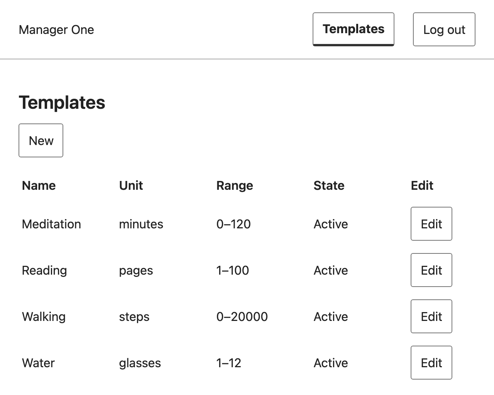<figcaption>Figure 1. F-03 (AC-03.1, FR-05): Manager; steps: New, name Meditation, unit minutes, minimum 0, maximum 120, Save; expected: 201 and the new template is listed as Active; actual: Meditation 0 to 120 minutes is listed.</figcaption></figure>


<figure>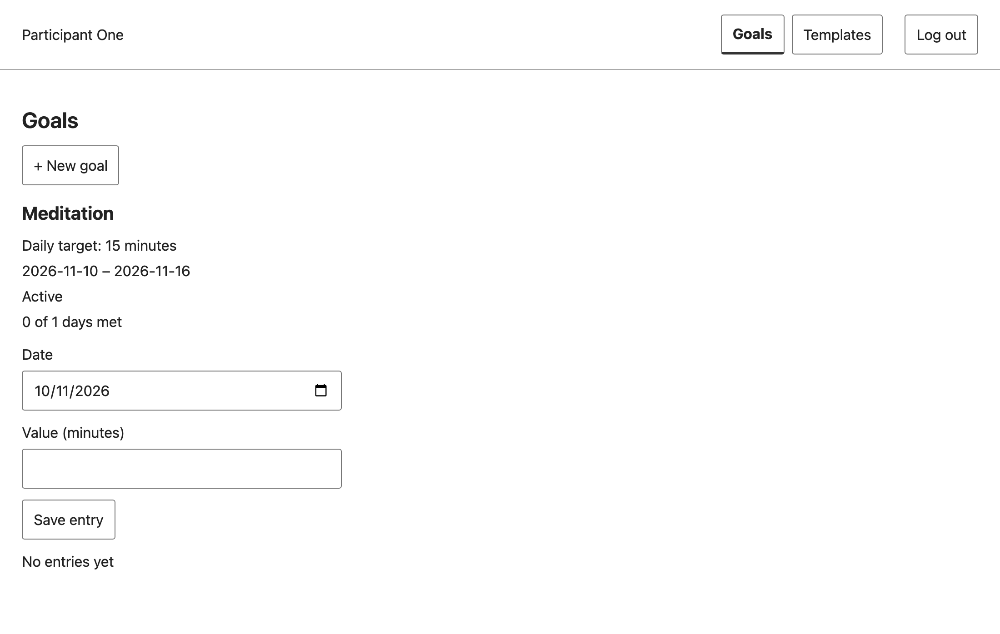<figcaption>Figure 2. F-07, F-09 (AC-07.1, AC-09.7): Participant; goal just saved, no entry yet; expected: the goal is listed with its target, dates, state Active and "0 of 1 days met" (today counts as a day so far); actual: as expected, "No entries yet".</figcaption></figure>

<figure>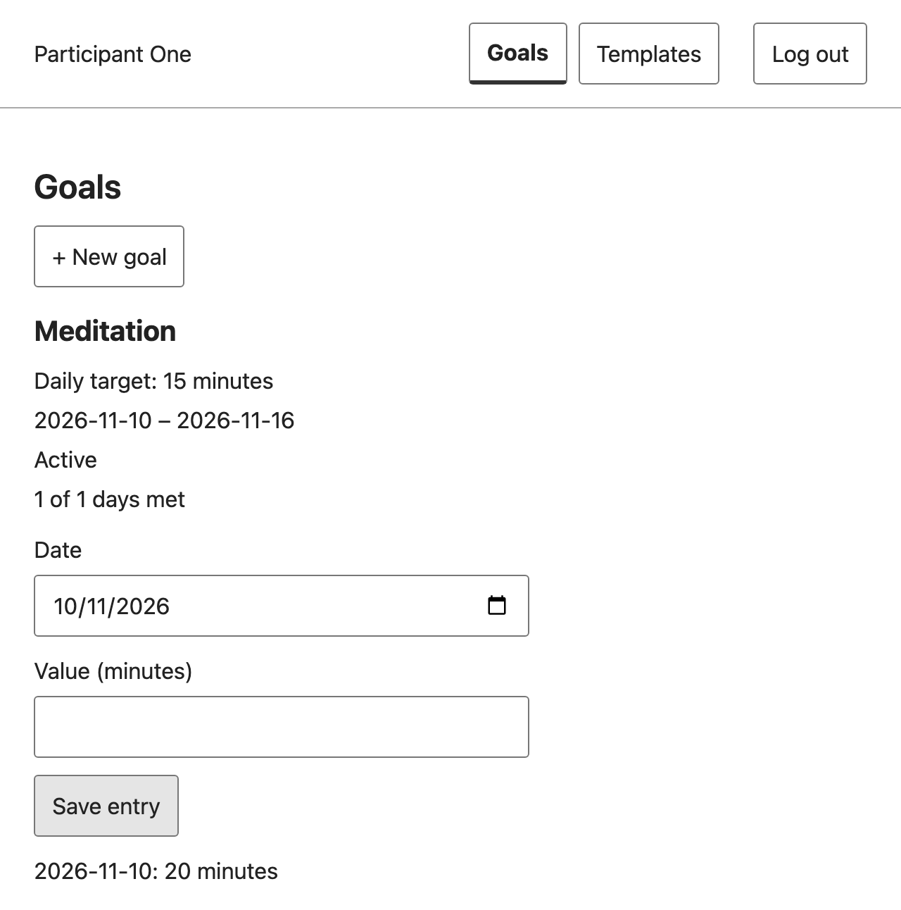<figcaption>Figure 3. F-08, F-09 (AC-08.1, AC-09.1, AC-09.6): Participant; goal of Figure 2; steps: value 20 for today (2026-11-10), Save entry; expected: 201, entry listed with its unit, progress rises to "1 of 1 days met" because 20 ≥ 15; actual: as expected.</figcaption></figure>

<figure>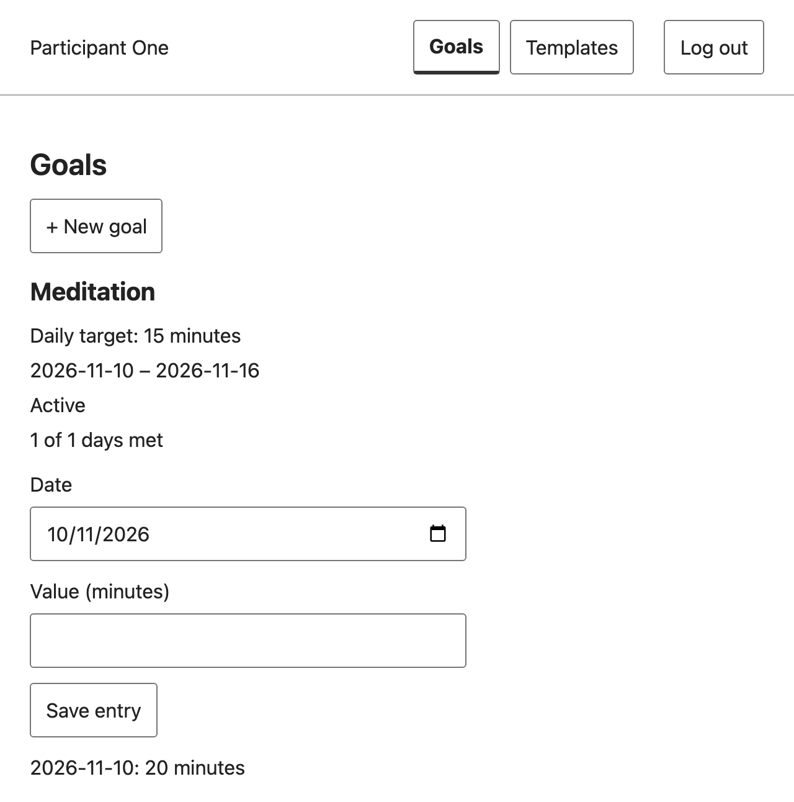<figcaption>Figure 4. F-08, F-09 (AC-08.1, AC-09.6): Participant; the app process was stopped and started again (new process, new database connection), then the page reloaded; expected: goal, entry and progress are read back from PostgreSQL; actual: "1 of 1 days met" and "2026-11-10: 20 minutes" are shown.</figcaption></figure>

### Scenario 2: business-rule rejections


<figure>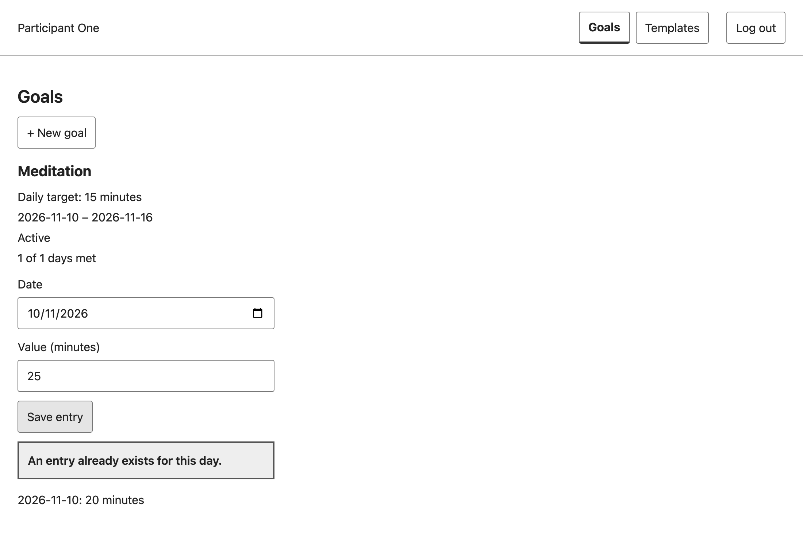<figcaption>Figure 5. F-08, BR-04 (AC-08.7, AC-08.10): Participant; an entry for 2026-11-10 already exists (Figure 3); steps: value 25 for the same day, Save entry; expected: 409 ENTRY_ALREADY_EXISTS, the stored entry stays 20; actual: "An entry already exists for this day.", the list still shows 20 minutes, the typed 25 is kept.</figcaption></figure>

In the same run, a value of 500 dated 2026-11-09 (before the goal starts) was refused with "The date must be inside the goal start and end dates." (BR-01, AC-08.3); the date check runs before the value range check, as the F-08 contract orders them.

### Scenario 3: login, logout and forbidden operations

<figure>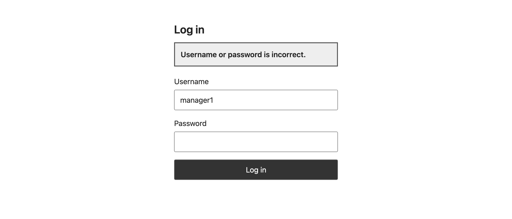<figcaption>Figure 6. F-01 (AC-01.2, AC-01.10): anonymous; steps: username manager1 with a wrong password, Log in; expected: one generic error, username kept, password cleared, no session; actual: "Username or password is incorrect.", username kept, password empty.</figcaption></figure>

<figure>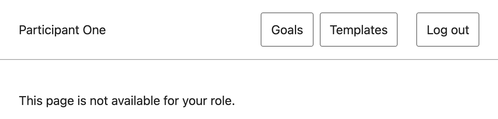<figcaption>Figure 7. F-02, BR-09: Participant participant1; logged in; steps: open the Manager-only address /templates/new; expected: the page is not offered to the role; actual: "This page is not available for your role." The screen alone proves nothing about the backend; the API refusals are in the listing below and in the TC-18 excerpt in F.4.</figcaption></figure>

<figure>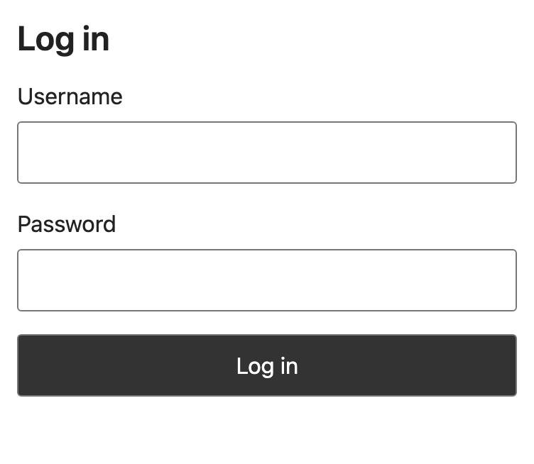<figcaption>Figure 8. F-01 (AC-01.4, AC-02.5): Participant participant1; logged in on /goals; steps: Log out, then open /goals again; expected: the session row is deleted and the login screen is shown; actual: the browser is sent to /login. The old cookie gets 401 (listing below).</figcaption></figure>

<figure>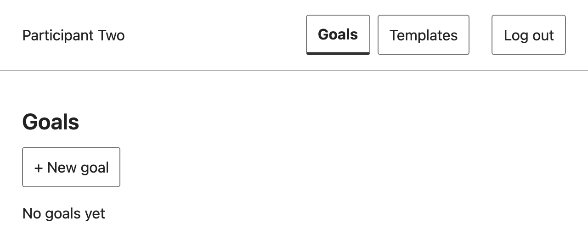<figcaption>Figure 9. F-10 (AC-10.7, BR-10): Participant participant2; participant1 owns the Meditation goal; steps: log in as participant2; expected: participant1's goal, entry and progress are not shown; actual: "No goals yet".</figcaption></figure>

### Backend evidence for the protected operations

Same run, right after Figure 9. The requests used the real session cookies of the browser run (`participant2`, a new `manager1` login, and the two cookies that were logged out). Cookie values are not printed. Goal 1 is participant1's Meditation goal; template 4 is Meditation.

```text
Who                                     | Request                            -> Status and body
anonymous                               | GET /api/goals                     -> 401 UNAUTHENTICATED "Please log in."
participant2 (Participant)              | POST /api/templates                -> 403 FORBIDDEN       (AC-06.3, BR-09)
participant2 (Participant)              | PATCH /api/templates/4             -> 403 FORBIDDEN       (AC-04.7, BR-09)
participant2 (Participant)              | GET /api/goals/1/entries           -> 404 GOAL_NOT_FOUND  (AC-10.1, BR-10)
participant2 (Participant)              | POST /api/goals/1/entries          -> 404 GOAL_NOT_FOUND  (AC-10.2)
participant2 (Participant)              | GET /api/goals/99999/entries       -> 404 GOAL_NOT_FOUND  (same answer, AC-10.5)
manager1 (Manager)                      | GET /api/goals                     -> 403 FORBIDDEN       (AC-10.3, AC-09.8)
manager1 (Manager)                      | GET /api/goals/1/entries           -> 403 FORBIDDEN       (AC-10.4)
manager1 after logout (old cookie)      | GET /api/templates                 -> 401 UNAUTHENTICATED (AC-01.4)
participant1 after logout (old cookie)  | GET /api/auth/me                   -> 401 UNAUTHENTICATED (AC-01.4, AC-01.6)
```

Each body has the shape `{"error":{"code":"…","message":"…"}}`; for example the 403 body is `{"error":{"code":"FORBIDDEN","message":"You do not have permission to do this."}}`. The automated tests for the same rules are TC-08, TC-17, TC-18, TC-33, TC-34 and TC-57 (F.3).

## F.3 Build and automated test results {#f-3}

### Commands and counts

All on 2026-11-10, tree `e1ee5dd` (= `v1.0`, commit `64831f7`), fresh PostgreSQL 16.15 databases, Playwright 1.65.0 with its downloaded Chromium.

| Step | Command | Result |
|---|---|---|
| Client install and build | `client/`: `npm ci`, `npm run build` | exit 0; Vite built `dist/index.html` and 2 assets |
| Server install and build | `server/`: `npm ci`, `npm run prisma:generate`, `npm run build` | exit 0 |
| Test database | `DATABASE_URL=<test db> npm run prisma:migrate` | 4 migrations applied |
| Server suite (unit and API, real PostgreSQL) | `server/`: `npm test` | **79 tests: 79 passed, 0 failed, 0 skipped, 0 cancelled**; exit 0 |
| Browser suite, run 1 | `client/`: `npx playwright test` | **44 tests (22 at 375 px and 22 at 1280 px): 43 passed, 1 failed, 0 skipped**; exit 1 |
| Browser rerun of the failed file | `client/`: `npx playwright test test/goals.spec.js --repeat-each=3` | 18 passed, 0 failed |
| Browser suite, run 2 | `client/`: `npx playwright test` | **44 passed, 0 failed, 0 skipped**; exit 0 |
| Rule coverage (TC-51) | `server/`: `node --experimental-test-coverage --test --test-concurrency=1 test/*.test.js` | 79 passed; `entry-rules.js`, `goal-rules.js`, `progress-rules.js` 100% lines, branches and functions; `template.js` 96.85% lines; all files 98.02% lines |

The one failure in run 1 was `goals.spec.js` "TC-47 / TC-48: goals screens fit and keyboard alone opens, submits and cancels form" at 1280 px:

```text
✘ 33 [1280px] › test/goals.spec.js:82:1 › TC-47 / TC-48: goals screens fit and keyboard alone opens, submits and cancels form (5.5s)
  Error: expect(locator).toBeFocused() failed
  > 112 |   await expect(page.getByRole('button', { name: 'Save', exact: true })).toBeFocused();
  1 failed
  43 passed (1.3m)
```

It passed in all 8 later runs of that test (6 in the rerun, 2 in run 2). The same test fails on Windows at both widths, which is a known limitation recorded before the release (README; PR #43). The macOS failure is intermittent; its cause was not investigated for this report.

End of the server run and of browser run 2:

```text
ℹ tests 79
ℹ suites 0
ℹ pass 79
ℹ fail 0
ℹ cancelled 0
ℹ skipped 0
ℹ todo 0
ℹ duration_ms 16393.83375

  ✓  44 [1280px] › test/templates.spec.js:249:1 › TC-47 / TC-48: the edit form fits both widths and the keyboard alone opens, saves and cancels it (1.1s)
  44 passed (1.5m)
```

### Acceptance criteria to test results

Every Sprint 1 AC from Part E with its planned test (STS), the actual test files and test labels, and the result in the runs above. "Automated" tests ran in the suites above. AC-SYS.3 is a manual check and was not run. AC-SYS.4 and AC-SYS.5 are command checks. A count such as "pass (6/6)" is the number of actual tests listed in that row.

| AC | Planned test | Actual test (file and test label) | Kind | Result |
|---|---|---|---|---|
| AC-01.1 | TC-01, TC-46 | `auth.test.js` TC-01 / TC-46; `session.test.js` TC-46 | automated API/unit | pass (2/2) |
| AC-01.2 | TC-02 | `auth.test.js` TC-02; `auth.test.js` TC-02 regression | automated API/unit | pass (2/2) |
| AC-01.3 | TC-62 | `auth.test.js` TC-62; `auth.test.js` TC-62 regression | automated API/unit | pass (2/2) |
| AC-01.4 | TC-03 | `auth.test.js` TC-03 | automated API/unit | pass (1/1) |
| AC-01.5 | TC-04 | `auth.test.js` TC-04; `auth.test.js` TC-04 regression | automated API/unit | pass (2/2) |
| AC-01.6 | TC-05 | `auth.test.js` TC-05 | automated API/unit | pass (1/1) |
| AC-01.7 | TC-06, TC-63 | `auth.test.js` TC-06; `session.test.js` TC-63 | automated API/unit | pass (2/2) |
| AC-01.8 | TC-44, TC-45 | `auth.test.js` TC-44 / TC-45 | automated API/unit | pass (1/1) |
| AC-01.9 | TC-64 | `auth.test.js` TC-64 | automated API/unit | pass (1/1) |
| AC-01.10 | TC-65 | `auth.spec.js` TC-65 | automated browser | pass (1/1) |
| AC-02.1 | TC-07 | `auth.spec.js` TC-07 | automated browser | pass (1/1) |
| AC-02.2 | TC-08 | `auth.test.js` TC-08; `auth.test.js` TC-08 regression; `entry.test.js` TC-56 / TC-08; `goal.test.js` TC-53 / TC-08 | automated API/unit | pass (6/6) |
| AC-02.3 | TC-66 | `auth.test.js` TC-66 | automated API/unit | pass (1/1) |
| AC-02.4 | TC-66 | `auth.test.js` TC-66 | automated API/unit | pass (1/1) |
| AC-02.5 | TC-67 | `auth.spec.js` TC-67 | automated browser | pass (1/1) |
| AC-03.1 | TC-09 | `template.test.js` TC-09 | automated API/unit | pass (1/1) |
| AC-03.2 | TC-10 | `template.test.js` TC-10 | automated API/unit | pass (2/2) |
| AC-03.3 | TC-68 | `template.test.js` TC-68 | automated API/unit | pass (1/1) |
| AC-03.4 | TC-69 | `template.test.js` TC-69 | automated API/unit | pass (1/1) |
| AC-03.5 | TC-68 | `template.test.js` TC-68 | automated API/unit | pass (1/1) |
| AC-03.6 | TC-11 | `templates.spec.js` TC-11 | automated browser | pass (1/1) |
| AC-03.7 | TC-70 | `templates.spec.js` TC-70 | automated browser | pass (1/1) |
| AC-04.1 | TC-12 | `template-edit.test.js` TC-12 | automated API/unit | pass (1/1) |
| AC-04.2 | TC-13 | `template-edit.test.js` TC-13; `template-edit.test.js` TC-13 race (a); `template-edit.test.js` TC-13 race (b) | automated API/unit | pass (3/3) |
| AC-04.3 | TC-72 | `template-edit.test.js` TC-72 | automated API/unit | pass (2/2) |
| AC-04.4 | TC-71 | `template-edit.test.js` TC-71 | automated API/unit | pass (1/1) |
| AC-04.5 | TC-13 | `template-edit.test.js` TC-13; `template-edit.test.js` TC-13 race (a); `template-edit.test.js` TC-13 race (b) | automated API/unit | pass (3/3) |
| AC-04.6 | TC-73 | `templates.spec.js` TC-73 | automated browser | pass (1/1) |
| AC-04.7 | TC-18 | `template-edit.test.js` TC-18 | automated API/unit | pass (1/1) |
| AC-06.1 | TC-16 | `template.test.js` TC-16 / TC-17; `templates.spec.js` TC-16 | automated API/unit + browser | pass (2/2) |
| AC-06.2 | TC-16 | `template.test.js` TC-16 / TC-17; `templates.spec.js` TC-16 | automated API/unit + browser | pass (2/2) |
| AC-06.3 | TC-17 | `template.test.js` TC-16 / TC-17 | automated API/unit | pass (1/1) |
| AC-07.1 | TC-20 | `goal.test.js` TC-20 | automated API/unit | pass (1/1) |
| AC-07.2 | TC-20, TC-55 | `goal.test.js` TC-20; `goal.test.js` TC-55 | automated API/unit | pass (2/2) |
| AC-07.3 | TC-21 | `goal.test.js` TC-21 | automated API/unit | pass (1/1) |
| AC-07.4 | TC-55 | `goal.test.js` TC-55 | automated API/unit | pass (1/1) |
| AC-07.5 | TC-22 | `goal.test.js` TC-22 | automated API/unit | pass (1/1) |
| AC-07.6 | TC-53, TC-54 | `goal.test.js` TC-53 / TC-08; `goal.test.js` TC-54 | automated API/unit | pass (2/2) |
| AC-07.7 | TC-54 | `goal.test.js` TC-54 | automated API/unit | pass (1/1) |
| AC-07.8 | TC-53 | `goal.test.js` TC-53 / TC-08 | automated API/unit | pass (1/1) |
| AC-07.9 | TC-60 | `goals.spec.js` TC-60 | automated browser | pass (1/1) |
| AC-07.10 | TC-74 | `goal.test.js` TC-74 | automated API/unit | pass (1/1) |
| AC-08.1 | TC-23, TC-58 | `entry.test.js` TC-23; `entries.spec.js` TC-23 / TC-61; `entry.test.js` TC-58; `entries.spec.js` TC-27 / AC-08.12 | automated API/unit + browser | pass (4/4) |
| AC-08.2 | TC-24 | `entry-rules.test.js` TC-24 / TC-25 / TC-26; `entry.test.js` TC-24 | automated API/unit | pass (2/2) |
| AC-08.3 | TC-25, TC-30 | `entry-rules.test.js` TC-24 / TC-25 / TC-26; `entry.test.js` TC-25 / TC-30 | automated API/unit | pass (2/2) |
| AC-08.4 | TC-26 | `entry-rules.test.js` TC-24 / TC-25 / TC-26; `entry.test.js` TC-26 | automated API/unit | pass (2/2) |
| AC-08.5 | TC-27 | `entry-rules.test.js` TC-27; `entries.spec.js` TC-27 / AC-08.12 | automated API/unit + browser | pass (2/2) |
| AC-08.6 | TC-28 | `entry-rules.test.js` TC-28; `entry.test.js` TC-28 | automated API/unit | pass (2/2) |
| AC-08.7 | TC-29 | `entry.test.js` TC-29 | automated API/unit | pass (1/1) |
| AC-08.8 | TC-56 | `entry-rules.test.js` TC-56; `entry.test.js` TC-56 / TC-08 | automated API/unit | pass (2/2) |
| AC-08.9 | TC-56 | `entry-rules.test.js` TC-56; `entry.test.js` TC-56 / TC-08 | automated API/unit | pass (2/2) |
| AC-08.10 | TC-61 | `entries.spec.js` TC-23 / TC-61 | automated browser | pass (1/1) |
| AC-08.11 | TC-30 | `entry.test.js` TC-25 / TC-30 | automated API/unit | pass (1/1) |
| AC-08.12 | TC-27 | `entry-rules.test.js` TC-27; `entries.spec.js` TC-27 / AC-08.12 | automated API/unit + browser | pass (2/2) |
| AC-09.1 | TC-31 | `progress-rules.test.js` TC-31; `progress.test.js` TC-31 / AC-09.1 to AC-09.3 over the API; `progress.test.js` AC-09.1 to AC-09.3 | automated API/unit | pass (6/6) |
| AC-09.2 | TC-31 | `progress-rules.test.js` TC-31; `progress.test.js` TC-31 / AC-09.1 to AC-09.3 over the API | automated API/unit | pass (5/5) |
| AC-09.3 | TC-31 | `progress-rules.test.js` TC-31; `progress.test.js` TC-31 / AC-09.1 to AC-09.3 over the API; `progress.test.js` AC-09.1 to AC-09.3 | automated API/unit | pass (6/6) |
| AC-09.4 | TC-31 | `progress-rules.test.js` TC-31; `progress.test.js` TC-31 / AC-09.1 to AC-09.3 over the API; `progress.test.js` AC-09.4 / AC-09.5 over the API | automated API/unit | pass (6/6) |
| AC-09.5 | TC-31 | `progress-rules.test.js` TC-31; `progress.test.js` TC-31 / AC-09.1 to AC-09.3 over the API; `progress.test.js` AC-09.4 / AC-09.5 over the API | automated API/unit | pass (6/6) |
| AC-09.6 | TC-59 | `progress.test.js` TC-59 / AC-09.8; `progress.spec.js` TC-59; `progress.test.js` AC-09.6 | automated API/unit + browser | pass (3/3) |
| AC-09.7 | TC-32, TC-59 | `progress.spec.js` TC-32; `progress.test.js` TC-59 / AC-09.8; `progress.spec.js` TC-59 | automated browser + API/unit | pass (3/3) |
| AC-09.8 | TC-59 | `progress.test.js` TC-59 / AC-09.8; `progress.spec.js` TC-59 | automated API/unit + browser | pass (2/2) |
| AC-10.1 | TC-33 | `privacy.test.js` TC-33 | automated API/unit | pass (1/1) |
| AC-10.2 | TC-33 | `privacy.test.js` TC-33 | automated API/unit | pass (1/1) |
| AC-10.3 | TC-34 | `privacy.test.js` TC-34 | automated API/unit | pass (1/1) |
| AC-10.4 | TC-34 | `privacy.test.js` TC-34 | automated API/unit | pass (1/1) |
| AC-10.5 | TC-57 | `privacy.test.js` TC-57 | automated API/unit | pass (1/1) |
| AC-10.6 | TC-33 | `privacy.test.js` TC-33 | automated API/unit | pass (1/1) |
| AC-10.7 | TC-35 | `privacy.test.js` TC-35 (API part); `progress.spec.js` TC-35 (browser part) | automated API/unit + browser | pass (2/2) |
| AC-SYS.1 | TC-47 | `auth.spec.js` TC-47 / TC-48; `entries.spec.js` TC-47 / TC-48; `goals.spec.js` TC-47 / TC-48; `templates.spec.js` TC-47 / TC-48 | automated browser | pass (5/5); goals TC-47/48 failed once at 1280 px in run 1 |
| AC-SYS.2 | TC-48 | `auth.spec.js` TC-47 / TC-48; `entries.spec.js` TC-47 / TC-48; `goals.spec.js` TC-47 / TC-48; `templates.spec.js` TC-47 / TC-48 | automated browser | pass (5/5); goals TC-47/48 failed once at 1280 px in run 1 |
| AC-SYS.3 | TC-50 | manual, timed clean clone | manual | Not run in Sprint 1 (timed run is in Lab 5, OP-S.2). The README commands were followed on an existing clone for this report (Part F, setup). |
| AC-SYS.4 | TC-51 | coverage report | command | Measured: `node --experimental-test-coverage` over the whole server suite: entry-rules.js, goal-rules.js and progress-rules.js 100% lines; template.js 96.85% lines. A unit-only run and a per-BR check were not made. |
| AC-SYS.5 | TC-52 | local run (CI from Lab 5) | command | Server suite exit 0 (79/79). Client suite run 1: 43 passed, 1 failed; run 2: 44 passed, exit 0. |

## F.4 Test excerpts and red/green history {#f-4}

Both excerpts were rerun for this report on the exact commits named below, each exported with `git archive`, installed with `npm ci`, and run against its own freshly migrated PostgreSQL database.

### Excerpt 1: domain rule, one entry per goal and day (BR-04, AC-08.7, TC-29)

`server/test/entry.test.js` at `v1.0`. Setup in the same file: `goalFor(a, template, -9, 20)` creates participant A's goal from 9 days ago to 20 days ahead in the database; `post(goal, data)` sends `POST /api/goals/:id/entries` with A's session cookie; `day(0)` is today in Asia/Bangkok.

```js
test('TC-29: a second entry for the same day is 409, also for two requests at once; the first value stays', async () => {
  const goal = await goalFor(a, template, -9, 20);
  await post(goal, { entryDate: day(0), value: 3 }).expect(201);
  const again = await post(goal, { entryDate: day(0), value: 9 });
  assert.equal(again.status, 409); assert.equal(again.body.error.code, 'ENTRY_ALREADY_EXISTS');
  const row = await db.entry.findFirstOrThrow({ where: { goalId: goal.id } });
  assert.equal(Number(row.value), 3);
  const responses = await Promise.all([post(goal, { entryDate: day(-1), value: 4 }), post(goal, { entryDate: day(-1), value: 5 })]);
  assert.deepEqual(responses.map(r => r.status).sort(), [201, 409]);
  assert.equal(await db.entry.count({ where: { goalId: goal.id } }), 2);
});
```

| Version | Commit | Command | Result |
|---|---|---|---|
| Red: tests before the code | `d43f160` "test: add failing Entry API, rule and migration tests (F-08)", 2026-11-09 01:01 +07 | `node --test --test-concurrency=1 --test-name-pattern=TC-29 test/entry.test.js` | **1 failed**: `TypeError: Cannot read properties of undefined (reading 'deleteMany')`. The `Entry` model did not exist yet, so the test stops in its setup |
| Green: implementation | `7d2979b` "feat: add daily entry recording (F-08)", 2026-11-09 01:04 +07 | same | **1 passed** |
| Release | `64831f7` (`v1.0`) | `npm test` | passed (F.3) |

The red run fails because the feature is absent, not on the 409 assertion itself. The recorded red run of the whole F-08 test set at `d43f160` was 0 of 11 passing (`docs/entry-implementation-evidence.md`), and the reviewer reproduced it (PR #43 review, F.5).

### Excerpt 2: role restriction, a Participant cannot edit a template (BR-09, AC-04.7, TC-18)

`server/test/template-edit.test.js` at `v1.0`. Setup in the same file: before each test the database is emptied, a Manager and a Participant are created with real session rows, and `cookies.a` is the Participant's cookie; `patch(id, body, cookie)` sends `PATCH /api/templates/:id`; `stored(id)` reads the template row back from the database.

```js
test('TC-18: a participant edit is forbidden for an existing and an unknown id, and nothing changes', async () => {
  const sleep = await template({ name: 'Sleep', unit: 'hours', minValue: 0, maxValue: 24 });
  for (const [id, body] of [[sleep.id, { maxValue: 12 }], [99999, { unit: 'x' }], ['abc', {}]]) {
    const response = await patch(id, body, cookies.a);
    assert.equal(response.status, 403, String(id));
    assert.deepEqual(response.body, error('FORBIDDEN', 'You do not have permission to do this.'));
  }
  assert.equal((await stored(sleep.id)).maxValue, 24);
});
```

| Version | Commit | Command | Result |
|---|---|---|---|
| Red: tests before the code | `e4fe33d` "test: add failing template edit tests (F-04: …)", 2026-11-10 02:03 +07 | `node --test --test-concurrency=1 --test-name-pattern=TC-18 test/template-edit.test.js` | **1 failed**: `AssertionError: 404 !== 403` at line 202. Without the route the API answered 404 instead of refusing the role |
| Green: implementation | `3d1ccbb` "feat: add template edit with in-use refusal and template row lock (F-04)", 2026-11-10 02:04 +07 | same | **1 passed** |
| Release | `64831f7` (`v1.0`) | `npm test` | passed (F.3) |

## F.5 Engineering workflow and history {#f-5}

### Two Issue → PR chains

| | Chain 1: daily entry | Chain 2: template edit |
|---|---|---|
| Issue | #42 "[Feature] Daily entry recording (F-08)", opened and assigned to projectnewy | #53 "[Feature] Template edit (F-04)", opened and assigned to phittayanan |
| Feature and contract IDs | F-08; FR-11; BR-01 to BR-04, BR-06; AC-08.1 to AC-08.12; TC-23 to TC-30, TC-56, TC-58, TC-61 | F-04; FR-07, FR-23; BR-08 (edit), BR-09; AC-04.1 to AC-04.7; TC-12, TC-13, TC-18, TC-71 to TC-73 |
| Contract PR | PR #29 (branch `docs/28-contracts-goal-entry-progress`), revised by PR #39 (`docs/38-revise-f07-f08-contracts`) | PR #31 (branch `docs/30-habit-auth-template-contracts`) |
| Build branch | `feat/42-daily-entry` (from `staging`) | `feat/53-habit-template-edit` (from `staging`) |
| Build PR | https://github.com/phittayanan/habit-tracker/pull/43 | https://github.com/phittayanan/habit-tracker/pull/54 |
| Author → reviewer | projectnewy → phittayanan | phittayanan → projectnewy |
| Review | Round 1 "changes requested" (2026-11-09 06:28 +07): ownership-before-validation not tested; TC-27 tested a helper the app never calls. Round 2 approved (2026-11-10 00:03 +07) after checking each fix by breaking the code (Figure 10) | Review comment (2026-11-10 12:06 +07): check order, row lock, stripped fields, Windows run 79/79 server, mutations that make TC-13 fail, OP-04.9 decision; approval 12:07 +07 |
| Into `staging` | merge commit `a5a9266`, 2026-11-10 00:08 +07, merged by phittayanan | merge commit `54ac16e`, 2026-11-10 12:07 +07, merged by projectnewy |
| Into `main` | release PR #61, merge `64831f7`, tag `v1.0` | release PR #61, merge `64831f7`, tag `v1.0` |
| Board | Issue #42 Done | Issue #53 Done |

<figure>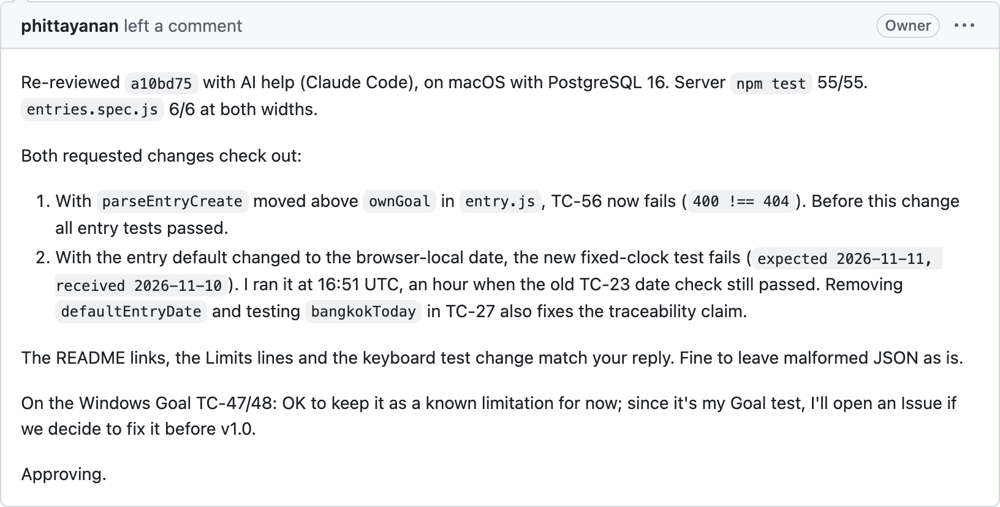<figcaption>Figure 10. PR #43 (F-08), phittayanan's approving re-review: each requested change was checked by moving the code back and watching the test fail. Public page, captured logged out on 2026-11-10.</figcaption></figure>


<figure>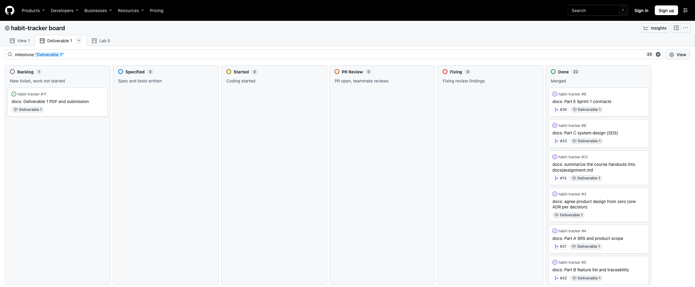<figcaption>Figure 11. Project board "habit-tracker board", view "Deliverable 1" (filter milestone "Deliverable 1", 23 items), captured logged out on 2026-11-10 after the release: Done 22, Backlog 1 (Issue #11, this PDF and its submission). The Done column continues below the visible part.</figcaption></figure>

### History sequence: contract and tests before implementation

Commit dates are author dates (+07). "Merged" is when the PR reached `staging`.

| When | Commit or PR | Step | F-08 | F-04 |
|---|---|---|---|---|
| 2026-11-07 04:00 | `db9efae` | Contract written | F-08 contract (with F-07, F-09, F-10) | |
| 2026-11-07 04:14 | `b5304f0` | Contract review fixes (PR #29) | F-08 | |
| 2026-11-07 04:17 | PR #29 merged (`9d5e3cc`) | Contract approved | F-08 | |
| 2026-11-07 04:32 | `06e536b` | Contract written | | F-04 contract (with F-03, F-06) |
| 2026-11-07 05:02 | `5e5c174` | Contract review fixes (PR #31) | | F-04 |
| 2026-11-07 05:04 | PR #31 merged (`1c72dbf`) | Contract approved | | F-04 |
| 2026-11-08 17:54 | `f2114c4` | Contract revision before build (decimals, template lock) | F-08 | |
| 2026-11-08 23:02 | PR #39 merged (`e16289c`) | Revision approved | F-08 | |
| 2026-11-09 01:01 | `d43f160` | Failing tests (red) | F-08 | |
| 2026-11-09 01:04 | `7d2979b` | Implementation (green) | F-08 | |
| 2026-11-09 22:59 | `a10bd75` | Review fixes (tests) | F-08 | |
| 2026-11-10 00:08 | PR #43 merged (`a5a9266`) | Into `staging` | F-08 | |
| 2026-11-10 02:00 | `14475ba` | Contract update for the build (row lock, race test) | | F-04 |
| 2026-11-10 02:03 | `e4fe33d` | Failing tests (red) | | F-04 |
| 2026-11-10 02:04 | `3d1ccbb` | Implementation (green) | | F-04 |
| 2026-11-10 12:07 | PR #54 merged (`54ac16e`) | Into `staging` | | F-04 |
| 2026-11-10 13:31 | PR #61 merged (`64831f7`) | Release into `main`; tag `v1.0` at 13:35 | F-08 | F-04 |

The commits on the F-08 branch carry the git author name PhutWeb; the PR that holds them, #43, is projectnewy's.

## F.6 Contributions, AI use and known limitations {#f-6}

### Contribution table

By part, from the PR authors and reviewers recorded on GitHub (merged PRs into `staging` and the release PR into `main`).

| Part | Phittayanan Tiencharoen (phittayanan) | Phuttipong Phankitnirundorn (projectnewy) | Together |
|---|---|---|---|
| A. SRS and product scope | Authored #20 (ADRs), #21 (SRS), #25 (SRS alignment) | Reviewed and merged #20, #21, #25 | Agreed the product design on Issue #3 (ADRs 0001-0051), which Parts A-E build on; each reviewed and merged the other's PRs |
| B. Feature inventory and traceability | Authored #22 (features and traceability), #25 (features alignment) | Reviewed and merged #22, #25 | Agreed the product design on Issue #3 (ADRs 0001-0051), which Parts A-E build on; each reviewed and merged the other's PRs |
| C. System-Level SDS | Reviewed and merged #23 | Authored #23 (SDS) | Agreed the product design on Issue #3 (ADRs 0001-0051), which Parts A-E build on; each reviewed and merged the other's PRs |
| D. Three-sprint plan | Authored #26 (plan) | Reviewed and merged #26 | Agreed the product design on Issue #3 (ADRs 0001-0051), which Parts A-E build on; each reviewed and merged the other's PRs |
| E. Sprint 1 engineering contracts | Authored #31 (F-01 to F-04, F-06); reviewed and merged #29, #35, #39 | Authored #29 (F-07 to F-10), #35 (overview), #39 (revision); reviewed and merged #31 | Agreed the product design on Issue #3 (ADRs 0001-0051), which Parts A-E build on; each reviewed and merged the other's PRs |
| F. Working Sprint 1 and verification | Authored #34 (F-01, F-02), #37 (F-03, F-06), #41 (F-07), #54 (F-04), #61 (release); reviewed and merged #43, #51, #60 | Authored #43 (F-08), #51 (F-09, F-10), #60 (README setup); reviewed and merged #34, #37, #41, #54, #61 | Each reviewed and merged the other's PRs |

### AI-use declaration

Short form of `docs/ai-use.md` at `v1.0`; that file has one line per Issue.

| Tool | Tasks it assisted | What the students checked |
|---|---|---|
| Claude Code (Claude Sonnet 5.5) | Drafted `docs/assignment.md`, the design questions, the ADRs from the students' answers, the SRS, features, traceability, SDS, sprint plan, the nine contracts and the Part E overview; implemented F-08 (Issue #42), F-09 and F-10 tests (Issue #44) and F-04 (Issue #53) tests-first; README updates. Open points were listed for the students, not decided by the AI | Design decisions are the students' answers on Issue #3, recorded as ADRs; points the documents did not settle were left as open points. Each PR was reviewed by the other student before merge (F.5); in PRs #43, #51 and #54 the reviewer broke the code to see the tests fail. For several documentation Issues the human-check line in `docs/ai-use.md` still says pending |
| Codex (gpt-6.1-sol) | Implemented Auth F-01/F-02 (Issue #32) and Goal F-07 (Issue #40) tests-first | projectnewy reviewed PR #34 and PR #41 and requested fixes; phittayanan, the owner of both Issues, approved the behaviour and the UI package |
| Cursor (Grok 4.7) | Implemented template create and view F-03/F-06 (Issue #36) tests-first | projectnewy reviewed PR #37 (read the code; did not run the suites) |
| Claude Code (this PDF, Issue #11) | Assembled this PDF from the released documents, ran the build and tests, took the screenshots with a headless browser and wrote Part F | [human check of this PDF, to be recorded by the team before submission] |

No prompt transcripts are included. Automated results and AI statements do not count as review; the reviews are the PR texts shown in F.5.

### Known limitations, failed and skipped tests

- Failed and skipped tests: no skipped test. One browser failure in run 1 (Goal TC-47/48 at 1280 px, F.3), passing in all 8 later runs. On Windows the Goal TC-47/48 keyboard test fails at both widths (README, PR #43); no Issue was opened.
- Not run in Sprint 1: the timed clean-clone setup TC-50 (AC-SYS.3) is planned for Lab 5. CI on every PR (AC-SYS.5) starts in Lab 5; the suites were run locally. Docker and GCP deployment are Lab 5.
- Coverage (AC-SYS.4): the coverage above was measured over the whole server suite, not the unit tests alone, and no separate check per BR-01 to BR-07 was made.
- Features not in Sprint 1: template retire F-05 (FR-08) and the retire refusal TC-19 are Sprint 2. Entry edit and delete (FR-17) are Sprint 2, so a wrong same-day entry cannot be fixed yet (SRS A-11). The calendar, colours, streaks and reminders are Sprints 2 and 3.
- Security limits: no limit on failed logins (OP-01.11). An unknown username runs a cost-10 dummy bcrypt comparison (ADR 0051), but response times are not guaranteed to be identical.
- Open points: the open points listed in Parts A to E (A-x, T-x, S-x, O-x, OP-x) stay open where marked. Several contract revision rows still say "pending" because the files were not edited after their PR was approved (Part E, OP-S.4).
- Part F screenshots: taken on macOS with headless Chromium at 1100 × 700; the date box format follows the operating system.
