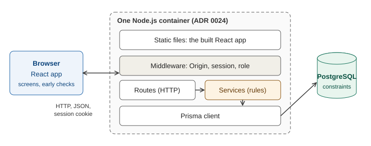
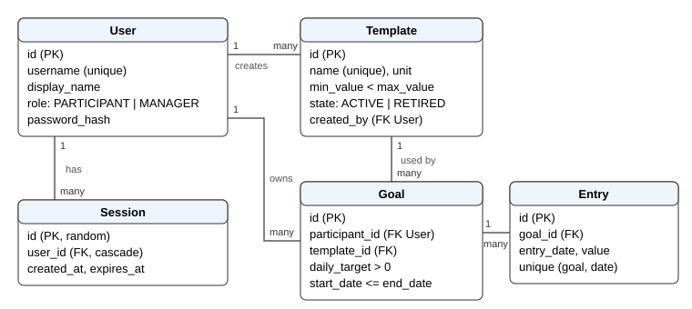

<!-- Deliverable 1 rewrite, Part C (Issue #11). New text; design facts checked against tag v1.0 (64831f7): server/src, server/prisma, client/src, README, .env.example. Design decisions S-1 to S-17 were answered by phittayanan in the review of PR #23. The full data model and the role matrix live only in this Part. -->

# Part C. System-level design (SDS) {#part-c}

This Part describes how the whole product is built: the stack and its parts, the data, the screens and the API, who may do what, how sign-in works, and how the app is configured and later deployed. Sprint 1 is described as built at `v1.0`; later sprints are marked as planned. Exact request and response shapes per feature are in the contracts of Part E.

## C.1 Architecture and stack {#c-1}

### Stack and why

| Layer | Technology |
|---|---|
| Browser app | React, built with Vite |
| API | Node.js with Express |
| Data access | Prisma |
| Database | PostgreSQL 16 |
| Tests | Node's built-in test runner for unit and API tests against a real PostgreSQL test database; Playwright for browser journeys (ADR 0035) |

The team kept the course starter kit's stack unchanged (ADR 0023), so the kit's Dockerfile, CI workflow and deploy script can be used in Lab 5 without rework. The API also serves the built browser app, so the product runs as one process in one container (ADR 0024).

### Components and how they communicate

| Component | Job | Talks to |
|---|---|---|
| Browser app | Screens and forms. Checks some inputs early for a quicker message, but holds no rule the server does not also enforce | The API, same origin, `fetch` to relative `/api/...` paths with the session cookie |
| Static file server (in the API process) | Serves `client/dist` and returns `index.html` for each app screen path | Browser |
| Middleware | Origin check on writes, session check, role check (C.6) | Routes |
| Routes | HTTP only: read the request, call a service, turn the result into a status and JSON | Services |
| Services | Ownership checks, input validation (zod), every business rule, transactions | PostgreSQL through Prisma |
| PostgreSQL | Durable storage and the last guard: unique, foreign-key and check constraints | API only |

During development Vite serves the browser app on its own port and forwards `/api` to the API on port 3000; the built app is served by the API itself.

### Where business rules are enforced

Every rule is enforced on the server, so a request that breaks a rule is refused whatever the browser shows (Group Work Specification §5.2). A request passes these steps in order:

1. **Origin check** on POST, PATCH, PUT and DELETE (C.6).
2. **Session check**: no valid session gives 401.
3. **Role check**: the wrong role gives 403.
4. **Validation and ownership** in the service: the input shape is checked with zod, and on entry routes the goal must belong to the session user (another Participant's goal gives 404). Entry routes check the owner first; goal and template routes validate first.
5. **Rule checks** in the service.
6. **Write** through Prisma; database constraints catch anything that slips past, including two requests at once.

The acting user always comes from the session. A user ID sent in the body is never read; validation drops unknown fields.

| Rule (Part A) | Enforced by | At `v1.0` |
|---|---|---|
| BR-01 | Entry service, against the goal's dates and the Bangkok "today" | Built |
| BR-02 | One server function computes "today" in Asia/Bangkok; dates are stored as `DATE` with no time part | Built |
| BR-03 | Entry service for the value range; template service and a database check (C.2) for the template's own range | Built |
| BR-04 | Database unique index on (goal, date), turned into 409 by the entry service | Built |
| BR-05 | Goal service inside a transaction that locks the template row (`SELECT … FOR UPDATE`), so two requests at once cannot both succeed | Built |
| BR-06 | Computed from the dates every time; no state column | Built |
| BR-07 | Computed from the entries every time; nothing stored | Built |
| BR-08 | Template service, inside a transaction that locks the template row, counts goals on the template before an edit | Edit built; retire in Sprint 2 |
| BR-09, BR-10 | Role check, then ownership check | Built |
| BR-11 to BR-15 | Services and computed values, the same way | Sprint 2 and 3 |

## C.2 Data design {#c-2}

### Tables

Table names are as Prisma writes them (`User`, `Session`, `Template`, `Goal`, `Entry`); column names are snake_case. Every number that a user enters is `DECIMAL(10,2)`: at most two decimal places, up to 99,999,999.99.

| Table | Column | Type | Constraint |
|---|---|---|---|
| User | `id` | integer | primary key |
| | `username` | text | unique |
| | `display_name` | text | not null |
| | `role` | `PARTICIPANT` or `MANAGER` | one role per account |
| | `password_hash` | text | bcrypt hash only |
| | `created_at` | timestamp | default now |
| Session | `id` | text, 32 random bytes | primary key; the only thing in the cookie |
| | `user_id` | → User | deleted with the user (cascade) |
| | `created_at`, `expires_at` | timestamp | `expires_at` = `created_at` + 8 hours |
| Template | `id` | integer | primary key |
| | `name` | text, 1–100 characters | unique |
| | `unit` | text, 1–30 characters | free text |
| | `min_value`, `max_value` | decimal | check `min_value < max_value` |
| | `state` | `ACTIVE` or `RETIRED` | default `ACTIVE`; nothing sets `RETIRED` until Sprint 2 |
| | `created_by` | → User | the Manager who made it |
| | `created_at` | timestamp | default now |
| Goal | `id` | integer | primary key |
| | `participant_id` | → User | set from the session |
| | `template_id` | → Template | |
| | `daily_target` | decimal | check `> 0`; "not above the template's highest value" is checked by the service |
| | `start_date`, `end_date` | date | check `end_date >= start_date` |
| | `created_at` | timestamp | default now |
| | | | index on (`participant_id`, `template_id`, `end_date`) |
| Entry | `id` | integer | primary key |
| | `goal_id` | → Goal | |
| | `entry_date` | date | |
| | `value` | decimal | range checked by the service |
| | `created_at` | timestamp | default now |
| | | | unique (`goal_id`, `entry_date`) |

Foreign keys other than Session's refuse to delete a row that is still referenced. A goal's state and progress are not columns; they are computed (BR-06, BR-07).

### Ownership

- A Goal belongs to one Participant through `participant_id`, and an Entry belongs to that Participant through its Goal. One check on the goal's owner therefore protects both (BR-10).
- A Template belongs to no Participant. Any Manager may edit any template, including one another Manager made; `created_by` is a record, not a right (design decision S-5).
- Nothing links a Manager to a Participant's goals or entries, so there is nothing to grant (ADR 0019).

### Migrations and seed data

- **Migrations** are Prisma migrations, applied with `prisma migrate deploy`. Sprint 1 has four, each committed with its feature: auth (User, Session), template, goal, entry. Migrations only add tables or columns, so an older build still runs against a newer database after a rollback.
- **Seed** (`npm run prisma:seed`) is safe to run again: it upserts by username and template name. It creates `manager1` (Manager), `participant1` and `participant2` (Participants; two are needed for the privacy tests). Their passwords come from the environment variables `SEED_MANAGER_PASSWORD` and `SEED_PARTICIPANT_PASSWORD`; the seed stops if either is missing. With `SEED_DEMO_DATA=true` it also adds three demo templates (Reading, Walking, Water). All data is synthetic.
- **Test database**: tests use a separate PostgreSQL database named by `TEST_DATABASE_URL` and refuse to run if it is missing or equals `DATABASE_URL`. Each test empties the tables and creates its own accounts with passwords made at run time; tests do not use the seed.

### Planned additions

| Sprint | Addition |
|---|---|
| 2 | Goal versions: each target change becomes a row with an effective-from date, so earlier days keep the old target (BR-12) |
| 2 | Entry edit and delete (BR-11) |
| 2 | Template retire sets `state` to `RETIRED`; goal creation must then refuse a retired template (BR-08) |
| 3 | Reminder time and weekdays per goal (BR-14) |
| 3 | Streaks, computed from entries and goal versions and never stored (BR-13) |

## C.3 Screens and shared UI behaviour {#c-3}

One layout for every role: a top bar with the user's name, the role's menu and a Log out button (ADR 0026). The Manager's menu is Templates; the Participant's menu is Goals and Templates. A role that opens another role's page sees "This page is not available for your role."; the API refuses the data anyway. Screens are plain, designed for desktop first and usable at 375 px (ADR 0038, ADR 0044).

| Screen | Path | Role | Sprint |
|---|---|---|---|
| Login | `/login` | everyone | 1 |
| Template table with New and Edit | `/templates` | Manager | 1 |
| New template, edit template | `/templates/new`, `/templates/:id/edit` | Manager | 1 |
| Active templates, read-only | `/templates` | Participant | 1 |
| Goals with progress, and a value box per goal | `/goals` | Participant | 1 |
| New goal | `/goals/new` | Participant | 1 |
| Month calendar with a side panel; Calendar / List switch | — | Participant | 2 |
| Retire action in the template table | — | Manager | 2 |
| Goal detail with best streak; reminder settings | — | Participant | 3 |

| UI state | Behaviour at `v1.0` |
|---|---|
| Loading | The button that sent the request is disabled until the API answers; its label changes to "Loading…", "Logging in…" or "Saving…" |
| Empty | A plain sentence: "No templates yet", "No goals yet", "No entries yet" |
| Validation and rule errors | The API's `message` is shown in an alert next to the form, and the typed input is kept (the login form clears only the password) |
| Session ended | Any 401 sends the user to the login screen |
| Server or network error | "Something went wrong. Please try again." with no technical detail |
| Keyboard | Every action works with the keyboard alone, with a visible focus outline (NFR-06) |

## C.4 API conventions {#c-4}

- **Style**: REST over JSON (ADR 0025). Paths start with `/api`; collections are plural nouns; an item is `/:id`; a child collection is nested, as in `/api/goals/:id/entries`.
- **Requests**: JSON bodies. Dates are `YYYY-MM-DD` strings meaning an Asia/Bangkok day; values are numbers with at most two decimal places.
- **Validation**: every body and path parameter is checked with zod before any rule runs. Unknown fields are dropped, never stored. A body that is not valid JSON gets 400.
- **Status codes**:

| Code | Meaning in this API |
|---|---|
| 200, 201, 204 | Success; 201 after a create; 204 after logout (no body) |
| 400 | The request itself is invalid: bad shape, or a date or value that breaks BR-01 or BR-03 |
| 401 | No valid session, or a failed login |
| 403 | Valid session, wrong role; or a write from a foreign origin |
| 404 | No such record, including another Participant's goal, so its existence is not revealed (design decision S-7) |
| 409 | The request conflicts with stored data: duplicate entry (BR-04), second active goal (BR-05), edit of a used template (BR-08), duplicate template name |
| 500 | Server fault |
| 503 | `/api/ready` only: the database does not answer |

- **Error body**: always `{ "error": { "code": "ENTRY_ALREADY_EXISTS", "message": "…" } }`. `code` is a stable name that tests check; `message` is plain language shown to the user. The codes per endpoint are in the contracts of Part E.
- **Safe errors**: no response carries a stack trace, SQL, file path, secret or another user's data. An unexpected fault returns `INTERNAL_ERROR` with a generic message. A failed login gives the same answer for an unknown username and a wrong password.
- **Health**: `GET /api/health` answers 200 while the process runs; `GET /api/ready` answers 200 when the database answers and 503 when it does not. Both are public, for the Lab 5 deployment checks.

## C.5 Roles and permissions {#c-5}

Two roles, one per account: Participant and Manager. "Anonymous" means no valid session. The API enforces every cell; hiding a menu item is never the protection. An automated route audit (TC-08) lists every route the server registers and fails if one is missing from this matrix or answers the wrong status.

| Operation | Endpoint | Anonymous | Participant | Manager | Records |
|---|---|---|---|---|---|
| Log in | `POST /api/auth/login` | allowed | allowed | allowed | own account |
| Log out | `POST /api/auth/logout` | 401 | allowed | allowed | own session |
| Who am I | `GET /api/auth/me` | 401 | allowed | allowed | own account |
| Health, readiness | `GET /api/health`, `GET /api/ready` | allowed | allowed | allowed | none |
| List templates | `GET /api/templates` | 401 | active only | all | all templates |
| Create a template | `POST /api/templates` | 401 | 403 | allowed | — |
| Edit a template | `PATCH /api/templates/:id` | 401 | 403 | allowed while no goal uses it | any template |
| List own goals with progress | `GET /api/goals` | 401 | own only | 403 | goals where `participant_id` = session user |
| Create a goal | `POST /api/goals` | 401 | allowed | 403 | owner = session user |
| List a goal's entries | `GET /api/goals/:id/entries` | 401 | own goal only; else 404 | 403 | entries of own goals |
| Record an entry | `POST /api/goals/:id/entries` | 401 | own goal only; else 404 | 403 | entries of own goals |
| Retire a template (Sprint 2) | planned | 401 | 403 | allowed | any template |
| Edit or delete an entry, change a goal's target, calendar and list views (Sprint 2) | planned | 401 | own only | 403 | own goals and entries |
| Goal detail, streaks, reminder (Sprint 3) | planned | 401 | own only | 403 | own goals |

A Participant asking for another Participant's goal gets 404; a Manager asking for any goal or entry gets 403, because the role check comes first.

## C.6 Authentication and sessions {#c-6}

**Credentials.** Accounts come only from the seed; there is no sign-up or password recovery (ADR 0004). Passwords are stored as bcrypt hashes at cost 10 with the `bcryptjs` library (ADR 0029).

**Login** (`POST /api/auth/login`, JSON body with username and password):

1. The server looks up the username. If it does not exist, it still compares the password against a fixed bcrypt hash of the same cost, so both failures take the same time (ADR 0051).
2. A wrong username or password gets 401 `INVALID_CREDENTIALS` with one shared message, and no session is made.
3. On success the server deletes the user's previous session, creates a Session row with 32 random bytes as its ID and an expiry 8 hours ahead, and sets the cookie.

**Cookie.** Named `sid`; HTTP-only, `SameSite=Lax`, path `/`, a lifetime of 8 hours, and `Secure` when `NODE_ENV=production`. It holds only the session ID.

**Each protected request.** The session middleware reads the cookie and loads the row. A missing row, or one whose `expires_at` has passed, gets 401; an expired row is deleted when it is found, so no clean-up job is needed. Use does not extend the 8 hours (ADR 0028).

**Current user.** `GET /api/auth/me` returns the session user's id, username, display name and role, never the password hash or the session ID.

**Logout.** `POST /api/auth/logout` deletes the Session row and clears the cookie; the old cookie value then gets 401 even if replayed.

**Cross-site requests.** Besides `SameSite=Lax` and JSON-only bodies, every POST, PATCH, PUT and DELETE is refused with 403 `ORIGIN_NOT_ALLOWED` when it carries an `Origin` header whose host differs from the request's `Host` (design decision S-12). This check runs before the session check. A request with no `Origin` header, such as one from a test tool, is not refused by this check.

**Why a database session.** A restart, a redeploy or a second instance does not log anyone out, and logout really ends the session (ADR 0027). Nothing about sessions lives in server memory.

## C.7 Configuration and deployment plan {#c-7}

### Environment variables

Every setting comes from the environment. `server/.env` is never committed; `server/.env.example` lists the names with fake values.

| Variable | Used for | Secret | Local | Planned on GCP (Lab 5) |
|---|---|---|---|---|
| `DATABASE_URL` | PostgreSQL connection for the app | yes | `server/.env` | Secret Manager |
| `TEST_DATABASE_URL` | Separate database for the tests | yes | `server/.env` | not used |
| `PORT` | Port to listen on (default 3000) | no | `server/.env` | set by Cloud Run |
| `NODE_ENV` | `production` turns on the `Secure` cookie flag | no | `server/.env` | Cloud Run setting |
| `SEED_MANAGER_PASSWORD`, `SEED_PARTICIPANT_PASSWORD` | Passwords given to the seeded accounts | yes | `server/.env` | Secret Manager |
| `SEED_DEMO_DATA` | `true` adds the demo templates | no | `server/.env` | Cloud Run setting |

The browser app needs no variable: it calls relative `/api` paths. The server listens on `PORT` on `0.0.0.0` and stops cleanly on `SIGTERM`, as Cloud Run expects.

### Secret handling

- No real secret goes into Git, the image, logs, screenshots or this report. `.gitignore` covers `.env` files, keys and service-account files.
- Seed passwords are shared privately between the students and the TA, never in the repository.
- On GCP, runtime secrets live in Secret Manager, and GitHub signs in to GCP with Workload Identity Federation rather than a key file.
- A leaked secret is changed at once and the app redeployed.

### Database configuration

Locally, the app uses a PostgreSQL 16 server reached through `DATABASE_URL`, and the tests a second database through `TEST_DATABASE_URL`. At `v1.0` the repository has no Docker or Compose file; the PostgreSQL server is installed by each student, and Docker arrives in Lab 5. On GCP the database is Cloud SQL for PostgreSQL 16 on the smallest tier, so data survives restarts and redeploys.

### Suitability for Docker and durable storage

The design already meets the course's cloud-readiness points: one process serves the API and the app; all data is in PostgreSQL and nothing on the container's disk; sessions are database rows; settings and secrets come from the environment; the port comes from `PORT`; `/api/ready` answers 503 without the database; the seed is safe to rerun; and there is no development shortcut such as picking a user without a password.

### Planned GCP deployment (Lab 5)

Decided in ADR 0030 to ADR 0033, following the course kit's defaults.

| Part | Plan |
|---|---|
| Image | One Docker image holding the API and the built browser app |
| Registry | Artifact Registry; images tagged with the commit SHA |
| Service | Cloud Run in `asia-southeast1`, 0 to 3 instances |
| Database | Cloud SQL for PostgreSQL 16, smallest tier |
| Migrations | A separate job runs `prisma migrate deploy` before the service is updated |
| Secrets | Secret Manager; Workload Identity Federation for GitHub |
| CI | GitHub Actions, one job `test-and-docker`, the required check before a merge |
| Release | Only `main` deploys; the reviewed release pull request is the gate, with no separate approval step |
| Rollback | Redeploy an earlier image; the database is not rolled back, which is why migrations only add |
| Ownership | phittayanan owns the GCP project; projectnewy is an Editor |
