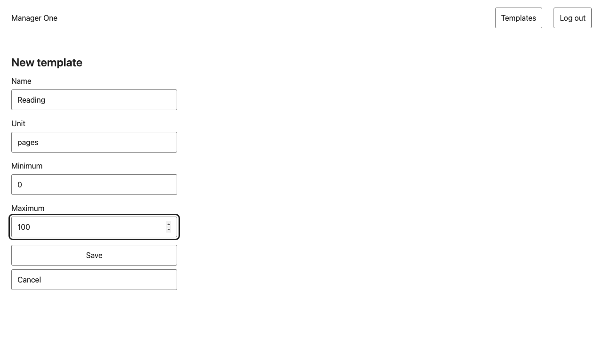
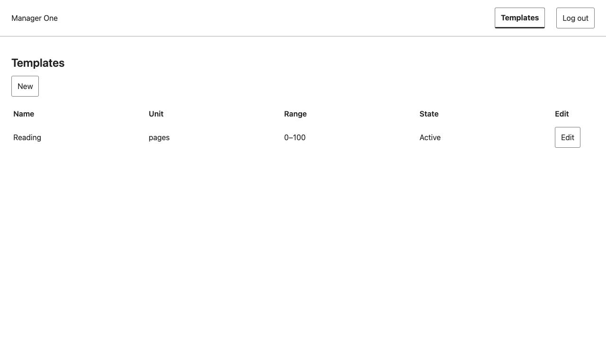
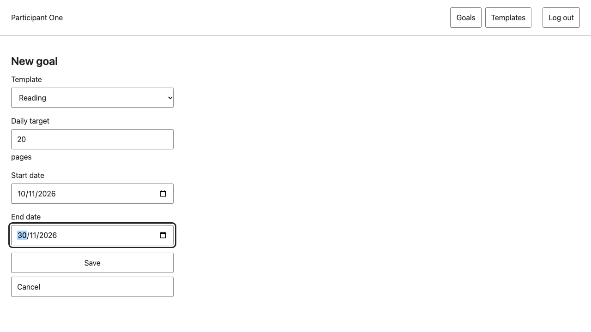
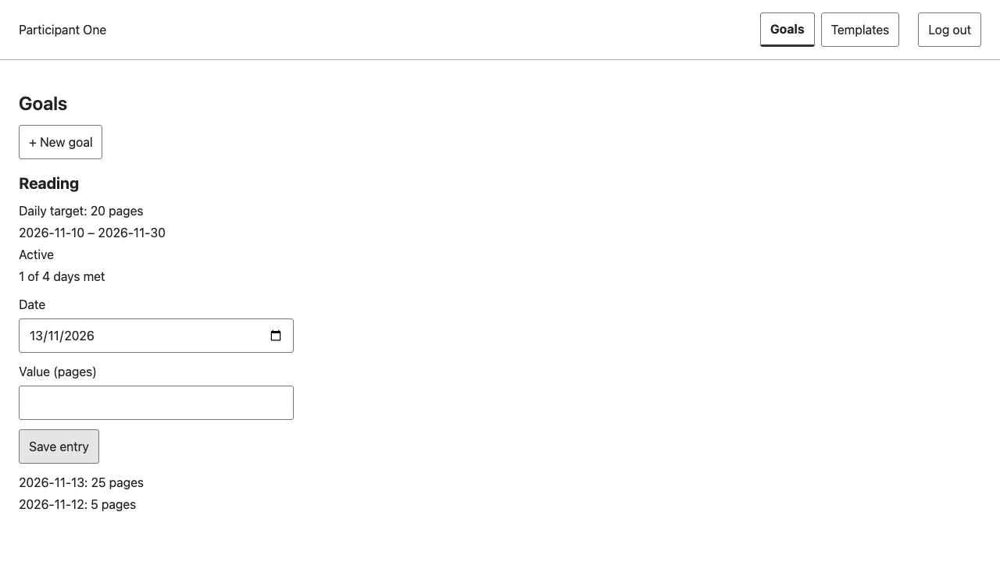
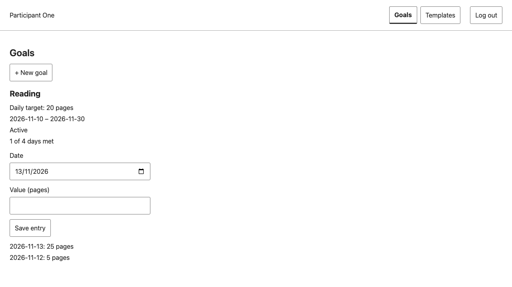
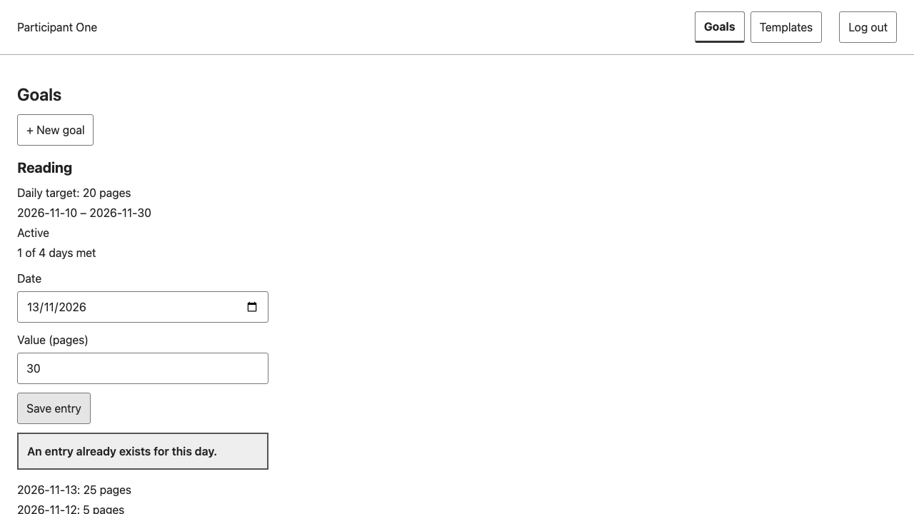
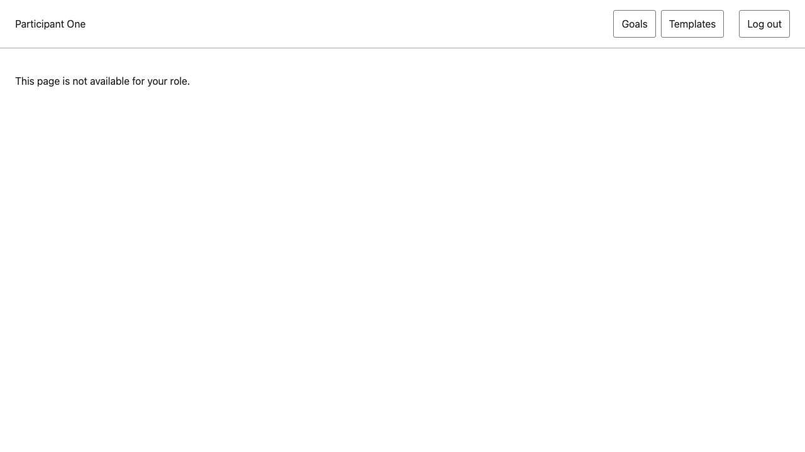
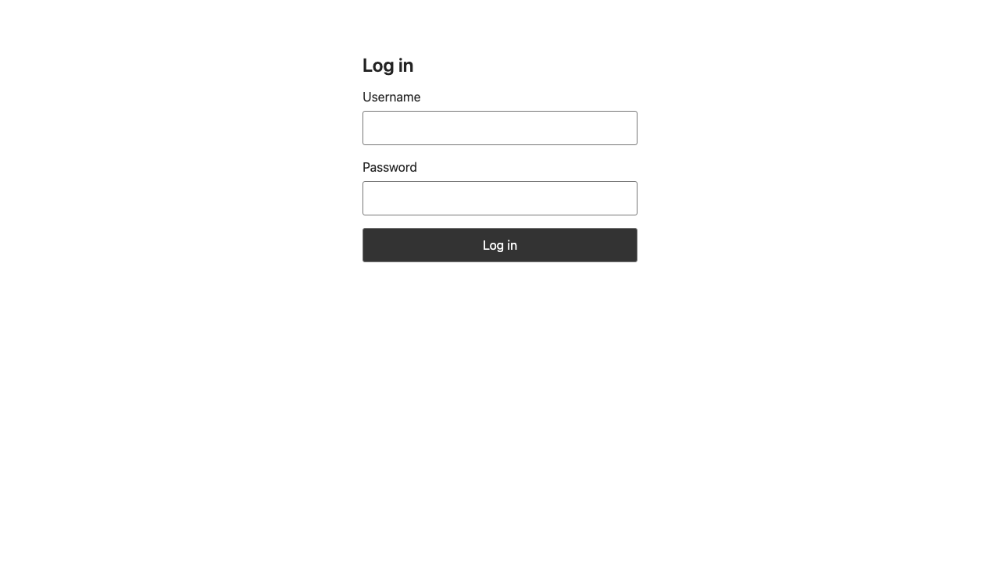
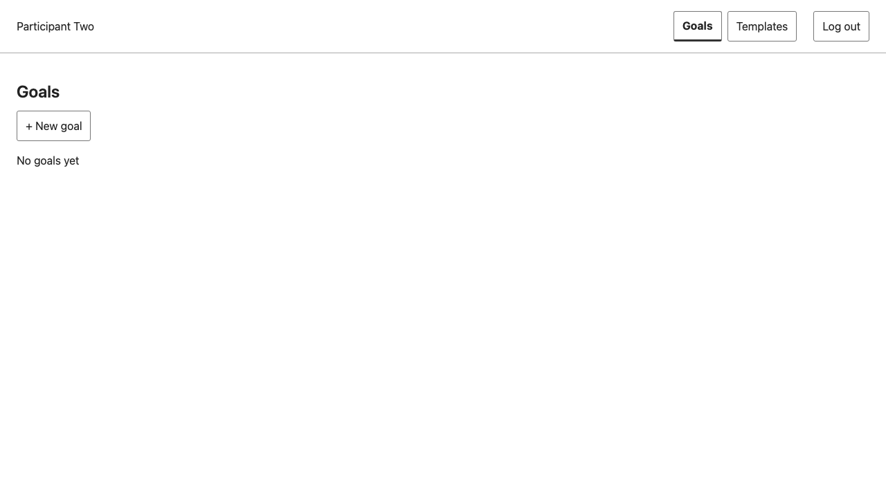

<!-- Deliverable 1 rewrite, Part F (Issue #11). New text and a fresh evidence run on 2026-11-13 on tag v1.0 (64831f7). Test results live only in this Part; Issue and PR evidence lives only in F.5. -->

# Part F. Working Sprint 1 and verification {#part-f}

Every result in this Part was produced on 2026-11-13 from a clean checkout of the submitted release, unless a line says otherwise.

## F.1 Release, setup and safe test access {#f-1}

### Submitted release

| | |
|---|---|
| Repository | https://github.com/phittayanan/habit-tracker |
| Release | Tag `v1.0`, annotated 2026-11-10 13:35 +07, on commit `64831f7`: the merge of the reviewed release pull request #61 from `staging` into `main` |
| Later work | Commits after `v1.0` (Lab 5, report work) are on `staging` and are not part of this assessment; `main` still points at `64831f7` |

All screenshots, test runs and excerpts in this Part come from `64831f7` unless a row names another commit.

### Setup summary

The README at `v1.0` gives the full steps. In short, with Node.js 22.16 or newer and a local PostgreSQL 16 server:

```bash
# browser app
cd client && npm ci && npm run build
# API
cd ../server && npm ci && cp .env.example .env    # then set DATABASE_URL, TEST_DATABASE_URL and the two seed passwords
npm run prisma:generate
npm run prisma:migrate                            # 4 migrations: auth, template, goal, entry
npm run prisma:seed                               # manager1, participant1, participant2
npm run build && npm start                        # http://localhost:3000/login
# tests
DATABASE_URL=<test database> npm run prisma:migrate && npm test      # in server/
npx playwright install chromium && npm test                          # in client/, with TEST_DATABASE_URL set
```

### Safe test access

The seed creates three synthetic accounts: `manager1`, `participant1` and `participant2`. Their passwords are not in Git or in this report. Each person who runs the app sets them in their own `.env` (`SEED_MANAGER_PASSWORD`, `SEED_PARTICIPANT_PASSWORD`); the TA receives the values through the private course handoff. For this report's run, random passwords were generated for a throw-away database and deleted afterwards.

**Run environment** for every result below: macOS 27.2, Node.js 26.8.1, npm 11.19.0, PostgreSQL 16.15, Playwright 1.65.0 with its own Chromium, fresh databases created for this run.

## F.2 Program demonstrations {#f-2}

All screenshots: release `64831f7`, desktop width 1280 px, taken with a scripted headless browser on a local run of the built app on 2026-11-13 (Bangkok date 13 Nov). No exceptions.

### Scenario 1: full journey, then the saved result after a restart {#scenario-1}

- **Features and AC:** F-03 (AC-03.1, AC-03.6), F-07 (AC-07.1), F-08 (AC-08.1, AC-08.4), F-09 (AC-09.1, AC-09.6, AC-09.7).
- **Roles:** Manager (`manager1`), then Participant (`participant1`).
- **Start:** freshly migrated and seeded database; no templates, goals or entries.
- **Steps:** the Manager creates the template Reading (pages, 0 to 100) and logs out. The Participant creates a goal on Reading with a daily target of 20 from 2026-11-10 to 2026-11-30, then records 5 pages for 12 Nov and 25 pages for 13 Nov. The app process is stopped and started again, and the page is reloaded.
- **Expected:** the template appears in the Manager's table; the goal shows "1 of 4 days met" (10 to 13 Nov so far; only 13 Nov reached 20); after the restart the goal and both entries are read back from PostgreSQL.
- **Actual:** as expected (Figures F-1 to F-5).











### Scenario 2: business-rule rejections {#scenario-2}

- **Features and AC:** F-08, AC-08.7 (BR-04) and AC-08.2 (BR-01), with AC-08.10 for how the message is shown.
- **Role:** Participant (`participant1`), continuing from scenario 1.
- **Steps:** (a) record 30 pages again for 13 Nov, which already has an entry; (b) record 30 pages for 14 Nov, which is after today.
- **Expected:** (a) refused with 409 `ENTRY_ALREADY_EXISTS`; (b) refused with 400 `ENTRY_DATE_IN_FUTURE`; in both cases the message is shown, the typed value is kept and nothing is stored.
- **Actual:** as expected (Figures F-6, F-7). The entry list still holds only the two entries of scenario 1, and progress is unchanged.




### Scenario 3: forbidden operations, logout and ownership {#scenario-3}

- **Features and AC:** F-02 (AC-02.1), F-06 (AC-06.3), F-01 (AC-01.4), F-10 (AC-10.1, AC-10.3).
- **Roles:** Participant (`participant1`, `participant2`), Manager (`manager1`), anonymous.
- **Steps:** (a) `participant1` opens the Manager's page `/templates/new` and, from the same session, sends `POST /api/templates`; (b) `participant1` logs out and a request is sent with no session; (c) `participant2` logs in; (d) `manager1` logs in and requests `GET /api/goals`.
- **Expected:** (a) the page says it is not available, and the API refuses with 403 whatever the page shows; (b) the login screen, and 401 for the request; (c) `participant2` sees no goals, because the Reading goal belongs to `participant1`; (d) 403.
- **Actual:** as expected (Figures F-8 to F-10 and the responses below).







Responses recorded by the same script:

```text
participant1  POST /api/templates  403 {"error":{"code":"FORBIDDEN","message":"You do not have permission to do this."}}
anonymous     GET  /api/goals      401 {"error":{"code":"UNAUTHENTICATED","message":"Please log in."}}
manager1      GET  /api/goals      403 {"error":{"code":"FORBIDDEN","message":"You do not have permission to do this."}}
```

### Backend evidence for the protected operations {#api-evidence}

Hiding a page is not the protection; these automated API tests send real requests to the server and passed on 2026-11-13 (full list in F.3):

| Protected operation | Test | What it proves |
|---|---|---|
| Every registered route | TC-08 | Lists every route the Express app registers and fails if one is public by mistake, misses its role check, or answers anonymous requests with anything but 401 |
| Wrong role, forged role | TC-66 | Anonymous gets 401 before 403; a role or user ID sent in the body or a header changes nothing |
| Valid and invalid login | TC-01, TC-02, TC-62 | Valid login creates one session; unknown user and wrong password get the same 401 and no session; malformed input gets 400 |
| Unauthenticated requests | TC-05, TC-06 | Missing, made-up, deleted and expired sessions get 401 |
| Participant writing templates | TC-17, TC-18 | 403 on create and edit, and the stored data is unchanged |
| Cross-account goals and entries | TC-33, TC-34, TC-57 | Another Participant gets 404 identical to an unknown id; a Manager gets 403; nothing is stored |

## F.3 Build and automated test results {#f-3}

### Commands and counts

Run on 2026-11-13 on a detached checkout of `64831f7`, following the README.

| Step | Command | Result |
|---|---|---|
| Browser app build | `client/`: `npm ci`, `npm run build` | Exit 0; Vite built `dist/index.html` and two assets |
| API build | `server/`: `npm ci`, `npm run prisma:generate`, `npm run build` | Exit 0 |
| Database | `npm run prisma:migrate` on the app and the test database; `npm run prisma:seed` | 4 migrations applied to each; "Seeded three accounts." |
| Server suite, run 1 (seed passwords in `server/.env`, as the README says) | `server/`: `npm test` | **79 tests: 78 passed, 1 failed, 0 skipped**; exit 1 |
| Server suite, run 2 (seed passwords in the shell instead of `.env`) | `server/`: `npm test` | **79 tests: 79 passed, 0 failed, 0 skipped**; exit 0 |
| Rule coverage (TC-51) | `server/`: `node --env-file-if-exists=.env --experimental-test-coverage --test --test-concurrency=1 test/*.test.js` | 79 passed. Line coverage: `entry-rules.js`, `goal-rules.js`, `progress-rules.js` 100%; `template.js` 96.85%; all files 98.02% |
| Browser suite, run 1 | `client/`: `npm test` | **44 tests (22 at 375 px, 22 at 1280 px): 42 passed, 2 failed, 0 skipped**; exit 1 |
| Browser, failed file alone | `client/`: `npx playwright test test/goals.spec.js --repeat-each=3` | **18 passed, 0 failed**; exit 0 |
| Browser suite, run 2 | `client/`: `npm test` | **44 tests: 43 passed, 1 failed, 0 skipped**; exit 1 |

**The server failure in run 1** is TC-44/45, the seed test. Its last step runs the seed with one password removed and expects the seed to refuse. With the passwords stored in `server/.env`, the Prisma client loads that file when the seed starts, so the seed still finds the password and succeeds:

```text
✖ TC-44 / TC-45: seed is idempotent, uses current env hashes, fails atomically without passwords; tracked files contain no seed values
  AssertionError [ERR_ASSERTION]: Expected "actual" to be strictly unequal to: 0
      at TestContext.<anonymous> (server/test/auth.test.js:401:12)
ℹ tests 79   ℹ pass 78   ℹ fail 1   ℹ skipped 0
```

The application behaviour is correct; the test depends on where the passwords are kept. Run 2, identical except that the seed passwords come from the shell, passes every test:

```text
ℹ tests 79
ℹ pass 79
ℹ fail 0
ℹ cancelled 0
ℹ skipped 0
```

**The browser failure** is the same test each time, `goals.spec.js` "TC-47 / TC-48: goals screens fit and keyboard alone opens, submits and cancels form", at the same line:

```text
Error: expect(locator).toBeFocused() failed
> 112 |   await expect(page.getByRole('button', { name: 'Save', exact: true })).toBeFocused();
  2 failed   [375px] and [1280px] › test/goals.spec.js:82:1 › TC-47 / TC-48 …
  42 passed (35.9s)
```

It failed at both widths in run 1 and at 1280 px in run 2, and passed in all 6 runs when its file ran alone. Every other browser test passed in both runs. The same test is the one recorded as failing on Windows before the release (PR #43, later Issue #62). Its cause on macOS was not investigated for this report. Both failures are listed in F.6.

**Result at release time.** The release pull request #61 records an earlier run on the release candidate `03e039e` (same tree as `64831f7`) on 2026-11-10: server 79 of 79 passed, browser 44 passed. That run used a different setup and is not repeated here as fresh evidence.

### Acceptance criteria → test → result {#ac-table}

All tests below are automated. "Pass" means every listed test passed in server run 2 and browser run 2 on 2026-11-13; the test files are in `server/test/` (`*.test.js`) and `client/test/` (`*.spec.js`). The test design for each ID is in Part E.

| AC | Test | File | Result |
|---|---|---|---|
| AC-01.1 | TC-01, TC-46 | auth.test.js, session.test.js | Pass |
| AC-01.2 | TC-02 | auth.test.js | Pass |
| AC-01.3 | TC-62 | auth.test.js | Pass |
| AC-01.4 | TC-03 | auth.test.js | Pass |
| AC-01.5 | TC-04 | auth.test.js | Pass |
| AC-01.6 | TC-05 | auth.test.js | Pass |
| AC-01.7 | TC-06, TC-63 | auth.test.js, session.test.js | Pass |
| AC-01.8 | TC-44, TC-45 | auth.test.js | Pass in run 2; failed in run 1 (see above) |
| AC-01.9 | TC-64 | auth.test.js | Pass |
| AC-01.10 | TC-65 | auth.spec.js | Pass |
| AC-02.1 | TC-07 | auth.spec.js | Pass |
| AC-02.2 | TC-08 | auth.test.js, entry.test.js, goal.test.js | Pass |
| AC-02.3 | TC-66 | auth.test.js | Pass |
| AC-02.4 | TC-66 | auth.test.js | Pass |
| AC-02.5 | TC-67 | auth.spec.js | Pass |
| AC-03.1 | TC-09 | template.test.js | Pass |
| AC-03.2 | TC-10 | template.test.js | Pass |
| AC-03.3 | TC-68 | template.test.js | Pass |
| AC-03.4 | TC-69 | template.test.js | Pass |
| AC-03.5 | TC-68 | template.test.js | Pass |
| AC-03.6 | TC-11 | templates.spec.js | Pass |
| AC-03.7 | TC-70 | templates.spec.js | Pass |
| AC-04.1 | TC-12 | template-edit.test.js | Pass |
| AC-04.2 | TC-13 | template-edit.test.js | Pass |
| AC-04.3 | TC-72 | template-edit.test.js | Pass |
| AC-04.4 | TC-71 | template-edit.test.js | Pass |
| AC-04.5 | TC-13 | template-edit.test.js | Pass |
| AC-04.6 | TC-73 | templates.spec.js | Pass |
| AC-04.7 | TC-18 | template-edit.test.js | Pass |
| AC-06.1 | TC-16 | template.test.js, templates.spec.js | Pass |
| AC-06.2 | TC-16 | template.test.js, templates.spec.js | Pass |
| AC-06.3 | TC-17 | template.test.js | Pass |
| AC-07.1 | TC-20 | goal.test.js | Pass |
| AC-07.2 | TC-20, TC-55 | goal.test.js | Pass |
| AC-07.3 | TC-21 | goal.test.js | Pass |
| AC-07.4 | TC-55 | goal.test.js | Pass |
| AC-07.5 | TC-22 | goal.test.js | Pass |
| AC-07.6 | TC-53, TC-54 | goal.test.js | Pass |
| AC-07.7 | TC-54 | goal.test.js | Pass |
| AC-07.8 | TC-53 | goal.test.js | Pass |
| AC-07.9 | TC-60 | goals.spec.js | Pass |
| AC-07.10 | TC-74 | goal.test.js | Pass |
| AC-08.1 | TC-23, TC-58 | entry.test.js, entries.spec.js | Pass |
| AC-08.2 | TC-24 | entry-rules.test.js, entry.test.js | Pass |
| AC-08.3 | TC-25, TC-30 | entry-rules.test.js, entry.test.js | Pass |
| AC-08.4 | TC-26 | entry-rules.test.js, entry.test.js | Pass |
| AC-08.5 | TC-27 | entry-rules.test.js, entries.spec.js | Pass |
| AC-08.6 | TC-28 | entry-rules.test.js, entry.test.js | Pass |
| AC-08.7 | TC-29 | entry.test.js | Pass |
| AC-08.8 | TC-56 | entry-rules.test.js, entry.test.js | Pass |
| AC-08.9 | TC-56 | entry-rules.test.js, entry.test.js | Pass |
| AC-08.10 | TC-61 | entries.spec.js | Pass |
| AC-08.11 | TC-30 | entry.test.js | Pass |
| AC-08.12 | TC-27 | entry-rules.test.js, entries.spec.js | Pass |
| AC-09.1 | TC-31 | progress-rules.test.js, progress.test.js | Pass |
| AC-09.2 | TC-31 | progress-rules.test.js, progress.test.js | Pass |
| AC-09.3 | TC-31 | progress-rules.test.js, progress.test.js | Pass |
| AC-09.4 | TC-31 | progress-rules.test.js, progress.test.js | Pass |
| AC-09.5 | TC-31 | progress-rules.test.js, progress.test.js | Pass |
| AC-09.6 | TC-59 | progress.test.js, progress.spec.js | Pass |
| AC-09.7 | TC-32, TC-59 | progress.test.js, progress.spec.js | Pass |
| AC-09.8 | TC-59 | progress.test.js, progress.spec.js | Pass |
| AC-10.1 | TC-33 | privacy.test.js | Pass |
| AC-10.2 | TC-33 | privacy.test.js | Pass |
| AC-10.3 | TC-34 | privacy.test.js | Pass |
| AC-10.4 | TC-34 | privacy.test.js | Pass |
| AC-10.5 | TC-57 | privacy.test.js | Pass |
| AC-10.6 | TC-33 | privacy.test.js | Pass |
| AC-10.7 | TC-35 | privacy.test.js, progress.spec.js | Pass |

System checks (Part E.0):

| AC | Test | Kind | Result on 2026-11-13 |
|---|---|---|---|
| AC-SYS.1 | TC-47 | Automated, in every `*.spec.js` | Passed for every screen except the goals screen test, which failed intermittently (above) |
| AC-SYS.2 | TC-48 | Automated, in every `*.spec.js` | Same as TC-47 |
| AC-SYS.3 | TC-50 | Manual | The README was followed step by step on a fresh checkout and fresh databases; the app started and the seeded accounts logged in (scenario 1). The time was not recorded; the timed 15-minute check belongs to Lab 5 |
| AC-SYS.4 | TC-51 | Coverage report | Pass: every rule BR-01 to BR-07 has unit tests; rule-file line coverage 96.85% to 100% |
| AC-SYS.5 | TC-52 | Test run | Both suites run with one documented command each against a real PostgreSQL test database, and the counts are kept above. Both suites did not exit 0 in every run (above). CI on every pull request starts in Lab 5 |

## F.4 Test excerpts and red-green history {#f-4}

Both tests were run again on 2026-11-13 at the commit that added them, where they must fail, and at the next commit, which added the code, where they must pass. Each run used a fresh database migrated at that commit. The source shown is from `v1.0`.

### Excerpt 1: domain rule BR-08, a used template cannot be edited (TC-13, AC-04.2, AC-04.5)

```js
test('TC-13: a template used by an Active or only an Ended goal is refused first and stays unchanged', async () => {
  const sleep = await template({ name: 'Sleep', unit: 'hours', minValue: 0, maxValue: 24 });
  const steps = await template({ name: 'Steps', unit: 'steps', minValue: 0, maxValue: 30000 });
  assert.equal((await goal(sleep.id, day(0), day(30))).status, 201);
  const ended = await goal(steps.id, day(-10), day(-1));
  assert.equal(ended.body.goal.state, 'ENDED');
  const before = [await stored(sleep.id), await stored(steps.id)];
  for (const [id, body] of [[sleep.id, { maxValue: 12 }], [sleep.id, { minValue: 50 }], [steps.id, { unit: 'km' }]]) {
    const response = await patch(id, body);
    assert.equal(response.status, 409, JSON.stringify(body));
    assert.deepEqual(response.body, inUse);           // TEMPLATE_IN_USE
  }
  assert.deepEqual([await stored(sleep.id), await stored(steps.id)], before);
});
```

### Excerpt 2: role restriction BR-09, a Participant cannot edit a template (TC-18, AC-04.7)

```js
test('TC-18: a participant edit is forbidden for an existing and an unknown id, and nothing changes', async () => {
  const sleep = await template({ name: 'Sleep', unit: 'hours', minValue: 0, maxValue: 24 });
  for (const [id, body] of [[sleep.id, { maxValue: 12 }], [99999, { unit: 'x' }], ['abc', {}]]) {
    const response = await patch(id, body, cookies.a);  // participant's session
    assert.equal(response.status, 403, String(id));
    assert.deepEqual(response.body, error('FORBIDDEN', 'You do not have permission to do this.'));
  }
  assert.equal((await stored(sleep.id)).maxValue, 24);
});
```

### Red, then green

| Commit | Date | What it contains | `node --test test/template-edit.test.js`, filtered | Result |
|---|---|---|---|---|
| `e4fe33d` | 2026-11-10 02:03 | The tests, no edit endpoint | TC-13 (3 tests), TC-18 (1 test) | **Red**: TC-13 0 of 3 passed (`404 !== 409`); TC-18 0 of 1 passed (`404 !== 403`) |
| `3d1ccbb` | 2026-11-10 02:04 | The edit endpoint, in-use check and row lock | the same | **Green**: TC-13 3 of 3, TC-18 1 of 1 |

```text
e4fe33d  ✖ TC-13: a template used by an Active or only an Ended goal is refused first and stays unchanged
           AssertionError [ERR_ASSERTION]: {"maxValue":12}   404 !== 409
         ✖ TC-18: a participant edit is forbidden for an existing and an unknown id, and nothing changes
           AssertionError [ERR_ASSERTION]: 1   404 !== 403
3d1ccbb  ✔ TC-13 …   ✔ TC-13 race (a) …   ✔ TC-13 race (b) …   ✔ TC-18 …
```

## F.5 Engineering workflow and history {#f-5}

### Build Issues and pull requests

Each build Issue was implemented on its own branch from `staging` and merged through a pull request that the other student reviewed. Issue and PR numbers link to `https://github.com/phittayanan/habit-tracker/issues/<n>` and `/pull/<n>`.

| Issue | Features (contract, Part E) | Branch → PR | Author | Reviewer |
|---|---|---|---|---|
| #32 | F-01, F-02 | `feat/32-habit-auth-build` → PR #34 | phittayanan | projectnewy |
| #36 | F-03, F-06 | `feat/36-habit-template-build` → PR #37 | phittayanan | projectnewy |
| #40 | F-07 | `feat/40-habit-goal-build` → PR #41 | phittayanan | projectnewy |
| #42 | F-08 | `feat/42-daily-entry` → PR #43 | projectnewy | phittayanan |
| #44 | F-09, F-10 | `feat/44-progress-privacy` → PR #51 | projectnewy | phittayanan |
| #53 | F-04 | `feat/53-habit-template-edit` → PR #54 | phittayanan | projectnewy |
| #10 | Release | `staging` → `main`, PR #61 | phittayanan | projectnewy |

### Two Issue → PR chains {#chains}

| | Chain 1: daily entries | Chain 2: template edit |
|---|---|---|
| Issue | #42, F-08 (contract E.7) | #53, F-04 (contract E.4) |
| Branch | `feat/42-daily-entry` from `staging` | `feat/53-habit-template-edit` from `staging` |
| Pull request | PR #43 into `staging`, `Closes #42` | PR #54 into `staging`, `Closes #53` |
| Author → reviewer | projectnewy → phittayanan | phittayanan → projectnewy |
| Review | 2026-11-09: changes requested, then approved on 2026-11-10 after a re-review | 2026-11-10: approved with a written review comment |
| Merged into `staging` | 2026-11-10 00:08 +07, merge `a5a9266` | 2026-11-10 12:07 +07, merge `54ac16e` |
| Into `main` | Release PR #61, merge `64831f7`, tag `v1.0` | Same |

**Substance of review 1 (PR #43, phittayanan).** The reviewer ran both suites, confirmed the red commit gives 0 of 11, and sent ten same-day requests at once (one 201, nine 409, one row stored). They found two gaps by changing the code: moving the input check above the ownership check still passed every test, and the browser date test could not tell the Bangkok date from the browser's local date for nine hours of each day. They asked for a TC-56 case on another Participant's goal and a fixed browser clock in TC-27. The author added both; the re-review repeated both code changes, saw the new tests fail (`400 !== 404`; `expected 2026-11-11, received 2026-11-10`), and approved.

**Substance of review 2 (PR #54, projectnewy).** The reviewer traced the order of checks in the edit endpoint inside its row lock, confirmed that unknown fields such as `state` are dropped, ran the suites on Windows (server 79 of 79; browser 42 passed, 2 failed, the known Windows goal test), and tested the tests by removing `FOR UPDATE` (both TC-13 race tests failed) and the in-use check (TC-13 and both races failed). They accepted the edit-page wording proposal OP-04.9 and approved with no blocking findings.

**Release review (PR #61, projectnewy).** The reviewer checked that the release candidate was the current `staging`, that no `.env` or secret was tracked, that the PR list matched the merged build PRs, and that every Sprint 1 board card was Done except the release Issue; they then approved and merged. The tag `v1.0` was placed on the merge commit.

### Board status

Project board "habit-tracker", read on 2026-11-13 08:19 +07: every Sprint 1 Issue (#4 to #10, #28, #30, #32, #36, #38, #40, #42, #44, #53) is in **Done**. Release reference: `v1.0` = `64831f7`.

### History: contract and tests before code {#history}

| Date and time (+07) | Commit | Author | Step |
|---|---|---|---|
| 2026-11-07 04:00 | `db9efae` | projectnewy | F-07 to F-10 contracts written (Issue #28) |
| 2026-11-07 04:32 | `06e536b` | phittayanan | F-03, F-04, F-06 contracts written (Issue #30) |
| 2026-11-08 17:54 | `f2114c4` | projectnewy | F-07, F-08 contracts revised before building (Issue #38) |
| 2026-11-09 01:01 | `d43f160` | projectnewy | F-08 failing tests committed |
| 2026-11-09 01:04 | `7d2979b` | projectnewy | F-08 code |
| 2026-11-10 00:08 | `a5a9266` | — | PR #43 merged into `staging` |
| 2026-11-10 02:00 | `14475ba` | phittayanan | F-04 contract updated before building (row lock, race test) |
| 2026-11-10 02:03 | `e4fe33d` | phittayanan | F-04 failing tests committed (red in F.4) |
| 2026-11-10 02:04 | `3d1ccbb` | phittayanan | F-04 code (green in F.4) |
| 2026-11-10 12:07 | `54ac16e` | — | PR #54 merged into `staging` |
| 2026-11-10 13:31 | `64831f7` | — | Release PR #61 merged into `main`; tagged `v1.0` at 13:35 |

## F.6 Contributions, AI use and known limitations {#f-6}

### Contribution table

Counts from Git and GitHub up to `v1.0`. An equal number of commits is not expected; both students designed, built, tested and reviewed.

| Student | GitHub | Main work | Commits (no merges) | PRs merged into `staging` | Approving reviews |
|---|---|---|---|---|---|
| Phittayanan Tiencharoen | phittayanan | Design answers and ADRs; SRS and feature list drafts; F-01 to F-06 contracts; builds of auth (F-01, F-02), templates (F-03, F-06), goals (F-07), template edit (F-04); release PR | 74 | 17 | 7 |
| Phuttipong Phankitnirundorn | projectnewy | SDS session; F-07 to F-10 contracts and the Part E overview; builds of daily entries (F-08) and progress with privacy (F-09, F-10); README update; reviews of most build PRs and the release | 21 | 7 | 17 |

Pair work: every build PR was reviewed by the other student with a written check (F.5); the contracts for one student's features were often reviewed or revised by the other (for example Issue #38 revised F-07 and F-08 after F-03 and F-04 settled the decimal and lock rules).

### AI-use declaration

AI tools were used throughout and declared in `docs/ai-use.md` and in each pull request. Claude Code, Codex and Cursor drafted documents and code, wrote and ran tests, and gathered evidence. The students made every product and design decision (ADRs from the students' answers on Issue #3), reviewed each pull request by hand, ran or re-ran the checks they cite in their reviews, and decided what to accept. For this report Claude Code wrote the text, ran the builds, tests and coverage on `v1.0`, re-ran the red and green commits, and captured the screenshots; phittayanan chose the structure, answered each open question and reviewed every Part, and projectnewy reviews the pull request. No AI statement is used as evidence on its own: every result above comes from a command that was run and read.

### Known limitations, failed and skipped tests

| # | Limitation | Status |
|---|---|---|
| 1 | TC-44/45 fails when the seed passwords are stored in `server/.env`, which the README tells users to do; it passes when they come from the shell (F.3). The application is correct; the test depends on its setup | Found on 2026-11-13; no Issue yet |
| 2 | The goals-screen browser test TC-47/48 failed intermittently on macOS (3 of 10 executions on 2026-11-13) and fails on Windows (F.3) | Fixed after `v1.0` in Issue #62 (closed 2026-11-12); the macOS failures in `v1.0` were not investigated |
| 3 | A goal's daily target may be below the template's minimum, so every entry meets it (TC-55 stores 0.01 on a 10-to-100 template) | Defect, Issue #74; the lower-limit rule must be decided first |
| 4 | A wrong entry for a day cannot be corrected until entry edit and delete arrive (assumption A-11) | Sprint 2 (F-13) |
| 5 | Retire is not built, and goal creation does not check a template's state; a retired template can only exist through a direct database change | Sprint 2 (F-05, TC-15, TC-19) |
| 6 | No limit on repeated failed logins | Not in Sprint 1 scope |
| 7 | F-10's ownership checks came with F-07 and F-08, so TC-33, TC-34 and TC-57 already passed at F-10's red commit `af813de`; only TC-35 was red there. They work as regression tests, not as TDD evidence | Recorded here |
| 8 | Some checked behaviour has no test ID (for example the Origin refusal on template edit, the newest-first entry list, the migration checks) | Recorded in the review notes |
| 9 | The timed clean-clone run (NFR-07), tests on every pull request in CI (NFR-09), Docker and the GCP deployment | Lab 5 |

No test was skipped, disabled or weakened.
