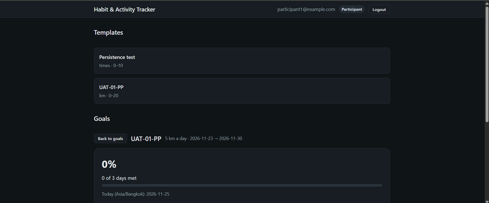
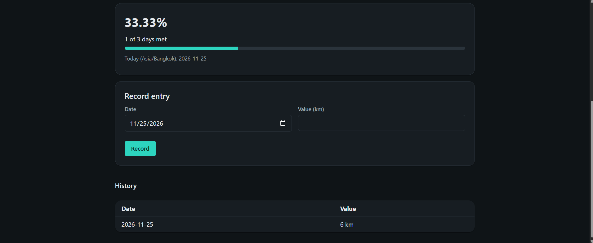
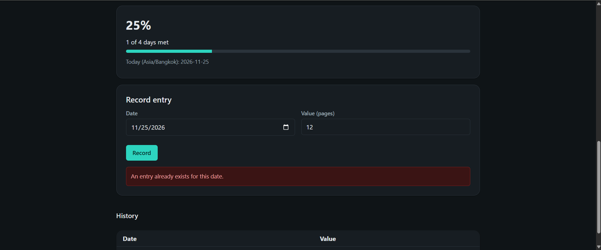
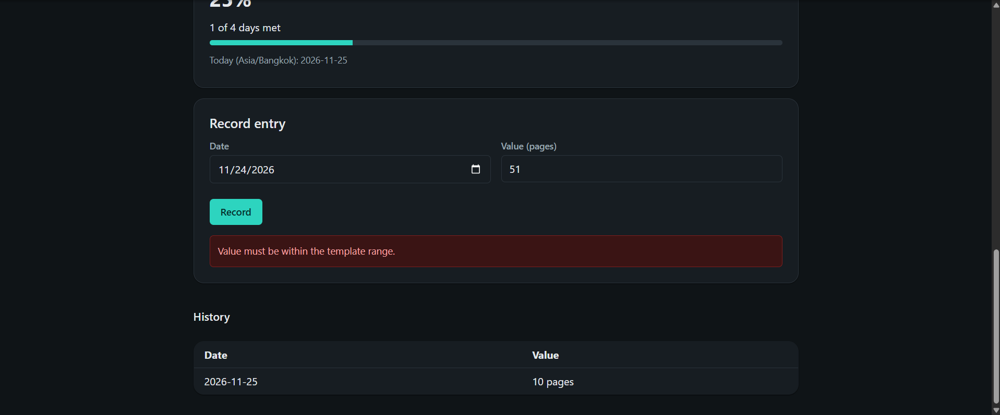
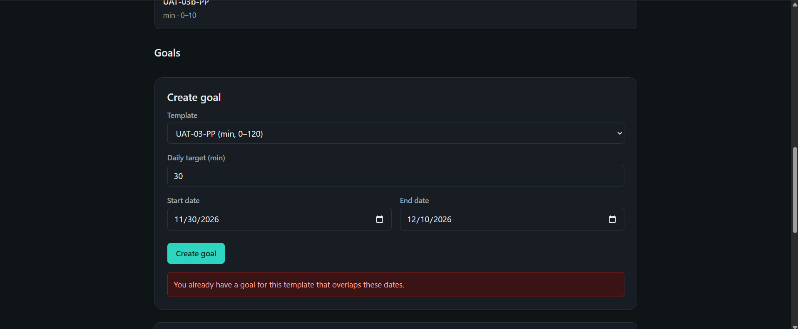
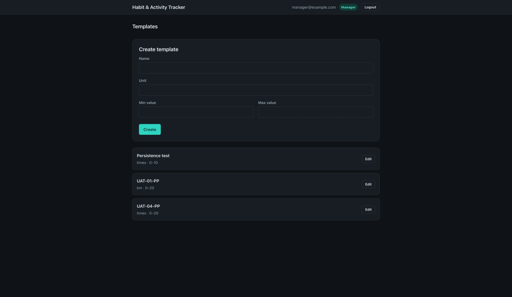
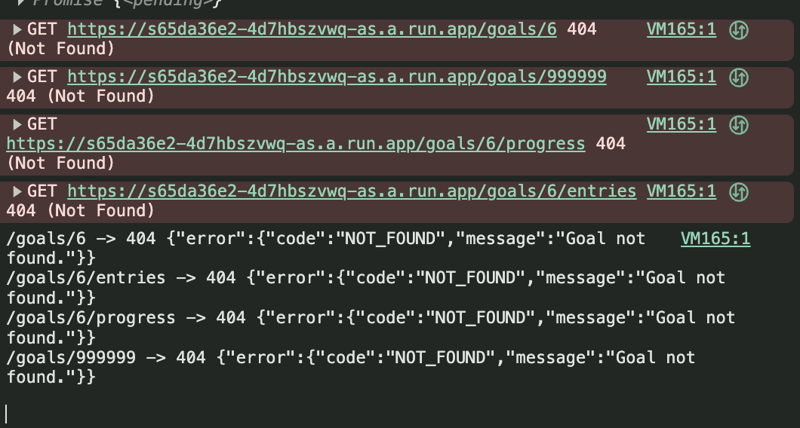
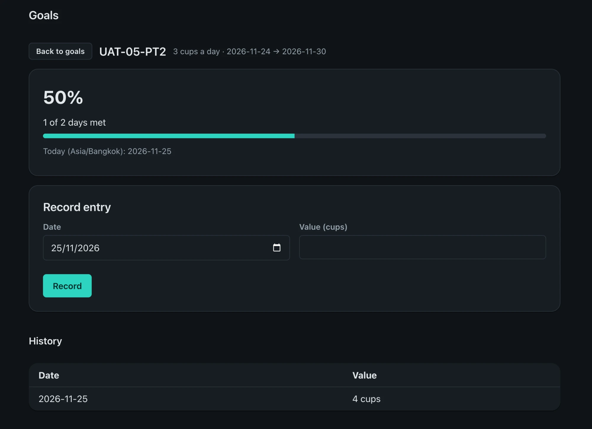
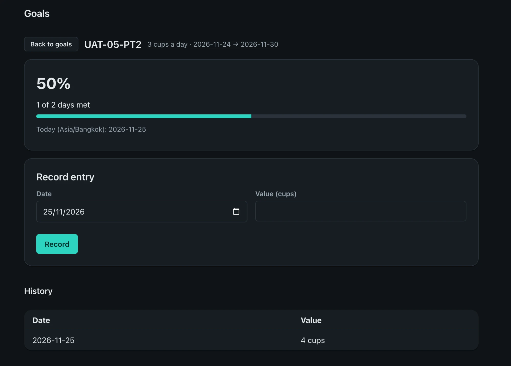

# Part B: independent execution on the partner's product

We are the UAT Team. All six cases the partner team supplied were run by hand in a browser on 2026-11-25 against Cloud Run revision `s65da36e2-00009-b4s` (`main` `0619c07`, from their package; the app shows no version text). Both students took part: each ran one half.

## B.1 Result summary

| Case | Category | Tester | Time (Asia/Bangkok) | Result | Evidence |
|---|---|---|---|---|---|
| UAT-01 | Normal journey | projectnewy | about 13:35–13:43 | PASS | E-B1-01 to E-B1-06 |
| UAT-02 | Business rules on entries | projectnewy | about 13:49–14:11 | PASS with deviations (tester input errors, B.3) | E-B1-07 to E-B1-20 |
| UAT-03 | Business rules on goals | projectnewy | about 14:14–14:23 | PASS | E-B1-21 to E-B1-29 |
| UAT-04 | Forbidden role | phittayanan | about 13:25–13:41 | PASS | E-B2-01 to E-B2-07 |
| UAT-05 | Ownership and privacy | phittayanan | about 14:00–14:16 | PASS | E-B2-08 to E-B2-16 |
| UAT-06 | Session, logout and persistence | phittayanan | about 14:17–14:28 | PASS | E-B2-17 to E-B2-29 |

None was FAIL or BLOCKED. An AI assistant did not operate the partner's app for these six cases: the students ran every step and decided each result. For the optional exploratory items X-01 and X-02 an AI agent did operate the app (B.5 and the AI-use declaration in Part D).

## B.2 Selected evidence

Every screenshot has an ID. The full registers in B.3 and B.4 list all of them with action, expected and actual result, time and revision. The registers are printed without their file name column; each file is in `docs/labs/lab-06/partner-uat/evidence/` and its name starts with the ID. All screenshots below: 2026-11-25, revision `s65da36e2-00009-b4s`, manual.

### Normal journey (UAT-01)

### Rejected operations (UAT-02, UAT-03)

### Forbidden role, privacy and session (UAT-04 to UAT-06), with the protected-state checks

## B.3 Full record, first half (UAT-01 to UAT-03)

{{include:../partner-uat/first-half.md}}

## B.4 Full record, second half (UAT-04 to UAT-06)

{{include:../partner-uat/second-half.md}}

## B.5 Optional exploratory testing

{{include:../partner-uat/exploratory.md}}
