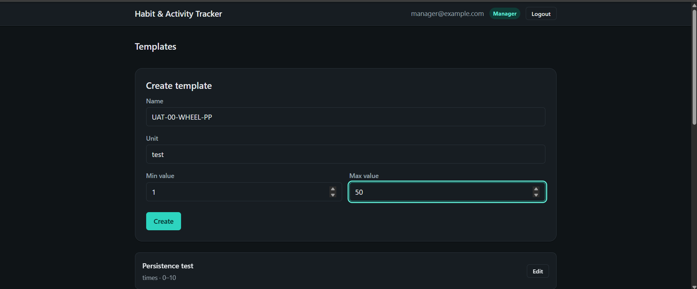
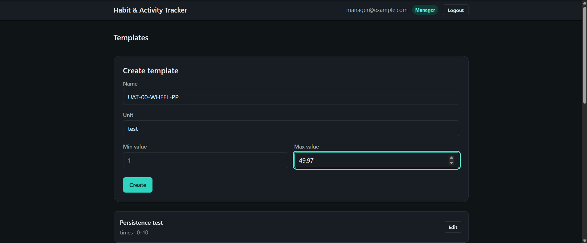
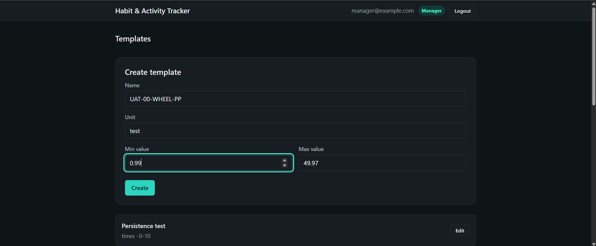
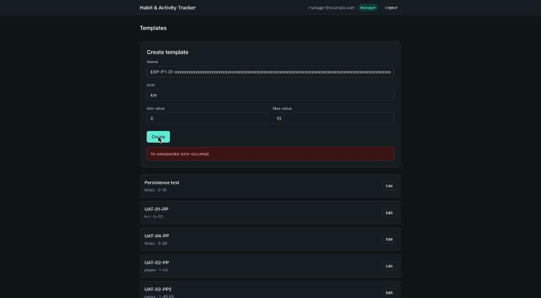
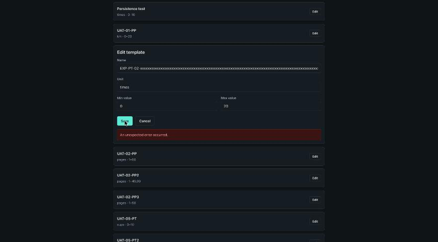

# Part C: defect reporting and triage

Agreed channel and answer time (Issue #107): one GitHub Issue per finding in the product team's own repository, classified within 24 hours with a reason tied to the Sprint 1 contract. The repository file `findings.md` was written on 2026-11-25 and is not updated for later events; the tables C.1 to C.3 give the state at the end of 2026-11-26.

## C.1 All findings received about our product

{{include:../resolution.md|## 2. Part C}}

## C.2 Reports we sent about the partner's product

| Report | Issue | Case or requirement | Reporter and filed | Their classification and severity (our agreement) | Resolution and our retest | Final state |
|---|---|---|---|---|---|---|
| B1-01: the mouse wheel changes a focused number field | [#60](https://github.com/asamapornch/habit-activity-tracker/issues/60) | none; observation during UAT preparation | projectnewy for our team, 2026-11-25 about 18:12 | **Enhancement, minor** (their SRS and contracts do not specify the wheel). We agreed | They fixed Min and Max in the template form (their PR #64). Our retest 2026-11-26: PASS for Min and Max (RT-60) | Closed by the partner, 2026-11-26. Known limitation: the Goals daily target and the entry value fields still react to the wheel |
| B2-01: a name of about 110,000 characters returns 500, not 400 | [#61](https://github.com/asamapornch/habit-activity-tracker/issues/61) | their AC-02.11, AC-02.17, NFR-05 | projectnewy for our team, 2026-11-25 about 18:12 | **Accepted defect, minor.** We agreed | Fixed in their PR #63. Our retest 2026-11-26: PASS on create and edit (RT-61) | Closed by the partner, 2026-11-26 |

Both reports were answered within 24 hours (about three hours after filing). No report of ours was critical or major. One further observation (X-03: a NUL character gives 500) was seen only on a local copy of their code and was **not** reported.

## C.3 Documented minor limitations

| Product | Limitation | Accepted by |
|---|---|---|
| Partner's | The mouse wheel still changes the focused Goals daily target and entry value fields (as the partner states in #60; we did not test these two) | Our team (AD-3) |
| Ours | None: both accepted defects were fixed and retested, and the partner's decision has no conditions | Partner team (AD-1) |

## C.4 The two reports as sent

{{include:../findings.md|### Report B1-01}}

{{include:../findings.md|### Report B2-01}}

The common data of both reports: product owner "Habit and Activity Tracker"; reporter, the UAT team of this project; tested version `s65da36e2-00009-b4s`, `main` `0619c07`; date 2026-11-25; account MANAGER. The two reports received about our product are the Issues [#126](https://github.com/phittayanan/habit-tracker/issues/126) and [#127](https://github.com/phittayanan/habit-tracker/issues/127); their reports as filed, with the steps, expected and actual results and request evidence, are F-126 and F-127 in the Appendix; C.1 has our classification, and the retests are RT-126 and RT-127.

## C.5 Evidence of the two reports we sent

All of it: the partner's deployed app, revision `s65da36e2-00009-b4s`, 2026-11-25, account MANAGER. These show the behaviour **before** the partner's fixes.

### B1-01: the mouse wheel changes a focused number field (manual)

### B2-01: a very long template name returns 500 (AI agent operating the browser, see Part D)

**E-B2X-03**, the response of that request, as captured in the page (expected 400, actual 500):

{{text:../partner-uat/evidence/E-B2X-03-X-01-post-templates-500.txt}}

**E-B2X-06**, the response of that request (expected 400, actual 500):

{{text:../partner-uat/evidence/E-B2X-06-X-02-put-templates-500.txt}}
