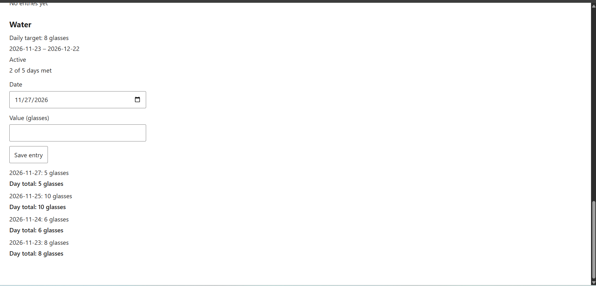
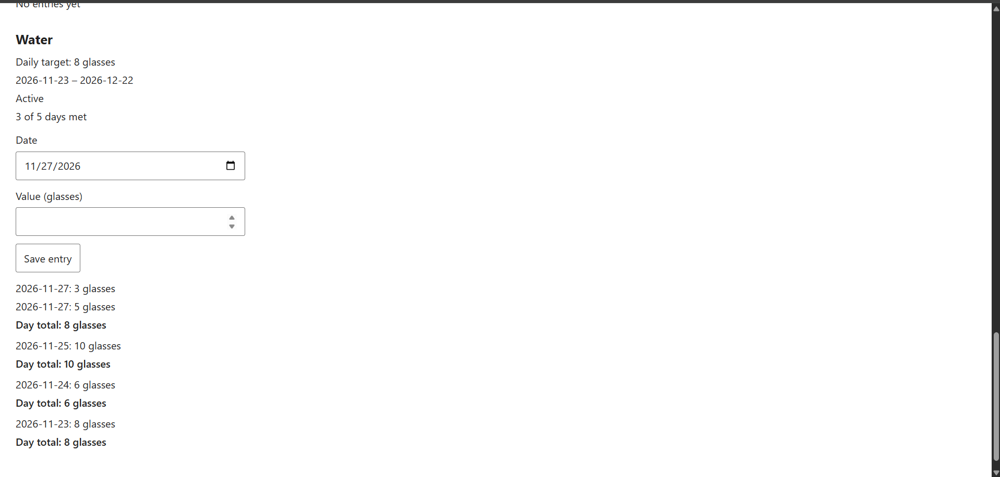
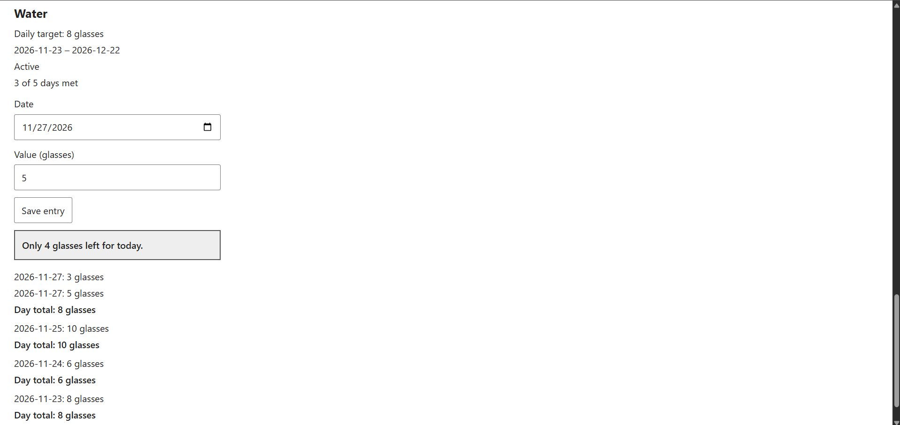
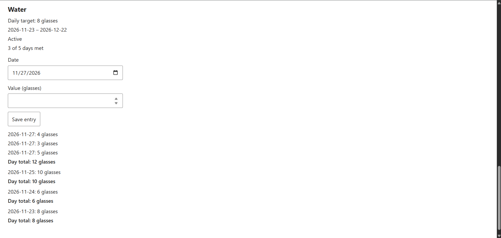
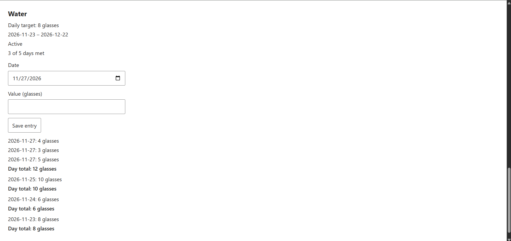
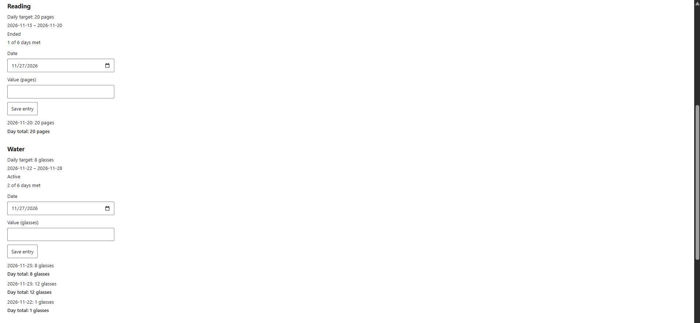
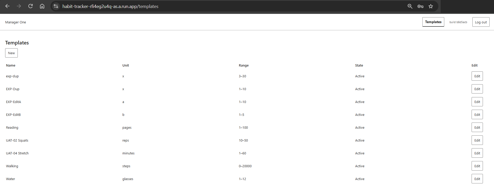

# Part B: Implementation and regression-safe delivery

The tests and code were written by phittayanan (Issue #140) and reviewed by projectnewy in PR #146: changes requested on `a3ea23a` (TC-89 failed on Windows), fixed in `f8736c9`, approved on `d30cf8c` (records R-146 and C-146-1 in the Appendix). The release, deployment and post-deployment checks were done by projectnewy (Issues #141, #148) and reviewed by phittayanan (records R-149, R-147, R-162).

## B.1 Tests first, then code: commits, RED, GREEN and regression

As merged (`docs/labs/lab-07/implementation.md`). The full output files it names are printed in B.2. The test changes themselves (setup and assertions) are in the Appendix, X.3.

{{include:../implementation.md}}

## B.2 Actual test output

Excerpts of the saved output (`docs/labs/lab-07/evidence/`): the header with command and tested commit, the failing or the Lab 7 test lines, and the counts. The full output files are printed in the Appendix, X.4.

RED, server suite on `761d87e` (new tests, old code), `cd server && npm test`. Every failure is the old one-entry rule (`ENTRY_ALREADY_EXISTS` or the unique index), not a compile error or a broken fixture:

{{text:red-server-excerpt.txt}}

RED, browser suite on `761d87e`, `cd client && npx playwright test`:

{{text:red-client-excerpt.txt}}

GREEN, server suite on `f8736c9` (the Lab 7 tests, then the counts for all 99):

{{text:green-server-excerpt.txt}}

GREEN, browser suite on `f8736c9`:

{{text:green-client-excerpt.txt}}

## B.3 Code diff

`git diff c4ba749 bbf12a2 -- server/src server/prisma client/src`: the migration, the day-total rule under a goal-row lock, progress by the day total, and the goals page. The test files are in the Appendix, X.3. `f8736c9` changed only how TC-89 starts the Prisma CLI.

{{text:code-diff.txt}}

## B.4 Review, integration, release, deployment and post-deployment checks

As merged (`docs/labs/lab-07/release.md`). The screenshots it lists follow in B.5.

{{include:../release.md}}

## B.5 Screenshots

Manual checks in Chrome by projectnewy on the deployed revision `habit-tracker-00008-jgf` (`build b8d5acb`), 2026-11-27. Times are when Claude Code received each screenshot, by projectnewy's computer clock, which runs about 10 minutes ahead of GitHub (B.4, section 4). The browser's extension and profile area is masked.

