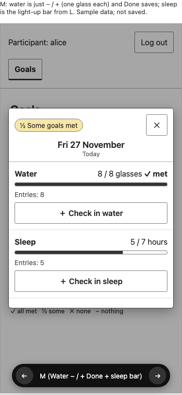
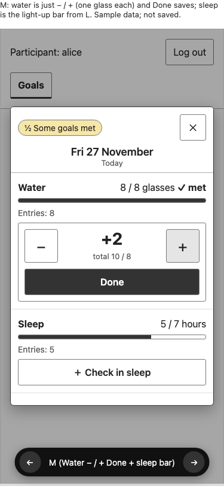
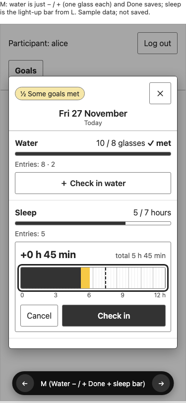
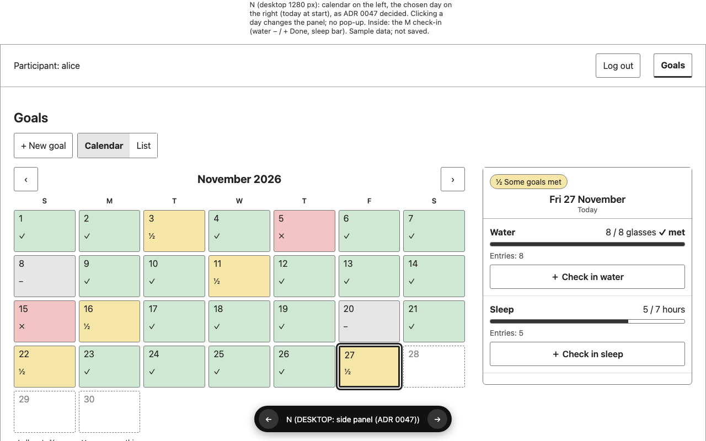

# F-11 Month calendar and day box

Sprint 2 contract (Deliverable 2 Part B, [Issue #151](https://github.com/phittayanan/habit-tracker/issues/151)). Written before any code. Built from the merged `docs/srs.md`, `docs/system-sds.md`, `docs/features.md`, `docs/traceability.md`, the Sprint 1 contracts and the ADRs, plus the decisions phittayanan took on 2026-11-27 (ADR 0063 to ADR 0072). Every decided point says where it was decided. Points drafted by Claude Code are marked as such in section 12, with phittayanan's acceptance.

## 1. Identity

| Item | Value |
|---|---|
| Feature | F-11 Month calendar and day box (the "side panel" of ADR 0047 on desktop) |
| Sprint | 2 |
| Requirements | FR-15 |
| Related | FR-11 and BR-01 to BR-04 (saving goes through F-08); F-12 (colours), F-15 (List); NFR-02, NFR-03, NFR-05, NFR-06 |
| Depends on | F-08, F-09; the template kind (ADR 0064, built in Issue #168, blocked by #151); F-14's goal versions for "the target that day" once #153 is merged |
| Needed by | F-12, F-15, F-13 (the day box is where entries are listed) |
| Author / reviewer | phittayanan / projectnewy |
| Status | Agreed (PR #167); built in Issue #155. The day state, colour and sign are built in Issue #156 (ADR 0097) |

## 2. Behaviour and workflow

1. After login a Participant's first screen is the calendar of the current month in Asia/Bangkok, on the page `/calendar` (ADR 0037, ADR 0073, BR-02). The week starts on Monday (ADR 0068). The Participant's menu is "Calendar", "Goals", "Templates"; "Goals" opens the Sprint 1 goals page at `/goals`, which stays unchanged except the display and input of Time values (ADR 0065): days-met progress (F-09), the entry list with day totals and the record form with a date box (F-08) (ADR 0073).
2. Arrows ‹ and › beside the month title move to earlier months and forward up to the current month, not past it (ADR 0068).
3. A future day is shown but cannot be opened. Today and past days open (ADR 0069).
4. **Desktop** (600 px wide and more, the current stylesheet breakpoint): the calendar is on the left and the panel on the right shows the chosen day, today at start. Choosing another day changes the panel; there is no pop-up (ADR 0047, ADR 0063).
5. **Phone** (below 600 px): tapping a day opens a box in the centre of the screen. The close button (✕), a tap outside the box or Escape closes it (ADR 0063).
6. The panel or box shows the date ("Fri 27 November", and "Today" under it for today), the day's sign from F-12 ("½ Some goals met"), and one card per goal active that day, that is, whose start and end dates include the day (ADR 0069). With no such goal it says "No goals on this day."
7. Each goal card shows the goal's name, the day total against the target valid that day ("5 / 8 glasses", "6 h 30 min / 7 h"), "✓ met" when met, a progress bar, the day's entries (newest saved first), and one "+ Check in {name}" button (ADR 0063).
8. "+ Check in" opens the goal's input, chosen by the template kind (ADR 0064):
   - **Count**: − and + buttons around the amount to add (starts at +0, steps of 1), the new total beside it, and Done, disabled at +0 (ADR 0063, ADR 0074).
   - **Time**: the light-up bar from 0 to the template's maximum, one segment per 15 minutes. Logged time is dark, the time being added is highlighted, and a mark shows the target. Cancel and Check in, disabled at +0 (ADR 0063, ADR 0064, ADR 0074).
   - Under either, a typed row: "Other amount" (number box) for Count; "Exact" with hour and minute boxes for Time; each with Save (ADR 0066).
9. Done, Check in or Save sends one entry through `POST /api/goals/:id/entries` (F-08). For Time the value sent is whole minutes (ADR 0065). On 201 the card, the day's sign and the calendar colour update without a page reload.
10. When an amount has been chosen but not saved and the user closes the box (or, on desktop, chooses another day), the app asks "Discard +3 glasses?" with "Keep editing" and "Discard". With nothing unsaved it closes at once (ADR 0067).

Prototype screenshots (sample data, not saved; ADR 0063). The prototype week starts on Sunday and its bar always runs to 12 h; the contract's Monday start and "0 to the template maximum" win. The prototype has no typed row (ADR 0066 adds it).

| Phone: day box (M) | Phone: count − / + (M) | Phone: time bar (M) | Desktop: side panel (N) |
|---|---|---|---|
|  |  |  |  |

## 3. Business rules

| Rule | Statement | Source |
|---|---|---|
| First screen | The Participant's first screen after login is this month's calendar at `/calendar` | SRS FR-15; ADR 0037, ADR 0073 |
| Goals page kept | The Sprint 1 goals page at `/goals` stays unchanged except the display and input of Time values and the Sprint 2 controls of F-13 and F-14 (ADR 0081, ADR 0084), and is reached from the menu item "Goals" | ADR 0065, ADR 0073 |
| Months | ‹ goes back without limit; › stops at the current month (Asia/Bangkok) | ADR 0068 |
| Days that open | Today and past days; never a future day | ADR 0069; SRS BR-01 |
| Goals listed | Only goals whose start and end dates include the day | ADR 0069; SRS BR-01 |
| Target that day | A goal's target for a day is the version valid on that day (F-14); until #153 is merged it is the goal's `dailyTarget` | SRS BR-12; ADR 0011 |
| Input per kind | Count: − / + by 1. Time: bar in 15-minute segments from 0 to the template's maximum. Both stop at what still fits in the day (`maxValue` minus the stored day total) | ADR 0064; SRS BR-04 |
| Time values | Whole minutes; shown as "7 h 10 min", "45 min" or "7 h" | ADR 0065 |
| Nothing at +0 | Done and Check in are disabled at +0; only the typed row can save an exact 0 | ADR 0074 |
| Saving | Every save is one F-08 entry; the API decides (BR-01 to BR-04, and whole minutes for Time) | SRS FR-11; F-08 |
| Unsaved amount | Closing with an unsaved amount asks first | ADR 0067 |

## 4. Validation and failure cases

The calendar read is `GET /api/calendar` (section 7). Checks run in this order (SDS 2.2): session (401), role (403), validation (400).

| Order | Case | Result | Error code |
|---|---|---|---|
| 1 | No valid session | 401 | `UNAUTHENTICATED` |
| 2 | Caller is a Manager | 403 | `FORBIDDEN` |
| 3 | `month` present but not `YYYY-MM` with a month 01 to 12 | 400 | `VALIDATION_ERROR` |

A month after the current month is not an error: every day has `state` `null` and no goals (the UI never asks for it, ADR 0068).

Saving uses F-08's checks and messages unchanged, plus the Time rule (F-08 revision): a fraction of a minute gets `400 VALIDATION_ERROR` "Minutes must be a whole number." A rejected save shows the API `message` in the goal's card and keeps the chosen amount. In the "Exact" row a Minutes value that is not a whole number from 0 to 59 is not sent: the card shows "Minutes must be 0 to 59." and keeps the typed values (phittayanan, Issue #155).

Boundaries: the + button and the bar cannot go past what still fits (`maxValue` minus the stored day total); when nothing fits, Check in is not offered and the card says "{Day} is full ({max} {unit})." (F-08 OP-08.14 wording). The − button cannot go below +0, and at +0 Done and Check in are disabled (ADR 0074). A day equal to a goal's start or end date lists that goal.

## 5. Permissions

| Caller | Calendar screen | `GET /api/calendar` | Save from the box |
|---|---|---|---|
| Anonymous | login page | 401 | 401 (F-08) |
| Participant | own goals only | own goals only | own goal only (F-08) |
| Manager | `/calendar` shows "This page is not available for your role." (F-02 OP-02.2); not in the Manager's menu | 403 | 403 (F-08) |

Another Participant's goals never appear (NFR-03). The acting user is always the session user.

## 6. UI behaviour

- Layout as in section 2; the current look of the app is kept (ADR 0063).
- Day cells are buttons. Each has an accessible name with the date and the day state in words, for example "24 November, some goals met" (F-12). A future day is a disabled button named "28 November, future".
- Phone box: a dialog (`role="dialog"`, `aria-modal="true"`) labelled by the date. Focus moves into it when it opens and returns to the day button when it closes. Escape closes it (with the ADR 0067 question when something is unsaved).
- Count input: − and + are buttons with names such as "One glass less" and "One glass more"; the amount is announced (`aria-live="polite"`).
- Time input: the bar is a slider (`role="slider"`) that the arrow keys move by 15 minutes, with `aria-valuetext` such as "45 min".
- Typed row: number boxes with labels; Time has "Hours" and "Minutes" boxes (minutes 0 to 59).
- While a save runs, its button is disabled. Nothing shows as saved until the API answers 201; then the new entry, total, sign and calendar colour show.
- 375 px and 1280 px wide with no horizontal scroll; every control works with the keyboard alone (NFR-05, NFR-06; TC-47, TC-48 run on this screen).

## 7. API

Errors use the body `{ "error": { "code": "...", "message": "..." } }` (ADR 0025). Decimal values travel as JSON numbers (OP-07.8); Time values are whole minutes (ADR 0065).

**`GET /api/calendar?month=YYYY-MM`** (Participant; ADR 0072). Without `month`, the current month in Asia/Bangkok.

Response 200:
```json
{ "month": "2026-11", "today": "2026-11-27",
  "days": [
    { "date": "2026-11-27", "state": "SOME_MET",
      "goals": [
        { "goalId": 12, "name": "Water", "unit": "glasses", "kind": "COUNT",
          "target": 8, "total": 5, "met": false, "minValue": 1, "maxValue": 12,
          "entries": [ { "id": 41, "value": 2 }, { "id": 40, "value": 3 } ] },
        { "goalId": 13, "name": "Sleep", "unit": "minutes", "kind": "TIME",
          "target": 420, "total": 430, "met": true, "minValue": 0, "maxValue": 720,
          "entries": [ { "id": 39, "value": 430 } ] } ] },
    { "date": "2026-11-28", "state": null, "goals": [] } ] }
```

- `days` has one item per day of the month, oldest first.
- `state` is `ALL_MET`, `SOME_MET`, `NONE_MET`, `NOTHING` or `null` by the F-12 rule. Issue #155 returns `null` on every day; Issue #156 fills it (ADR 0097).
- `goals` lists the caller's goals active that day; it is empty for a future day. `name` is the template's name. `entries` are newest saved first (F-08 OP-08.10). `total` is the sum of the entries; `met` is `total >= target`.
- Errors: 400, 401, 403 as in section 4.

Saving uses `POST /api/goals/:id/entries` unchanged (F-08 section 7).

## 8. Data

| Layer change | Detail |
|---|---|
| Tables | No new table for F-11. The template kind column belongs to the new kind Issue (F-03 revision, ADR 0064) |
| Query | One read per month: the caller's goals overlapping the month, their templates, and their entries in the month; day totals are computed in the service with exact decimals (as F-08's day total) |
| Endpoint list | SDS 4.4: `GET /api/calendar` serves FR-15, FR-16 and FR-19; `GET /api/entries?month` is removed (ADR 0072). TC-08's protected-route list gains `GET /api/calendar` |

## 9. Acceptance criteria

| AC | Observable outcome |
|---|---|
| AC-11.1 | After login a Participant is on `/calendar` and sees the current month's calendar (Asia/Bangkok) with a Monday-first week, and on desktop the panel for today |
| AC-11.2 | ‹ shows the previous month and can be pressed again; › is not available on the current month; the List follows the shown month |
| AC-11.3 | A future day cannot be opened; today and a past day open the box (phone) or the panel (desktop) |
| AC-11.4 | The box or panel lists exactly the goals active that day, each with total / target, "✓ met" when met, and entries newest first; a day with no active goal says "No goals on this day." |
| AC-11.5 | Phone: the box closes with ✕, a tap outside and Escape, and focus returns to the day. Desktop: choosing a day changes the panel without a pop-up |
| AC-11.6 | Count: + and − change the amount by 1, never below +0 or past what still fits; Done is disabled at +0 and saves one entry with that amount |
| AC-11.7 | Time: the bar moves in 15-minute steps by pointer and arrow keys, from 0 to the template maximum, never past what still fits; Check in is disabled at +0 and saves one entry in whole minutes |
| AC-11.8 | The typed row saves an exact amount (Count: up to 2 decimals; Time: hours and minutes as whole minutes); a rejected save shows the API message and keeps the amount |
| AC-11.9 | Closing with an unsaved amount asks "Discard …?"; "Keep editing" keeps the box and amount; "Discard" closes without saving; with nothing unsaved the box closes at once |
| AC-11.10 | After a save, the card's total and entries, the day sign and the calendar colour update without a reload |
| AC-11.11 | `GET /api/calendar` returns the shape in section 7 with only the caller's goals; a bad `month` gets `400 VALIDATION_ERROR`; anonymous gets 401; a Manager gets 403 |
| AC-11.12 | The calendar screen has no horizontal scroll and works at 375 px and 1280 px, and every action on it works with the keyboard alone |
| AC-11.13 | After login a Participant is on `/calendar`; the menu shows "Calendar", "Goals", "Templates"; "Goals" opens the Sprint 1 goals page, where every Sprint 1 check of its progress, entry list, day totals and record form still holds; a Manager on `/calendar` sees "This page is not available for your role." |

## 10. Test specification

`D` is today in Asia/Bangkok (F-08 section 10). Fixtures: Participant A with goal W (template "Water", Count, unit glasses, min 1, max 12, target 8) and goal S (template "Sleep", Time, unit minutes, min 0, max 720, target 420), both from `D-30` to `D+30`; Participant B with a goal of its own; one Manager. Test-only passwords.

| Test | AC | Level | Precondition / input | Action | Expected result |
|---|---|---|---|---|---|
| TC-36 | AC-11.1, AC-11.4 | Browser | A; entries 3 and 2 on W for `D`; one goal X of A ending `D-3` | Log in at 1280 px; read the address, the calendar and the panel; open `D-5` and `D-1` | The address is `/calendar`; current month title, Monday first column; panel shows today with W "5 / 8 glasses" and entries "2 · 3" and S "0 min / 7 h"; `D-5` lists X, W and S; `D-1` lists W and S only |
| TC-110 | AC-11.2 | Browser | A logged in | Press ‹ twice, then › twice; switch to List after the first ‹ (this step runs in #156, ADR 0097) | Titles show the two earlier months, then the current one; › is not available on the current month; the List shows the previous month |
| TC-111 | AC-11.3 | Browser | A logged in, phone width | Try to open `D+1` (if in this month) by pointer and keyboard; open `D` and `D-1` | `D+1` is a disabled button named "… future" and nothing opens; `D` and `D-1` open the box |
| TC-112 | AC-11.4 | Browser | A whose only goal starts `D-2` | Go to the previous month; open its first day | "No goals on this day." |
| TC-113 | AC-11.6 | Browser | A; W has 10 on `D` (2 still fit) | Open `D`, "+ Check in water"; try Done and − at +0; press + three times, Done | At +0 Done and − are disabled; + stops at +2 ("total 12 / 8"); Done stores one entry of 2; the card shows 12 / 8 ✓ met |
| TC-114 | AC-11.7 | Browser | A; S has 400 on `D` | Open `D`, "+ Check in sleep"; focus the bar; press → three times; Check in | The bar reads "+45 min", total "7 h 25 min"; one entry of 45 is stored; the bar cannot add more than 5 h 20 min (720 − 400 minutes) |
| TC-115 | AC-11.8 | Browser and API | A; W and S with no entries on `D-1` | Count "Other amount" 2.5 → Save; Time "Exact" 7 h 10 min → Save; Count "Other amount" 20 → Save | 2.5 and 430 are stored; 20 shows the API's `VALUE_OUT_OF_RANGE` message and keeps 20 |
| TC-116 | AC-11.9 | Browser | A, phone width | Choose +3 on W, press Escape, choose "Keep editing", tap outside, choose "Discard"; then open again and close with nothing chosen | First the question "Discard +3 glasses?"; after "Keep editing" the box and +3 stay; after "Discard" the box closes and no entry is stored; the last close happens at once |
| TC-117 | AC-11.10 | Browser (cross-feature with F-12; runs in #156, ADR 0097) | A; on `D`, W met (8) and S empty | Check in 420 on S; watch the card and calendar | Without a reload the S card shows "7 h / 7 h ✓ met", the box sign and the day turn from "½ some goals met" to "✓ all goals met" |
| TC-120 | AC-11.11 | API | A with W and S and entries on `D` and `D-1`; X ended `D-3` | `GET /api/calendar`; `?month=` previous month; `?month=2026-13`; `?month=abc` | Shape as in section 7; one item per day, oldest first; entries newest first; X only on its days; the bad months get `400 VALIDATION_ERROR` |
| TC-121 | AC-11.11 | API | A, B, Manager, as above | `GET /api/calendar` as B, as the Manager, and anonymous | B sees none of A's goals; Manager `403 FORBIDDEN`; anonymous `401 UNAUTHENTICATED`. TC-08 lists the route as protected |
| TC-130 | AC-11.13 | Browser | A with goal W and an entry on `D`; the Manager | As A: log in; read the address and the menu; choose "Goals". Run TC-07, TC-32, TC-59, TC-61, TC-65, TC-86 and the auth, goals and entries TC-47/TC-48 with only the steps of ADR 0073 point 4 changed. As the Manager: open `/calendar` | A is on `/calendar`; menu "Calendar", "Goals", "Templates"; "Goals" opens `/goals` with "x of y days met", the entry list with "Day total" and the record form; those Sprint 1 tests pass, with their goals-page checks as in Sprint 1; the Manager sees "This page is not available for your role." |
| TC-47, TC-48 | AC-11.12 | Browser | A logged in | Run the NFR-05 and NFR-06 checks on the calendar screen, the phone box and the desktop panel | No horizontal scroll at 375 and 1280 px; every step of TC-113 to TC-116 can be done with the keyboard alone |

## 11. Definition of done

- Every AC has at least one test in section 10, written first and seen failing, then passing; the command, counts and tested commit are recorded.
- `GET /api/calendar` is in TC-08's protected-route list; NFR-02 and NFR-03 checks pass for it.
- Screenshots at 375 px and 1280 px are kept for the D2 PDF.
- Contract, `docs/traceability.md` rows (AC, test ID, Issue and PR) and the SDS endpoint list are current; open points are disclosed.
- The PR is reviewed by the teammate with a specific check, and merged into `staging` (after the Lab 7 release PR, per the merge rule of 27 Nov).

## 12. Open points and decisions

| ID | Point | Status and answer |
|---|---|---|
| OP-11.1 | Phone and desktop design | Decided by phittayanan, 2026-11-27 (ADR 0063); agreement by projectnewy pending in review |
| OP-11.2 | How a goal is count or time | Decided by phittayanan (Q1): a template kind (ADR 0064); agreed by projectnewy in the [review of d4c72cb](https://github.com/phittayanan/habit-tracker/pull/167#pullrequestreview-6087108343) |
| OP-11.3 | Exact value against BR-03's 2 decimals | Decided by phittayanan (Q2): Time stores whole minutes, so every exact time fits (ADR 0065) |
| OP-11.4 | Unsaved amount when the box closes | Decided by phittayanan (Q4): ask first (ADR 0067) |
| OP-11.5 | Typed row | Decided by phittayanan (Q3): kept (ADR 0066) |
| OP-11.6 | Months and week start | Decided by phittayanan (Q5, Q12): ‹ › arrows up to the current month; Monday first (ADR 0068) |
| OP-11.7 | Which days open, which goals listed | Decided by phittayanan (Q6): ADR 0069 |
| OP-11.8 | The API shape and dropping `GET /api/entries?month` | Drafted by Claude Code, accepted as drafted by phittayanan (Q11): ADR 0072 |
| OP-11.9 | Counter start (+0), the "Other amount" and "Exact" labels, the "No goals on this day." text, the dialog and slider markup, and "choosing another day on desktop" counting as closing for ADR 0067 | Drafted by Claude Code; accepted as drafted by phittayanan on 2026-11-27 (Q13) |
| OP-11.11 | What happens to the Sprint 1 goals page | Decided by phittayanan (R1, answering projectnewy's blocking finding 1): kept unchanged at `/goals`; the calendar is the new first page `/calendar` (ADR 0073) |
| OP-11.13 | Which Sprint 1 test steps may change for the new first page | Decided by phittayanan (R4, answering projectnewy's blocking finding 1 in the [review of 2a4b0e5](https://github.com/phittayanan/habit-tracker/pull/167#pullrequestreview-6087213487)): only the steps that lead to the goals page (address after login, opening "Goals", the menu list, the tab order); the goals-page checks stay (ADR 0073 point 4) |
| OP-11.12 | What Done does at +0 | Decided by phittayanan (R2, answering projectnewy's finding 2): disabled, and the same for Check in (ADR 0074) |
| OP-11.14 | Who builds the day state, colour and sign | Decided by phittayanan in Issue #155 (ADR 0097): Issue #156 (F-12). #155 returns `state: null`, shows no sign, colour or chip, and names a day button by its date ("… future" for a future day). TC-117 and the List step of TC-110 wait for #156 |
| OP-11.10 | Editing and deleting an entry from the card (F-13) | In the day box or panel and on the goals page (ADR 0081; F-13 section 6). A card lists each entry with Edit and Delete once F-13 is built |

## 13. Revision history

| Date | Change | Approved by |
|---|---|---|
| 2026-11-27 | First draft (Issue #151) | pending (reviewer projectnewy) |
| 2026-11-27 | Review of PR #167 ([review of d4c72cb](https://github.com/phittayanan/habit-tracker/pull/167#pullrequestreview-6087108343)): first page `/calendar` and the Sprint 1 goals page kept (ADR 0073; sections 2, 3, 5, 9, 10, 12; AC-11.13, TC-130); Done and Check in disabled at +0 (ADR 0074; AC-11.6, AC-11.7, TC-113); projectnewy's agreement to ADR 0064 | pending (reviewer projectnewy) |
| 2026-11-27 | Re-check of PR #167 ([review of 2a4b0e5](https://github.com/phittayanan/habit-tracker/pull/167#pullrequestreview-6087213487)): the Sprint 1 test steps that change for `/calendar` (ADR 0073 point 4; section 2, section 3, AC-11.13, TC-130, OP-11.13) | pending (reviewer projectnewy) |
| 2026-11-27 | Issue #150: F-13 controls in the card (OP-11.10) and the F-13 and F-14 controls on the goals page (section 3; ADR 0081, ADR 0084) | pending (reviewer phittayanan) |
| 2026-11-27 | Issue #155, independent check: the Minutes box takes 0 to 59, with the message "Minutes must be 0 to 59." (section 4) | phittayanan; projectnewy in the #155 PR review |
| 2026-11-27 | Issue #155: the day state, colour, sign and chip are built in #156; `state` is `null` until then; TC-117 and TC-110's List step wait for #156 (ADR 0097; sections 1, 7, 10, 12) | phittayanan; projectnewy in the #155 PR review |
