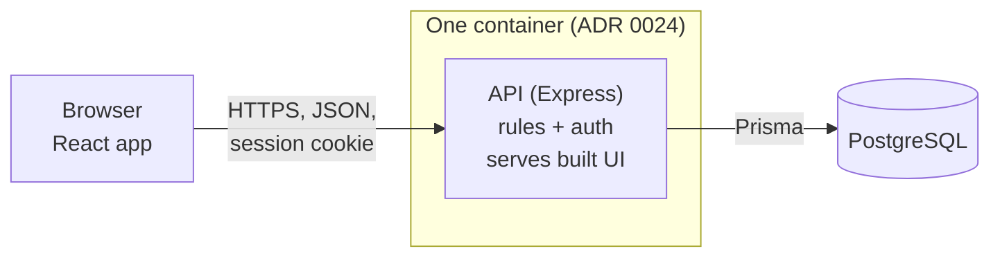
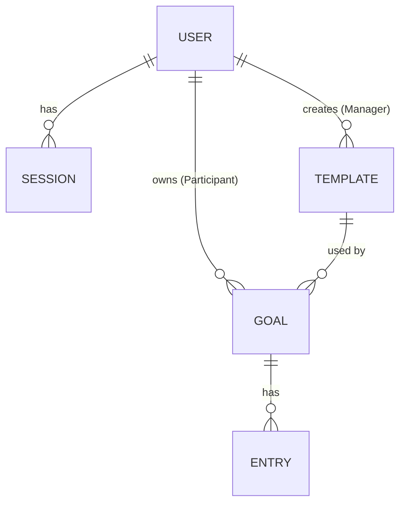

# System Design Specification

Part C of Deliverable 1 (Issue #6). The design is built from the ADRs (`docs/adr/`) and the requirements in `docs/srs.md`. Each section cites its source. Where no ADR or SRS line settles a point, the design gives a **proposal** and lists it in section 8.2. On PR #23 phittayanan answered the open points S-1 to S-14; those answers are recorded in 8.2 as decided, and S-15 to S-17 are new and still open. Nothing here changes a requirement or an ADR. Per-feature detail (exact request and response shapes, acceptance criteria) belongs to the Sprint 1 contracts (Part E).

## 1. Overview

### 1.1 What this document covers
How the Habit Tracker is built: the stack and components, the data model, the screens and API conventions, who may do what, how login and sessions work, and how the app is configured and later deployed. It covers the whole product. Sprint 1 (the handout's slice) is marked where the design differs by sprint. Sprint 2 and Sprint 3 screens, endpoints and permissions are outlined here; their exact paths and shapes are set in those sprints' contracts.

### 1.2 Design at a glance
| Topic | Decision | Source |
|---|---|---|
| Stack | Node.js, Express, React with Vite, Prisma, PostgreSQL | ADR 0023 |
| Shape | One container: the API serves the built frontend. A modular monolith | ADR 0024 |
| API | REST over JSON, standard status codes, JSON error body with a code and message | ADR 0025 |
| Layout | One layout for everyone; menu items follow the role | ADR 0026 |
| Sessions | A session row in the database; an HTTP-only cookie holds the session ID; logout deletes the row | ADR 0027 |
| Session length | 8 hours from login | ADR 0028 |
| Passwords | bcrypt (the `bcryptjs` package) | ADR 0029 |
| Day | A calendar date in Asia/Bangkok for every user | ADR 0006 |
| Goal state | Derived from dates, never stored | ADR 0012 |
| Hosting | GCP reference stack with the kit defaults | ADR 0030 |
| Tests | Unit and API tests against a real test database; Playwright for browser journeys | ADR 0035 |

**Why this stack:** ADR 0023 chose the Lab 5 kit's stack as it is, because the kit's Dockerfile, CI and deploy scripts then work with no changes, which is the least risk (the handout asks us to explain the stack, D1 §3.3).

### 1.3 Constraints from the course
Real UI, API, then persistent database; data survives a restart and a redeploy (GWS §5.1). Roles are enforced on the backend, never by a hidden control or a client-chosen user ID (GWS §5.2). Docker, CI and GCP come in Lab 5, so Sprint 1 is designed for them but does not need them. No real secret in Git, the image, logs or the PDF (L5 §4.3).

## 2. Architecture

### 2.1 Components
| Component | Responsibility | Talks to |
|---|---|---|
| Browser app (React, built with Vite) | Screens, form validation for fast feedback, calling the API. Holds no business rule that the server does not also enforce | API over HTTPS, same origin |
| API (Express, Node.js) | Authentication, authorization, every business rule (BR-01 to BR-15), request validation, serving the built frontend files | Database through Prisma |
| Database (PostgreSQL) | Durable storage, constraints (unique, foreign key, check), migrations | API only |
| Test database | A separate PostgreSQL database for the tests. ADR 0035 says only "a real test database"; that the suite resets and seeds it before each run is a proposal (S-15) | API tests |

### 2.2 Where business rules are enforced
The API enforces every rule. The frontend may repeat a rule to show a message sooner, but a request that breaks a rule is refused by the API whatever the frontend does (GWS §5.2; SRS 6.1). Inside the API a request passes through these steps:

1. Session check: read the cookie, load the session row, refuse with 401 if it is missing or expired.
2. Role check: refuse with 403 if the role may not use the route.
3. Ownership check: for goal and entry routes, the record's participant must be the session user.
4. Validation: shape and types of the input.
5. Rule check: date, range, uniqueness and state rules (section 3.4).
6. Write through Prisma, with database constraints as the last guard.

The user ID for any action comes from the session, never from the request body or the URL.

### 2.3 Time and dates
"Today" is computed on the server as a calendar date in Asia/Bangkok (BR-02, ADR 0006). Dates are stored as plain `DATE` values with no time part, so there is no time-zone field and no per-user setting.

### 2.4 Code layout (S-1, decided)
The Lab 5 kit expects a `client/` folder and a `server/` folder, each with `package.json`, `npm ci`, `npm test` and `npm run build`; Prisma migrations and a seed script (`npm run prisma:seed`) in `server/`; and a server that starts with `node dist/index.js` and reads `PORT` (KIT README). The design follows that layout. Inside `server/src/`: routes (HTTP only), services (rules), and a thin data layer (Prisma).

## 3. Data Design

### 3.1 Entities
Sprint 1 entities are User, Session, Template, Goal and Entry. Later sprints add to them (3.5). The key type and decimal precision are decided (S-2); the relationships and constraints come from the SRS and ADRs.

### 3.2 Fields and constraints
**User** (seeded; no self-registration, ADR 0004)
| Field | Type | Constraint | Note |
|---|---|---|---|
| id | integer | primary key | Integer IDs (S-2, decided) |
| username | text | unique, not null | Login name; seeded account names are open (SRS A-9) |
| display_name | text | not null | Shown by "who am I" (FR-03) |
| role | `PARTICIPANT` or `MANAGER` | not null | One role per account (GWS §5.2) |
| password_hash | text | not null | bcrypt hash only (NFR-01) |
| created_at | timestamp | not null | |

**Session** (ADR 0027, ADR 0028)
| Field | Type | Constraint | Note |
|---|---|---|---|
| id | random text, at least 128 bits | primary key | The value in the cookie. Not guessable |
| user_id | reference to User | not null, on delete cascade | |
| created_at | timestamp | not null | |
| expires_at | timestamp | not null | `created_at` plus 8 hours; not extended by activity. ADR 0028 says "8 hours from login"; the 30-minute inactivity option (a sliding expiry) was not chosen |

**Template** (ADR 0007, ADR 0017)
| Field | Type | Constraint | Note |
|---|---|---|---|
| id | integer | primary key | |
| name | text | not null, unique | A duplicate name is refused with 409 (S-4, decided) |
| unit | text | not null | Free text; spelling is not checked (ADR 0007) |
| min_value | decimal | not null | Per entry |
| max_value | decimal | not null, `min_value < max_value` | Database check (BR-03) |
| state | `ACTIVE` or `RETIRED` | not null, default `ACTIVE` | Retire is built in Sprint 2 (FR-08); the column exists from the start |
| created_by | reference to User | not null | The Manager who created it |
| created_at | timestamp | not null | |

**Goal** (ADR 0010, ADR 0012)
| Field | Type | Constraint | Note |
|---|---|---|---|
| id | integer | primary key | |
| participant_id | reference to User | not null | Ownership link. Set from the session, never from the request |
| template_id | reference to Template | not null | |
| daily_target | decimal | not null, greater than 0 and not above the template's `max_value` | Decided on PR #23 (answer to SRS A-4), so every target can be met. The "not above `max_value`" check is a service rule because it compares two tables. The SRS closes A-4 in a separate change |
| start_date | date | not null | |
| end_date | date | not null, `end_date >= start_date` | Database check |
| created_at | timestamp | not null | |

The goal's state (Active or Ended) is not a column. It is computed from the dates (ADR 0012, BR-06).

**Entry** (ADR 0005, ADR 0008)
| Field | Type | Constraint | Note |
|---|---|---|---|
| id | integer | primary key | |
| goal_id | reference to Goal | not null, on delete restrict | Ownership follows the goal's participant |
| entry_date | date | not null | |
| value | decimal | not null | Range checked against the template (BR-03) |
| created_at | timestamp | not null | |
| | | **unique (goal_id, entry_date)** | One entry per goal per day (BR-04). The database enforces it even under two requests at once |

Decimal columns (`min_value`, `max_value`, `daily_target`, `value`) use a fixed precision; the scale is set in the contracts (S-2, decided).

### 3.3 Ownership links
- A Goal belongs to one Participant (`participant_id`). An Entry belongs to that Participant through its Goal. This is what makes "a Participant sees only their own data" (BR-10) a single check.
- A Template belongs to no Participant. Any Manager may see, edit or retire any template, including one another Manager made (S-5, decided). `created_by` records who made it but gives no extra right.
- A Manager has no link to a Participant's Goal or Entry, so there is nothing for a Manager to be granted (ADR 0019, no sharing).

### 3.4 Where each rule lives
| Rule | Enforced by | Test (traceability) |
|---|---|---|
| BR-01 entry date today or earlier, inside the goal period | Service (needs the goal and "today") | TC-24 to TC-26 |
| BR-02 day is an Asia/Bangkok date | Service computes "today" | TC-27 |
| BR-03 value inside the template range; min below max | Service for the entry range; database check for min below max | TC-10, TC-28 |
| BR-04 one entry per goal per day | Database unique constraint, mapped to a 409 | TC-29 |
| BR-05 one active goal per template per Participant | Service, inside a transaction (S-6, decided) | TC-21 |
| BR-06 goal state from dates | Computed; no stored state | TC-22, TC-30 |
| BR-07 progress is days met | Computed from entries | TC-31 |
| BR-08 edit a template only while no goal uses it | Service (checks for goals on the template) | TC-12, TC-13 |
| BR-09, BR-10 role and ownership | Role and ownership checks (2.2) | TC-17, TC-18, TC-33 to TC-35 |
| BR-11 edit or delete an entry inside the goal period (Sprint 2) | Service; progress and streaks are recomputed from entries | TC-38 |
| BR-12 goal change applies from today on (Sprint 2) | Service writes a new goal version; each day is judged against the version in force | TC-39 |
| BR-13 streak (Sprint 3) | Computed from entries and goal versions | TC-41, TC-42 |
| BR-14 reminder stored and shown, nothing sent (Sprint 3) | Service stores it; no outbound call | TC-43 |
| BR-15 calendar day colour (Sprint 2) | Computed from the day's entries | TC-37 |

### 3.5 Planned additions (later sprints)
| Sprint | Addition | Source |
|---|---|---|
| 2 | Goal versions: each change of the daily target is a new row with an effective-from date, so earlier days keep the old target. The Sprint 1 `daily_target` column then moves to the version rows | ADR 0011, BR-12 |
| 2 | Entry edit and delete | Rule: ADR 0009, BR-11. Sprint: SRS FR-17 (ADR 0009 gives no sprint) |
| 2 | Template retire (the `state` column is already there) | Rule: ADR 0017. Sprint: SRS FR-08 and features O-4 |
| 3 | Reminder time and weekdays per goal (stored, nothing is sent) | Rule: ADR 0016, BR-14. Sprint: ADR 0021 |
| 3 | Streaks: computed from entries and goal versions, never stored | Rule: ADR 0015. Sprint: ADR 0021 |

Progress and streaks are computed from entries each time, so an edit needs no extra update step (ADR 0009). Calendar colours are computed the same way (BR-15).

### 3.6 Database setup, migrations and seed data
- **Setup:** PostgreSQL 16 (the kit's version). The connection comes only from `DATABASE_URL` (section 7).
- **Migrations:** Prisma migrations, applied with `prisma migrate deploy`. They are additive only (add tables or columns), so an older image still works after a rollback (SG Ep. 0.4). Each migration is committed with the feature that needs it.
- **Seed:** a script that is safe to run twice (the kit's `npm run prisma:seed`). It creates synthetic data only: one Manager, at least two Participants (the cross-account tests need two), and a few templates. Seeded passwords are read from environment variables, never written in code or the repository (SG Ep. 2.2). Account names are open (SRS A-9).
- **Tests:** ADR 0035 says the tests run against a real test database. That the suite uses its own database and resets and seeds it before each run is a proposal (S-15).

## 4. Interface Design

### 4.1 Screens and navigation
One layout for everyone: a top bar with the user's name, the role's menu items and a Log out control (ADR 0026, FR-22). The menu only hides what a role cannot use; the API still checks every request.

| Screen | Role | Sprint | Source |
|---|---|---|---|
| Login | everyone | 1 | FR-01 |
| Template list: a table (name, unit, min-max, active or retired) with New and Edit. Retire appears in Sprint 2 | Manager | 1 | FR-06, ADR 0043 |
| Template form (create and edit) | Manager | 1 | FR-05, FR-07 |
| Templates: active templates, read-only | Participant | 1 | FR-09, ADR 0018 |
| Goals page: the Participant's goals with computed progress. A plain page in Sprint 1 | Participant | 1 | FR-10, FR-12; SRS A-3 |
| New goal form: template dropdown, daily target, start and end dates | Participant | 1 | FR-10, ADR 0049 |
| Record a day: a number box with the unit shown, per goal | Participant | 1 | FR-11, ADR 0039 |
| Month calendar with a side panel for the chosen day (today at start): every goal with a number box. The streak is not shown in Sprint 2; it comes in Sprint 3 with FR-20 (decided on PR #23). SRS FR-15 and features F-11 still list the streak and get a one-line fix in a separate PR | Participant | 2 | FR-15, ADR 0037, ADR 0047, ADR 0021 |
| Calendar colours: green all met, yellow some met, red none met, grey nothing recorded | Participant | 2 | FR-16, ADR 0040, ADR 0045, ADR 0046 |
| Calendar and List switch (list is newest first, for the same month) | Participant | 2 | FR-19, ADR 0041, ADR 0048 |
| Goal detail page with the best streak | Participant | 3 | FR-20, ADR 0042 |
| Reminder settings on a goal | Participant | 3 | FR-21 |

Sprint 1 does not build the calendar; the calendar becomes the Participant's first screen in Sprint 2 (SRS A-3). The look is plain, with colour only on the calendar (ADR 0044). Desktop is designed first, and the screens also work at 375 px wide (ADR 0038, NFR-05).

### 4.2 Shared UI behaviour
| State | Behaviour |
|---|---|
| Validation | A rule message is shown next to the field or the form. The text comes from the API error's `message`. The frontend may check the same rule first |
| Loading | While a request runs, the control that sent it is disabled and a loading indicator is shown. Nothing is shown as saved until the API answers |
| Empty | Each list has a plain sentence when it has no rows (for example "No templates yet"), and the New button stays visible for the role that can create |
| Error | A failed request shows one clear message and keeps the user's input. A 401 returns the user to the login screen. A 5xx shows a generic message with no technical detail |
| Keyboard and colour | Every action works with the keyboard alone, and a colour is never the only signal of a state (NFR-06) |

Exact wording of the messages is set in each feature contract.

### 4.3 API conventions (ADR 0025)
- REST over JSON. Paths start with `/api`. Resource names are plural nouns.
- **Status codes:** 200 and 201 for success; 204 for success with no body; **400** when the request itself is invalid, including a date or value that breaks BR-01 or BR-03 (proposal, S-16); 401 for no valid session; 403 for a valid session whose role may not do this; **404** when the record does not exist, and for another Participant's goal or entry, so its existence is not revealed (S-7, decided); **409** when the request conflicts with data already stored: a second entry on the same day (BR-04), a second active goal on a template (BR-05), an edit of a template that a goal uses (BR-08) or a duplicate template name (S-4); 500 for a server fault. A Manager's request for a Participant's data still gets 403, for the wrong role.
- **Error body:** `{ "error": { "code": "ENTRY_ALREADY_EXISTS", "message": "..." } }`. `code` is a stable name tests can check; `message` is plain language for the user.
- **Validation:** every request body, parameter and query is validated on the server before any rule runs. The validation library is zod (S-8, decided). Unknown fields are never stored; whether the schema ignores or refuses them is set in the first contract.
- **Safe errors:** responses never carry a stack trace, SQL, file path, secret or another user's data. The full detail goes to the server log only. Login failures give the same message for an unknown user and a wrong password.
- **Dates and numbers:** dates are `YYYY-MM-DD` strings (Asia/Bangkok dates); values are numbers.

### 4.4 Endpoints (baseline, S-9)
Accepted as a baseline on PR #23. Exact paths and shapes are set in the feature contracts; rows for Sprint 2 and 3 are outlines. Roles are in section 5.

| Method and path | Purpose | Sprint | FR |
|---|---|---|---|
| `GET /api/health` | Process is up | 1 | kit smoke test |
| `GET /api/ready` | 200 when the database answers, 503 when it does not | 1 | kit smoke test |
| `POST /api/auth/login` | Log in, set the session cookie | 1 | FR-01 |
| `POST /api/auth/logout` | Delete the session row, clear the cookie | 1 | FR-02 |
| `GET /api/auth/me` | Name and role of the session user | 1 | FR-03 |
| `GET /api/templates` | Participant: active templates. Manager: all | 1 | FR-06, FR-09 |
| `POST /api/templates` | Create a template | 1 | FR-05 |
| `PATCH /api/templates/:id` | Edit a template that no goal uses | 1 | FR-07 |
| `POST /api/templates/:id/retire` | Retire a template | 2 | FR-08 |
| `GET /api/goals` | The caller's own goals, each with progress | 1 | FR-10, FR-12 |
| `POST /api/goals` | Create a goal for the caller | 1 | FR-10 |
| `POST /api/goals/:id/entries` | Record a value for a day | 1 | FR-11 |
| `GET /api/goals/:id/entries` | List the entries of the caller's goal | 1 | FR-12, FR-13 |
| `PATCH` and `DELETE /api/goals/:id/entries/:entryId` | Edit or delete an entry | 2 | FR-17 |
| `PATCH /api/goals/:id` | Change the daily target from today on | 2 | FR-18 |
| `GET /api/calendar?month=YYYY-MM` | The caller's day colours for a month, over all goals | 2 | FR-15, FR-16 |
| `GET /api/entries?month=YYYY-MM` | The caller's entries for a month, newest first (the List view) | 2 | FR-19 |
| `GET /api/goals/:id` | One goal with its current and best streak (detail page) | 3 | FR-20 |
| `PUT /api/goals/:id/reminder` | Store a reminder time and weekdays on a goal | 3 | FR-21 |

## 5. Roles and Permissions

Two roles, one per account: Participant and Manager (GWS §5.2, GWS §6.8). A request with no valid session is "anonymous". The permissions below are enforced by the API (section 2.2); a hidden control is not authorization.

### 5.1 Role / Permission Matrix
| Operation | Anonymous | Participant | Manager | Records it may touch |
|---|---|---|---|---|
| Log in | allowed | allowed | allowed | own account |
| Log out, who am I | 401 | allowed | allowed | own session |
| View templates | 401 | active only, read-only | all | all templates |
| Create a template | 401 | 403 | allowed | |
| Edit a template | 401 | 403 | allowed while no goal uses it | any template |
| Retire a template (Sprint 2) | 401 | 403 | allowed | any template |
| Create a goal | 401 | allowed | 403 | for self only |
| View goals and progress | 401 | own goals only | 403 | only records with `participant_id` equal to the session user |
| Record an entry | 401 | on own goal only | 403 | only goals owned by the session user |
| View entries | 401 | own only | 403 | only entries of own goals |
| Edit or delete an entry (Sprint 2) | 401 | own only | 403 | only entries of own goals |
| Change a goal's daily target (Sprint 2) | 401 | own goals only | 403 | only goals owned by the session user |
| View the month calendar and the entry list (Sprint 2) | 401 | own data only | 403 | only the session user's entries |
| Store or change a reminder (Sprint 3) | 401 | own goals only | 403 | only goals owned by the session user |
| View a goal's detail and streak (Sprint 3) | 401 | own goals only | 403 | only goals owned by the session user |

Rules behind the matrix:
- **Ownership:** a Participant's goals and entries are private (BR-10, ADR 0019). A request for another Participant's goal or entry gets 404, so its existence is not revealed (S-7, decided). A Manager's request for them gets 403, for the wrong role. A Manager sees templates only.
- **No client-chosen identity:** the acting user is always the session user. A request field such as `participant_id` is ignored or refused (GWS §5.2).
- **Test cover:** NFR-02 asks that every protected endpoint has a test for 401 and for the wrong role (TC-08); NFR-03 asks for cross-account tests with two Participants and a Manager (TC-33, TC-34).

## 6. Authentication and Session Lifecycle

### 6.1 Credentials
Accounts are seeded; there is no self-registration or password recovery (ADR 0004). Passwords are stored only as bcrypt hashes (ADR 0029, NFR-01). Seed passwords come from environment variables and are never in code, Git, logs or screens.

### 6.2 Login
1. The browser sends `POST /api/auth/login` with the username and password.
2. The API looks up the user and compares the password with the bcrypt hash. An unknown user and a wrong password give the same 401 and the same message, and create no session (FR-01).
3. On success the API creates a Session row with a random ID and `expires_at` = now plus 8 hours (ADR 0028), and sets a cookie holding that ID.

### 6.3 Session cookie
HTTP-only, so page scripts cannot read it (ADR 0027, NFR-04). Also: `Secure` in production and `SameSite=Lax` (S-10, decided), path `/`, and no `Max-Age` beyond the 8 hours. The cookie holds only the random session ID, never user data.

### 6.4 Every protected request
The API reads the cookie, loads the Session row, and refuses with 401 if the row is missing or `expires_at` has passed. The 8 hours run from login and are not extended by activity (ADR 0028: "8 hours from login"; the 30-minute inactivity option was not chosen). Expired rows are removed when the API finds them (S-11, decided); there is no scheduled clean-up.

### 6.5 Current user
`GET /api/auth/me` returns the name and role of the session user, or 401 (FR-03).

### 6.6 Logout
`POST /api/auth/logout` deletes the Session row and clears the cookie. The old cookie value no longer gives access, even if it is replayed (FR-02, NFR-04, TC-03).

### 6.7 Why a database session
A redeploy or a new container does not log users out, and logout really ends the session (ADR 0027, SG Ep. 2.2). No session data lives in server memory.

### 6.8 Cross-site requests (S-12)
A cookie session needs protection against cross-site requests. Decided on PR #23 (S-12): `SameSite=Lax`, JSON-only bodies, and a refusal of state-changing requests whose `Origin` is not the app's own origin. The exact check is written in the F-01 contract.

## 7. Configuration and Deployment Plan

### 7.1 Environment variables (baseline, S-13 decided)
Every setting comes from the environment. `.env` is never committed; `.env.example` holds placeholders only (L5 R-02, R-12). Names follow the kit; the table is the design baseline and is finalised in `docs/labs/lab-05/deployment.md`. `VITE_API_URL` was removed from the table in Lab 5 step 2 because no code reads it; the client calls relative `/api` paths (Issue #48).

| Variable | Purpose | Secret | Local source | GCP source |
|---|---|---|---|---|
| `DATABASE_URL` | PostgreSQL connection string | yes | `server/.env` | Secret Manager |
| `PORT` | Port the server listens on (3000) | no | `server/.env` | Cloud Run sets it |
| `NODE_ENV` | `production` makes the session cookie `Secure`; any other value does not | no | not set by any npm script; `server/.env` only to try the production cookie | Cloud Run setting `production` |
| `SEED_MANAGER_PASSWORD` | Password for the seeded Manager | yes | `server/.env` | Secret Manager |
| `SEED_PARTICIPANT_PASSWORD` | Password for the seeded Participants | yes | `server/.env` | Secret Manager |
| `SEED_DEMO_DATA` | Whether the seed also loads demo templates | no | `server/.env` | Cloud Run setting |

The container listens on `PORT` at `0.0.0.0`, keeps no data on its own disk and reads every setting from the environment (SG Ep. 3.3).

### 7.2 Secret handling
- No secret in Git, the image, logs, screenshots or the PDF. `.gitignore` already covers `.env`, `*.pem`, `*.key` and `service-account*.json`.
- Runtime secrets live in GCP Secret Manager. Pipeline settings live in GitHub environment variables and secrets. GitHub signs in to GCP with Workload Identity Federation, not a key file (SG Ep. 0.4).
- Seeded passwords are shared with testers privately, not in the repository (D1 §4.4).
- If a secret is ever pushed: change it at once, redeploy and tell a TA (L5 §4.3).

### 7.3 Database configuration
Local: a PostgreSQL 16 instance reached through `DATABASE_URL`, started with the kit's Docker Compose file (S-14, decided). GCP: Cloud SQL for PostgreSQL 16 (KIT `deploy.sh`) on the `db-f1-micro` tier (ADR 0030), reached by Cloud Run through the connection name (KIT). The kit creates a 10 GB SSD. Turning storage auto-increase off is recommended, not required (L5 §5).

### 7.4 Planned GCP deployment (Lab 5; ADR 0030 to ADR 0033, kit defaults)
Each row says where it comes from. ADRs 0030 to 0033 set the reference stack with the kit defaults, the Cloud Run and Cloud SQL sizes, no approval step and the CI job name; the other facts come from the kit (KIT) and the GCP guide (SG).

| Part | Plan | Source |
|---|---|---|
| Image | One Docker image: the API plus the built frontend. Port 3000 and a non-root user come from the kit's Dockerfile | ADR 0024; KIT `Dockerfile` |
| Registry | Artifact Registry. The image tag is the full commit SHA, and the service is deployed by image digest | KIT; SG Ep. 0.4 |
| Run | Cloud Run: minimum 0, maximum 3 instances. Region `asia-southeast1` and public access for the demo | ADR 0030; KIT `deploy.sh` |
| Database | Cloud SQL for PostgreSQL 16, smallest tier `db-f1-micro`. Data lives here, so it survives a restart and a redeploy | ADR 0030; KIT; L5 R-04 |
| Migrations | A separate job runs `prisma migrate deploy` before the service is updated; migrations are additive only | KIT; SG Ep. 0.4 |
| Secrets | Secret Manager for `DATABASE_URL` and the seed passwords; GitHub signs in with Workload Identity Federation, not a key file | KIT; SG Ep. 0.4 |
| CI | GitHub Actions, one job `test-and-docker`, the single required check. The kit runs it on PRs into `main` and SG Ep. 4.2 adds `staging`. Which branches the required check gates is open (T-5) | ADR 0033; KIT `ci-docker.yml`; SG Ep. 4.2 |
| Release | Only `main` deploys. The reviewed release PR is the gate; there is no extra approval step. A smoke test runs after each deploy (read-only, no admin account) | ADR 0032; KIT; SG Ep. 7 |
| Rollback | Redeploy an earlier image SHA; the database is not rolled back | KIT; SG Ep. 8 |
| Ownership | phittayanan creates and owns the GCP project and adds projectnewy as Editor. ADR 0031 says to use the other way round (projectnewy owns it) if phittayanan's Gmail has already used the Free Trial. Which GCP access method applies is open (T-10) | ADR 0031; L5 §4.4 |

The kit's names (`toktickit`, `toktickit-migrate`, `toktickit-pg`, `toktickit-runner`, `toktickit-deployer`) are replaced everywhere by this project's names in Lab 5. The kit's smoke test calls `/api/categories`, which this app does not have. What it checks instead is open (S-17).

Sprint 1 itself needs only the local setup: install, migrate, seed, run and test, documented in the README. Docker and GCP are due in Lab 5.

## 8. Key Design Decisions

### 8.1 Decisions this design rests on
| Decision | ADR |
|---|---|
| Kit stack, one container, REST over JSON | 0023, 0024, 0025 |
| One layout; roles checked on the backend | 0026; GWS §5.2 |
| Database sessions, 8 hours, bcrypt | 0027, 0028, 0029 |
| Fixed Asia/Bangkok day | 0006 |
| Free-text unit with a per-entry range | 0007 |
| One entry per goal per day | 0008 |
| Daily-target goal with start and end dates; one active goal per template | 0010 |
| Goal state from dates, not stored | 0012 |
| Progress as days met | 0013 |
| Template edit only while unused; retire | 0017 |
| No sharing; a Manager sees templates only | 0019 |
| Sprint 1 is the handout slice; later split | 0020, 0021 |
| GCP reference stack; no approval step; one CI job | 0030, 0032, 0033 |
| Tests at three levels against a real database | 0035 |

### 8.2 Open points and answers
On PR #23 phittayanan answered S-1 to S-14. The answers are recorded here as decided; any of them can still be changed in a contract. S-15 to S-17 are new and open.

| ID | Point | Status and answer | Affects |
|---|---|---|---|
| S-1 | Folder layout | Decided: the kit's layout (`client/`, `server/`) | 2.4 |
| S-2 | Key type, names and decimal precision | Decided: integer IDs; decimals with a fixed precision (the scale is set in the contracts). Field and table names stay as in 3.2 | 3.2 |
| S-3 | Goal delete | Decided: no goal delete. The SRS has none, and goals end only by date (ADR 0012) | 3.2 |
| S-4 | Unique template name | Decided: unique, and a duplicate returns 409 | 3.2, 4.3 |
| S-5 | Manager rights on templates | Decided: any Manager may edit or retire any template, including one another Manager made | 3.3, section 5 |
| S-6 | BR-05 under two requests at once | Decided: a check inside a transaction in the service | 3.4 |
| S-7 | Another Participant's record | Decided: 404, so its existence is not revealed. A Manager's request still gets 403 | 4.3, section 5 |
| S-8 | Validation library | Decided: zod | 4.3 |
| S-9 | Endpoint names and paths | Accepted as a baseline; exact paths are set in the contracts | 4.4 |
| S-10 | Cookie flags | Decided: `Secure` in production, `SameSite=Lax` | 6.3 |
| S-11 | Expired sessions | Decided: removed when found; no scheduled clean-up | 6.4 |
| S-12 | Cross-site requests | Decided: an Origin check on state-changing requests, with `SameSite=Lax` and JSON-only bodies | 6.8 |
| S-13 | Environment variables | Decided: the table in 7.1 is the baseline | 7.1 |
| S-14 | Local PostgreSQL | Decided: the kit's Docker Compose file | 7.3 |
| S-15 | Does the test suite use its own database and reset and seed it before each run | Open (proposal): yes. ADR 0035 says only "a real test database" | 2.1, 3.6 |
| S-16 | Codes for rule rejections | Open (proposal): 400 for BR-01 and BR-03 (the request's date or value is invalid); 409 for BR-04, BR-05 and BR-08 (it conflicts with stored data) | 4.3 |
| S-17 | What the post-deploy smoke test checks for this app | Open (proposal): `/api/health`, `/api/ready`, `/`, and an optional login as a seeded Participant. Seeded account names are SRS A-9 | 7.4 |

Also decided on PR #23 (not S-numbered):
- **SRS A-4:** a goal's `daily_target` is above 0 and not above the template's maximum, so every target can be met (3.2).
- **Streak in the Sprint 2 side panel:** none. The streak comes in Sprint 3 with FR-20, BR-13 and ADR 0021 (4.1).

The SRS and `docs/features.md` need a one-line change for each of these two; both are made in separate PRs. The other SRS open points (A-1 to A-11) and the TA questions (T-1 to T-10) still apply to the parts of this design they affect: A-1 to the progress calculation, A-9 to the seed, T-5 and T-10 to 7.4.
